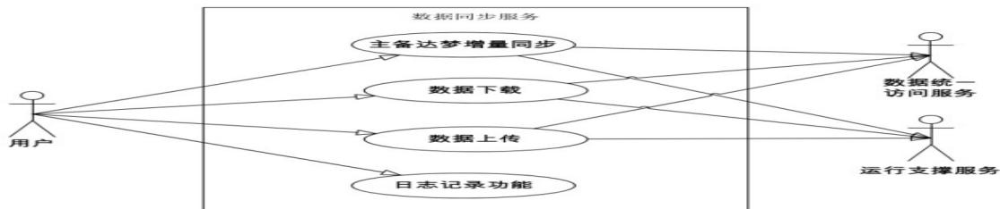
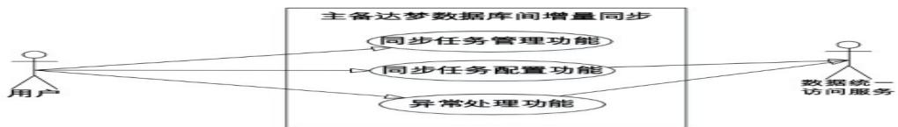
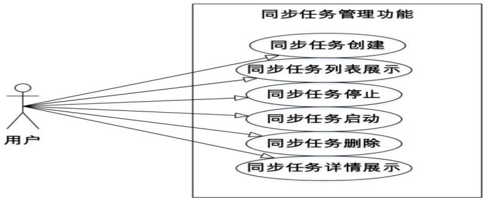
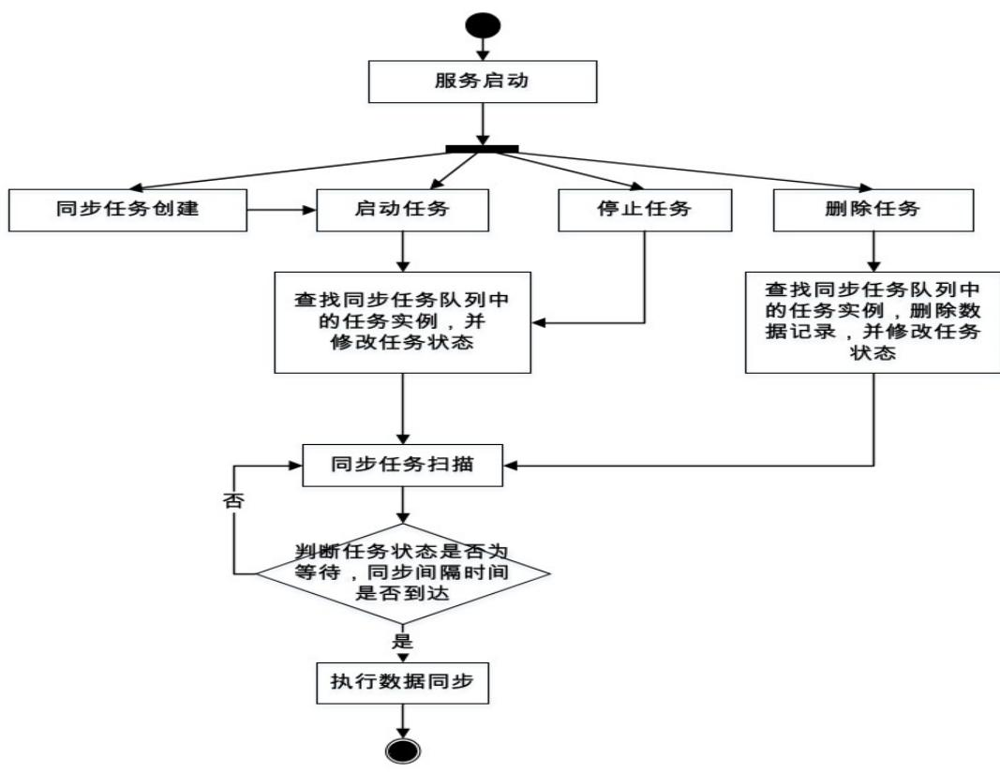
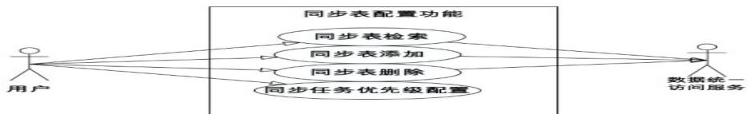

<table><tr><td rowspan=1 colspan=1>序号</td><td rowspan=1 colspan=1>Use case名称</td><td rowspan=1 colspan=1>项目唯一标识符</td><td rowspan=1 colspan=1>需求描述</td><td rowspan=1 colspan=1>需求重用</td><td rowspan=1 colspan=1>方式名称</td><td rowspan=1 colspan=1>运行状态</td><td rowspan=1 colspan=1>对应的任务书功能</td></tr><tr><td rowspan=1 colspan=1>2</td><td rowspan=1 colspan=1>数据资源管理</td><td rowspan=1 colspan=1>PZXQ-GN-SJZYGL</td><td rowspan=1 colspan=1>数据资源目录的展现功能和模糊查找；提供数据资源的修改功能；支持修改数据资源的内容。</td><td rowspan=1 colspan=1>新研</td><td rowspan=1 colspan=1>桌面</td><td rowspan=1 colspan=1>运行阶段</td><td rowspan=1 colspan=1>4.1.3</td></tr><tr><td rowspan=1 colspan=1>3</td><td rowspan=1 colspan=1>数据共享</td><td rowspan=1 colspan=1>PZXQ-GN-SJGX</td><td rowspan=1 colspan=1>存储和获取数据</td><td rowspan=1 colspan=1>新研</td><td rowspan=1 colspan=1>桌面、平板</td><td rowspan=1 colspan=1>运行阶段</td><td rowspan=1 colspan=1>4.1.1</td></tr></table>

## 3.2.1 数据同步能力(PZXQ-GN-SJTB)

数据同步功能包括主备数据库间增量同步、数据下载和数据上传三大功能。数据同步任务用例图如下图 10所示。

  
图 10 数据同步任务用例图

数据同步服务所有能力标识表，见表 3所示。

表 3数据同步服务软件所有能力标识
<table><tr><td colspan="1" rowspan="1">序号</td><td colspan="1" rowspan="1">Usecase 名称</td><td colspan="1" rowspan="1">项目唯一标识符</td><td colspan="1" rowspan="1">需求描述</td><td colspan="1" rowspan="1">需求重用</td><td colspan="1" rowspan="1">方式名称</td><td colspan="1" rowspan="1">运行状态</td><td colspan="1" rowspan="1">对应的任务书功能/性能</td></tr><tr><td colspan="1" rowspan="1">1</td><td colspan="1" rowspan="1">主备达梦增量同步</td><td colspan="1" rowspan="1">PZXQ-GN-SJTB-ZBZLTB</td><td colspan="1" rowspan="1">主备服务器数据库间增量同步功能</td><td colspan="1" rowspan="1">沿用</td><td colspan="1" rowspan="1">桌面</td><td colspan="1" rowspan="1">运行阶段</td><td colspan="1" rowspan="1">4.1.2.a、4.2.a</td></tr><tr><td colspan="1" rowspan="1">2</td><td colspan="1" rowspan="1">数据下载</td><td colspan="1" rowspan="1">PZXQ-GN-SJTB-SJXZ</td><td colspan="1" rowspan="1">达梦数据库到席位sqlite3 轻量数据库的数据下载功能</td><td colspan="1" rowspan="1">新研</td><td colspan="1" rowspan="1">桌面、平板</td><td colspan="1" rowspan="1">运行阶段</td><td colspan="1" rowspan="1">4.1.2.f、4.2.a</td></tr><tr><td colspan="1" rowspan="1">3</td><td colspan="1" rowspan="1">数据上传</td><td colspan="1" rowspan="1">PZXQ-GN-SJTB-SJSC</td><td colspan="1" rowspan="1">席位 sqlite3 轻量数据库到达梦数据库的数据上传功能</td><td colspan="1" rowspan="1">新研</td><td colspan="1" rowspan="1">桌面、平板</td><td colspan="1" rowspan="1">运行阶段</td><td colspan="1" rowspan="1">4.1.2.g、4.2.a</td></tr><tr><td colspan="1" rowspan="1">4</td><td colspan="1" rowspan="1">日志记录功能</td><td colspan="1" rowspan="1">PZXQ-GN-SJTB-RZJLGN</td><td colspan="1" rowspan="1">对同步任务日志、数据下载日志和数据上传日志进行记录</td><td colspan="1" rowspan="1">沿用</td><td colspan="1" rowspan="1">桌面、平板</td><td colspan="1" rowspan="1">运行阶段</td><td colspan="1" rowspan="1">4.1.2.h</td></tr></table>

## 3.2.1.1 主备达梦增量同步(PZXQ-GN-SJTB-ZBZLTB)

主备达梦数据库间增量同步功能包括同步任务管理功能、同步任务配置功能和异常处理功能。数据同步用例图如图 11所示。

  
图 11数据同步任务用例图

主备达梦数据库增量同步能力标识表，见表 4所示。

表 4主备达梦数据库增量同步能力标识
<table><tr><td rowspan=1 colspan=1>序号</td><td rowspan=1 colspan=1>Use case名称</td><td rowspan=1 colspan=1>项目唯一标识符</td><td rowspan=1 colspan=1>需求描述</td><td rowspan=1 colspan=1>需求重用</td><td rowspan=1 colspan=1>方式名称</td><td rowspan=1 colspan=1>运行状态</td><td rowspan=1 colspan=1>对应的任务书功能/性能</td></tr><tr><td rowspan=1 colspan=1>1</td><td rowspan=1 colspan=1>同步任务管理功能</td><td rowspan=1 colspan=1>PZXQ-GN-SJTB-ZBZLTB-TBRWGL</td><td rowspan=1 colspan=1>提供对同步任务的管理功能</td><td rowspan=1 colspan=1>沿用</td><td rowspan=1 colspan=1>桌面</td><td rowspan=1 colspan=1>运行阶段</td><td rowspan=1 colspan=1>4.1.2.d</td></tr><tr><td rowspan=1 colspan=1>2</td><td rowspan=1 colspan=1>同步任务配置功能</td><td rowspan=1 colspan=1>PZXQ-GN-SJTB-ZBZLTB-TBRWPZ</td><td rowspan=1 colspan=1>提供对同步数据表、任务优先级的配置功能</td><td rowspan=1 colspan=1>沿用</td><td rowspan=1 colspan=1>桌面</td><td rowspan=1 colspan=1>运行阶段</td><td rowspan=1 colspan=1>4.1.2.b</td></tr><tr><td rowspan=1 colspan=1>3</td><td rowspan=1 colspan=1>异常处理功能</td><td rowspan=1 colspan=1>PZXQ-GN-SJTB-ZBZLTB-YCCLGN</td><td rowspan=1 colspan=1>提供异常处理功能</td><td rowspan=1 colspan=1>沿用</td><td rowspan=1 colspan=1>桌面</td><td rowspan=1 colspan=1>运行阶段</td><td rowspan=1 colspan=1>4.1.2.e</td></tr></table>

## 3.2.1.1.1 同步任务管理(PZXQ-GN-SJTB-ZBZLTB-TBRWGL)

同步任务管理功能用例图如图 12所示。

  
图 12 同步任务功能用例图  
同步任务管理功能能力标识表，见表 5所示。

表 5同步任务管理功能能力标识
<table><tr><td colspan="1" rowspan="1">序号</td><td colspan="1" rowspan="1">Usecase名称</td><td colspan="1" rowspan="1">项目唯一标识符</td><td colspan="1" rowspan="1">需求描述</td><td colspan="1" rowspan="1">需求重用</td><td colspan="1" rowspan="1">方式名称</td><td colspan="1" rowspan="1">运行状态</td><td colspan="1" rowspan="1">对应的任务书功能/性能</td></tr><tr><td colspan="1" rowspan="1">1</td><td colspan="1" rowspan="1">同步任务创建</td><td colspan="1" rowspan="1">PZXQ-GN-SJTB-ZBZLTB-TBRWCJ</td><td colspan="1" rowspan="1">同步任务的创建；</td><td colspan="1" rowspan="1">沿用</td><td colspan="1" rowspan="1">桌面</td><td colspan="1" rowspan="1">运行阶段</td><td colspan="1" rowspan="1">4.1.2.d</td></tr><tr><td colspan="1" rowspan="1">2</td><td colspan="1" rowspan="1">同步任务列表展示</td><td colspan="1" rowspan="1">PZXQ-GN-SJTB-ZBZLTB-TBRWLBZS</td><td colspan="1" rowspan="1">同步任务列表展示；</td><td colspan="1" rowspan="1">沿用</td><td colspan="1" rowspan="1">桌面</td><td colspan="1" rowspan="1">运行阶段</td><td colspan="1" rowspan="1">4.1.2.d</td></tr><tr><td colspan="1" rowspan="1">3</td><td colspan="1" rowspan="1">同步任务停止</td><td colspan="1" rowspan="1">PZXQ-GN-SJTB-ZBZLTB-TBRWTZ</td><td colspan="1" rowspan="1">同步任务提供停止功能；</td><td colspan="1" rowspan="1">沿用</td><td colspan="1" rowspan="1">桌面</td><td colspan="1" rowspan="1">运行阶段</td><td colspan="1" rowspan="1">4.1.2.d</td></tr><tr><td colspan="1" rowspan="1">4</td><td colspan="1" rowspan="1">同步任务启动</td><td colspan="1" rowspan="1">PZXQ-GN-SJTB-ZBZLTB-TBRWQD</td><td colspan="1" rowspan="1">同步任务启动功能；</td><td colspan="1" rowspan="1">沿用</td><td colspan="1" rowspan="1">桌面</td><td colspan="1" rowspan="1">运行阶段</td><td colspan="1" rowspan="1">4.1.2.d</td></tr><tr><td colspan="1" rowspan="1">5</td><td colspan="1" rowspan="1">同步任务删除</td><td colspan="1" rowspan="1">PZXQ-GN-SJTB-ZBZLTB-TBRWSC</td><td colspan="1" rowspan="1">同步任务删除功能</td><td colspan="1" rowspan="1">沿用</td><td colspan="1" rowspan="1">桌面</td><td colspan="1" rowspan="1">运行阶段</td><td colspan="1" rowspan="1">4.1.2.d</td></tr><tr><td colspan="1" rowspan="1">6</td><td colspan="1" rowspan="1">同步任务详情展示</td><td colspan="1" rowspan="1">PZXQ-GN-SJTB-ZBZLTB-TBRWXQZS</td><td colspan="1" rowspan="1">同步任务详细信息展示功能</td><td colspan="1" rowspan="1">沿用</td><td colspan="1" rowspan="1">桌面</td><td colspan="1" rowspan="1">运行阶段</td><td colspan="1" rowspan="1">4.1.2.d</td></tr></table>

同步任务管理流程图如图 13所示。

  
图 13 同步任务管理流程图

## 3.2.1.1.1.1 同步任务创建（PZXQ-GN-SJTB-ZBZLTB-TBRWCJ）

主备达梦数据库间数据同步提供了同步任务创建功能。同步任务创建功能用例场景见表6所示。

表6创建同步任务用例描述
<table><tr><td colspan="3">Use Case 名称：主备数据库间增量同 Actors：用户 步任务创建</td></tr><tr><td colspan="3">概述：本用例主要实现主备达梦数据库间数据的同步功能</td></tr><tr><td colspan="3">前置条件：主备达梦数据库连接正常。</td></tr><tr><td colspan="3">主事件流</td></tr><tr><td>Actor 的动作</td><td>系统的动作</td><td>动作约束 (性能、可靠性、容错等)</td></tr><tr><td>1.用户配置源达梦数据库的IP地址、数 据库用户名和密码； 2.用户输入任务相关信息，如任务名 称、任务描述和任务同步频率、任务需 求方、选择好任务优先级；输入目标数 据库IP地址、用户名和密码；选择好同 步策略；</td><td>3.连接源达梦数据库，从主数据库中获</td><td></td></tr><tr><td>4.用户勾选同步数据表；</td><td>取所有表名称，如果失败，执行异常流 E1，如果成功，返回数据库表名称列 表。</td><td></td></tr><tr><td></td><td>5.判断同步表是否存在其他任务中，如 果不存在，执行异常流E2，否则，执行 下一步判断。</td><td></td></tr><tr><td></td><td>6.判断同步表在从数据库中是否存在. 如果不存在，执行异常流E3，否则，执 行下一步判断。</td><td></td></tr><tr><td></td><td>7.判断同步表结构是否一致，如果不存 在，执行异常流E4，否则，执行下一步 判断。</td><td></td></tr><tr><td></td><td></td><td></td></tr><tr><td></td><td>8.开启源数据库审计功能，只记录</td><td></td></tr><tr><td>9.任务创建成功。</td><td></td><td></td></tr><tr><td></td><td></td><td></td></tr><tr><td></td><td></td><td></td></tr><tr><td></td><td></td><td></td></tr><tr><td></td><td></td><td></td></tr><tr><td></td><td></td><td></td></tr><tr><td></td><td></td><td></td></tr><tr><td></td><td></td><td></td></tr><tr><td></td><td></td><td></td></tr><tr><td></td><td></td><td></td></tr><tr><td></td><td></td><td></td></tr><tr><td></td><td></td><td></td></tr><tr><td></td><td></td><td></td></tr><tr><td></td><td>insert、update、delete 成功的命令，如</td><td></td></tr><tr><td></td><td></td><td></td></tr><tr><td></td><td></td><td></td></tr><tr><td></td><td></td><td></td></tr><tr><td></td><td></td><td></td></tr><tr><td></td><td></td><td></td></tr><tr><td></td><td></td><td></td></tr><tr><td></td><td></td><td></td></tr><tr><td></td><td></td><td></td></tr><tr><td></td><td></td><td></td></tr><tr><td></td><td></td><td></td></tr><tr><td></td><td></td><td></td></tr><tr><td></td><td></td><td></td></tr><tr><td></td><td></td><td></td></tr><tr><td></td><td></td><td></td></tr><tr><td></td><td></td><td></td></tr><tr><td></td><td></td><td></td></tr><tr><td></td><td>果不成功，执行异常流E5，否则，将任</td><td></td></tr><tr><td></td><td></td><td></td></tr><tr><td></td><td></td><td></td></tr><tr><td></td><td></td><td></td></tr><tr><td></td><td></td><td></td></tr><tr><td></td><td></td><td></td></tr><tr><td></td><td></td><td></td></tr><tr><td></td><td></td><td></td></tr><tr><td></td><td></td><td></td></tr><tr><td></td><td></td><td></td></tr><tr><td></td><td></td><td></td></tr><tr><td></td><td></td><td></td></tr><tr><td></td><td></td><td></td></tr><tr><td></td><td></td><td></td></tr><tr><td></td><td></td><td></td></tr><tr><td></td><td></td><td></td></tr><tr><td></td><td></td><td></td></tr><tr><td></td><td></td><td></td></tr><tr><td></td><td></td><td></td></tr><tr><td></td><td></td><td></td></tr><tr><td></td><td></td><td></td></tr><tr><td></td><td></td><td></td></tr><tr><td></td><td></td><td></td></tr><tr><td></td><td></td><td></td></tr><tr><td></td><td></td><td></td></tr><tr><td></td><td></td><td></td></tr><tr><td></td><td></td><td></td></tr><tr><td></td><td></td><td></td></tr><tr><td></td><td></td><td></td></tr><tr><td></td><td></td><td></td></tr><tr><td></td><td></td><td></td></tr><tr><td></td><td></td><td></td></tr><tr><td></td><td></td><td></td></tr><tr><td></td><td>务实例加入任务队列。</td><td></td></tr><tr><td></td><td></td><td></td></tr><tr><td></td><td></td><td></td></tr><tr><td></td><td></td><td></td></tr><tr><td></td><td></td><td></td></tr><tr><td></td><td></td><td></td></tr><tr><td></td><td></td><td></td></tr><tr><td></td><td></td><td></td></tr><tr><td></td><td></td><td></td></tr><tr><td></td><td></td><td></td></tr><tr><td></td><td></td><td></td></tr><tr><td></td><td></td><td></td></tr><tr><td></td><td></td><td></td></tr><tr><td></td><td></td><td></td></tr><tr><td></td><td></td><td></td></tr><tr><td></td><td></td><td></td></tr><tr><td></td><td></td><td></td></tr><tr><td></td><td></td><td></td></tr><tr><td></td><td></td><td></td></tr><tr><td></td><td></td><td></td></tr><tr><td></td><td></td><td></td></tr><tr><td></td><td></td><td></td></tr><tr><td></td><td></td><td></td></tr><tr><td></td><td></td><td></td></tr><tr></tr><tr><td>10.启动任务</td><td></td><td></td></tr><tr><td colspan="3">异常流E1：系统提示源数据库数据表获取失败，用例结束。 异常流E2：系统提示同步表存在其他任务中，用例结束。 异常流E3：系统提示目标数据库同步表不存在，用例结束。</td></tr><tr><td colspan="3">异常流E4：系统提示源数据库、目标数据库，同步表结构不一致，用例结束。 异常流E5：系统提示源数据库审计功能开启失败，用例结束。</td></tr><tr><td colspan="3">后置条件：无。</td></tr></table>

3.2.1.1.1.2 同步任务删除（PZXQ-GN-SJTB-ZBZLTB-TBRWSC）

主备达梦数据库间数据同步提供了同步任务的删除功能。同步任务删除用例场景见表 7所示

表 7同步任务删除用例描述
<table><tr><td rowspan=1 colspan=1>Use Case 名称：删除同步任务</td><td rowspan=1 colspan=2>Actors：用户</td></tr><tr><td rowspan=1 colspan=3>概述：本用例主要实现删除同步任务功能</td></tr><tr><td rowspan=1 colspan=3>前置条件：主达梦数据库连接正常。</td></tr><tr><td rowspan=1 colspan=3>主事件流</td></tr><tr><td rowspan=1 colspan=1>Actor 的动作</td><td rowspan=1 colspan=1>系统的动作</td><td rowspan=1 colspan=1>动作约束(性能、可靠性、容错等)</td></tr><tr><td rowspan=1 colspan=1>1.选择“任务监控”标签页3.用户界面展示任务列表4.在任务列表中的，点击“删除”按钮</td><td rowspan=1 colspan=1>2.连接源达梦数据库，从主数据库中获取所有任务信息，如果失败，执行异常流E1，如果成功，返回同步任务列表json 字符串。5.修改任务实例的运行状态，使得该任务实例永久不能进入同步任务线程池。如果失败，进入执行异常流E26.从数据库中删除该任务记录如果失败，进入执行异常流E27.重新展示同步任务列表</td><td rowspan=1 colspan=1></td></tr><tr><td rowspan=1 colspan=2>异常流E1：系统提示源数据库数据表获取失败，用例结束。异常流E2：系统提示删除任务失败，用例结束。</td><td rowspan=1 colspan=1></td></tr><tr><td rowspan=1 colspan=2>后置条件：无。</td><td rowspan=1 colspan=1></td></tr></table>

## 3.2.1.1.1.3 同步任务停止（PZXQ-GN-SJTB-ZBZLTB-TBRWTZ）

主备达梦数据库间数据同步提供了同步任务停止功能。同步任务停止用例场景见表 8所示。

表 8同步任务停止用例描述
<table><tr><td rowspan=1 colspan=1>Use Case 名称：同步任务停止</td><td rowspan=1 colspan=2>Actors：用户</td></tr><tr><td rowspan=1 colspan=3>概述：本用例主要实现停止同步任务功能</td></tr><tr><td rowspan=1 colspan=3>前置条件：主达梦数据库连接正常。</td></tr><tr><td rowspan=1 colspan=3>主事件流</td></tr><tr><td rowspan=1 colspan=1>Actor 的动作</td><td rowspan=1 colspan=1>系统的动作</td><td rowspan=1 colspan=1>动作约束(性能、可靠性、容错等)</td></tr><tr><td rowspan=1 colspan=1>1.选择“任务监控”标签页3.用户界面展示任务列表4.在任务列表中的，点击“停止”按钮</td><td rowspan=1 colspan=1>2.连接源达梦数据库，从主数据库中获取所有任务信息，如果失败，执行异常流E1，如果成功，返回同步任务列表json 字符串。5.修改任务实例的运行状态，使得该任务实例不会再进入同步任务线程池，而不会执行同步任务，如果失败，执行异常流E2。6.对应任务行，“停止”按钮置灰，“开始”按钮可以点击，“状态”圆点变为红色。</td><td rowspan=1 colspan=1></td></tr><tr><td rowspan=1 colspan=2>异常流E1：系统提示源数据库数据表获取失败，用例结束。异常流E2：系统提示任务停止失败，用例结束。</td><td rowspan=1 colspan=1></td></tr><tr><td rowspan=1 colspan=2>后置条件：无。</td><td rowspan=1 colspan=1></td></tr></table>

3.2.1.1.1.4 同步任务启动（PZXQ-GN-SJTB-ZBZLTB-TBRWQD）

主备达梦数据库间数据同步提供了同步任务启动功能。同步任务启动用例场景见表 9所示。

表 9同步任务启动用例描述

<table><tr><td rowspan=1 colspan=1>Use Case 名称：同步任务启动</td><td rowspan=1 colspan=2>Actors：用户</td></tr><tr><td rowspan=1 colspan=3>概述：本用例主要实现启动同步任务功能</td></tr><tr><td rowspan=1 colspan=3>前置条件：主达梦数据库连接正常。</td></tr><tr><td rowspan=1 colspan=3>主事件流</td></tr><tr><td rowspan=1 colspan=1>Actor 的动作</td><td rowspan=1 colspan=1>系统的动作</td><td rowspan=1 colspan=1>动作约束(性能、可靠性、容错等)</td></tr><tr><td rowspan=1 colspan=1>1.选择“任务监控”标签页3.用户界面展示任务列表4.在任务列表中的，点击“启动”按钮</td><td rowspan=1 colspan=1>2. 连接源达梦数据库，从主数据库中获取所有任务信息，如果失败，执行异常流E1，如果成功，返回同步任务列表json 字符串。5.修改任务实例的运行状态，使得该任务实例可以进入同步任务线程池，根据同步频率间隔时间，周期性执行同步任务，如果操作失败，执行执行异常流E26.对应任务行，“启动”按钮置灰，“删除”按钮可以点击，“状态”圆点变为绿色</td><td rowspan=1 colspan=1></td></tr><tr><td rowspan=1 colspan=2>异常流E1：系统提示源数据库数据表获取失败，用例结束。异常流E2：系统提示启动任务失败，用例结束。</td><td rowspan=1 colspan=1></td></tr><tr><td rowspan=1 colspan=2>后置条件：无。</td><td rowspan=1 colspan=1></td></tr></table>

3.2.1.1.1.5 同步任务列表展示（PZXQ-GN-SJTB-ZBZLTB-TBRWLBZS）

主备达梦数据库间数据同步提供了同步任务列表展示功能。同步任务列表展示用例场景见表 10所示。

表 10同步任务列表展示用例描述
<table><tr><td rowspan=1 colspan=1>Use Case 名称：同步任务列表展示</td><td rowspan=1 colspan=2>Actors：用户</td></tr><tr><td rowspan=1 colspan=3>概述：本用例主要实现同步任务列表展示功能</td></tr><tr><td rowspan=1 colspan=3>前置条件：主备达梦数据库连接正常。</td></tr><tr><td rowspan=1 colspan=3>主事件流</td></tr><tr><td rowspan=1 colspan=1>Actor 的动作</td><td rowspan=1 colspan=1>系统的动作</td><td rowspan=1 colspan=1>动作约束</td></tr></table>

3.2.1.1.1.6 同步任务详情展示（PZXQ-GN-SJTB-ZBZLTB-TBRWXQZS）

<table><tr><td rowspan=1 colspan=1></td><td rowspan=1 colspan=1></td><td rowspan=1 colspan=1>(性能、可靠性、容错等)</td></tr><tr><td rowspan=1 colspan=1>1.选择“任务监控”标签页3.用户界面展示同步任务列表；</td><td rowspan=1 colspan=1>2.连接源达梦数据库，从主数据库中获取所有任务信息，如果失败，执行异常流E1，如果成功，返回同步任务列表json 字符串。</td><td rowspan=1 colspan=1></td></tr><tr><td rowspan=1 colspan=2>异常流E1：系统提示源数据库数据表获取失败，用例结束。</td><td rowspan=1 colspan=1></td></tr><tr><td rowspan=1 colspan=2>后置条件：无。</td><td rowspan=1 colspan=1></td></tr></table>

主备达梦数据库间数据同步提供了同步任务的详情展示功能。同步任务详情展示用例场景见表 11所示。

表 11同步任务详情展示用例描述
<table><tr><td rowspan=1 colspan=1>Use Case 名称：同步任务详情展示</td><td rowspan=1 colspan=2>Actors：用户</td></tr><tr><td rowspan=1 colspan=3>概述：本用例主要实现同步任务详情展示功能</td></tr><tr><td rowspan=1 colspan=3>前置条件：主达梦数据库连接正常。</td></tr><tr><td rowspan=1 colspan=3>主事件流</td></tr><tr><td rowspan=1 colspan=1>Actor 的动作</td><td rowspan=1 colspan=1>系统的动作</td><td rowspan=1 colspan=1>动作约束(性能、可靠性、容错等)</td></tr><tr><td rowspan=1 colspan=1>1.选择“任务监控”标签页3.用户界面展示任务列表4.在任务列表中的，点击“详情”按钮</td><td rowspan=1 colspan=1>2.连接源达梦数据库，从主数据库中获取所有任务信息，如果失败，执行异常流E1，如果成功，返回同步任务列表json 字符串。5.查找对应任务信息，如果失败，执行异常流E2，如果成功，将任务详细信息展示在详情页面。</td><td rowspan=1 colspan=1></td></tr><tr><td rowspan=1 colspan=2>异常流E1：系统提示源数据库数据表获取失败，用例结束。异常流E2：系统提示获取任务信息失败，用例结束。</td><td rowspan=1 colspan=1></td></tr><tr><td rowspan=1 colspan=2>后置条件：无。</td><td rowspan=1 colspan=1></td></tr></table>

## 3.2.1.1.2 同步任务配置功能（PZXQ-GN-SJTB-ZBZLTB-TBRWPZ）

同步任务配置功能包括同步表检索、同步表添加、同步表删除和同步任务优先级配置功能。同步任务配置功能用例图如图 14所示。

  
图 14 同步任务配置功能用例图  
同步任务配置功能能力标识表，见表 12所示。

表 12同步任务配置功能能力标识
<table><tr><td rowspan=1 colspan=1>序号</td><td rowspan=1 colspan=1>Usecase 名称</td><td rowspan=1 colspan=1>项目唯一标识符</td><td rowspan=1 colspan=1>需求描述</td><td rowspan=1 colspan=1>需求重用</td><td rowspan=1 colspan=1>方式名称</td><td rowspan=1 colspan=1>运行状态</td><td rowspan=1 colspan=1>对应的任务书功能/性能</td></tr><tr><td rowspan=1 colspan=1>1</td><td rowspan=1 colspan=1>同步表检索</td><td rowspan=1 colspan=1>PZXQ-GN-SJTB-ZBZLTB-TBBJS</td><td rowspan=1 colspan=1>主备服务器同步数据表检索功能</td><td rowspan=1 colspan=1>沿用</td><td rowspan=1 colspan=1>桌面</td><td rowspan=1 colspan=1>运行阶段</td><td rowspan=1 colspan=1>4.1.2.b</td></tr><tr><td rowspan=1 colspan=1>2</td><td rowspan=1 colspan=1>同步表添加</td><td rowspan=1 colspan=1>PZXQ-GN-SJTB-ZBZLTB-TBBTJ</td><td rowspan=1 colspan=1>主备服务器同步数据表添加功能</td><td rowspan=1 colspan=1>沿用</td><td rowspan=1 colspan=1>桌面</td><td rowspan=1 colspan=1>运行阶段</td><td rowspan=1 colspan=1>4.1.2.b</td></tr><tr><td rowspan=1 colspan=1>3</td><td rowspan=1 colspan=1>同步表删除</td><td rowspan=1 colspan=1>PZXQ-GN-SJTB-ZBZLTB-TBBSC</td><td rowspan=1 colspan=1>主备服务器同步数据表删除功能</td><td rowspan=1 colspan=1>沿用</td><td rowspan=1 colspan=1>桌面</td><td rowspan=1 colspan=1>运行阶段</td><td rowspan=1 colspan=1>4.1.2.b</td></tr><tr><td rowspan=1 colspan=1>4</td><td rowspan=1 colspan=1>同步任务优先级配置</td><td rowspan=1 colspan=1>PZXQ-GN-SJTB-ZBZLTB-RWYXJPZ</td><td rowspan=1 colspan=1>主备服务器同步任务优先级配置功能</td><td rowspan=1 colspan=1>沿用</td><td rowspan=1 colspan=1>桌面</td><td rowspan=1 colspan=1>运行阶段</td><td rowspan=1 colspan=1>4.1.2.c</td></tr></table>

同步任务配置流程图如图 15所示。