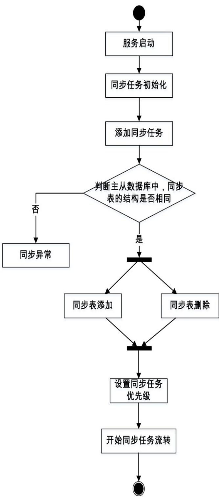
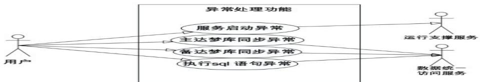
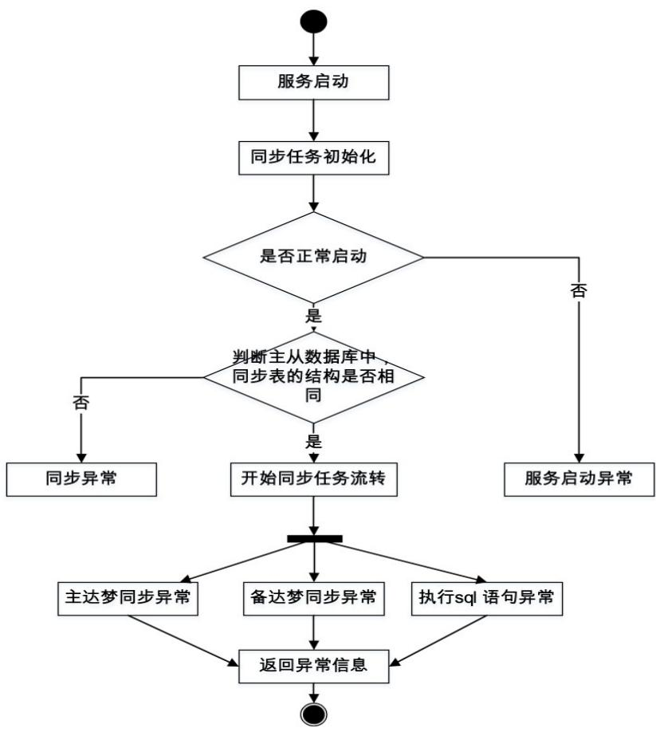
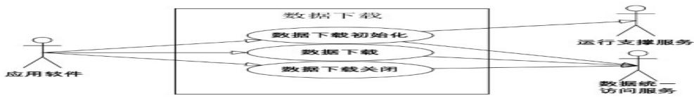
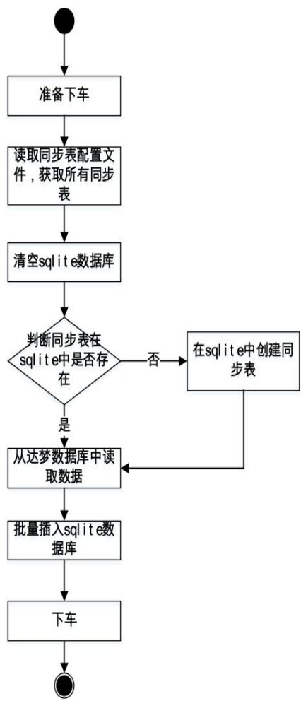

  
图 15 同步表配置功能流程图

## 3.2.1.1.2.1 同步表检索（PZXQ-GN-SJTB-ZBZLTB-TBRWPZ-TBBJS）

数据同步能力中，向用户提供了同步表的检索功能。同步表检索用例描述见表 13所示。

表 13数据库同步表检索用例描述
<table><tr><td rowspan=1 colspan=1>Use Case 名称：同步表检索</td><td rowspan=1 colspan=2>Actors：用户、数据统一访问服务</td></tr><tr><td rowspan=1 colspan=3>概述：本用例主要实现同步表检索功能</td></tr><tr><td rowspan=1 colspan=3>前置条件：主备达梦数据库连接正常。</td></tr><tr><td rowspan=1 colspan=3>主事件流</td></tr><tr><td rowspan=1 colspan=1>Actor 的动作</td><td rowspan=1 colspan=1>系统的动作</td><td rowspan=1 colspan=1>动作约束(性能、可靠性、容错等)</td></tr><tr><td rowspan=1 colspan=1>1.录入同步任务信息，提交4.在搜索框中添加完整的表名称，并对输入结果进行合法性校验；6.在搜索框中添加部分表名称</td><td rowspan=1 colspan=1>2.调用数据统一访问服务，检查主数据库连接是否正常，如果异常，则进入异常流E13.获取所有表，并在界面上展示表列表5.检索结果展示7.检索结果展示</td><td rowspan=1 colspan=1></td></tr><tr><td rowspan=1 colspan=2>异常流E1：系统提示源数据库数据表获取失败，用例结束。</td><td rowspan=1 colspan=1></td></tr><tr><td rowspan=1 colspan=2>后置条件：无。</td><td rowspan=1 colspan=1></td></tr></table>

3.2.1.1.2.2 同步表添加（PZXQ-GN-SJTB-ZBZLTB-TBRWPZ-TBBTJ）

数据同步能力中，向用户提供了同步表的添加功能。同步表添加用例描述见表 14所示。

表 14数据库同步表添加用例描述
<table><tr><td>Use Case 名称：同步表添加</td><td colspan="3">Actors：用户、数据统一访问服务</td></tr><tr><td>概述：本用例主要实现同步表添加功能</td><td colspan="3"></td></tr><tr><td colspan="4">前置条件：主备达梦数据库连接正常。</td></tr><tr><td></td><td colspan="3">主事件流</td></tr><tr><td>Actor 的动作</td><td>系统的动作</td><td>动作约束 (性能、可靠性、容错等)</td></tr><tr><td>1.录入同步任务信息，提交</td><td>2.调用数据统一访问服务，检查主数据 库连接是否正常，如果异常，则进入异 常流E1</td><td rowspan="3"></td></tr><tr><td>3.调用数据统一访问服务，获取所有 4.在“选择待同步列表”中，单选、多选、 全选表名称，单击添加按钮</td><td>表，并在界面上展示表列表 5.将选择的表添加到“已经选择列表”，并 从“选择待同步列表”删除</td></tr><tr><td colspan="2">异常流E1：系统提示源数据库数据表获取失败，用例结束。</td><td></td></tr><tr><td colspan="2">后置条件：无。</td><td></td></tr></table>

3.2.1.1.2.3 同步表删除（PZXQ-GN-SJTB-ZBZLTB-TBRWPZ-BBSC）

数据同步能力中，向用户提供了同步表的删除功能。同步表删除用例描述见表 15所示。

表 15数据库同步表删除用例描述
<table><tr><td colspan="1" rowspan="1">Use Case 名称：同步表删除</td><td colspan="2" rowspan="1">Actors：用户、数据统一访问服务</td></tr><tr><td colspan="3" rowspan="1">概述：本用例主要实现同步表删除功能</td></tr><tr><td colspan="3" rowspan="1">前置条件:主备达梦数据库连接正常。</td></tr><tr><td colspan="3" rowspan="1">主事件流</td></tr><tr><td colspan="1" rowspan="1">Actor 的动作</td><td colspan="1" rowspan="1">系统的动作</td><td colspan="1" rowspan="1">动作约束(性能、可靠性、容错等)</td></tr><tr><td colspan="1" rowspan="1">1.录入同步任务信息，提交4.在“选择待同步列表”中，单选、多选、全选表名称，单击“添加”按钮</td><td colspan="1" rowspan="1">2.调用数据统一访问服务，检查主数据库连接是否正常，如果异常，则进入异常流E13.调用数据统一访问服务，获取所有表，并在界面上展示表列表</td><td colspan="1" rowspan="1"></td></tr><tr><td colspan="1" rowspan="1">6.在“已经选择列表”中，单击、多选、全选表名称，单击“删除”按钮</td><td colspan="1" rowspan="1">5.将选择的表添加到“已经选择列表”，并从“选择待同步列表”删除7.将选择的表还原到“选择同步列表”，并从“已经选择列表”中删除</td><td colspan="1" rowspan="1"></td></tr><tr><td colspan="2" rowspan="1">异常流E1：系统提示源数据库数据表获取失败，用例结束。</td><td colspan="1" rowspan="1"></td></tr><tr><td colspan="2" rowspan="1">后置条件：无。</td><td colspan="1" rowspan="1"></td></tr></table>

## 3.2.1.1.2.4 同步任务优先级配置（PZXQ-GN-SJTB-ZBZLTB-TBRWPZ-RWYXJPZ）

数据同步能力中，向用户提供了同步任务优先级的配置功能。同步任务优先级配置用例描述见表 16所示。

表 16数据库同步任务优先级配置用例描述
<table><tr><td colspan="1" rowspan="1">Use Case 名称：同步任务优先级配置</td><td colspan="2" rowspan="1">Actors：用户</td></tr><tr><td colspan="3" rowspan="1">概述：本用例主要描述同步任务优先级配置活动</td></tr><tr><td colspan="3" rowspan="1">前置条件：主备达梦数据库连接正常。</td></tr><tr><td colspan="3" rowspan="1">主事件流</td></tr><tr><td colspan="1" rowspan="1">Actor 的动作</td><td colspan="1" rowspan="1">系统的动作</td><td colspan="1" rowspan="1">动作约束(性能、可靠性、容错等)</td></tr><tr><td colspan="1" rowspan="1">1.录入同步任务信息，提交4.在“选择待同步列表”中，单选、多选、全选表名称，单击“添加”按钮6.在“已经选择列表”中，单击、多选、全选表名称，单击“删除”按钮</td><td colspan="1" rowspan="1">2.检查主数据库连接是否正常，如果异常，则进入异常流E13.获取所有表，并在界面上展示表列表5.将选择的表添加到“已经选择列表”，并从“选择待同步列表”删除7.将选择的表还原到“选择同步列表”，并</td><td colspan="1" rowspan="1"></td></tr><tr><td colspan="1" rowspan="1"></td><td colspan="1" rowspan="1">从“已经选择列表”中删除</td><td colspan="1" rowspan="1"></td></tr><tr><td colspan="2" rowspan="1">异常流E1：系统提示源数据库数据表获取失败，用例结束。</td><td colspan="1" rowspan="1"></td></tr><tr><td colspan="2" rowspan="1">后置条件：无。</td><td colspan="1" rowspan="1"></td></tr></table>

## 3.2.1.1.3 异常处理功能(PZXQ-GN-SJTB-ZBZLTB-YCCLGN)

异常处理功能用例图如图 16所示。

  
图 16 异常处理功能用例图  
异常处理功能能力标识表，见表 17所示。

表 17异常处理功能能力标识
<table><tr><td rowspan=1 colspan=1>序号</td><td rowspan=1 colspan=1>Usecase 名称</td><td rowspan=1 colspan=1>项目唯一标识符</td><td rowspan=1 colspan=1>需求描述</td><td rowspan=1 colspan=1>需求重用</td><td rowspan=1 colspan=1>方式名称</td><td rowspan=1 colspan=1>运行状态</td><td rowspan=1 colspan=1>对应的任务书功能/性能</td></tr><tr><td rowspan=1 colspan=1>1</td><td rowspan=1 colspan=1>服务启动异常</td><td rowspan=1 colspan=1>PZXQ-GN-SJTB-ZBZLTB-FWQQDYC</td><td rowspan=1 colspan=1>记录主备服务器数据同步服务启动异常</td><td rowspan=1 colspan=1>沿用</td><td rowspan=1 colspan=1>桌面</td><td rowspan=1 colspan=1>运行阶段</td><td rowspan=1 colspan=1>4.1.2.e</td></tr><tr><td rowspan=1 colspan=1>2</td><td rowspan=1 colspan=1>主达梦库同步异常</td><td rowspan=1 colspan=1>PZXQ-GN-SJTB-ZBZLTB-ZDMKTBYC</td><td rowspan=1 colspan=1>记录主备服务器数据同步主服务器数据库异常</td><td rowspan=1 colspan=1>沿用</td><td rowspan=1 colspan=1>桌面</td><td rowspan=1 colspan=1>运行阶段</td><td rowspan=1 colspan=1>4.1.2.e</td></tr><tr><td rowspan=1 colspan=1>3</td><td rowspan=1 colspan=1>备达梦库同步异常</td><td rowspan=1 colspan=1>PZXQ-GN-SJTB-ZBZLTB-BKTBYC</td><td rowspan=1 colspan=1>记录主备服务器数据同步备服务器数据库异常</td><td rowspan=1 colspan=1>沿用</td><td rowspan=1 colspan=1>桌面</td><td rowspan=1 colspan=1>运行阶段</td><td rowspan=1 colspan=1>4.1.2.e</td></tr><tr><td rowspan=1 colspan=1>4</td><td rowspan=1 colspan=1>执行 sql语句异常</td><td rowspan=1 colspan=1>PZXQ-GN-SJTB-ZBZLTB-ZXSQLYJYC</td><td rowspan=1 colspan=1>记录主备服务器数据同步中执行 sql 语句异常</td><td rowspan=1 colspan=1>沿用</td><td rowspan=1 colspan=1>桌面</td><td rowspan=1 colspan=1>运行阶段</td><td rowspan=1 colspan=1>4.1.2.e</td></tr></table>

异常处理流程图如图 17所示。

  
图 17 异常处理流程图

## 3.2.1.1.3.1 服务启动异常（PZXQ-GN-SJTB-ZBZLTB-FWQQDYC）

数据同步能力中，提供了服务启动异常的处理。服务启动异常处理用例描述见表 18所示。

表 18服务启动异常处理用例描述
<table><tr><td colspan="1" rowspan="1">Use Case 名称:服务启动异常处理</td><td colspan="2" rowspan="1">Actors：用户、运行支撑服务</td></tr><tr><td colspan="3" rowspan="1">概述：本用例主要对同步过程中，主达梦数据库发生异常时，任务启动失败进行异常处理功能</td></tr><tr><td colspan="3" rowspan="1">前置条件:主达梦数据库连接不正常</td></tr><tr><td colspan="3" rowspan="1">主事件流</td></tr><tr><td colspan="1" rowspan="1">Actor 的动作</td><td colspan="1" rowspan="1">系统的动作</td><td colspan="1" rowspan="1">动作约束(性能、可靠性、容错等)</td></tr><tr><td colspan="1" rowspan="1">1.同步服务启动完成；</td><td colspan="1" rowspan="1"></td><td colspan="1" rowspan="1"></td></tr><tr><td colspan="1" rowspan="1"></td><td colspan="1" rowspan="1">2.调用运行支撑服务，检查主服务器数据库服务是否启动正常，如果异常，则进入异常流E1</td><td colspan="1" rowspan="1"></td></tr><tr><td colspan="2" rowspan="1">异常流E1：系统提示主服务器数据库服务启动失败，用例结束。</td><td colspan="1" rowspan="1"></td></tr><tr><td colspan="2" rowspan="1">后置条件：无。</td><td colspan="1" rowspan="1"></td></tr></table>

## 3.2.1.1.3.2 主达梦库同步异常（PZXQ-GN-SJTB-ZBZLTB-ZDMKTBYC）

数据同步能力中，提供了主达梦数据库异常的处理。主达梦数据库异常的处理用例描述见表 19所示。

表 19主达梦数据库异常处理用例描述
<table><tr><td rowspan=1 colspan=1>Use Case 名称：主达梦数据库异常处理</td><td rowspan=1 colspan=2>Actors：用户、数据统一访问服务</td></tr><tr><td rowspan=1 colspan=3>概述：本用例主要实现同步过程中，主达梦数据库发生异常时，停止同步任务功能</td></tr><tr><td rowspan=1 colspan=3>前置条件：主备达梦数据库启动时连接正常，在运行过程中，主达梦数据库连接失败。</td></tr><tr><td rowspan=1 colspan=3>主事件流</td></tr><tr><td rowspan=1 colspan=1>Actor 的动作</td><td rowspan=1 colspan=1>系统的动作</td><td rowspan=1 colspan=1>动作约束(性能、可靠性、容错等)</td></tr><tr><td rowspan=1 colspan=1>1.同步服务启动3.手动关闭主数据库所在机器的网络</td><td rowspan=1 colspan=1>2.调用数据统一访问服务，检查主数据库连接是否正常，如果异常，则进入异常流 E14.执行同步任务时，检查发现主数据库连接不成功，进入异常流E2</td><td rowspan=1 colspan=1></td></tr><tr><td rowspan=1 colspan=2>异常流E1：系统提示源数据库数据表获取失败，用例结束。异常流E1：系统提示源数据库数据表连接失败，停止同步任务，用例结束。</td><td rowspan=1 colspan=1></td></tr><tr><td rowspan=1 colspan=2>后置条件：无。</td><td rowspan=1 colspan=1></td></tr></table>

3.2.1.1.3.3 备达梦库同步异常（PZXQ-GN-SJTB-ZBZLTB-BKTBYC）

数据同步能力中，提供了备达梦数据库异常的处理。备达梦数据库异常的处理用例描述见表 20所示。

表 20备数据库异常处理用例描述
<table><tr><td>Use Case 名称:备数据库异常处理</td><td>Actors：用户、数据统一访问服务</td></tr></table>

<table><tr><td rowspan=1 colspan=3>概述：本用例主要实现同步过程中，从达梦数据库发生异常时，停止同步任务功能</td></tr><tr><td rowspan=1 colspan=3>前置条件：主备达梦数据库启动时连接正常，在运行过程中，从达梦数据库连接失败。</td></tr><tr><td rowspan=1 colspan=3>主事件流</td></tr><tr><td rowspan=1 colspan=1>Actor 的动作</td><td rowspan=1 colspan=1>系统的动作</td><td rowspan=1 colspan=1>动作约束(性能、可靠性、容错等)</td></tr><tr><td rowspan=1 colspan=1>1.同步服务启动3.手动关闭从数据库所在机器的网络</td><td rowspan=1 colspan=1>2.调用数据统一访问服务，检查主数据库连接是否正常，如果异常，则进入异常流 E1；4.执行同步任务时，检查发现主数据库连接不成功，进入异常流E2；</td><td rowspan=1 colspan=1></td></tr><tr><td rowspan=1 colspan=2>异常流E1：系统提示源数据库数据表获取失败，用例结束。异常流E1：系统提示从数据库数据表连接失败，停止同步任务，用例结束。</td><td rowspan=1 colspan=1></td></tr><tr><td rowspan=1 colspan=2>后置条件：无。</td><td rowspan=1 colspan=1></td></tr></table>

3.2.1.1.3.4 执行 sql 语句异常（PZXQ-GN-SJTB-ZBZLTB-ZXSQLYJYC）

数据库异常处理中，提供了执行 sql 语句异常的处理，执行 sql 语句异常的处理用例描述见表 21所示。

表 21执行sql语句异常用例描述
<table><tr><td colspan="1" rowspan="1">Use Case 名称:执行 sql 语句异常处理</td><td colspan="2" rowspan="1">Actors：用户、数据统一访问服务</td></tr><tr><td colspan="3" rowspan="1">概述：本用例主要实现同步过程中，执行同步sql语句错误，停止同步任务功能</td></tr><tr><td colspan="3" rowspan="1">前置条件：主备达梦数据库启动时连接正常。</td></tr><tr><td colspan="3" rowspan="1">主事件流</td></tr><tr><td colspan="1" rowspan="1">Actor 的动作</td><td colspan="1" rowspan="1">系统的动作</td><td colspan="1" rowspan="1">动作约束(性能、可靠性、容错等)</td></tr><tr><td colspan="1" rowspan="1">1.同步服务启动3.手动修改从数据库中同步表的表结构；</td><td colspan="1" rowspan="1">2.调用数据统一访问服务，检查主数据库连接是否正常，如果异常，则进入异常流 E1；</td><td colspan="1" rowspan="1"></td></tr><tr><td colspan="1" rowspan="1"></td><td colspan="1" rowspan="1">4.执行同步任务时，从数据库执行插入语句失败，进入异常流E2；</td><td colspan="1" rowspan="1"></td></tr><tr><td colspan="2" rowspan="1">异常流E1：系统提示源数据库数据表获取失败，用例结束。异常流E2：系统提示从数据库数据执行sqI异常，停止同步任务，用例结束。</td><td colspan="1" rowspan="1"></td></tr><tr><td colspan="2" rowspan="1">后置条件：无。</td><td colspan="1" rowspan="1"></td></tr></table>

## 3.2.1.2 数据下载（PZXQ-GN-SJTB-SJXZ）

数据下载用例图，如图 18所示。

  
图 18数据下载用例图

数据下载能力标识表，见表 22所示。

表 22数据下载能力标识表
<table><tr><td colspan="1" rowspan="1">序号</td><td colspan="1" rowspan="1">Usecase名称</td><td colspan="1" rowspan="1">项目唯一标识符</td><td colspan="1" rowspan="1">需求描述</td><td colspan="1" rowspan="1">需求重用</td><td colspan="1" rowspan="1">状态/方式名称</td><td colspan="1" rowspan="1">运行状态</td><td colspan="1" rowspan="1">对应的任务书功能/性能</td></tr><tr><td colspan="1" rowspan="1">1</td><td colspan="1" rowspan="1">数据下载初始化</td><td colspan="1" rowspan="1">PZXQ-GN-SJTB-SJXZ-CSH</td><td colspan="1" rowspan="1">实现主服务器的数据库(达梦数据库)到席位数据库（sqlite数据库）的数据下载初始化功能</td><td colspan="1" rowspan="1">新研</td><td colspan="1" rowspan="1">桌面、平板</td><td colspan="1" rowspan="1">运行阶段</td><td colspan="1" rowspan="1">4.1.2.f</td></tr><tr><td colspan="1" rowspan="1">2</td><td colspan="1" rowspan="1">数据下载</td><td colspan="1" rowspan="1">PZXQ-GN-SJTB-SJXZ-SJXZ</td><td colspan="1" rowspan="1">实现主服务器的数据库(达梦数据库)到席位数据库（sqlite数据库）的配置数据获取功能</td><td colspan="1" rowspan="1">新研</td><td colspan="1" rowspan="1">桌面、平板</td><td colspan="1" rowspan="1">运行阶段</td><td colspan="1" rowspan="1">4.1.2.f</td></tr><tr><td colspan="1" rowspan="1">3</td><td colspan="1" rowspan="1">数据下载关闭</td><td colspan="1" rowspan="1">PZXQ-GN-SJTB-SJXZ-SJXZGB</td><td colspan="1" rowspan="1">实现主服务器的数据库(达梦数据库)到席位数据库（sqlite数据</td><td colspan="1" rowspan="1">新研</td><td colspan="1" rowspan="1">桌面、平板</td><td colspan="1" rowspan="1">运行阶段</td><td colspan="1" rowspan="1">4.1.2.f</td></tr><tr><td colspan="1" rowspan="1"></td><td colspan="1" rowspan="1"></td><td colspan="1" rowspan="1"></td><td colspan="1" rowspan="1">库）的数据下载关闭功能</td><td colspan="1" rowspan="1"></td><td colspan="1" rowspan="1"></td><td colspan="1" rowspan="1"></td><td colspan="1" rowspan="1"></td></tr></table>

主服务器数据库到席位 sqlite 数据库数据下载流程图如图 19所示。

3.2.1.2.1 数据下载初始化（PZXQ-GN-SJTB-SJXZ-CSH）

  
图 19数据下载流程图