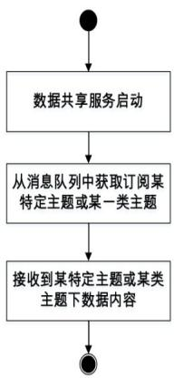
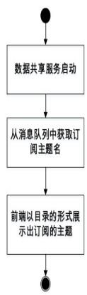
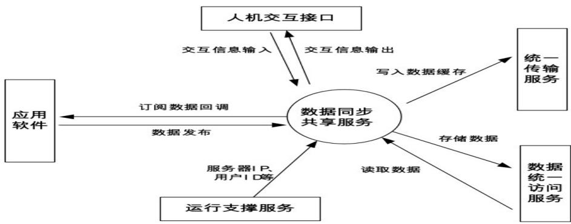

图 25 数据发送流程图

数据发布用例场景见表 36所示。

表 36数据发布用例描述
<table><tr><td rowspan=1 colspan=1>Use Case 名称:数据发布</td><td rowspan=1 colspan=2>Actors：应用软件、统一传输服务</td></tr><tr><td rowspan=1 colspan=3>概述：本用例主要实现数据共享下的数据发布功能</td></tr><tr><td rowspan=1 colspan=3>前置条件：数据共享服务正常启动。</td></tr><tr><td rowspan=1 colspan=3>主事件流</td></tr><tr><td rowspan=1 colspan=1>Actor 的动作</td><td rowspan=1 colspan=1>系统的动作</td><td rowspan=1 colspan=1>动作约束(性能、可靠性、容错等)</td></tr><tr><td rowspan=1 colspan=1>1.初始化数据共享服务，并保证初始化成功；2.选中一个主题名，在右侧输入框中输入待提交的数据，点击提交按钮；5.前端页面更新该主题下的数据内容；</td><td rowspan=1 colspan=1>3.系统会通过后台消息队列传输接口，以覆盖的形式将数据内容发送给该主题对应的消息队列；4.系统根据是否进行数据缓存，选择调用统一传输服务进行数据缓存；</td><td rowspan=1 colspan=1></td></tr><tr><td rowspan=1 colspan=2>异常流E1：系统提示失败，用例结束。</td><td rowspan=1 colspan=1></td></tr><tr><td rowspan=1 colspan=2>后置条件：无。</td><td rowspan=1 colspan=1></td></tr></table>

## 3.2.2.3 主题订阅(PZXQ-GN-SJGX-ZTDY)

数据共享中的主题订阅功能为上层应用提供自定义订阅主题的接口。主题订阅流程图如图 26所示。

  
图 26 主题订阅流程图

主题订阅用例场景见表 37所示。

表 37主题订阅用例描述
<table><tr><td colspan="1" rowspan="1">Use Case 名称:主题订阅</td><td colspan="2" rowspan="1">Actors：应用软件</td></tr><tr><td colspan="3" rowspan="1">概述：本用例主要实现数据共享下某特定主题的订阅功能</td></tr><tr><td colspan="3" rowspan="1">前置条件：数据共享服务正常启动。</td></tr><tr><td colspan="3" rowspan="1">主事件流</td></tr><tr><td colspan="1" rowspan="1">Actor 的动作</td><td colspan="1" rowspan="1">系统的动作</td><td colspan="1" rowspan="1">动作约束(性能、可靠性、容错等)</td></tr><tr><td colspan="1" rowspan="1">1.初始化消息共享服务，并保证初始化成功；2.进入数据共享目录界面，</td><td colspan="1" rowspan="1">3.系统会获取消息队列中订阅的所有主</td><td colspan="1" rowspan="1"></td></tr><tr><td>4.点击选中一个主题； 6.前端页面展示出该主题下的数据内 容，长度，TTL值等信息；</td><td>题，并推送给前端页面； 5.系统发送get 请求，获取该主题下的数 据内容，包括订阅主题，TTL值以及数 据的长度，并将这些信息推送到前端页 面；</td><td></td></tr><tr><td>异常流E1：系统提示失败，用例结束。</td><td></td><td></td></tr><tr><td>后置条件：无。</td><td></td><td></td></tr></table>

## 3.2.3 数据资源管理能力(PZXQ-GN-SJZYGL)

数据资源管理主要提供数据资源目录的展现功能和数据资源的修改功能。数据资源管理任务用例图如下图 27所示。

  
图 27 数据资源管理任务用例图

数据资源管理所有能力标识表，见表 38所示。

表 38数据资源管理软件所有能力标识
<table><tr><td rowspan=1 colspan=1>序号</td><td rowspan=1 colspan=1>Usecase名称</td><td rowspan=1 colspan=1>项目唯一标识符</td><td rowspan=1 colspan=1>需求描述</td><td rowspan=1 colspan=1>需求重用</td><td rowspan=1 colspan=1>方式名称</td><td rowspan=1 colspan=1>运行状态</td><td rowspan=1 colspan=1>对应的任务书功能/性能</td></tr><tr><td rowspan=1 colspan=1>1</td><td rowspan=1 colspan=1>数据资源目录的展现功能</td><td rowspan=1 colspan=1>PZXQ-GN-SJZYGL-SJZYMLZX</td><td rowspan=1 colspan=1>用页面目录形式展示出所有的数据资源</td><td rowspan=1 colspan=1>沿用</td><td rowspan=1 colspan=1>桌面、平板</td><td rowspan=1 colspan=1>运行阶段</td><td rowspan=1 colspan=1>4.1.3.a</td></tr><tr><td rowspan=1 colspan=1>2</td><td rowspan=1 colspan=1>数据资源的修改功能</td><td rowspan=1 colspan=1>PZXQ-GN-SJZYGL-SJZYXG</td><td rowspan=1 colspan=1>对数据资源进行修改</td><td rowspan=1 colspan=1>沿用</td><td rowspan=1 colspan=1>桌面、平板</td><td rowspan=1 colspan=1>运行阶段</td><td rowspan=1 colspan=1>4.1.3.b</td></tr></table>

## 3.2.3.1 数据资源目录展现(PZXQ-GN-SJZYGL-SJZYMLZX)

数据资源目录展现功能为用户提供数据资源的呈现展示功能，用户可以查看所有注册成功的主题名称，并支持模糊查找。

数据资源目录展现流程图如图 28所示。

  
图 28 数据资源目录展现流程图

数据资源目录展现用例场景见表 39所示。

表 39数据资源目录展现用例描述
<table><tr><td colspan="1" rowspan="1">Use Case 名称：数据资源目录展现</td><td colspan="2" rowspan="1">Actors：用户</td></tr><tr><td colspan="3" rowspan="1">概述：本用例主要实现数据资源的展示功能</td></tr><tr><td colspan="3" rowspan="1">前置条件：数据共享服务正常启动。</td></tr><tr><td colspan="3" rowspan="1">主事件流</td></tr><tr><td colspan="1" rowspan="1">Actor 的动作</td><td colspan="1" rowspan="1">系统的动作</td><td colspan="1" rowspan="1">动作约束(性能、可靠性、容错等)</td></tr><tr><td colspan="1" rowspan="1">1. 初始化数据共享服务，并保证初始化成功；2.进入初始化页面；</td><td colspan="1" rowspan="1"></td><td colspan="1" rowspan="1"></td></tr><tr><td>4.关闭数据共享服务；</td><td>3.获取所有主题名称；</td><td></td></tr><tr><td>异常流E1：系统提示失败，用例结束。</td><td></td><td></td></tr><tr><td>后置条件：无。</td><td></td><td></td></tr></table>

## 3.2.3.2 数据资源修改(PZXQ-GN-SJZYGL-SJZYXG)

数据资源修改功能提供对数据资源主题内容的修改功能。数据资源修改流程图如图29所示。

  
图 29 数据资源目录修改功能流程图

数据资源修改用例场景见表 40所示。

表 40数据资源修改用例描述
<table><tr><td>Use Case 名称:数据资源修改</td><td colspan="2">Actors：用户、统一传输服务</td></tr><tr><td colspan="3">概述：本用例主要实现数据资源的修改功能</td></tr><tr><td colspan="3">前置条件：数据共享服务正常启动。</td></tr><tr><td colspan="3" rowspan="1">主事件流</td></tr><tr><td colspan="1" rowspan="1">Actor 的动作</td><td colspan="1" rowspan="1">系统的动作</td><td colspan="1" rowspan="1">动作约束(性能、可靠性、容错等)</td></tr><tr><td colspan="1" rowspan="1">1.初始化数据共享服务，并保证初始化成功；4.关闭数据共享服务；</td><td colspan="1" rowspan="1">2.选中某主题，修改该主题下的内容；3.系统根据是否需要进行数据缓存，选择调用统一传输服务，进行数据内容缓存；</td><td colspan="1" rowspan="1"></td></tr><tr><td colspan="2" rowspan="1">异常流E1：系统提示失败，用例结束。</td><td colspan="1" rowspan="1"></td></tr><tr><td colspan="2" rowspan="1">后置条件：无。</td><td colspan="1" rowspan="1"></td></tr></table>

## 3.3 CSCI 外部接口需求

## 3.3.1 接口标识和接口图

数据同步共享服务接口需求图如图30所示。

  
图30 数据同步共享服务外部接口需求

数据同步共享服务接口包括与应用软件的发布订阅接口、人机交互接口、与数据统一访问服务访问接口和与运行支撑服务接口。数据同步共享服务外部接口需求表见表41所示。

表41 数据同步共享服务外部接口需求
<table><tr><td rowspan=1 colspan=1>序号</td><td rowspan=1 colspan=1>接口需求名称</td><td rowspan=1 colspan=1>接口需求标识</td><td rowspan=1 colspan=1>接口类型</td><td rowspan=1 colspan=1>发送方</td><td rowspan=1 colspan=1>接收方</td><td rowspan=1 colspan=1>接口内容</td><td rowspan=1 colspan=1>接口优先级</td></tr><tr><td rowspan=1 colspan=1>1</td><td rowspan=2 colspan=1>与应用软件接口</td><td rowspan=2 colspan=1>PZXQ-WBJK-YYRJ</td><td rowspan=2 colspan=1>API 接口</td><td rowspan=1 colspan=1>本软件</td><td rowspan=1 colspan=1>应用软件</td><td rowspan=1 colspan=1>提供数据发布</td><td rowspan=1 colspan=1>高</td></tr><tr><td rowspan=1 colspan=1>2</td><td rowspan=1 colspan=1>应用软件</td><td rowspan=1 colspan=1>本软件</td><td rowspan=1 colspan=1>订阅数据回调</td><td rowspan=1 colspan=1>高</td></tr><tr><td rowspan=1 colspan=1>3</td><td rowspan=1 colspan=1>与运行支撑服务接口</td><td rowspan=1 colspan=1>PZXQW-WBJK-YXZCFW</td><td rowspan=1 colspan=1>API 接口</td><td rowspan=1 colspan=1>运行支撑服务</td><td rowspan=1 colspan=1>本软件</td><td rowspan=1 colspan=1>向运行支撑服务获取数据库信息、主备服务器IP地址等信息</td><td rowspan=1 colspan=1>低</td></tr><tr><td rowspan=1 colspan=1>4</td><td rowspan=1 colspan=1>人机交互接口</td><td rowspan=1 colspan=1>PZXQ-WBJK-RJJH</td><td rowspan=1 colspan=1>人机接口</td><td rowspan=1 colspan=1>界面集成框架</td><td rowspan=1 colspan=1>本软件</td><td rowspan=1 colspan=1>提供用户配置同步策略信息</td><td rowspan=1 colspan=1>低</td></tr><tr><td rowspan=1 colspan=1>5</td><td rowspan=2 colspan=1>与数据统一访问服务接口</td><td rowspan=2 colspan=1>PZXQ-WBJK-SJTYFW</td><td rowspan=2 colspan=1>API 接口</td><td rowspan=1 colspan=1>数据统一访问服务</td><td rowspan=1 colspan=1>本软件</td><td rowspan=1 colspan=1>向数据库中存储数据</td><td rowspan=1 colspan=1>高</td></tr><tr><td rowspan=1 colspan=1>6</td><td rowspan=1 colspan=1>本软件</td><td rowspan=1 colspan=1>数据统一访问服务</td><td rowspan=1 colspan=1>访问数据库中的数据</td><td rowspan=1 colspan=1>高</td></tr><tr><td rowspan=1 colspan=1>7</td><td rowspan=1 colspan=1>与统一传输服务接口</td><td rowspan=1 colspan=1>PZXQ-WBJK-TYCSFW</td><td rowspan=1 colspan=1>API 接口</td><td rowspan=1 colspan=1>本软件</td><td rowspan=1 colspan=1>统一传输服务</td><td rowspan=1 colspan=1>数据同步共享服务向统一传输服务中写入缓存数据</td><td rowspan=1 colspan=1>低</td></tr></table>

## 3.3.2 与应用软件接口（PZXQ-WBJK-YYRJ）

与应用软件接口为应用软件提供数据发布和数据订阅两个子功能。数据发布功能为应用提供数据内容的发布功能。数据订阅功能支持应用获取某特定主题或某一类主题的数据内容。

## 3.3.2.1 数据发布

数据发布功能为应用提供数据内容的发布功能，应用调用此接口实现消息发送功能。数据发布功能中数据元素说明表，见表42所示。

表42 数据发布功能中数据元素说明
<table><tr><td rowspan=1 colspan=1>序号</td><td rowspan=1 colspan=1>数据集名称</td><td rowspan=1 colspan=1>数据组成</td><td rowspan=1 colspan=1>数据约束</td><td rowspan=1 colspan=1>数据标准</td></tr><tr><td rowspan=1 colspan=1>1</td><td rowspan=1 colspan=1>主题</td><td rowspan=1 colspan=1>主题描述信息</td><td rowspan=1 colspan=1>String</td><td rowspan=1 colspan=1></td></tr><tr><td rowspan=1 colspan=1>2</td><td rowspan=1 colspan=1>传输参数列表</td><td rowspan=1 colspan=1>参数描述信息</td><td rowspan=1 colspan=1>String</td><td rowspan=1 colspan=1></td></tr><tr><td rowspan=1 colspan=1>3</td><td rowspan=1 colspan=1>出车标志位</td><td rowspan=1 colspan=1>是否出车标志</td><td rowspan=1 colspan=1>bool</td><td rowspan=1 colspan=1></td></tr><tr><td rowspan=1 colspan=1>4</td><td rowspan=1 colspan=1>发布的数据</td><td rowspan=1 colspan=1>数据</td><td rowspan=1 colspan=1>char *</td><td rowspan=1 colspan=1></td></tr><tr><td rowspan=1 colspan=1>5</td><td rowspan=1 colspan=1>发布数据的长度</td><td rowspan=1 colspan=1>数据长度</td><td rowspan=1 colspan=1>size_t</td><td rowspan=1 colspan=1></td></tr></table>

## 3.3.2.2 数据订阅

数据订阅功能支持应用获取某特定主题数据内容。数据订阅功能中数据元素说明表，

见表 43所示。

表 43数据订阅功能中数据元素说明
<table><tr><td rowspan=1 colspan=1>序号</td><td rowspan=1 colspan=1>数据集名称</td><td rowspan=1 colspan=1>数据组成</td><td rowspan=1 colspan=1>数据约束</td><td rowspan=1 colspan=1>数据标准</td></tr><tr><td rowspan=1 colspan=1>1</td><td rowspan=1 colspan=1>主题结构体</td><td rowspan=1 colspan=1>主题描述信息</td><td rowspan=1 colspan=1>String</td><td rowspan=1 colspan=1></td></tr><tr><td rowspan=1 colspan=1>2</td><td rowspan=1 colspan=1>回调函数</td><td rowspan=1 colspan=1>主题、数据长度、数据内容</td><td rowspan=1 colspan=1>函数</td><td rowspan=1 colspan=1></td></tr></table>

## 3.3.3 与运行支撑服务接口（PZXQ-WBJK-YXZCFW）

数据同步共享服务通过运行支撑服务接口向运行支撑服务获取数据库信息、用户ID、主备服务器IP地址等信息。运行支撑服务接口数据元素说明表，见表 44所示。

表 44运行支撑服务接口数据元素说明
<table><tr><td rowspan=1 colspan=1>序号</td><td rowspan=1 colspan=1>数据集名称</td><td rowspan=1 colspan=1>数据组成</td><td rowspan=1 colspan=1>数据约束</td><td rowspan=1 colspan=1>数据标准</td></tr><tr><td rowspan=5 colspan=1>1</td><td rowspan=5 colspan=1>数据库监控信息</td><td rowspan=1 colspan=1>主服务器IP信息</td><td rowspan=1 colspan=1>String</td><td rowspan=5 colspan=1></td></tr><tr><td rowspan=1 colspan=1>用户ID</td><td rowspan=1 colspan=1>String</td></tr><tr><td rowspan=1 colspan=1>备服务器IP信息</td><td rowspan=1 colspan=1>String</td></tr><tr><td rowspan=1 colspan=1>上下车状态</td><td rowspan=1 colspan=1>String</td></tr><tr><td rowspan=1 colspan=1>数据库相关信息</td><td rowspan=1 colspan=1>String</td></tr></table>

## 3.3.4 与数据统一访问服务接口（PZXQ-WBJK-SJTYFW）

数据同步共享服务与数据统一访问服务接口包括数据访问、数据存储两个子功能。数据访问功能支持数据同步共享服务通过数据统一访问服务提供的数据访问接口从数据库中获取到数据；数据存储功能支持数据同步共享服务通过数据统一访问服务提供的存储数据接口向数据库中存入数据。

## 3.3.4.1 数据存储

数据同步共享服务通过数据统一访问服务存储接口将同步数据存储到相应的目标数据库。数据统一访问服务存储接口数据元素说明表，见下表所示。

表 45数据统一访问服务存储接口数据元素说明
<table><tr><td colspan="1" rowspan="1">序号</td><td colspan="1" rowspan="1">数据集名称</td><td colspan="1" rowspan="1">数据组成</td><td colspan="1" rowspan="1">数据约束</td><td colspan="1" rowspan="1">数据标准</td></tr><tr><td colspan="1" rowspan="12">1</td><td colspan="1" rowspan="12">存储数据</td><td colspan="1" rowspan="1">初始化数据库连接句柄</td><td colspan="1" rowspan="1">String</td><td colspan="1" rowspan="12"></td></tr><tr><td colspan="1" rowspan="1">连接数据库用户名</td><td colspan="1" rowspan="1">String</td></tr><tr><td colspan="1" rowspan="1">连接数据库密码</td><td colspan="1" rowspan="1">String</td></tr><tr><td colspan="1" rowspan="1">连接数据库服务地址</td><td colspan="1" rowspan="1">String</td></tr><tr><td colspan="1" rowspan="1">SQL 文本数据插入</td><td colspan="1" rowspan="1">String</td></tr><tr><td colspan="1" rowspan="1">BLOB 字段插入</td><td colspan="1" rowspan="1">Blob</td></tr><tr><td colspan="1" rowspan="1">配置文件存储</td><td colspan="1" rowspan="1">文件</td></tr><tr><td colspan="1" rowspan="1">INT 类型数据插入</td><td colspan="1" rowspan="1">Int</td></tr><tr><td colspan="1" rowspan="1">FLOAT 类型数据插入</td><td colspan="1" rowspan="1">Float</td></tr><tr><td colspan="1" rowspan="1">String 类型数据插入</td><td colspan="1" rowspan="1">String</td></tr><tr><td colspan="1" rowspan="1">Date 类型数据插入</td><td colspan="1" rowspan="1">date</td></tr><tr><td colspan="1" rowspan="1">Json 类型数据插入</td><td colspan="1" rowspan="1">Json</td></tr></table>

## 3.3.4.2 数据访问

数据同步共享服务通过数据统一访问服务访问接口访问源数据库中的数据信息。数据统一访问服务访问接口数据元素说明表，见表 46所示。

表 46数据统一访问服务访问接口数据元素说明
<table><tr><td colspan="1" rowspan="1">序号</td><td colspan="1" rowspan="1">数据集名称</td><td colspan="1" rowspan="1">数据组成</td><td colspan="1" rowspan="1">数据约束</td><td colspan="1" rowspan="1">数据标准</td></tr><tr><td colspan="1" rowspan="10">2</td><td colspan="1" rowspan="10">数据访问</td><td colspan="1" rowspan="1">初始化数据库连接句柄</td><td colspan="1" rowspan="1">String</td><td colspan="1" rowspan="10"></td></tr><tr><td colspan="1" rowspan="1">连接数据库用户名</td><td colspan="1" rowspan="1">String</td></tr><tr><td colspan="1" rowspan="1">连接数据库密码</td><td colspan="1" rowspan="1">String</td></tr><tr><td colspan="1" rowspan="1">连接数据库服务地址</td><td colspan="1" rowspan="1">String</td></tr><tr><td colspan="1" rowspan="1">SQL 数据查询</td><td colspan="1" rowspan="1">String</td></tr><tr><td colspan="1" rowspan="1">BLOB 字段查询</td><td colspan="1" rowspan="1">Blob</td></tr><tr><td colspan="1" rowspan="1">配置文件读取</td><td colspan="1" rowspan="1">String</td></tr><tr><td colspan="1" rowspan="1">INT 类型数据查询</td><td colspan="1" rowspan="1">Int</td></tr><tr><td colspan="1" rowspan="1">FLOAT 类型数据查询</td><td colspan="1" rowspan="1">Float</td></tr><tr><td colspan="1" rowspan="1">String 类型数据查询</td><td colspan="1" rowspan="1">String</td></tr><tr><td colspan="1" rowspan="3"></td><td colspan="1" rowspan="3"></td><td colspan="1" rowspan="1">Date 类型数据查询</td><td colspan="1" rowspan="1">date</td><td colspan="1" rowspan="3"></td></tr><tr><td colspan="1" rowspan="1">Json 类型数据查询</td><td colspan="1" rowspan="1">Json</td></tr><tr><td colspan="1" rowspan="1">SQL 文本数据导出</td><td colspan="1" rowspan="1">文件</td></tr></table>

## 3.3.5 人机交互接口（PZXQ-WBJK-RJJH）

数据同步共享服务通过界面集成框架获取到用户的各种操作信息。界面集成框架接口数据元素说明表，见表 47所示。

表 47界面集成框架接口数据元素说明
<table><tr><td rowspan=1 colspan=1>序号</td><td rowspan=1 colspan=1>数据集名称</td><td rowspan=1 colspan=1>数据组成</td><td rowspan=1 colspan=1>数据约束</td><td rowspan=1 colspan=1>数据标准</td></tr><tr><td rowspan=1 colspan=1>1</td><td rowspan=1 colspan=1>人机操作信息</td><td rowspan=1 colspan=1>用户的各种操作信息，包括获取主数据库所有表、获取所有数据同步任务、创建数据同步任务、启动数据同步任务、停止数据同步任务、删除数据同步任务等</td><td rowspan=1 colspan=1>String</td><td rowspan=1 colspan=1>--</td></tr></table>

## 3.3.6 与统一传输服务接口（PZXQ-WBJK-TYCSFW）

数据同步共享服务与统一传输服务接口实现缓存数据存储功能。

## 3.3.6.1 缓存数据存储

缓存数据存储功能为应用提供发布数据内容的缓存功能，数据同步共享服务调用此接口实现数据内容的缓存功能。缓存数据存储功能中数据元素说明表，见表 48 所示。

表48 缓存数据存储功能中数据元素说明
<table><tr><td rowspan=1 colspan=1>序号</td><td rowspan=1 colspan=1>数据集名称</td><td rowspan=1 colspan=1>数据组成</td><td rowspan=1 colspan=1>数据约束</td><td rowspan=1 colspan=1>数据标准</td></tr><tr><td rowspan=1 colspan=1>1</td><td rowspan=1 colspan=1>主题</td><td rowspan=1 colspan=1>主题描述信息</td><td rowspan=1 colspan=1>String</td><td rowspan=1 colspan=1>--</td></tr><tr><td rowspan=1 colspan=1>2</td><td rowspan=1 colspan=1>数据有效期</td><td rowspan=1 colspan=1>以秒为单位0表示没有有效期，覆盖模式存储</td><td rowspan=1 colspan=1>int64_t</td><td rowspan=1 colspan=1>--</td></tr><tr><td rowspan=1 colspan=1>3</td><td rowspan=1 colspan=1>数据序列号</td><td rowspan=1 colspan=1>输出参数，数据序列号</td><td rowspan=1 colspan=1>int64_t</td><td rowspan=1 colspan=1>--</td></tr><tr><td rowspan=1 colspan=1>4</td><td rowspan=1 colspan=1>发布的数据</td><td rowspan=1 colspan=1>数据</td><td rowspan=1 colspan=1>char *</td><td rowspan=1 colspan=1>--</td></tr><tr><td rowspan=1 colspan=1>5</td><td rowspan=1 colspan=1>发布数据的长度</td><td rowspan=1 colspan=1>数据长度</td><td rowspan=1 colspan=1>size_t</td><td rowspan=1 colspan=1>--</td></tr></table>

## 3.4 CSCI 内部接口需求

## 3.4.1 接口标识和接口图

数据同步共享服务内部接口如图 31所示