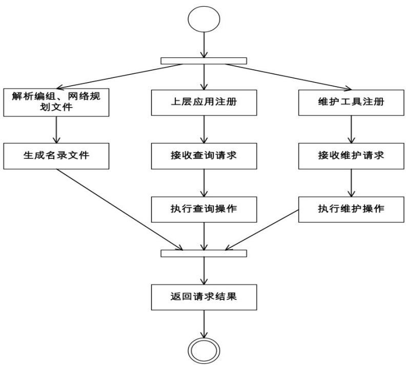
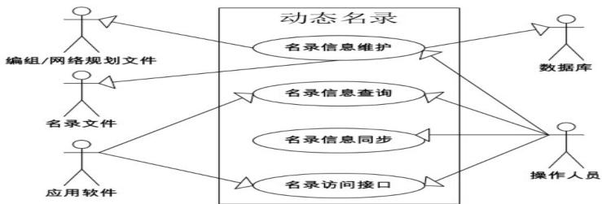
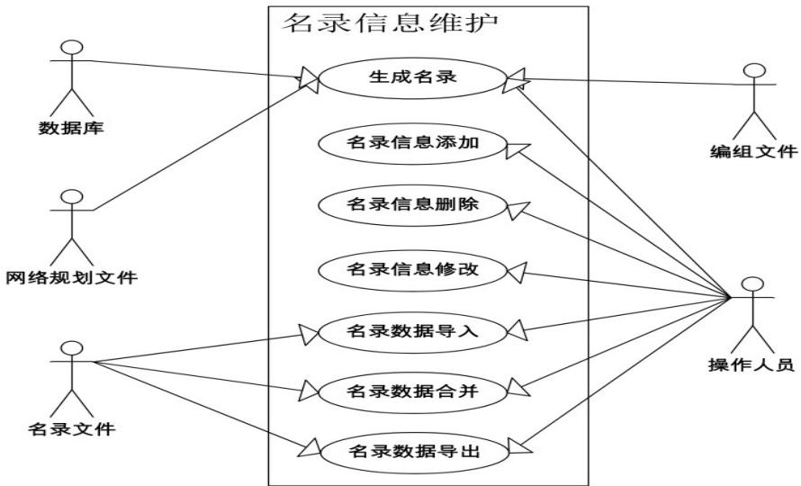
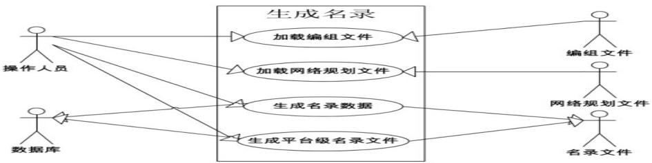

## 目 录

1 范围..  
1.1 标识..  
1.2 系统概述.  
1.2.1 系统和软件的用途.  
1.2.2 系统与软件的一般特性.  
1.3 文档概述.. ..2  
2 引用文档.. ..2  
3 需求... ..2  
3.1 要求的状态和方式.. ..2  
3.2 CSCI 能力需求. ..3  
3.2.1 名录信息维护（PZXQ-GN-MLXXWH） ..5  
3.2.2 名录信息查询（PZXQ-GN-MLXXCX） ..22  
3.2.3 名录信息同步（PZXQ-GN-MLXXTB） ..40  
3.2.4 名录访问接口（PZXQ-GN-MLFWJK） ..42  
3.3 CSCI 外部接口需求. ..45  
3.3.1 接口标识和接口图. ..45  
3.3.2 与运行支撑服务接口（PZXQ-WBJK-YXZCFWJK）. ..46  
3.3.3 与文件系统接口（PZXQ-WBJK-WJJK） .46  
3.3.4 与应用软件接口（PZXQ-WBJK-YYRJJK） ..47  
3.3.5 与人机交互框架接口（PZXQ-WBJK-RJJHKJJK） ..47  
3.3.6 与服务集成框架接口（PZXQ-WBJK-FWJCKJJK） ..47  
3.3.7 与统一传输服务接口（PZXQ-WBJK-TYCSFWJK） ..48  
3.3.8 与数据统一访问服务接口（PZXQ-WBJK-SJTYFWJK） .48  
3.4 CSCI 内部接口需求.. ..48  
3.4.1 接口标识和接口图. ..48  
3.4.2 名录信息查询（PZXQ-NBJK-MLXXCX） ..49  
3.4.3 名录访问接口（PZXQ-NBJK-MLFWJK） ..50  
3.4.4 名录信息同步（PZXQ-NBJK-MLXXTB） .50  
3.4.5 名录信息维护（PZXQ-NBJK-MLXXWH）. ..50  
3.5 CSCI 内部数据需求.. ..50  
3.6 适应性需求.. ..50  
3.7 安全性需求.. ..51  
3.8 保密性需求.. ..51  
3.9 CSCI 环境需求. ...51  
3.9.1 运行环境需求. ..51  
3.9.2 开发环境需求.. ..52  
3.10 计算机资源需求.. ..52  
3.10.1 计算机硬件需求. ..52  
3.10.2 计算机硬件资源利用需求.. ..53  
3.10.3 计算机软件需求. ..53  
3.10.4 计算机通信需求. ...54  
3.11 软件质量因素.. ..54  
3.12 设计和构造的约束.. ...54  
3.13 人员需求.. ..54  
3.14 培训需求. ..55  
3.15 软件保障需求. ..55  
3.16 其他需求.. ..55  
3.17 验收、交付和包装需求.. ..55  
3.18 需求的优先顺序和关键性.. ..56  
4 合格性规定. ..59  
5 需求可追踪性.. ..60  
6 注释... ...63

## 1 范围

## 1.1 标识

a) 本文档已被批准的标识号： $\mathrm { A Z _ { 6 9 3 } 2 . 4 9 0 . 0 1 1 1 \ S R S }$

b) 本文档所适用的软件名称为：动态名录；

c) 本文档的版本号为：V1.00.04/2020 年 12 月 31 日；

d) 本文档所适用的软件所属系统为：某级信息系统软件。

## 1.2 系统概述

## 1.2.1 系统和软件的用途

某级信息系统软件按照国产自主可控要求，进行基础软件环境选型，以及应用软件的新研和国产化迁移改造，对功能要素分散、流程独立的业务功能进行整合优化，研制适应不同使用需求、使用场景的软件，实现信息系统软件的融合、型谱优化和业务提能，推动某信息系统软件向“国产化、服务化、轻量化”方向发展。

某信息服务环境软件是某信息系统软件的重要组成，是连接底层各类硬件信息基础设施与上层各种应用系统的桥梁，通过基础平台融合汇聚底层资源，规范技术体制、支撑体系运行、促进互通互联等，是支撑构建某信息系统的重要支撑，其软件主要部署运行在各级机构的信息处理设备上，提供系统运维、数据运维、信息传输、信息处理、信息展现等功能，支撑应用软件和用户完成开发、集成、运维、运行全流程的使用。

动态名录完成信息服务环境软件功能域名录生成、查询的功能，提供桌面、平板、手持三种形态的软件，该软件提供基于编组关系、用户信息、装备信息的名录信息，包括在集成阶段提供名录信息维护功能，在运行阶段提供名录解析查询、维护、同步功能，并在开发阶段提供相应二次开发接口。其中，名录信息维护功能提供桌面、平板版，具有名录数据生成、管理、维护能力及与现役名录的转换能力；名录解析查询功能提供桌面、平板、手持版，能够对属性信息、统计信息等名录信息进行查询；名录信息同步功能提供桌面、平板、手持版，实现将用户在线状态信息按照既定策略的同步。

## 1.2.2 系统与软件的一般特性

a)需方：某单位；

b)使用方：某单位；

c)开发方：某单位；

d)保障机构：某单位；

e) 运行方案：系统开机后，动态名录服务端软件由服务集成框架加载运行，由运行

支撑服务监控其运行状态，动态名录客户端访问库提供被各应用软件、业务服务调用；

## 1.3 文档概述

在本文档中，第2章列出了本文档中引用的其它文档的信息，第3章详细描述了动态名录的各种需求以及实现方式，第4章规定了确认第3章各项需求正确实现的合格性验证方法，第5章描述本文档列出的各项需求与相应的系统需求规格说明文档列出的需求的对应关系。其中，第3章是本文档的主要部分。

## 2 引用文档

本文档的引用文档见表1。

表1 引用文档
<table><tr><td rowspan=1 colspan=1>文档编号</td><td rowspan=1 colspan=1>标题</td><td rowspan=1 colspan=1>修订版本</td><td rowspan=1 colspan=1>修订日期</td><td rowspan=1 colspan=1>编写单位</td></tr><tr><td rowspan=1 colspan=1>GJB 438B-2009</td><td rowspan=1 colspan=1>《军用软件开发文档编制规范》</td><td rowspan=1 colspan=1>一</td><td rowspan=1 colspan=1>2009年5月</td><td rowspan=1 colspan=1>总装备部</td></tr><tr><td rowspan=1 colspan=1>GJB 439A-2013</td><td rowspan=1 colspan=1>《军品软件质量保证通用要求》</td><td rowspan=1 colspan=1>一</td><td rowspan=1 colspan=1>2013年7月</td><td rowspan=1 colspan=1>国防科学技术工业委员会</td></tr><tr><td rowspan=1 colspan=1>GJB 450A-2004</td><td rowspan=1 colspan=1>《装备可靠性工作通用要求》</td><td rowspan=1 colspan=1>一</td><td rowspan=1 colspan=1>2004年7月</td><td rowspan=1 colspan=1>总装备部</td></tr><tr><td rowspan=1 colspan=1>GJB 2786A-2009</td><td rowspan=1 colspan=1>《军用软件开发通用要求》</td><td rowspan=1 colspan=1>1</td><td rowspan=1 colspan=1>2009年5月</td><td rowspan=1 colspan=1>总装备部</td></tr><tr><td rowspan=1 colspan=1>GJB 5235-2004</td><td rowspan=1 colspan=1>《军用软件配置管理》</td><td rowspan=1 colspan=1>一</td><td rowspan=1 colspan=1>2004年9月</td><td rowspan=1 colspan=1>总装备部</td></tr><tr><td rowspan=1 colspan=1>GJB/Z 102A-2012</td><td rowspan=1 colspan=1>《军用软件安全性设计指南》</td><td rowspan=1 colspan=1></td><td rowspan=1 colspan=1>2012年7月</td><td rowspan=1 colspan=1>总装备部</td></tr></table>

## 3 需求

## 3.1 要求的状态和方式

## 3.1.1 软件状态图

动态名录软件状态图描述了数据同步服务在整个使用中的所有可能出现的状态，以及各状态之间的相互转移情况。

动态名录软件状态图如图 1所示。

图 1 动态名录软件状态图

动态名录软件状态/方式与需求对应表见表 2。

表 2 动态名录软件状态/方式与需求对应表
<table><tr><td colspan="1" rowspan="1">状态/方式名称</td><td colspan="1" rowspan="1">子状态</td><td colspan="1" rowspan="1">状态/方式描述</td><td colspan="1" rowspan="1">状态转移条件</td></tr><tr><td colspan="1" rowspan="1">开发阶段</td><td colspan="1" rowspan="1">无</td><td colspan="1" rowspan="1">提供查询维护接口供上层应用开发</td><td colspan="1" rowspan="1"></td></tr><tr><td colspan="1" rowspan="1">集成阶段</td><td colspan="1" rowspan="1">无</td><td colspan="1" rowspan="1">任务数据包制作时生成名录文件</td><td colspan="1" rowspan="1">开始集成开设，软件进入集成阶段状态</td></tr><tr><td colspan="1" rowspan="1">运行阶段</td><td colspan="1" rowspan="1">无</td><td colspan="1" rowspan="1">提供名录信息的查询维护</td><td colspan="1" rowspan="1">任务开始后，软件进入运行阶段状态</td></tr></table>

## 3.1.2 软件活动图

  
图 2 动态名录活动图

动态名录软件部署在服务器上，集成阶段状态在任务数据包制作的过程中生成名录文件，输入数据包含编组数据、网络规划数据以及系统基础数据；在进入运行阶段状态后，在该状态下等待应用软件访问，为用户提供查询、添加、修改、删除名录信息的查询维护能力，同时提供名录数据维护工具，并将维护后的名录信息及用户状态信息同步进行逐级增量式同步。

## 3.2 CSCI 能力需求

动态名录软件按照其功能需求，包含名录信息维护、名录信息查询、名录信息同步和名录访问接口功能，并提供名录辅助工具，操作人员可通过该工具进行名录相关功能的操作。

动态名录软件功能图，见所示。

图3 动态名录软件功能图（组件图）

动态名录软件用例图如图4所示。

  
图4 动态名录软件用例图  
动态名录软件的所有能力标识表见表3。

表3 动态名录软件所有能力标识
<table><tr><td colspan="1" rowspan="1">序号</td><td colspan="1" rowspan="1">Usecase 名称</td><td colspan="1" rowspan="1">项目唯一标识符</td><td colspan="1" rowspan="1">需求描述</td><td colspan="1" rowspan="1">需求重用</td><td colspan="1" rowspan="1">方式名称</td><td colspan="1" rowspan="1">运行状态</td><td colspan="1" rowspan="1">对应的任务书功能/性能</td></tr><tr><td colspan="1" rowspan="1">1</td><td colspan="1" rowspan="1">名录信息维护</td><td colspan="1" rowspan="1">PZXQ-GN-MLXXWH</td><td colspan="1" rowspan="1">完成名录信息的生成、维护功能，并提供可视化维护界面</td><td colspan="1" rowspan="1">改进</td><td colspan="1" rowspan="1">桌面版平板版</td><td colspan="1" rowspan="1">集成阶段、运行阶段</td><td colspan="1" rowspan="1">4.1.1、4.2a、4.2b</td></tr><tr><td colspan="1" rowspan="1">2</td><td colspan="1" rowspan="1">名录信息查询</td><td colspan="1" rowspan="1">PZXQ-GN-MLXXCX</td><td colspan="1" rowspan="1">完成名录节点信息查询能力，包括上级、下级、友邻等关系信息</td><td colspan="1" rowspan="1">沿用</td><td colspan="1" rowspan="1">桌面版平板版手持版</td><td colspan="1" rowspan="1">运行阶段</td><td colspan="1" rowspan="1">4.1.2、4.2a、4.2b</td></tr><tr><td colspan="1" rowspan="1">3</td><td colspan="1" rowspan="1">名录信息同步</td><td colspan="1" rowspan="1">PZXQ-GN-MLXXTB</td><td colspan="1" rowspan="1">完成更新节点信息、用户上下线信息、用</td><td colspan="1" rowspan="1">新研</td><td colspan="1" rowspan="1">桌面版平板版</td><td colspan="1" rowspan="1">运行阶段</td><td colspan="1" rowspan="1">4.1.3</td></tr><tr><td colspan="1" rowspan="1"></td><td colspan="1" rowspan="1"></td><td colspan="1" rowspan="1"></td><td colspan="1" rowspan="1">户装备映射关系更新后将信息在全网内同步的功能</td><td colspan="1" rowspan="1"></td><td colspan="1" rowspan="1">手持版</td><td colspan="1" rowspan="1"></td><td colspan="1" rowspan="1"></td></tr><tr><td colspan="1" rowspan="1">4</td><td colspan="1" rowspan="1">名录访问接口</td><td colspan="1" rowspan="1">PZXQ-GN-MLFWJK</td><td colspan="1" rowspan="1">提供应用软件访问查询名录信息的接口</td><td colspan="1" rowspan="1">改进</td><td colspan="1" rowspan="1">桌面版平板版手持版</td><td colspan="1" rowspan="1">开发阶段</td><td colspan="1" rowspan="1">4.1.4</td></tr></table>

3.2.1 名录信息维护（PZXQ-GN-MLXXWH）

动态名录软件名录信息维护功能主要完成名录文件的生成和名录信息的添加、删除、修改、导入、导出、合并功能，并提供名录信息的可视化维护功能，名录信息维护用例图如图5所示。

  
图5 名录信息维护用例图  
名录信息维护功能能力标识见表4。

表4名录信息维护功能能力标识

<table><tr><td rowspan=1 colspan=1>序号</td><td rowspan=1 colspan=1>Usecase名称</td><td rowspan=1 colspan=1>项目唯一标识符</td><td rowspan=1 colspan=1>需求描述</td><td rowspan=1 colspan=1>需求重用</td><td rowspan=1 colspan=1>方式名称</td><td rowspan=1 colspan=1>运行状态</td><td rowspan=1 colspan=1>对应的任务书功能/性能</td></tr><tr><td rowspan=1 colspan=1>1</td><td rowspan=1 colspan=1>生成名录</td><td rowspan=1 colspan=1>PZXQ-GN-MLXXWH-SCML</td><td rowspan=1 colspan=1>能够通过所需编组数据、装备数据、人员数据、网络规划等基础数据，生成名录文件。</td><td rowspan=1 colspan=1>改进</td><td rowspan=1 colspan=1>桌面版平板版</td><td rowspan=1 colspan=1>集成阶段</td><td rowspan=1 colspan=1>4.1.1a、4.2a、4.2b</td></tr><tr><td rowspan=1 colspan=1>2</td><td rowspan=1 colspan=1>名录信息添加</td><td rowspan=1 colspan=1>PZXQ-GN-MLXXWH-MLXXTJ</td><td rowspan=1 colspan=1>能够提供添加名录节点及其属性信息的功能。</td><td rowspan=1 colspan=1>沿用</td><td rowspan=1 colspan=1>桌面版平板版手持版</td><td rowspan=1 colspan=1>集成阶段、运行阶段</td><td rowspan=1 colspan=1>4.1.1b、4.2a、4.2b</td></tr><tr><td rowspan=1 colspan=1>3</td><td rowspan=1 colspan=1>名录信息删除</td><td rowspan=1 colspan=1>PZXQ-GN-MLXXWH-MLXXSC</td><td rowspan=1 colspan=1>能够提供删除名录节点及其属性信息的功能。</td><td rowspan=1 colspan=1>沿用</td><td rowspan=1 colspan=1>桌面版平板版手持版</td><td rowspan=1 colspan=1>集成阶段、运行阶段</td><td rowspan=1 colspan=1>4.1.1b</td></tr><tr><td rowspan=1 colspan=1>4</td><td rowspan=1 colspan=1>名录信息修改</td><td rowspan=1 colspan=1>PZXQ-GN-MLXXWH-MLXXXG</td><td rowspan=1 colspan=1>能够提供修改名录节点及其属性信息的功能</td><td rowspan=1 colspan=1>沿用</td><td rowspan=1 colspan=1>桌面版平板版手持版</td><td rowspan=1 colspan=1>集成阶段、运行阶段</td><td rowspan=1 colspan=1>4.1.1b</td></tr><tr><td rowspan=1 colspan=1>5</td><td rowspan=1 colspan=1>名录数据导出</td><td rowspan=1 colspan=1>PZXQ-GN-MLXXWH-MLSJDC</td><td rowspan=1 colspan=1>能够提供导出名录数据的功能</td><td rowspan=1 colspan=1>改进</td><td rowspan=1 colspan=1>桌面版平板版手持版</td><td rowspan=1 colspan=1>集成阶段、运行阶段</td><td rowspan=1 colspan=1>4.1.1d</td></tr><tr><td rowspan=1 colspan=1>6</td><td rowspan=1 colspan=1>名录数据导入</td><td rowspan=1 colspan=1>PZXQ-GN-MLXXWH-MLSJDR</td><td rowspan=1 colspan=1>能够提供导入名录数据的功能</td><td rowspan=1 colspan=1>改进</td><td rowspan=1 colspan=1>桌面版平板版手持版</td><td rowspan=1 colspan=1>集成阶段、运行阶段</td><td rowspan=1 colspan=1>4.1.1c、4.2a、4.2b</td></tr><tr><td rowspan=1 colspan=1>7</td><td rowspan=1 colspan=1>名录数据合并</td><td rowspan=1 colspan=1>PZXQ-GN-MLXXWH-MLSJHB</td><td rowspan=1 colspan=1>能够提供合并名录数据的功能</td><td rowspan=1 colspan=1>改进</td><td rowspan=1 colspan=1>桌面版平板版</td><td rowspan=1 colspan=1>集成阶段、运行阶段</td><td rowspan=1 colspan=1>4.1.1e、4.2a、4.2b</td></tr></table>

3.2.1.1 生成名录（PZXQ-GN-MLXXWH-SCML）

动态名录软件提供名录数据生成的功能，支持根据编组文件、网络规划文件及系统基础数据生成名录文件，包括节点信息及各节点间的编组从属关系，支持生成平台级名录文件。生成名录的用例图如图 6所示。

3.2.1.1.1 加 载 编 组 文 件 （ PZXQ-GN-MLXXWH-SCML-JZBZWJ）

图 6 名录生成用例图  
动态名录软件生成名录功能能力标识见表 5。  
表 5 生成名录功能能力标识
<table><tr><td rowspan=1 colspan=1>序号</td><td rowspan=1 colspan=1>Usecase名称</td><td rowspan=1 colspan=1>项目唯一标识符</td><td rowspan=1 colspan=1>需求描述</td><td rowspan=1 colspan=1>需求重用</td><td rowspan=1 colspan=1>方式名称</td><td rowspan=1 colspan=1>运行状态</td><td rowspan=1 colspan=1>对应的任务书功能/性能</td></tr><tr><td rowspan=1 colspan=1>1</td><td rowspan=1 colspan=1>加载编组文件</td><td rowspan=1 colspan=1>PZXQ-GN-MLXXWH-SCML-JZBZWJ</td><td rowspan=1 colspan=1>根据编组结果，加载编组文件并解析。</td><td rowspan=1 colspan=1>改进</td><td rowspan=1 colspan=1>桌面版平板版</td><td rowspan=1 colspan=1>集成阶段</td><td rowspan=1 colspan=1>4.1.1a、4.2a、4.2b</td></tr><tr><td rowspan=1 colspan=1>2</td><td rowspan=1 colspan=1>加载网络规划文件</td><td rowspan=1 colspan=1>PZXQ-GN-MLXXWH-SCML-JZWLGHWJ</td><td rowspan=1 colspan=1>根据网络规划结果，加载网络规划文件并解析。</td><td rowspan=1 colspan=1>改进</td><td rowspan=1 colspan=1>桌面版平板版</td><td rowspan=1 colspan=1>集成阶段</td><td rowspan=1 colspan=1>4.1.1a</td></tr><tr><td rowspan=1 colspan=1>3</td><td rowspan=1 colspan=1>生成名录数据</td><td rowspan=1 colspan=1>PZXQ-GN-MLXXWH-SCML-SCMLSJ</td><td rowspan=1 colspan=1>根据输入的信息生成名录数据，包括节点信息及各节点间的编组从属关系。</td><td rowspan=1 colspan=1>改进</td><td rowspan=1 colspan=1>桌面版平板版</td><td rowspan=1 colspan=1>集成阶段</td><td rowspan=1 colspan=1>4.1.1a</td></tr><tr><td rowspan=1 colspan=1>4</td><td rowspan=1 colspan=1>生成平台级名录文件</td><td rowspan=1 colspan=1>PZXQ-GN-MLXXWH-SCML-SCPTJMLWJ</td><td rowspan=1 colspan=1>支持生成平台级名录文件</td><td rowspan=1 colspan=1>改进</td><td rowspan=1 colspan=1>桌面版平板版</td><td rowspan=1 colspan=1>集成阶段</td><td rowspan=1 colspan=1>4.1.1a</td></tr></table>

动态名录软件能够加载解析编组文件并完成编组文件的解析，加载编组文件的用例

场景见表 6。

表 6 加载编组文件用例场景描述
<table><tr><td rowspan=1 colspan=1>Use Case 名称:加载编组文件</td><td rowspan=1 colspan=2>Actors：操作人员、编组文件</td></tr><tr><td rowspan=1 colspan=3>概述：加载解析编组文件，并完成编组文件的解析</td></tr><tr><td rowspan=1 colspan=3>前置条件：动态名录软件正常运行</td></tr><tr><td rowspan=1 colspan=3>主事件流</td></tr><tr><td rowspan=1 colspan=1>Actor 的动作</td><td rowspan=1 colspan=1>系统的动作</td><td rowspan=1 colspan=1>动作约束(性能、可靠性、容错等)</td></tr><tr><td rowspan=1 colspan=1>1.      操作人员打开名录辅助工具，进入名录维护界面3.      操作人员点击名录生成按钮5.      操作人员点击导入编组文件按钮7.      操作人员选择节点数小于等于3000，层级深度小于等于20的编组文件，点击导入</td><td rowspan=1 colspan=1>2.       进入名录维护界面，通过维护界面可查看当前名录信息；4.       进入生成名录流程界面；6.       弹出文件选择对话框8.       名录辅助工具加载编组文件，如果加载失败则进入E1；</td><td rowspan=1 colspan=1>支持的最大名录节点数不小于3000个；支持的最大名录层级深度不小于20层；</td></tr><tr><td rowspan=1 colspan=3>异常流E1：提示用户编组文件加载失败，并记录日志。</td></tr><tr><td rowspan=1 colspan=3>后置条件：生成名录数据</td></tr></table>

## 3.2.1.1.2 加载网络规划文件（PZXQ-GN-MLXXWH-SCML-JZWLGHWJ）

动态名录软件加载并解析网络规划文件，加载网络规划文件用例场景见表 7。

表 7 加载网络规划文件用例场景描述
<table><tr><td rowspan=1 colspan=1>Use Case 名称:加载网络规划文件</td><td rowspan=1 colspan=2>Actors：操作人员、网络规划文件</td></tr><tr><td rowspan=1 colspan=3>概述：加载、解析网络规划文件</td></tr><tr><td rowspan=1 colspan=3>前置条件：动态名录软件正常运行</td></tr><tr><td rowspan=1 colspan=3>主事件流</td></tr><tr><td rowspan=1 colspan=1>Actor 的动作</td><td rowspan=1 colspan=1>系统的动作</td><td rowspan=1 colspan=1>动作约束</td></tr></table>