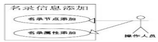
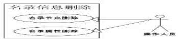
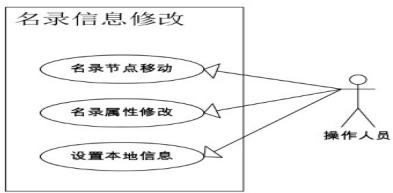
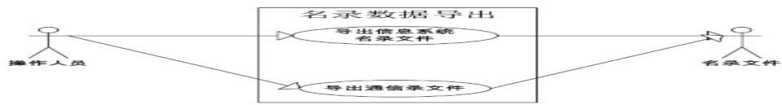

<table><tr><td></td><td></td><td></td><td>(性能、可靠性、容错等)</td></tr><tr><td colspan="2" rowspan="3">1. 操作人员打开名录辅助工 具，进入名录维护界面</td><td>进入名录维护界面，通过维</td><td></td></tr><tr><td>2. 护界面可查看当前名录信息；</td><td></td></tr><tr><td rowspan="2">4. 进入生成名录流程界面；</td><td rowspan="2">支持的最大名录节点数不小于3000 个； 支持的最大名录层级深度不小于20</td></tr><tr><td rowspan="2">5. 操作人员点击导入网络规 划文件按钮</td><td rowspan="2">层； 6.</td></tr><tr><td>弹出文件选择对话框</td></tr><tr><td colspan="2">7. 操作人员选择编组文件对 应的网络规划文件，点击导入 8. 文件，如果加载失败则进入E1；</td><td>名录辅助工具加载网络规划</td></tr><tr><td colspan="3">异常流E1：提示用户网络规划文件加载失败，并记录日志。</td></tr><tr><td colspan="4">后置条件：无</td></tr></table>

## 3.2.1.1.3 生 成 名 录 数 据 （ PZXQ-GN-MLXXWH-SCML-SCMLSJ）

动态名录软件根据输入的信息生成名录数据，包括节点信息及各节点间的编组从属关系。生成名录数据的用例场景，见表8。

表8 生成名录用例场景描述
<table><tr><td colspan="1" rowspan="1">Use Case 名称:生成名录</td><td colspan="3" rowspan="1">Actors：名录文件、数据库、操作人员</td></tr><tr><td colspan="4" rowspan="1">概述：根据输入的信息生成名录数据，包括节点信息及各节点间的编组从属关系。</td></tr><tr><td colspan="4" rowspan="1">前置条件：动态名录软件正常运行，数据库连接正常，已导入编组文件和网络规划文件</td></tr><tr><td colspan="4" rowspan="1">主事件流</td></tr><tr><td colspan="1" rowspan="1">Actor 的动作</td><td colspan="1" rowspan="1">系统的动作</td><td colspan="1" rowspan="1">动作约束(性能、可靠性、容错等)</td></tr><tr><td colspan="1" rowspan="1">1.      操作人员打开名录辅助工具，进入名录维护界面3.      操作人员分别导入编组文件、网络规划文件，导入无误后，选择或填写名录文件生成目录，然后点击生成名录</td><td colspan="1" rowspan="1">2.       展示名录维护界面4.       按照编组文件预定义格式解析</td><td colspan="1" rowspan="1">支持的最大名录节点数不小于3000个；支持的最大名录层级深度不小于20层；</td></tr><tr><td>E1; 5. 6.</td><td>编组文件；如解析失败，则进入异常流 按照网络规划文件预 定义格式解析网络规划文件；如解析失 败，则进入异常流E2 连接数据库，从数据库基础数 据中获取节点属性，将节点属性、编组 文件解析出的编组关系和节点信息、网 络规划文件解析出的节点通信属性进行 整合后生成名录数据信息；如连接数据 库失败，则进入异常流E3；</td><td></td></tr><tr><td colspan="3">异常流E1：提示操作人员解析编组文件失败，并记录日志，结束用例； 异常流E2：提示操作人员解析网络规划文件失败，生成的名录文件信息不全，并记录日志；</td></tr><tr><td colspan="3">异常流E3：提示操作人员数据库连接失败，生成的名录文件信息不全，并记录日志。</td></tr><tr><td colspan="4">后置条件：生成名录数据</td></tr></table>

## 3.2.1.1.4 生成平台级名录文件(PZXQ-GN-MLXXWH-SCML-SCPTJMLWJ)

能够支持生成名录文件。生成平台级名录文件用例场景，见表 9。

表 9 生成平台级名录文件
<table><tr><td>Use Case 名称:生成平台级名 录文件</td><td colspan="2">Actors：名录文件、数据库、操作人员</td></tr><tr><td colspan="3">概述：支持生成名录文件。</td></tr><tr><td colspan="3">前置条件：名录服务正常运行，数据库连接正常</td></tr><tr><td colspan="3"></td></tr><tr><td>Actor 的动作</td><td>主事件流 系统的动作</td><td>动作约束</td></tr><tr><td>1. 操作人员打开名录辅助 工具，进入名录维护界面；</td><td>2. 展示名录维护界面；</td><td>(性能、可靠性、容错等)</td></tr><tr><td>3. 操作人员点击导出； 4. 5. 操作人员选择名录节点</td><td>进入平台级名录生成界面；</td><td></td></tr><tr><td>添加到导出列表，点击导出 PRN 或导出 ZKL ; 6. 7. 操作人员填写保存位置</td><td>弹出保存位置选择菜单：</td><td></td></tr><tr><td colspan="1" rowspan="1">后，点击保存；</td><td colspan="1" rowspan="1">8.       将操作人员选择的分支，或裁剪后的名录信息保存到用户选择的位置；如导出失败则进入异常流E1。</td><td colspan="1" rowspan="1"></td></tr><tr><td colspan="3" rowspan="1">异常流E1：提示操作人员导出平台级名录失败，日志记录失败原因。</td></tr><tr><td colspan="3" rowspan="1">后置条件：生成对应平台级系统名录文件</td></tr></table>

3.2.1.2 名录信息添加（PZXQ-GN-MLXXWH-MLXXTJ）

动态名录软件提供添加名录节点及其属性信息的功能。名录信息添加用例图如图 7所示。

图 7 名录信息添加用例图  
名录信息添加功能能力标识见表 10。  
表 10 名录信息添加能力标识
<table><tr><td rowspan=1 colspan=1>序号</td><td rowspan=1 colspan=1>Use case名称</td><td rowspan=1 colspan=1>项目唯一标识符</td><td rowspan=1 colspan=1>需求描述</td><td rowspan=1 colspan=1>需求重用</td><td rowspan=1 colspan=1>方式名称</td><td rowspan=1 colspan=1>运行状态</td><td rowspan=1 colspan=1>对应的任务书功能/性能</td></tr><tr><td rowspan=1 colspan=1></td><td rowspan=1 colspan=1>名录节点添加</td><td rowspan=1 colspan=1>PZXQ-GN-MLXXWH-MLXXTJ-MLJDTJ</td><td rowspan=1 colspan=1>具备添加名录节点的功能。</td><td rowspan=1 colspan=1>沿用</td><td rowspan=1 colspan=1>桌面版平板版</td><td rowspan=1 colspan=1>集成阶段、运行阶段</td><td rowspan=1 colspan=1>4.1.1b、4.2a、4.2b</td></tr><tr><td rowspan=1 colspan=1></td><td rowspan=1 colspan=1>名录属性添加</td><td rowspan=1 colspan=1>PZXQ-GN-MLXXWH-MLXXTJ-MLSXTJ</td><td rowspan=1 colspan=1>具备添加名录节点属性的功能。</td><td rowspan=1 colspan=1>沿用</td><td rowspan=1 colspan=1>桌面版平板版</td><td rowspan=1 colspan=1>集成阶段、运行阶段</td><td rowspan=1 colspan=1>4.1.1b</td></tr></table>

## 3.2.1.2.1 名 录 节 点 添 加 (PZXQ-GN-MLXXWH-MLXXTJ-MLJDTJ)

具备添加名录节点的功能。名录节点添加功能用例场景描述见表 11。

表 11 名录节点添加用例场景描述
<table><tr><td>Use Case 名称:名录节点添加</td><td>Actors：操作人员</td></tr></table>

<table><tr><td rowspan=1 colspan=3>概述：能够提供添加名录节点的功能</td></tr><tr><td rowspan=1 colspan=3>前置条件：名录服务正常运行</td></tr><tr><td rowspan=1 colspan=3>主事件流1</td></tr><tr><td rowspan=1 colspan=1>Actor 的动作</td><td rowspan=1 colspan=1>系统的动作</td><td rowspan=1 colspan=1>动作约束(性能、可靠性、容错等)</td></tr><tr><td rowspan=1 colspan=1>1. 操作人员打开名录辅助工具，进入名录维护界面3.操作人员选中名录树中一个节点，点击添加节点5.操作人员填写完新增节点必要信息后，点击添加</td><td rowspan=1 colspan=1>2.展示名录维护界面；4.判断是否可添加子节点，如可以则弹出添加节点窗口，否则进入异常流E1；6.添加新增节点到操作人员选择的父节点下，如添加失败，进入异常流E2</td><td rowspan=1 colspan=1>支持的最大名录节点数不小于3000个；支持的最大名录层级深度不小于20层；</td></tr><tr><td rowspan=1 colspan=3>异常流E1：提示操作人员该节点下无法添加子节点，结束用例；异常流E2：提示操作人员添加失败，记录失败原因。</td></tr><tr><td rowspan=1 colspan=3>后置条件：无</td></tr></table>

## 3.2.1.2.2 名 录 属 性 添 加 (PZXQ-GN-MLXXWH-MLXXTJ-MLSXTJ)

具备添加名录属性的功能。名录属性添加功能用例场景描述见表 12。

表 12 添加名录属性用例场景描述
<table><tr><td colspan="1" rowspan="1">Use Case 名称:名录属性添加</td><td colspan="2" rowspan="1">Actors:操作人员</td></tr><tr><td colspan="3" rowspan="1">概述：能够提供添加名录属性信息的功能</td></tr><tr><td colspan="3" rowspan="1">前置条件：名录服务正常运行</td></tr><tr><td colspan="3" rowspan="1">主事件流1</td></tr><tr><td colspan="1" rowspan="1">Actor 的动作</td><td colspan="1" rowspan="1">系统的动作</td><td colspan="1" rowspan="1">动作约束(性能、可靠性、容错等)</td></tr><tr><td colspan="1" rowspan="1">1. 操作人员打开名录辅助工具，进入名录维护界面3.操作人员选中名录树中一个节点，点击修改属性</td><td colspan="1" rowspan="1">2.展示名录维护界面；4.弹出属性修改窗口；</td><td colspan="1" rowspan="1"></td></tr><tr><td colspan="1" rowspan="1">5.操作人员填写要添加的属性名，并填写属性值，点击确认添加；</td><td colspan="1" rowspan="1">6.判断该属性是否可添加到该节点，如果可以则为操作人员选择的节点添加属性名称及属性值；如果添加失败，则进入异常流E1；</td><td colspan="1" rowspan="1"></td></tr><tr><td colspan="3" rowspan="1">异常流E1：提示操作人员添加属性失败，并记录失败原因。</td></tr><tr><td colspan="3" rowspan="1">后置条件：无</td></tr></table>

3.2.1.3 名录信息删除（PZXQ-GN-MLXXWH-MLXXSC）

能够提供删除名录节点及其属性信息的功能。名录信息删除用例图如图 8所示。

  
图 8 名录信息删除用例图

名录信息删除功能能力标识见表 13。

表 13 名录信息删除能力标识
<table><tr><td rowspan=1 colspan=1>序号</td><td rowspan=1 colspan=1>Use case名称</td><td rowspan=1 colspan=1>项目唯一标识符</td><td rowspan=1 colspan=1>需求描述</td><td rowspan=1 colspan=1>需求重用</td><td rowspan=1 colspan=1>方式名称</td><td rowspan=1 colspan=1>运行状态</td><td rowspan=1 colspan=1>对应的任务书功能/性能</td></tr><tr><td rowspan=1 colspan=1>1</td><td rowspan=1 colspan=1>名录节点删除</td><td rowspan=1 colspan=1>PZXQ-GN-MLXXWH-MLXXSC-MLJDSC</td><td rowspan=1 colspan=1>具备删除名录节点的功能。</td><td rowspan=1 colspan=1>沿用</td><td rowspan=1 colspan=1>桌面版平板版</td><td rowspan=1 colspan=1>集成阶段、运行阶段</td><td rowspan=1 colspan=1>4.1.1b</td></tr><tr><td rowspan=1 colspan=1>2</td><td rowspan=1 colspan=1>名录属性删除</td><td rowspan=1 colspan=1>PZXQ-GN-MLXXWH-MLXXSC-MLSXSC</td><td rowspan=1 colspan=1>具备删除名录节点属性的功能。</td><td rowspan=1 colspan=1>沿用</td><td rowspan=1 colspan=1>桌面版平板版</td><td rowspan=1 colspan=1>集成阶段、运行阶段</td><td rowspan=1 colspan=1>4.1.1b</td></tr></table>

## 3.2.1.3.1 名 录 节 点 删 除 (PZXQ-GN-MLXXWH-MLXXSC-MLJDSC)

具备删除名录节点的功能。名录节点删除功能用例场景描述见表 14。

表 14 名录节点删除用例场景描述
<table><tr><td>Use Case 名称:名录节点删除</td><td>Actors：操作人员</td></tr></table>

<table><tr><td rowspan=1 colspan=3>概述：能够提供删除名录节点的功能</td></tr><tr><td rowspan=1 colspan=3>前置条件：名录服务正常运行</td></tr><tr><td rowspan=1 colspan=3>主事件流1</td></tr><tr><td rowspan=1 colspan=1>Actor 的动作</td><td rowspan=1 colspan=1>系统的动作</td><td rowspan=1 colspan=1>动作约束(性能、可靠性、容错等)</td></tr><tr><td rowspan=1 colspan=1>1. 操作人员打开名录辅助工具，进入名录维护界面3.操作人员选中名录树中一个节点，点击删除节点5.操作人员点击确认</td><td rowspan=1 colspan=1>2.展示名录维护界面；4.提示操作人员是否确认删除6.判断是否可删除节点，如可以则删除操作人员选中的节点，否则进入异常流E1;</td><td rowspan=1 colspan=1></td></tr><tr><td rowspan=1 colspan=3>异常流E1：提示操作人员节点无法删除及无法删除原因，结束用例。</td></tr><tr><td rowspan=1 colspan=3>后置条件：无</td></tr></table>

## 3.2.1.3.2 名 录 属 性 删 除 (PZXQ-GN-MLXXWH-MLXXSC-MLSXSC)

具备删除名录属性的功能。名录属性删除功能用例场景描述见表 15。

表 15 删除名录属性用例场景描述
<table><tr><td colspan="1" rowspan="1">Use Case 名称:名录属性删除</td><td colspan="2" rowspan="1">Actors：操作人员</td></tr><tr><td colspan="3" rowspan="1">概述：能够提供删除名录属性信息的功能</td></tr><tr><td colspan="3" rowspan="1">前置条件：名录服务正常运行</td></tr><tr><td colspan="3" rowspan="1">主事件流1</td></tr><tr><td colspan="1" rowspan="1">Actor 的动作</td><td colspan="1" rowspan="1">系统的动作</td><td colspan="1" rowspan="1">动作约束(性能、可靠性、容错等)</td></tr><tr><td colspan="1" rowspan="1">1. 操作人员打开名录辅助工具，进入名录维护界面3.操作人员选中名录树中一个节点，点击修改属性</td><td colspan="1" rowspan="1">2.展示名录维护界面；4.弹出属性修改窗口；</td><td colspan="1" rowspan="1"></td></tr><tr><td colspan="1" rowspan="1">5.操作人员选择要删除的属性进行删除，点击确认；</td><td colspan="1" rowspan="1">6.判断该属性是否可删除到该节点，如果可以则为操作人员选择的节点删除属性名称及属性值；如果删除失败，则进入异常流E1；</td><td colspan="1" rowspan="1"></td></tr><tr><td colspan="3" rowspan="1">异常流E1：提示操作人员删除属性失败，并记录失败原因。</td></tr><tr><td colspan="3" rowspan="1">后置条件：无</td></tr></table>

## 3.2.1.4 名录信息修改（PZXQ-GN-MLXXWH-MLXXXG）

能够提供修改名录节点及其属性信息的功能。名录信息修改用例图如图 9所示。

图 9 名录信息修改用例图  
名录信息修改功能能力标识见表 16。  
表 16 名录信息修改能力标识
<table><tr><td rowspan=1 colspan=1>序号</td><td rowspan=1 colspan=1>Use case名称</td><td rowspan=1 colspan=1>项目唯一标识符</td><td rowspan=1 colspan=1>需求描述</td><td rowspan=1 colspan=1>需求重用</td><td rowspan=1 colspan=1>方式名称</td><td rowspan=1 colspan=1>运行状态</td><td rowspan=1 colspan=1>对应的任务书功能/性能</td></tr><tr><td rowspan=1 colspan=1>1.</td><td rowspan=1 colspan=1>名录节点移动</td><td rowspan=1 colspan=1>PZXQ-GN-MLXXWH-MLXXXG-MLJDYD</td><td rowspan=1 colspan=1>具备移动名录节点的功能。</td><td rowspan=1 colspan=1>沿用</td><td rowspan=1 colspan=1>桌面版平板版</td><td rowspan=1 colspan=1>集成阶段、运行阶段</td><td rowspan=1 colspan=1>4.1.1b</td></tr><tr><td rowspan=1 colspan=1>2.</td><td rowspan=1 colspan=1>名录属性修改</td><td rowspan=1 colspan=1>PZXQ-GN-MLXXWH-MLXXXG-MLSXXG</td><td rowspan=1 colspan=1>具备修改名录节点属性的功能。</td><td rowspan=1 colspan=1>沿用</td><td rowspan=1 colspan=1>桌面版平板版</td><td rowspan=1 colspan=1>集成阶段、运行阶段</td><td rowspan=1 colspan=1>4.1.1b</td></tr><tr><td rowspan=1 colspan=1>3.</td><td rowspan=1 colspan=1>设置本地信息</td><td rowspan=1 colspan=1>PZXQ-GN-MLXXWH-MLXXXG-</td><td rowspan=1 colspan=1>具备设置本地信息的功能。</td><td rowspan=1 colspan=1>沿用</td><td rowspan=1 colspan=1>桌面版平板版</td><td rowspan=1 colspan=1>集成阶段</td><td rowspan=1 colspan=1>4.1.1b</td></tr></table>

<table><tr><td rowspan=1 colspan=1></td><td rowspan=1 colspan=1>SZBDXX</td><td rowspan=1 colspan=1></td><td rowspan=1 colspan=1></td><td rowspan=1 colspan=1></td><td rowspan=1 colspan=1></td><td rowspan=1 colspan=1></td></tr></table>

## 3.2.1.4.1 名 录 节 点 移 动 (PZXQ-GN-MLXXWH-MLXXXG-MLJDYD)

具备移动名录节点的功能。名录节点移动功能用例场景描述见表 17。

表 17 名录节点移动用例场景描述
<table><tr><td>Use Case 名称:名录节点移动</td><td colspan="2">Actors：操作人员</td></tr><tr><td colspan="3">概述：能够提供移动名录节点的功能</td></tr><tr><td colspan="3">前置条件：名录服务正常运行</td></tr><tr><td colspan="3">主事件流1</td></tr><tr><td>Actor 的动作</td><td>系统的动作</td><td>动作约束 (性能、可靠性、容错等)</td></tr><tr><td>1.操作人员打开名录辅助工具， 进入名录维护界面</td><td>2.展示名录维护界面；</td><td></td></tr><tr><td>3.操作人员选中名录树中一个节 点，点击移动节点 5.操作人员拖拽节点到目的位置</td><td>4.选择的节点变为可拖拽的状态；</td><td></td></tr><tr><td>后，释放鼠标确认移动</td><td>6.判断是否可移动节点，如可以则移动 操作人员选中的节点到目标位置，否则</td><td></td></tr><tr><td colspan="3">进入异常流E1。 异常流E1：提示操作人员节点无法移动及无法移动原因，结束用例。</td></tr><tr><td colspan="3">后置条件：无</td></tr></table>

## 3.2.1.4.2 名 录 属 性 修 改 (PZXQ-GN-MLXXWH-MLXXXG-MLSXXG)

具备修改名录属性的功能。名录属性修改功能用例场景描述见表 18。

表 18 修改名录属性用例场景描述
<table><tr><td colspan="1" rowspan="1">Use Case 名称：名录属性修改</td><td colspan="2" rowspan="1">Actors:操作人员</td></tr><tr><td colspan="3" rowspan="1">概述:能够提供修改名录属性信息的功能</td></tr><tr><td colspan="3" rowspan="1">前置条件：名录服务正常运行</td></tr><tr><td colspan="3" rowspan="1">主事件流1</td></tr><tr><td colspan="1" rowspan="1">Actor 的动作</td><td colspan="1" rowspan="1">系统的动作</td><td colspan="1" rowspan="1">动作约束</td></tr><tr><td></td><td></td><td>(性能、可靠性、容错等)</td></tr><tr><td>1.操作人员打开名录辅助工具， 进入名录维护界面</td><td>2.展示名录维护界面；</td><td></td></tr><tr><td>3.操作人员选中名录树中一个节 点，点击修改属性 5.操作人员选择要修改的属性， 并填写属性值，点击确认修改；</td><td>4.弹出属性修改窗口； 6.判断该属性值是否可修改到该节点，</td><td></td></tr><tr><td>异常流E1：提示操作人员修改属性失败，并记录失败原因。</td><td colspan="2">如果可以则为操作人员选择的节点修改 属性名称及属性值；如果修改失败，则 进入异常流E1。</td></tr><tr><td colspan="3">后置条件：无</td></tr></table>

## 3.2.1.4.3 设 置 本 地 信 息 （ PZXQ-GN-MLXXWH-MLXXXG-SZBDXX）

具备设置本地信息的功能。设置本地信息功能用例场景描述见表 19。

表 19 设置本地信息用例场景描述
<table><tr><td>Use Case 名称:设置本地信息</td><td colspan="2">Actors:操作人员</td></tr><tr><td colspan="3">概述：能够提供设置本地信息的功能</td></tr><tr><td colspan="3">前置条件：名录服务正常运行</td></tr><tr><td colspan="3">主事件流1</td></tr><tr><td>Actor 的动作</td><td>系统的动作</td><td>动作约束 (性能、可靠性、容错等)</td></tr><tr><td>1.操作人员打开名录辅助工具， 进入名录维护界面</td><td>2.展示名录维护界面：</td><td></td></tr><tr><td>3.操作人员选中名录树中一个装 备节点，点击设置为本地身份 5.操作人员选择确认设置为本地</td><td>4.弹出确认菜单；</td><td></td></tr><tr><td>身份</td><td>6.将操作人员选中的装备节点设置为本 地身份，如设置失败则进入异常流E1。</td><td></td></tr></table>

<table><tr><td>异常流E1：提示操作人员无法设置本地身份，记录失败原因，结束用例。</td></tr><tr><td>后置条件：无</td></tr></table>

3.2.1.5 名录数据导出（PZXQ-GN-MLXXWH-MLSJDC）

动态名录提供名录文件的导出功能，支持导出旅信息系统名录文件、“统一版”通信录文件。名录数据导出用例图如图 10所示。

  
图 10 名录数据导出用例图

名录数据导出功能能力标识见表 20。

表 20 名录数据导出能力标识
<table><tr><td rowspan=1 colspan=1>序号</td><td rowspan=1 colspan=1>Use case名称</td><td rowspan=1 colspan=1>项目唯一标识符</td><td rowspan=1 colspan=1>需求描述</td><td rowspan=1 colspan=1>需求重用</td><td rowspan=1 colspan=1>方式名称</td><td rowspan=1 colspan=1>运行状态</td><td rowspan=1 colspan=1>对应的任务书功能/性能</td></tr><tr><td rowspan=1 colspan=1>1</td><td rowspan=1 colspan=1>导出名录文件</td><td rowspan=1 colspan=1>PZXQ-GN-MLXXWH-MLSJDC-DCMLWJ</td><td rowspan=1 colspan=1>能够将名录数据导出为信息系统名录文件。</td><td rowspan=1 colspan=1>改进</td><td rowspan=1 colspan=1>桌面版平板版</td><td rowspan=1 colspan=1>集成阶段、运行阶段</td><td rowspan=1 colspan=1>4.1.1d</td></tr><tr><td rowspan=1 colspan=1>2</td><td rowspan=1 colspan=1>导出通信录文件</td><td rowspan=1 colspan=1>PZXQ-GN-MLXXWH-MLSJDC-DCXYTXL</td><td rowspan=1 colspan=1>能够将名录数据导出为通信录文件。</td><td rowspan=1 colspan=1>改进</td><td rowspan=1 colspan=1>桌面版平板版</td><td rowspan=1 colspan=1>集成阶段、运行阶段</td><td rowspan=1 colspan=1>4.1.1d</td></tr></table>

## 3.2.1.5.1 导 出 名 录 文 件 （ PZXQ-GN-MLXXWH-MLSJDC-DCMLWJ）

能够将名录数据导出为信息系统名录文件。导出名录文件功能用例场景描述见表21。

表 21 导出名录文件用例场景描述
<table><tr><td>Use Case 名称:导出名录文件</td><td>Actors：操作人员、名录文件</td></tr></table>