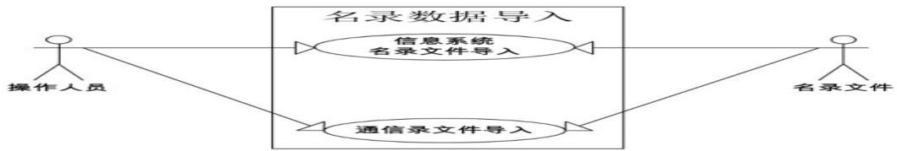
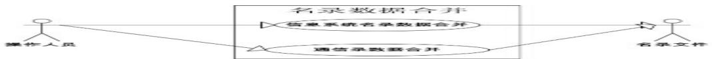
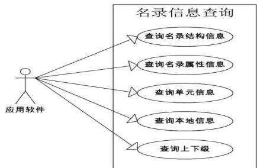
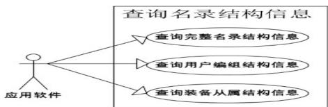

<table><tr><td rowspan=1 colspan=3>概述：能够将名录数据导出为信息系统名录文件</td></tr><tr><td rowspan=1 colspan=3>前置条件：名录服务正常运行</td></tr><tr><td rowspan=1 colspan=3>主事件流</td></tr><tr><td rowspan=1 colspan=1>Actor 的动作</td><td rowspan=1 colspan=1>系统的动作</td><td rowspan=1 colspan=1>动作约束(性能、可靠性、容错等)</td></tr><tr><td rowspan=1 colspan=1>1.操作人员打开名录辅助工具，进入名录维护界面；3.操作人员点击导出名录按钮；5.操作人员选择导出目录后点击确认导出；</td><td rowspan=1 colspan=1>2.展示名录维护界面；4.弹出名录导出界面；6.将名录数据导出成名录文件存放到用户指定的目录下；如导出失败，则进入异常流E1。</td><td rowspan=1 colspan=1>支持的最大名录节点数不小于3000个；支持的最大名录层级深度不小于20层；</td></tr><tr><td rowspan=1 colspan=3>异常流E1：提示操作人员导出失败并提示失败原因，结束用例。</td></tr><tr><td rowspan=1 colspan=3>后置条件：无</td></tr></table>

## 3.2.1.5.2 导出通信录文件（PZXQ-GN-MLXXWH-MLSJDC-DCTXL）

动态名录软件具备导出通信录文件的功能。导出通信录文件功能用例场景描述见表22。

表 22导出通信录文件用例场景描述
<table><tr><td colspan="1" rowspan="1">Use Case 名称:导出通信录文件</td><td colspan="2" rowspan="1">Actors：操作人员、名录文件</td></tr><tr><td colspan="3" rowspan="1">概述：具备导出通信录文件的功能</td></tr><tr><td colspan="3" rowspan="1">前置条件：名录服务正常运行</td></tr><tr><td colspan="3" rowspan="1">主事件流</td></tr><tr><td colspan="1" rowspan="1">Actor 的动作</td><td colspan="1" rowspan="1">系统的动作</td><td colspan="1" rowspan="1">动作约束(性能、可靠性、容错等)</td></tr><tr><td colspan="1" rowspan="1">1.操作人员打开名录辅助工具，进入名录维护界面3.操作人员点击导出通信录按钮；</td><td colspan="1" rowspan="1">2.展示名录维护界面：4.弹出通信录导出界面；</td><td colspan="1" rowspan="1"></td></tr><tr><td colspan="1" rowspan="1">5.操作人员选择导出目录后点击确认导出；</td><td colspan="1" rowspan="1">6.将名录数据转换为通信录格式，并导出成通信录文件存放到用户指定的目录下；如导出失败，则进入异常流E1。</td><td colspan="1" rowspan="1"></td></tr><tr><td colspan="3" rowspan="1">异常流E1：提示操作人员无法导出通信录，并记录失败原因。</td></tr><tr><td colspan="3" rowspan="1">后置条件：无</td></tr></table>

3.2.1.6 名录数据导入（PZXQ-GN-MLXXWH-MLSJDR）

动态名录软件提供导入名录数据的功能，支持导入信息系统名录文件或通信录文件，将解析后的名录数据替换当前名录数据。名录数据导入功能的用例图见图 11所示。

  
图 11 名录数据导入用例图

名录数据导入功能能力标识见表 23。

表 23 名录数据导入功能能力标识
<table><tr><td rowspan=1 colspan=1>序号</td><td rowspan=1 colspan=1>Use case名称</td><td rowspan=1 colspan=1>项目唯一标识符</td><td rowspan=1 colspan=1>需求描述</td><td rowspan=1 colspan=1>需求重用</td><td rowspan=1 colspan=1>方式名称</td><td rowspan=1 colspan=1>运行状态</td><td rowspan=1 colspan=1>对应的任务书功能/性能</td></tr><tr><td rowspan=1 colspan=1>1</td><td rowspan=1 colspan=1>名录文件导入</td><td rowspan=1 colspan=1>PZXQ-GN-MLXXWH-MLSJDR-MLWJDR</td><td rowspan=1 colspan=1>支持导入信息系统名录文件，将解析后的名录数据替换当前名录数据。</td><td rowspan=1 colspan=1>沿用</td><td rowspan=1 colspan=1>桌面版平板版</td><td rowspan=1 colspan=1>集成阶段、运行阶段</td><td rowspan=1 colspan=1>4.1.1c</td></tr><tr><td rowspan=1 colspan=1>2</td><td rowspan=1 colspan=1>现役通信录文件导入</td><td rowspan=1 colspan=1>PZXQ-GN-MLXXWH-MLSJDR-XYTXLWJ</td><td rowspan=1 colspan=1>支持导入通信录文件，将解析后的名录数据替换当前名录数据。</td><td rowspan=1 colspan=1>改进</td><td rowspan=1 colspan=1>桌面版平板版</td><td rowspan=1 colspan=1>集成阶段、运行阶段</td><td rowspan=1 colspan=1>4.1.1c</td></tr></table>

## 3.2.1.6.1 名 录 文 件 导 入 （ PZXQ-GN-MLXXWH-MLSJDR-MLWJDR）

支持导入信息系统名录文件，将解析后的名录数据替换当前名录数据。名录文件导入功能用例场景描述见表 24。

表 24 名录文件导入用例场景描述
<table><tr><td rowspan=1 colspan=1>Use Case 名称:名录文件导入</td><td rowspan=1 colspan=2>Actors：名录文件、操作人员</td></tr><tr><td rowspan=1 colspan=3>概述：能够将信息系统名录文件导入为名录数据</td></tr><tr><td rowspan=1 colspan=3>前置条件：名录服务正常运行</td></tr><tr><td rowspan=1 colspan=3>主事件流</td></tr><tr><td rowspan=1 colspan=1>Actor 的动作</td><td rowspan=1 colspan=1>系统的动作</td><td rowspan=1 colspan=1>动作约束(性能、可靠性、容错等)</td></tr><tr><td rowspan=1 colspan=1>1.操作人员打开名录辅助工具，进入名录维护界面；3.操作人员点击导入名录按钮；5.操作人员选择导入信息系统名录文件，选择的名录文件的节点数应小于等于3000，层次深度应小于等于20；7.操作人员选择待导入的信息系统名录文件，点击导入；</td><td rowspan=1 colspan=1>2.展示名录维护界面；4.弹出名录导入界面；6.弹出名录文件选择窗口；8.将操作人员选择的名录文件读取并解析为名录数据，替换当前名录数据；如导入失败，则进入异常流E1</td><td rowspan=1 colspan=1>支持的最大名录节点数不小于3000个；支持的最大名录层级深度不小于20层；</td></tr><tr><td rowspan=1 colspan=3>异常流E1：提示操作人员导入失败并提示失败原因，结束用例。</td></tr><tr><td rowspan=1 colspan=3>后置条件：无</td></tr></table>

## 3.2.1.6.2 通信录文件导入（ PZXQ-GN-MLXXWH-MLSJDR-TXLWJ）

支持导入通信录文件，将解析后的名录数据替换当前名录数据。通信录文件导入用例场景描述见表 25。

表 25 通信录文件导入用例场景描述
<table><tr><td rowspan=1 colspan=1>Use Case 名称:名录文件导入</td><td rowspan=1 colspan=2>Actors：名录文件、操作人员</td></tr><tr><td rowspan=1 colspan=3>概述:支持导入通信录文件，将解析后的名录数据替换当前名录数据</td></tr><tr><td rowspan=1 colspan=3>前置条件：名录服务正常运行</td></tr><tr><td rowspan=1 colspan=3>主事件流</td></tr><tr><td rowspan=1 colspan=1>Actor 的动作</td><td rowspan=1 colspan=1>系统的动作</td><td rowspan=1 colspan=1>动作约束(性能、可靠性、容错等)</td></tr><tr><td rowspan=1 colspan=1>1.操作人员打开名录辅助工具，进入名录维护界面；3.操作人员点击导入名录按钮；5.操作人员选择导入通信录文件；7.操作人员选择待导入的通信录文件，选择的通信录文件的节点数应小于等于3000，层次深度应小于等于20，点击导入；</td><td rowspan=1 colspan=1>2.展示名录维护界面；4.弹出名录导入界面；6.弹出通信录文件选择窗口；8.将操作人员选择的通信录文件读取并解析，转换为旅信息系统名录数据，替换当前名录数据；如导入失败，则进入异常流E1</td><td rowspan=1 colspan=1>支持的最大名录节点数不小于3000个；支持的最大名录层级深度不小于20层；</td></tr><tr><td rowspan=1 colspan=3>异常流E1：提示操作人员导入失败并提示失败原因，结束用例。</td></tr><tr><td rowspan=1 colspan=3>后置条件：无</td></tr></table>

## 3.2.1.7 名录数据合并（PZXQ-GN-MLXXWH-MLSJHB）

动态名录软件提供名录数据合并功能，支持将不同级别的名录文件合并为一个完整的名录文件。名录数据合并用例图见图 12所示。

  
图 12 名录数据合并用例图

名录数据合并功能能力标识见表 26。

表 26 名录数据合并功能能力标识
<table><tr><td rowspan=1 colspan=1>序号</td><td rowspan=1 colspan=1>Use case名称</td><td rowspan=1 colspan=1>项目唯一标识符</td><td rowspan=1 colspan=1>需求描述</td><td rowspan=1 colspan=1>需求重用</td><td rowspan=1 colspan=1>方式名称</td><td rowspan=1 colspan=1>运行状态</td><td rowspan=1 colspan=1>对应的任务书功能/性能</td></tr><tr><td rowspan=1 colspan=1>1</td><td rowspan=1 colspan=1>信息系统名录数据合并</td><td rowspan=1 colspan=1>PZXQ-GN-MLXXWH-MLSJHB-LVXXXT</td><td rowspan=1 colspan=1>能够将信息系统不同级别的名录文件合并为一个完整的名录文件。</td><td rowspan=1 colspan=1>改进</td><td rowspan=1 colspan=1>桌面版平板版</td><td rowspan=1 colspan=1>集成阶段、运行阶段</td><td rowspan=1 colspan=1>4.1.1e</td></tr><tr><td rowspan=1 colspan=1>2</td><td rowspan=1 colspan=1>通信录数据合并</td><td rowspan=1 colspan=1>PZXQ-GN-MLXXWH-MLSJHB-XYTXL</td><td rowspan=1 colspan=1>能够将通信录文件与当前名录数据合并为一个完整的名录文件。</td><td rowspan=1 colspan=1>改进</td><td rowspan=1 colspan=1>桌面版平板版</td><td rowspan=1 colspan=1>集成阶段、运行阶段</td><td rowspan=1 colspan=1>4.1.1e</td></tr></table>

## 3.2.1.7.1 信 息 系 统 名 录 数 据 合 并 （ PZXQ-GN-MLXXWH-MLSJHB-XXXT）

能够将信息系统不同级别的名录文件合并为一个完整的名录文件。信息系统名录数据合并用例场景描述见表 27。

表 27 信息系统名录数据合并
<table><tr><td colspan="1" rowspan="1">Use Case 名称:信息系统名录数据合并</td><td colspan="2" rowspan="1">Actors：操作人员、名录文件</td></tr><tr><td colspan="3" rowspan="1">概述：能够将信息系统不同级别的名录文件合并为一个完整的名录文件</td></tr><tr><td colspan="3" rowspan="1">前置条件：名录服务正常运行</td></tr><tr><td colspan="3" rowspan="1">主事件流</td></tr><tr><td colspan="1" rowspan="1">Actor 的动作</td><td colspan="1" rowspan="1">系统的动作</td><td colspan="1" rowspan="1">动作约束(性能、可靠性、容错等)</td></tr><tr><td colspan="1" rowspan="1">1.操作人员打开名录辅助工具，进入名录维护界面；3.操作人员点击名录数据导入按</td><td colspan="1" rowspan="1">2.展示名录维护界面：</td><td colspan="1" rowspan="1">支持的最大名录节点数不小于3000个；支持的最大名录层级深度不小于20层；</td></tr><tr><td>钮；</td><td>4.弹出名录导入界面； 5.操作人员在当前名录树结构中 选择一个节点，点击导入信息系</td><td></td></tr><tr><td>7.操作人员选择待导入的信息系 统名录文件，合并后的节点数应 小于等于3000，层次深度应小 于等于20，点击导入；</td><td>6.弹出名录文件选择窗口； 8.将操作人员选择的名录文件读取并解 析，合并挂接在当前名录数据中操作人 员选择的节点下；如合并失败，则进入</td><td></td></tr><tr><td>9.操作人员将合并后的名录数据 进行导出；</td><td>异常流E1 10.导出合并后的名录文件。</td><td></td></tr><tr><td>异常流E1：提示操作人员合并失败并提示失败原因，结束用例。</td><td colspan="2"></td></tr><tr><td colspan="3">后置条件：无</td></tr></table>

## 3.2.1.7.2 通信录数据合并（ PZXQ-GN-MLXXWH-MLSJHB-XTTXL）

能够将通信录文件与当前名录数据合并为一个完整的名录文件。名录数据合并用例场景描述见表 28。

表 28 名录数据合并用例场景描述
<table><tr><td colspan="1" rowspan="1">Use Case 名称：通信录数据合并</td><td colspan="2" rowspan="1">Actors：操作人员、名录文件</td></tr><tr><td colspan="3" rowspan="1">概述:支持导入通信录文件，将解析后的名录数据替换当前名录数据</td></tr><tr><td colspan="3" rowspan="1">前置条件：名录服务正常运行</td></tr><tr><td colspan="3" rowspan="1">主事件流</td></tr><tr><td colspan="1" rowspan="1">Actor 的动作</td><td colspan="1" rowspan="1">系统的动作</td><td colspan="1" rowspan="1">动作约束(性能、可靠性、容错等)</td></tr><tr><td colspan="1" rowspan="1">1.操作人员打开名录辅助工具，进入名录维护界面；3.操作人员点击名录数据导入按钮；</td><td colspan="1" rowspan="1">2.展示名录维护界面；</td><td colspan="1" rowspan="1">支持的最大名录节点数不小于3000个；支持的最大名录层级深度不小于20层；</td></tr><tr><td>5.操作人员在当前名录树结构中 选择一个节点，点击挂接导入待 合并文件； 7.操作人员选择待导入的通信录 文件，合并后的节点数应小于等 于3000，层次深度应小于等于 20，点击导入； 8.将操作人员选择的通信录文件读取并 解析，转换为信息系统名录数据，并合</td><td>4.弹出名录导入界面； 6.弹出通信录文件选择窗口；</td><td></td></tr><tr><td>9.操作人员将合并后的名录数据 进行导出；</td><td>并挂接到当前名录数据中操作人员选择 的节点下方；如合并失败，则进入异常 流E1 10.导出合并后的名录文件。</td><td></td></tr><tr><td colspan="3">异常流E1：提示操作人员合并失败并提示失败原因，结束用例。</td></tr><tr><td colspan="3">后置条件：无</td></tr></table>

3.2.2 名录信息查询（PZXQ-GN-MLXXCX）

动态名录软件完成名录节点信息查询能力，包括编组关系、节点详细信息等名录数据，其用例图如图 13所示。

  
图 13 名录信息查询用例图  
名录信息查询能力标识见表 29。

表 29 名录信息查询能力标识
<table><tr><td rowspan=1 colspan=1>序号</td><td rowspan=1 colspan=1>Use case名称</td><td rowspan=1 colspan=1>项目唯一标识符</td><td rowspan=1 colspan=1>需求描述</td><td rowspan=1 colspan=1>需求重用</td><td rowspan=1 colspan=1>方式名称</td><td rowspan=1 colspan=1>运行状态</td><td rowspan=1 colspan=1>对应的任务书功能/性能</td></tr><tr><td rowspan=1 colspan=1></td><td rowspan=1 colspan=1>查询名录结构信息</td><td rowspan=1 colspan=1>PZXQ-GN-MLXXCX-CXMLJGXX</td><td rowspan=1 colspan=1>提供完整名录结构信息查询功能，支持按照用户编组关系、从属关系进行查询。</td><td rowspan=1 colspan=1>沿用</td><td rowspan=1 colspan=1>桌面版平板版手持版</td><td rowspan=1 colspan=1>运行阶段</td><td rowspan=1 colspan=1>4.1.2a</td></tr><tr><td rowspan=1 colspan=1></td><td rowspan=1 colspan=1>查询名录属性信息</td><td rowspan=1 colspan=1>PZXQ-GN-MLXXCX-CXMLSXXX</td><td rowspan=1 colspan=1>能够根据数据唯一标识查询指定节点的单个或多个属性信息。</td><td rowspan=1 colspan=1>沿用</td><td rowspan=1 colspan=1>桌面版平板版手持版</td><td rowspan=1 colspan=1>运行阶段</td><td rowspan=1 colspan=1>4.1.2b</td></tr><tr><td rowspan=1 colspan=1></td><td rowspan=1 colspan=1>查询单元信息</td><td rowspan=1 colspan=1>PZXQ-GN-MLXXCX-CXZHDY</td><td rowspan=1 colspan=1>能够通过属性名称及属性值查询符合条件的所有单元信息。</td><td rowspan=1 colspan=1>沿用</td><td rowspan=1 colspan=1>桌面版平板版手持版</td><td rowspan=1 colspan=1>运行阶段</td><td rowspan=1 colspan=1>4.1.2c</td></tr><tr><td rowspan=1 colspan=1></td><td rowspan=1 colspan=1>查询本地信息</td><td rowspan=1 colspan=1>PZXQ-GN-MLXXCX-CXBDXX</td><td rowspan=1 colspan=1>能够查询本地节点信息</td><td rowspan=1 colspan=1>沿用</td><td rowspan=1 colspan=1>桌面版平板版手持版</td><td rowspan=1 colspan=1>运行阶段</td><td rowspan=1 colspan=1>4.1.2d</td></tr><tr><td rowspan=1 colspan=1></td><td rowspan=1 colspan=1>查询上下级</td><td rowspan=1 colspan=1>PZXQ-GN-MLXXCX-CXSXJ</td><td rowspan=1 colspan=1>提供编组关系信息查询功能，支持根据数据唯一标识查询上级、下级、友邻单元信息的功能</td><td rowspan=1 colspan=1>沿用</td><td rowspan=1 colspan=1>桌面版平板版手持版</td><td rowspan=1 colspan=1>运行阶段</td><td rowspan=1 colspan=1>4.1.2d</td></tr></table>

3.2.2.1 查询名录结构信息（PZXQ-GN-MLXXCX-CXMLJGXX）

动态名录软件提供完整名录结构信息查询功能，支持按照用户编组关系、从属关系进行查询。查询名录结构信息的用例图如图 14所示。

  
图 14 查询名录结构信息用例图

查询名录结构信息功能能力标识见表 30。

表 30 查询名录结构信息能力标识
<table><tr><td rowspan=1 colspan=1>序号</td><td rowspan=1 colspan=1>Use case名称</td><td rowspan=1 colspan=1>项目唯一标识符</td><td rowspan=1 colspan=1>需求描述</td><td rowspan=1 colspan=1>需求重用</td><td rowspan=1 colspan=1>方式名称</td><td rowspan=1 colspan=1>运行状态</td><td rowspan=1 colspan=1>对应的任务书功能/性能</td></tr><tr><td rowspan=1 colspan=1>1.</td><td rowspan=1 colspan=1>查询完整名录结构信息</td><td rowspan=1 colspan=1>PZXQ-GN-MLXXCX-CXMLJGXX-CXWZMLJG</td><td rowspan=1 colspan=1>提供完整名录结构信息查询功能。</td><td rowspan=1 colspan=1>沿用</td><td rowspan=1 colspan=1>桌面版平板版手持版</td><td rowspan=1 colspan=1>运行阶段</td><td rowspan=1 colspan=1>4.1.2a</td></tr><tr><td rowspan=1 colspan=1>2.</td><td rowspan=1 colspan=1>查询用户编组结构信息</td><td rowspan=1 colspan=1>PZXQ-GN-MLXXCX-CXMLJGXX-CXYHBZJG</td><td rowspan=1 colspan=1>能够按照用户编组关系查询名录结构信息</td><td rowspan=1 colspan=1>沿用</td><td rowspan=1 colspan=1>桌面版平板版手持版</td><td rowspan=1 colspan=1>运行阶段</td><td rowspan=1 colspan=1>4.1.2a</td></tr><tr><td rowspan=1 colspan=1>3.</td><td rowspan=1 colspan=1>查询装备从属结构信息</td><td rowspan=1 colspan=1>PZXQ-GN-MLXXCX-CXMLJGXX-CXZBCSJG</td><td rowspan=1 colspan=1>能够按照装备从属关系查询名录结构信息。</td><td rowspan=1 colspan=1>沿用</td><td rowspan=1 colspan=1>桌面版平板版手持版</td><td rowspan=1 colspan=1>运行阶段</td><td rowspan=1 colspan=1>4.1.2a</td></tr></table>

## 3.2.2.1.1 查 询 完 整 名 录 结 构 信 息 （ PZXQ-GN-MLXXCX-CXMLJGXX-CXWZMLJG）

提供完整名录结构信息查询功能。查询完整名录结构信息用例场景描述见表 31。

表 31 查询完整名录结构信息用例场景描述
<table><tr><td rowspan=1 colspan=1>Use Case 名称:查询完整名录结构信息</td><td rowspan=1 colspan=2>Actors:应用软件</td></tr><tr><td rowspan=1 colspan=3>概述:提供完整名录结构信息查询功能</td></tr><tr><td rowspan=1 colspan=3>前置条件：名录服务正常运行</td></tr><tr><td rowspan=1 colspan=3>主事件流</td></tr><tr><td rowspan=1 colspan=1>Actor 的动作</td><td rowspan=1 colspan=1>系统的动作</td><td rowspan=1 colspan=1>动作约束(性能、可靠性、容错等)</td></tr><tr><td rowspan=1 colspan=1>1.应用软件调用查询名录完整结构信息接口，查询名录完整结构信息</td><td rowspan=1 colspan=1>2. 名录服务查询名录完整结构信息，并将查询结果返回给应用软件；如查询失败，则执行异常流E1；</td><td rowspan=1 colspan=1></td></tr></table>

<table><tr><td>异常流E1：返回查询失败及失败原因，日志记录失败原因。</td></tr><tr><td>后置条件：无</td></tr></table>

## 3.2.2.1.2 查 询 用 户 编 组 结 构 信 息 （ PZXQ-GN-MLXXCX-CXMLJGXX-CXYHBZJG）

能够按照用户编组关系查询名录结构信息。查询用户编组结构信息用例场景描述见表 32。

表 32查询用户编组结构信息用例场景描述
<table><tr><td rowspan=1 colspan=1>Use Case 名称:查询用户编组结构信息</td><td rowspan=1 colspan=2>Actors：应用软件</td></tr><tr><td rowspan=1 colspan=3>概述:能够按照用户编组关系查询名录结构信息</td></tr><tr><td rowspan=1 colspan=3>前置条件：名录服务正常运行</td></tr><tr><td rowspan=1 colspan=3>主事件流</td></tr><tr><td rowspan=1 colspan=1>Actor 的动作</td><td rowspan=1 colspan=1>系统的动作</td><td rowspan=1 colspan=1>动作约束(性能、可靠性、容错等)</td></tr><tr><td rowspan=1 colspan=1>1.应用软件调用查询用户编组结构信息接口，查询用户编组结构信息；</td><td rowspan=1 colspan=1>2.名录服务查询用户编组结构信息信息，并将查询结果返回给应用软件；如查询失败，则执行异常流E1；</td><td rowspan=1 colspan=1></td></tr><tr><td rowspan=1 colspan=3>异常流E1：返回查询失败及失败原因，日志记录失败原因。</td></tr><tr><td rowspan=1 colspan=3>后置条件：无</td></tr></table>

## 3.2.2.1.3 查 询 从 属 结 构 信 息 （ PZXQ-GN-MLXXCX-CXMLJGXX-CXZBCSJG）

能够按照从属关系查询名录结构信息。查询从属结构信息用例场景描述见表 33。

表 33 查询从属结构信息用例场景描述
<table><tr><td rowspan=1 colspan=1>Use Case 名称：查询从属结构信息</td><td rowspan=1 colspan=2>Actors：应用软件</td></tr><tr><td rowspan=1 colspan=3>概述:能够按照从属关系查询名录结构信息</td></tr><tr><td rowspan=1 colspan=3>前置条件：名录服务正常运行</td></tr><tr><td rowspan=1 colspan=3>主事件流</td></tr><tr><td rowspan=1 colspan=1>Actor 的动作</td><td rowspan=1 colspan=1>系统的动作</td><td rowspan=1 colspan=1>动作约束(性能、可靠性、容错等)</td></tr><tr><td rowspan=1 colspan=1>1.应用软件调用查询从属结构信息接口，查询从属结构信息；</td><td rowspan=1 colspan=1></td><td rowspan=1 colspan=1></td></tr></table>