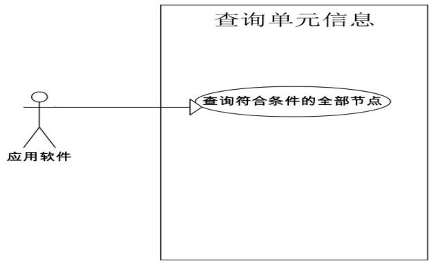
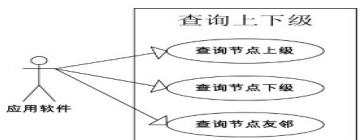
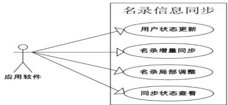

  
图 17 查询单元信息用例图

查询单元信息能力标识见表 49。

表 49 查询单元信息能力标识
<table><tr><td rowspan=1 colspan=1>序号</td><td rowspan=1 colspan=1>Use case名称</td><td rowspan=1 colspan=1>项目唯一标识符</td><td rowspan=1 colspan=1>需求描述</td><td rowspan=1 colspan=1>需求重用</td><td rowspan=1 colspan=1>方式名称</td><td rowspan=1 colspan=1>运行状态</td><td rowspan=1 colspan=1>对应的任务书功能/性能</td></tr><tr><td rowspan=1 colspan=1>1</td><td rowspan=1 colspan=1>查询符合条件的全部节点</td><td rowspan=1 colspan=1>PZXQ-GN-MLXXCX-CXZHDY-CXQBJD</td><td rowspan=1 colspan=1>能够根据属性名、属性值查询全部符合条件的节点。</td><td rowspan=1 colspan=1>沿用</td><td rowspan=1 colspan=1>桌面版平板版手持版</td><td rowspan=1 colspan=1>运行阶段</td><td rowspan=1 colspan=1>4.1.2c</td></tr></table>

## 3.2.2.3.1 查 询 符 合 条 件 的 全 部 节 点 （ PZXQ-GN-MLXXCX-CXZHDY-CXQBJD）

能够根据属性名、属性值查询全部符合条件的节点。查询符合条件的全部节点用例场景说明见表 50。

表 50查询符合条件的全部节点用例场景说明
<table><tr><td>Use Case 名称：查询符合条件 的全部节点</td><td colspan="2">Actors:应用软件</td></tr><tr><td colspan="3">概述：能够根据属性名、属性值查询全部符合条件的节点</td></tr><tr><td colspan="3" rowspan="1">前置条件：名录服务正常运行</td></tr><tr><td colspan="3" rowspan="1">主事件流</td></tr><tr><td colspan="1" rowspan="1">Actor 的动作</td><td colspan="1" rowspan="1">系统的动作</td><td colspan="1" rowspan="1">动作约束(性能、可靠性、容错等)</td></tr><tr><td colspan="1" rowspan="1">1.应用软件调用查询单元信息接口，传入属性名及属性值查询满足条件的单元信息；</td><td colspan="1" rowspan="1">2.名录服务查询满足条件的单元唯一标识，并将查询结果返回给应用软件；如查询失败，则执行异常流E1；</td><td colspan="1" rowspan="1"></td></tr><tr><td colspan="3" rowspan="1">异常流E1：返回查询失败及失败原因，日志记录失败原因。</td></tr><tr><td colspan="3" rowspan="1">后置条件：无</td></tr></table>

3.2.2.4 查询本地信息（PZXQ-GN-MLXXCX-CXBDXX）

能够查询本地节点信息，即本地登录的用户信息或当前相关信息。查询本地节点信息用例图如图 18所示。

  
图 18 查询本地信息用例图

查询本地节点信息能力标识见表 51。

表 51查询本地节点信息能力标识
<table><tr><td rowspan=1 colspan=1>序号</td><td rowspan=1 colspan=1>Use case名称</td><td rowspan=1 colspan=1>项目唯一标识符</td><td rowspan=1 colspan=1>需求描述</td><td rowspan=1 colspan=1>需求重用</td><td rowspan=1 colspan=1>方式名称</td><td rowspan=1 colspan=1>运行状态</td><td rowspan=1 colspan=1>对应的任务书功能/性能</td></tr><tr><td rowspan=1 colspan=1>1.</td><td rowspan=1 colspan=1>查询本地用户信息</td><td rowspan=1 colspan=1>PZXQ-GN-MLXXCX-CXBDXX-CXBDYHXX</td><td rowspan=1 colspan=1>能够查询本地登录的用户节点信息。</td><td rowspan=1 colspan=1>沿用</td><td rowspan=1 colspan=1>桌面版平板版手持版</td><td rowspan=1 colspan=1>运行阶段</td><td rowspan=1 colspan=1>4.1.2d</td></tr></table>

## 3.2.2.4.1 查询本地用户信息（PZXQ-GN-MLXXCX-CXBDXX-CXBDYHXX）

能够查询本地节点所属用户节点信息。查询本地用户信息用例场景说明见表 52。

表 52查询本地用户信息用例场景
<table><tr><td rowspan=1 colspan=1>Use Case 名称:查询本地用户信息</td><td rowspan=1 colspan=2>Actors：应用软件</td></tr><tr><td rowspan=1 colspan=3>概述：能够查询本地登录的用户节点信息</td></tr><tr><td rowspan=1 colspan=3>前置条件：名录服务正常运行</td></tr><tr><td rowspan=1 colspan=3>主事件流</td></tr><tr><td rowspan=1 colspan=1>Actor 的动作</td><td rowspan=1 colspan=1>系统的动作</td><td rowspan=1 colspan=1>动作约束(性能、可靠性、容错等)</td></tr><tr><td rowspan=1 colspan=1>1.应用软件调用查询本地用户信息接口，查询本地用户信息</td><td rowspan=1 colspan=1>2.名录服务查询本地用户信息，并将查询结果返回给应用软件；如查询失败，则执行异常流E1。</td><td rowspan=1 colspan=1></td></tr><tr><td rowspan=1 colspan=3>异常流E1：返回查询失败及失败原因，日志记录失败原因。</td></tr><tr><td rowspan=1 colspan=3>后置条件：无</td></tr></table>

3.2.2.5 查询上下级（PZXQ-GN-MLXXCX-CXSXJ）

提供编组关系信息查询功能，支持根据数据唯一标识查询上级、下级、友邻单元信息的功能。查询上下级的用例图如图 19所示。

  
图 19 查询上下级用例图

查询上下级功能能力标识表见表 53。

表 53 查询上下级功能能力标识
<table><tr><td colspan="1" rowspan="1">序号</td><td colspan="1" rowspan="1">Use case名</td><td colspan="1" rowspan="1">项目唯一标识符</td><td colspan="1" rowspan="1">需求描述</td><td colspan="1" rowspan="1">需求重用</td><td colspan="1" rowspan="1">方式名称</td><td colspan="1" rowspan="1">运行阶段</td><td colspan="1" rowspan="1">对应的任务书功能/性能</td></tr><tr><td colspan="1" rowspan="1"></td><td colspan="1" rowspan="1">称</td><td colspan="1" rowspan="1"></td><td colspan="1" rowspan="1"></td><td colspan="1" rowspan="1"></td><td colspan="1" rowspan="1"></td><td colspan="1" rowspan="1"></td><td colspan="1" rowspan="1"></td></tr><tr><td colspan="1" rowspan="1">1.</td><td colspan="1" rowspan="1">查询节点上级</td><td colspan="1" rowspan="1">PZXQ-GN-MLXXCX-CXSXJ-CXJDSJ</td><td colspan="1" rowspan="1">获取上级节点信息。</td><td colspan="1" rowspan="1">沿用</td><td colspan="1" rowspan="1">桌面版平板版手持版</td><td colspan="1" rowspan="1">运行阶段</td><td colspan="1" rowspan="1">4.1.2d</td></tr><tr><td colspan="1" rowspan="1">2.</td><td colspan="1" rowspan="1">查询节点下级</td><td colspan="1" rowspan="1">PZXQ-GN-MLXXCX-CXSXJ-CXJDXJ</td><td colspan="1" rowspan="1">获取所有下级节点信息</td><td colspan="1" rowspan="1">沿用</td><td colspan="1" rowspan="1">桌面版平板版手持版</td><td colspan="1" rowspan="1">运行阶段</td><td colspan="1" rowspan="1">4.1.2d</td></tr><tr><td colspan="1" rowspan="1">3.</td><td colspan="1" rowspan="1">查询节点友邻</td><td colspan="1" rowspan="1">PZXQ-GN-MLXXCX-CXSXJ-CXJDYL</td><td colspan="1" rowspan="1">获取所有友邻节点信息</td><td colspan="1" rowspan="1">沿用</td><td colspan="1" rowspan="1">桌面版平板版手持版</td><td colspan="1" rowspan="1">运行阶段</td><td colspan="1" rowspan="1">4.1.2d</td></tr></table>

3.2.2.5.1 查 询 节 点 上 级 （ PZXQ-GN-MLXXCX-CXSXJ-CXJDSJ）  
能够查询上级节点信息，查询节点上级用例图如图 20所示。

  
图 20查询节点上级用例图  
查询节点上级能力标识见表 54。

表 54查询节点上级能力标识
<table><tr><td rowspan=1 colspan=1>序号</td><td rowspan=1 colspan=1>Use case名称</td><td rowspan=1 colspan=1>项目唯一标识符</td><td rowspan=1 colspan=1>需求描述</td><td rowspan=1 colspan=1>需求重用</td><td rowspan=1 colspan=1>方式名称</td><td rowspan=1 colspan=1>运行状态</td><td rowspan=1 colspan=1>对应的任务书功能/性能</td></tr><tr><td rowspan=1 colspan=1>1.</td><td rowspan=1 colspan=1>查询上级用户信息</td><td rowspan=1 colspan=1>PZXQ-GN-MLXXCX-CXSXJ-CXJDSJ-CXSJYHXX</td><td rowspan=1 colspan=1>能够查询上级用户节点信息。</td><td rowspan=1 colspan=1>沿用</td><td rowspan=1 colspan=1>桌面版平板版手持版</td><td rowspan=1 colspan=1>运行阶段</td><td rowspan=1 colspan=1>4.1.2d</td></tr></table>

3.2.2.5.1.1 查询上级用户信息（PZXQ-GN-MLXXCX-CXSXJ-CXJDSJ-CXSJYHXX）

能够查询上级用户节点信息。查询上级用户信息用例场景说明见表 55。

表 55查询上级用户信息用例场景
<table><tr><td rowspan=1 colspan=1>Use Case 名称:查询上级用户信息</td><td rowspan=1 colspan=2>Actors：应用软件</td></tr><tr><td rowspan=1 colspan=3>概述：能够查询上级所属用户节点信息</td></tr><tr><td rowspan=1 colspan=3>前置条件：名录服务正常运行</td></tr><tr><td rowspan=1 colspan=3>主事件流</td></tr><tr><td rowspan=1 colspan=1>Actor的动作</td><td rowspan=1 colspan=1>系统的动作</td><td rowspan=1 colspan=1>动作约束（性能、可靠性、容错等）</td></tr><tr><td rowspan=1 colspan=1>1.应用软件调用查询上级用户信息接口，查询上级用户信息</td><td rowspan=1 colspan=1>2.名录服务查询上级用户信息，并将查询结果返回给应用软件；如查询失败，则执行异常流E1；</td><td rowspan=1 colspan=1></td></tr><tr><td rowspan=1 colspan=3>异常流E1：返回查询失败及失败原因，日志记录失败原因。</td></tr><tr><td rowspan=1 colspan=3>后置条件：无</td></tr></table>

## 3.2.2.5.2 查 询 节 点 下 级 （ PZXQ-GN-MLXXCX-CXSXJ-CXJDXJ）

能够查询下级节点信息，查询节点下级用例图如图 21所示。

  
图 21查询节点下级用例图

查询节点下级能力标识见表 56。

表 56查询节点下级能力标识
<table><tr><td rowspan=1 colspan=1>序号</td><td rowspan=1 colspan=1>Use case名称</td><td rowspan=1 colspan=1>项目唯一标识符</td><td rowspan=1 colspan=1>需求描述</td><td rowspan=1 colspan=1>需求重用</td><td rowspan=1 colspan=1>方式名称</td><td rowspan=1 colspan=1>运行状态</td><td rowspan=1 colspan=1>对应的任务书功能/性能</td></tr><tr><td rowspan=1 colspan=1>1.</td><td rowspan=1 colspan=1>查询</td><td rowspan=1 colspan=1>PZXQ-GN-</td><td rowspan=1 colspan=1>能够查询下级用户节</td><td rowspan=1 colspan=1>沿用</td><td rowspan=1 colspan=1>桌面版</td><td rowspan=1 colspan=1>运行阶段</td><td rowspan=1 colspan=1></td></tr></table>

3.2.2.5.2.1 查询下级用户信息（PZXQ-GN-MLXXCX-CXSXJ-CXJDSJ-CXXJYHXX）

<table><tr><td>信息</td><td>下级 用户</td><td>MLXXCX- CXSXJ- CXJDSJ-C XXJYHXX</td><td>点信息。</td><td></td><td>平板版 手持版</td><td></td><td></td></tr></table>

能够查询下级用户节点信息。查询下级用户信息用例场景说明见表 57。

表 57查询下级用户信息用例场景
<table><tr><td rowspan=1 colspan=1>Use Case 名称:查询下级用户信息</td><td rowspan=1 colspan=2>Actors：应用软件</td></tr><tr><td rowspan=1 colspan=3>概述:能够查询下级所属用户节点信息</td></tr><tr><td rowspan=1 colspan=3>前置条件：名录服务正常运行</td></tr><tr><td rowspan=1 colspan=3>主事件流</td></tr><tr><td rowspan=1 colspan=1>Actor 的动作</td><td rowspan=1 colspan=1>系统的动作</td><td rowspan=1 colspan=1>动作约束(性能、可靠性、容错等)</td></tr><tr><td rowspan=1 colspan=1>1.应用软件调用查询下级用户信息接口，查询下级用户信息</td><td rowspan=1 colspan=1>2. 名录服务查询下级用户信息，并将查询结果返回给应用软件；如查询失败，则执行异常流E1；</td><td rowspan=1 colspan=1></td></tr><tr><td rowspan=1 colspan=3>异常流E1:返回查询失败及失败原因，日志记录失败原因。</td></tr><tr><td rowspan=1 colspan=3>后置条件：无</td></tr></table>

## 3.2.2.5.3 查 询 节 点 友 邻 （ PZXQ-GN-MLXXCX-CXSXJ-CXJDYL）

能够查询友邻节点信息，查询节点友邻用例图如图 22所示。

  
图 22查询节点友邻用例图

查询节点友邻能力标识见表 58。

表 58查询节点友邻能力标识
<table><tr><td rowspan=1 colspan=1>序号</td><td rowspan=1 colspan=1>Use case名称</td><td rowspan=1 colspan=1>项目唯一标识符</td><td rowspan=1 colspan=1>需求描述</td><td rowspan=1 colspan=1>需求重用</td><td rowspan=1 colspan=1>方式名称</td><td rowspan=1 colspan=1>运行状态</td><td rowspan=1 colspan=1>对应的任务书功能/性能</td></tr><tr><td rowspan=1 colspan=1>1.</td><td rowspan=1 colspan=1>查询友邻用户信息</td><td rowspan=1 colspan=1>PZXQ-GN-MLXXCX-CXSXJ-CXJDSJ-CXYLYHXX</td><td rowspan=1 colspan=1>能够查询友邻用户节点信息。</td><td rowspan=1 colspan=1>沿用</td><td rowspan=1 colspan=1>桌面版平板版手持版</td><td rowspan=1 colspan=1>运行阶段</td><td rowspan=1 colspan=1></td></tr></table>

## 3.2.2.5.3.1 查询友邻用户信息（PZXQ-GN-MLXXCX-CXSXJ-CXJDSJ-CXYLYHXX）

能够查询友邻用户节点信息。查询友邻用户信息用例场景说明见表 59。

表 59查询友邻用户信息用例场景
<table><tr><td rowspan=1 colspan=1>Use Case 名称:查询友邻用户信息</td><td rowspan=1 colspan=2>Actors：应用软件</td></tr><tr><td rowspan=1 colspan=3>概述:能够查询友邻所属用户节点信息</td></tr><tr><td rowspan=1 colspan=3>前置条件：名录服务正常运行</td></tr><tr><td rowspan=1 colspan=3>主事件流</td></tr><tr><td rowspan=1 colspan=1>Actor 的动作</td><td rowspan=1 colspan=1>系统的动作</td><td rowspan=1 colspan=1>动作约束(性能、可靠性、容错等)</td></tr><tr><td rowspan=1 colspan=1>1.应用软件调用查询友邻用户信息接口，查询友邻用户信息</td><td rowspan=1 colspan=1>2.名录服务查询友邻用户信息，并将查询结果返回给应用软件；如查询失败，则执行异常流E1；</td><td rowspan=1 colspan=1></td></tr><tr><td rowspan=1 colspan=3>异常流E1：返回查询失败及失败原因，日志记录失败原因。</td></tr><tr><td rowspan=1 colspan=3>后置条件：无</td></tr></table>

## 3.2.3 名录信息同步（PZXQ-GN-MLXXTB）

名录信息同步功能将用户在线状态信息按照既定策略在单元间同步。其用例图如图23所示。

  
图 23 名录信息同步用例图  
名录信息同步功能能力标识见表 60。

表 60 名录信息同步能力标识
<table><tr><td rowspan=1 colspan=1>序号</td><td rowspan=1 colspan=1>Use case名称</td><td rowspan=1 colspan=1>项目唯一标识符</td><td rowspan=1 colspan=1>需求描述</td><td rowspan=1 colspan=1>需求重用</td><td rowspan=1 colspan=1>方式名称</td><td rowspan=1 colspan=1>运行状态</td><td rowspan=1 colspan=1>对应的任务书功能/性能</td></tr><tr><td rowspan=1 colspan=1>1</td><td rowspan=1 colspan=1>用户状态更新</td><td rowspan=1 colspan=1>PZXQ-GN-MLXXTB-YHZTGX</td><td rowspan=1 colspan=1>具备用户上下线管理、登录地址维护更新能力</td><td rowspan=1 colspan=1>新研</td><td rowspan=1 colspan=1>桌面版平板版手持版</td><td rowspan=1 colspan=1>运行阶段</td><td rowspan=1 colspan=1>4.1.3a</td></tr><tr><td rowspan=1 colspan=1>2</td><td rowspan=1 colspan=1>名录增量同步</td><td rowspan=1 colspan=1>PZXQ-GN-MLXXTB-MLZLTB</td><td rowspan=1 colspan=1>具备将编组节点属性信息有变化的部分、用户上线、下线等信息进行增量同步的功能</td><td rowspan=1 colspan=1>新研</td><td rowspan=1 colspan=1>桌面版平板版手持版</td><td rowspan=1 colspan=1>运行阶段</td><td rowspan=1 colspan=1>4.1.3b</td></tr><tr><td rowspan=1 colspan=1>3</td><td rowspan=1 colspan=1>名录局部调整</td><td rowspan=1 colspan=1>PZXQ-GN-MLXXTB-MLJBTZ</td><td rowspan=1 colspan=1>具备将待同步信息同步到相关的上级或下级的功能</td><td rowspan=1 colspan=1>新研</td><td rowspan=1 colspan=1>桌面版平板版手持版</td><td rowspan=1 colspan=1>运行阶段</td><td rowspan=1 colspan=1>4.1.3b</td></tr><tr><td rowspan=1 colspan=1>4</td><td rowspan=1 colspan=1>同步状态查看</td><td rowspan=1 colspan=1>PZXQ-GN-MLXXTB-TBZTCK</td><td rowspan=1 colspan=1>提供名录信息同步状态查看的功能</td><td rowspan=1 colspan=1>沿用</td><td rowspan=1 colspan=1>桌面版平板版手持版</td><td rowspan=1 colspan=1>运行阶段</td><td rowspan=1 colspan=1>4.1.3c</td></tr></table>

3.2.3.1 用户状态更新（PZXQ-GN-MLXXTB-YHZTGX）

具备用户上下线管理、登录地址维护更新能力。用户状态更新功能的用例场景，见表61。

表61用户登录地址维护用例描述

<table><tr><td rowspan=1 colspan=1>Use Case 名称:用户状态更新</td><td rowspan=1 colspan=2>Actors:应用软件</td></tr><tr><td rowspan=1 colspan=3>概述：具备用户上下线管理、登录地址维护更新能力</td></tr><tr><td rowspan=1 colspan=3>前置条件：名录服务正常运行</td></tr><tr><td rowspan=1 colspan=3>主事件流</td></tr><tr><td rowspan=1 colspan=1>Actor 的动作</td><td rowspan=1 colspan=1>系统的动作</td><td rowspan=1 colspan=1>动作约束(性能、可靠性、容错等)</td></tr><tr><td rowspan=1 colspan=1>1.       操作人员登录信息系统3.       操作人员注销登录</td><td rowspan=1 colspan=1>2.       获取用户登录装备信息，更新用户与装备映射关系，更改名录信息中用户在线状态为在线；如无法获取到登录地址，则进入异常流E1；4.       更改名录信息中用户在线状态为离线；如更新失败，则进入异常流E2。</td><td rowspan=1 colspan=1></td></tr><tr><td rowspan=1 colspan=3>异常流E1：不更新用户在线状态，通知操作人员本节点处于未开通状态，并记录日志。异常流E2:记录日志更新用户在线信息失败。</td></tr><tr><td rowspan=1 colspan=3>后置条件：无</td></tr></table>

3.2.3.2 名录增量同步（PZXQ-GN-MLXXTB-TBZLTB）

具备将编组节点属性信息有变化的部分、用户上线、下线等信息进行增量同步的功能。名录属性增量同步用例场景见表 62。

表 62 名录属性增量同步用例场景描述
<table><tr><td colspan="1" rowspan="1">Use Case 名称:名录属性增量同步</td><td colspan="2" rowspan="1">Actors:操作人员</td></tr><tr><td colspan="3" rowspan="1">概述：具备将编组节点属性信息有变化的部分进行增量同步的功能</td></tr><tr><td colspan="3" rowspan="1">前置条件：名录服务正常运行</td></tr><tr><td colspan="3" rowspan="1">主事件流</td></tr><tr><td colspan="1" rowspan="1">Actor 的动作</td><td colspan="1" rowspan="1">系统的动作</td><td colspan="1" rowspan="1">动作约束(性能、可靠性、容错等)</td></tr><tr><td colspan="1" rowspan="1">1.       操作人员通过名录辅助工具对部分节点的属性进行增加、删除或修改操作，并保存</td><td colspan="1" rowspan="1">2.       记录操作人员修改过的信息，并触发属性增量同步操作，将有变化的信息按照内部协议封装成更新数据包后按照同步策略进行发送；如无法发送，</td><td colspan="1" rowspan="1"></td></tr><tr><td colspan="1" rowspan="1"></td><td colspan="1" rowspan="1">则进入异常流E1；</td><td colspan="1" rowspan="1"></td></tr><tr><td colspan="3" rowspan="1">异常流E1：提示操作人员同步不成功，并记录日志。异常流E2:返回同步失败，记录日志。</td></tr><tr><td colspan="3" rowspan="1">后置条件：无</td></tr></table>

3.2.3.3 名录局部调整（PZXQ-GN-MLXXTB-MLJBTZ）

具备将待同步信息同步到相关的上级或下级的功能。名录局部调整用例场景描述见表 63。

表 63名录局部调整用例场景描述
<table><tr><td rowspan=1 colspan=1>Use Case 名称:名录局部调整</td><td rowspan=1 colspan=2>Actors:操作人员</td></tr><tr><td rowspan=1 colspan=3>概述：具备将待同步信息同步到相关的上级或下级的功能</td></tr><tr><td rowspan=1 colspan=3>前置条件：名录服务正常运行</td></tr><tr><td rowspan=1 colspan=3>主事件流</td></tr><tr><td rowspan=1 colspan=1>Actor 的动作</td><td rowspan=1 colspan=1>系统的动作</td><td rowspan=1 colspan=1>动作约束(性能、可靠性、容错等)</td></tr><tr><td rowspan=1 colspan=1>1.      操作人员在名录辅助工具中设置同步模式为局部调整，执行登录或修改属性操作触发同步功能；</td><td rowspan=1 colspan=1>2.       将待同步数据包发送给直属上级、直属下级，收端名录服务接收后对同步数据包进行校验，校验成功则在收端节点进行同步；如校验失败，则进入异常流E1。</td><td rowspan=1 colspan=1></td></tr><tr><td rowspan=1 colspan=3>异常流E1：记录同步失败日志，写明校验失败原因。</td></tr><tr><td rowspan=1 colspan=3>后置条件：无</td></tr></table>

## 3.2.3.4 同步状态查看（PZXQ-GN-MLXXTB-TBZTCK）

提供名录信息同步状态查看的功能。同步状态查看用例场景描述见表 64。

表 64同步状态查看用例场景描述
<table><tr><td rowspan=1 colspan=1>Use Case 名称：同步状态查看</td><td rowspan=1 colspan=2>Actors：操作人员</td></tr><tr><td rowspan=1 colspan=3>概述:提供名录信息同步状态查看的功能</td></tr><tr><td rowspan=1 colspan=3>前置条件：名录服务正常运行</td></tr><tr><td rowspan=1 colspan=3>主事件流</td></tr><tr><td rowspan=1 colspan=1>Actor 的动作</td><td rowspan=1 colspan=1>系统的动作</td><td rowspan=1 colspan=1>动作约束(性能、可靠性、容错等)</td></tr></table>