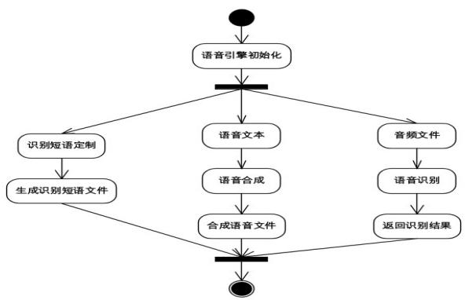
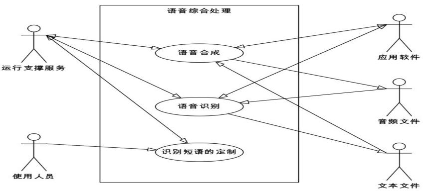
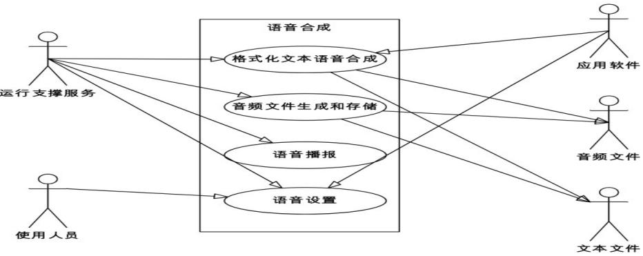
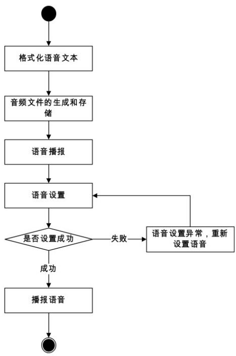
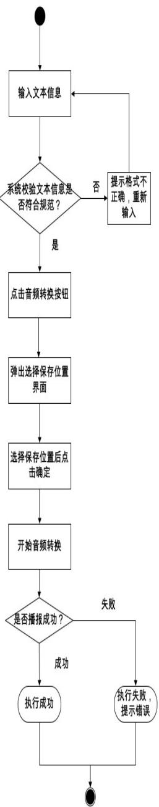

## 目 录

1 范围...  
1.1 标识..  
1.2 系统概述.  
1.3 文档概述.  
2 引用文档..  
3 需求.... ..2  
3.1 要求的状态和方式.. ..2  
3.1.1 软件状态图. ..2  
3.1.2 软件活动图.. ..2  
3.2 CSCI 能力需求. ..3  
3.2.1 语音合成（PZXQ-GN-YYZHCL-YYHC） ..4  
3.2.2 语音识别（PZXQ-GN-YYZHCL-YYSB） ..10  
3.2.3 识别短语定制（PZXQ-GN-YYZHCL-SBDYDZ）. ..15  
3.3 CSCI 外部接口需求. ..20  
3.3.1接口标识和接口图. .20  
3.3.2 与用户的接口（PZXQ-WBJK-YYZHCL-RJJK） ..21  
3.3.3 与应用软件的接口（PZXQ-WBJK-YYZHCL-YYRJ） ..22  
3.3.4 与运行支撑服务的接口（PZXQ-WBJK-YYZHCL-YXZC） .22  
3.3.5 与文件的接口（PZXQ-WBJK-YYZHCL-WJJK） ..22  
3.3.6 与文本的接口（PZXQ-WBJK-YYZHCL-WBJK）. ..22  
3.4 CSCI 内部接口需求. ..23  
3.4.1 接口标识和接口图. ..23  
3.4.2 语音识别与语音合成的接口. .23  
3.4.3 语音合成与语音识别的接口. .. 24  
3.4.4 语音识别与识别短语定制接口. ..24  
3.5 CSCI 内部数据需求. ..24  
3.6 适应性需求. ..25  
3.7 安全性需求. .25  
3.8 保密性需求... ..26  
3.9 CSCI 环境需求. ..26  
3.9.1 运行环境需求. ..26  
3.9.2 开发环境需求. ..27  
3.10 计算机资源需求.. ..27  
3.10.1 计算机硬件需求. .27  
3.10.2 计算机硬件资源利用需求.. ..28  
3.10.3 计算机软件需求. ..28  
3.10.4 计算机通信需求. .28  
3.11 软件质量因素.... ..28  
3.12 设计和构造的约束.. ..29  
3.13 人员需求. ..29  
3.14 培训需求.. ..29  
3.15 软件保障需求.. ..29  
3.16 其他需求. ..30  
3.17 验收、交付和包装需求. ...30  
3.18 需求的优先顺序和关键性.. ...30  
4 合格性规定.. ..31  
5 需求可追踪性.. ..33  
6 注释.. ..36

## 1 范围

## 1.1 标识

a) 本文档已被批准的标识号： $\mathsf { A } Z _ { 6 9 3 } 2 . 4 9 0 . 0 1 1 2 \mathsf { S } \mathsf { R } \mathsf { S }$

b) 本文档所适用的软件名称为：语音综合处理；

c) 本文档的版本号为：V1.00.03/2020 年 06 月 25 日；

d) 本文档所适用的软件所属系统为：某级信息系统软件。

## 1.2 系统概述

某级信息系统软件按照国产自主可控要求，进行基础软件环境选型，以及应用软件的新研和国产化迁移改造，对功能要素分散、流程独立的业务功能进行整合优化，研制适应不同使用需求、使用场景的软件，实现信息系统软件的融合、型谱优化和业务提能，推动某信息系统软件向“国产化、服务化、轻量化”方向发展。

某信息服务环境软件是某信息系统软件的重要组成，是连接底层各类硬件信息基础设施与上层各种应用系统的桥梁，通过基础平台融合汇聚底层资源，规范技术体制、支撑体系运行、促进互通互联等，是支撑构建某信息系统的重要支撑，其软件主要部署运行在各级机构的信息处理设备上，提供系统运维、数据运维、信息传输、信息处理、信息展现等功能，支撑应用软件和用户完成开发、集成、运维、运行全流程的使用。

语音综合处理提供桌面版、平板版、手持版形态的软件，主要完成语音合成和语音识别功能，支持识别短语定制功能。其中，语音合成功能满足使用人员在运行阶段的使用需求，能够实现格式化文本合成音频文件和语音播报；语音识别功能满足使用人员在运行阶段的使用需求，能够实现语音录入和特定短语识别；识别短语定制功能满足集成人员和使用人员在集成阶段和运行阶段的使用需求，支持用于进行识别短语的定制。

## 1.3 文档概述

在本文档中，第2章列出了本文档中引用的其它文档的信息，第3章详细描述了界面集成框架的各种需求以及实现方式，第4章规定了确认第3章各项需求正确实现的合格性验证方法，第5章描述本文档列出的各项需求与相应的系统需求规格说明文档列出的需求的对应关系。其中，第3章是本文档的主要部分。

## 2 引用文档

本文档的引用文档见表1。

表1 引用文档

<table><tr><td rowspan=1 colspan=1>文档编号</td><td rowspan=1 colspan=1>标题</td><td rowspan=1 colspan=1>修订版本</td><td rowspan=1 colspan=1>修订日期</td><td rowspan=1 colspan=1>编写单位</td></tr><tr><td rowspan=1 colspan=1>GJB 438B-2009</td><td rowspan=1 colspan=1>《军用软件开发文档编制规范》</td><td rowspan=1 colspan=1>一</td><td rowspan=1 colspan=1>2009年5月</td><td rowspan=1 colspan=1>总装备部</td></tr><tr><td rowspan=1 colspan=1>GJB 439A-2013</td><td rowspan=1 colspan=1>《军品软件质量保证通用要求》</td><td rowspan=1 colspan=1></td><td rowspan=1 colspan=1>2013年7月</td><td rowspan=1 colspan=1>国防科学技术工业委员会</td></tr><tr><td rowspan=1 colspan=1>GJB 450A-2004</td><td rowspan=1 colspan=1>《装备可靠性工作通用要求》</td><td rowspan=1 colspan=1>一</td><td rowspan=1 colspan=1>2004年7月</td><td rowspan=1 colspan=1>总装备部</td></tr><tr><td rowspan=1 colspan=1>GJB 2786A-2009</td><td rowspan=1 colspan=1>《军用软件开发通用要求》</td><td rowspan=1 colspan=1></td><td rowspan=1 colspan=1>2009年5月</td><td rowspan=1 colspan=1>总装备部</td></tr><tr><td rowspan=1 colspan=1>GJB 5235-2004</td><td rowspan=1 colspan=1>《军用软件配置管理》</td><td rowspan=1 colspan=1></td><td rowspan=1 colspan=1>2004年9月</td><td rowspan=1 colspan=1>总装备部</td></tr></table>

## 3 需求

## 3.3 要求的状态和方式

语音综合处理软件包括语音合成、语音识别和识别短语定制三个模块。语音综合处理运行在便携式计算机、携行作业设备、便携式计算机（国产化）、综合信息终端等目标使用环境。

## 3.1.1 软件状态图

语音综合处理软件状态图有多个运行状态，包括开发阶段、集成阶段、运行阶段；支持多种方式，包括桌面、平板、手持。

## 3.1.2 软件活动图

语音综合处理软件活动图如图1所示。

## 图1 语音综合处理软件活动图

## 3.2 CSCI 能力需求

语音综合处理软件按照其功能需求，包含语音合成、语音识别、识别短语的定制的功能，见图2所示。

  
图2 语音综合处理软件功能图  
语音综合处理软件用例图，如图3所示。

  
图3 语音综合处理软件用例图  
语音综合处理软件所有能力标识表，见表2。  
表2 语音综合处理软件所有能力标识

<table><tr><td rowspan=1 colspan=1>序号</td><td rowspan=1 colspan=1>Usecase 名称</td><td rowspan=1 colspan=1>项目唯一标识符</td><td rowspan=1 colspan=1>需求描述</td><td rowspan=1 colspan=1>需求重用</td><td rowspan=1 colspan=1>方式名称</td><td rowspan=1 colspan=1>运行状态</td><td rowspan=1 colspan=1>对应的任务书功能/性能</td></tr><tr><td rowspan=1 colspan=1>1</td><td rowspan=1 colspan=1>语音合成</td><td rowspan=1 colspan=1>PZXQ-GN-YYZHCL-YYHC</td><td rowspan=1 colspan=1>提供格式化文本信息向语音信息转换的语音合成功能，能够实现根据标点停顿；提供音频文件生成和存储功能，能够将合成的语音转换成 wav 格式音频文件进行记录和存储；提供语音播报功能，能够对本地 wav 音频和合成的 wav音频进行播报；提供语音设置功能，可进行人声选择（男声、女声)，进行语音播报开启、关闭设置；</td><td rowspan=1 colspan=1>新研</td><td rowspan=1 colspan=1>手持、桌面、平板</td><td rowspan=1 colspan=1>运行阶段</td><td rowspan=1 colspan=1>4.1.1</td></tr><tr><td rowspan=1 colspan=1>2</td><td rowspan=1 colspan=1>语音识别</td><td rowspan=1 colspan=1>PZXQ-GN-YYZHCL-YYSB</td><td rowspan=1 colspan=1>提供语音录入功能，能够将语音信息转换为 wav 格式音频文件；提供语音转换为短语文本的功能，实现在无网络连接的情况下特定格式语音向短语文本的转换；对语音转换成的文本格式进行规范化定义，实现格式化输出。</td><td rowspan=1 colspan=1>无</td><td rowspan=1 colspan=1>手持、桌面、平板</td><td rowspan=1 colspan=1>运行阶段</td><td rowspan=1 colspan=1>4.1.24.2 a)</td></tr><tr><td rowspan=1 colspan=1>3</td><td rowspan=1 colspan=1>识别短语定制</td><td rowspan=1 colspan=1>PZXQ-GN-YYZHCL-SBDYDZ</td><td rowspan=1 colspan=1>提供识别短语的管理功能，支持用户按照需求进行识别短语的配置和扩展；提供识别短语语法文件的生成功能，依据语法规则构建用于语言解码的 BNF文件；支持本地特定识别短语数不小于200条。</td><td rowspan=1 colspan=1>无</td><td rowspan=1 colspan=1>桌面</td><td rowspan=1 colspan=1>集成阶段、运行阶段</td><td rowspan=1 colspan=1>4.1.34.2 b )</td></tr></table>

## 3.2.1 语音合成（PZXQ-GN-YYZHCL-YYHC）

语音合成的主要功能包括：格式化文本语音合成、音频文件生成和存储、语音播报、语音设置，功能用例如图4所示。

  
图4 语音合成用例图  
语音合成所有能力标识表，见表3。

表3 语音合成能力标识
<table><tr><td rowspan=1 colspan=1>序号</td><td rowspan=1 colspan=1>Usecase名称</td><td rowspan=1 colspan=1>项目唯一标识符</td><td rowspan=1 colspan=1>需求描述</td><td rowspan=1 colspan=1>需求重用</td><td rowspan=1 colspan=1>方式名称</td><td rowspan=1 colspan=1>运行状态</td><td rowspan=1 colspan=1>对应的任务书功能/性能</td></tr><tr><td rowspan=1 colspan=1>1</td><td rowspan=1 colspan=1>格式化文本语音合成</td><td rowspan=1 colspan=1>PZXQ-GN-YYZHCL-YYHC-GSHWBYYHC</td><td rowspan=1 colspan=1>提供格式化文本信息向语音信息转换的语音合成功能</td><td rowspan=1 colspan=1>新研</td><td rowspan=1 colspan=1>桌面、平板、手持</td><td rowspan=1 colspan=1>运行阶段</td><td rowspan=1 colspan=1>4.1.1a)</td></tr><tr><td rowspan=1 colspan=1>2</td><td rowspan=1 colspan=1>音频文件生成和存储</td><td rowspan=1 colspan=1>PZXQ-GN-YYZHCL-YYHC-YPWJSCHCC</td><td rowspan=1 colspan=1>能够将合成的语音转换成wav 格式音频文件进行记录和存储</td><td rowspan=1 colspan=1>新研</td><td rowspan=1 colspan=1>桌面、平板、手持</td><td rowspan=1 colspan=1>运行阶段</td><td rowspan=1 colspan=1>4.1.1b)</td></tr><tr><td rowspan=1 colspan=1>3</td><td rowspan=1 colspan=1>语音播报</td><td rowspan=1 colspan=1>PZXQ-GN-YYZHCL-YYHC-YYBB</td><td rowspan=1 colspan=1>能够对本地 wav 音频和合成的 wav 音频进行播报</td><td rowspan=1 colspan=1>新研</td><td rowspan=1 colspan=1>桌面、平板、手持</td><td rowspan=1 colspan=1>运行阶段</td><td rowspan=1 colspan=1>4.1.1c)</td></tr><tr><td rowspan=1 colspan=1>4</td><td rowspan=1 colspan=1>语音设置</td><td rowspan=1 colspan=1>PZXQ-GN-YYZHCL-YYHC-YYSZ</td><td rowspan=1 colspan=1>可进行人声选择(男声、女声），进行语音播报开启、关闭设置</td><td rowspan=1 colspan=1>新研</td><td rowspan=1 colspan=1>桌面、平板、手持</td><td rowspan=1 colspan=1>运行阶段</td><td rowspan=1 colspan=1>4.1.1d)</td></tr></table>

语音合成流程图如图 5所示。

  
图 5 语音合成流程图

## 3.2.1.1 格式化文本语音合成（PZXQ-GN-YYZHCL-YYHC-GSHWBYYHC）

用户进行格式化语音文本合成的用例场景，见表4。

表4 格式化文本语音合成用例描述
<table><tr><td colspan="1" rowspan="1">Use Case 名称:格式化文本语音合成</td><td colspan="2" rowspan="1">Actors：使用人员</td></tr><tr><td colspan="3" rowspan="1">概述：本用例是语音综合处理的格式化文本语音合成用例，描述用户使进行格式化文本信息语音合成的过程。</td></tr><tr><td colspan="3" rowspan="1">前置条件：无。</td></tr><tr><td colspan="3" rowspan="1">主事件流</td></tr><tr><td colspan="1" rowspan="1">Actor 的动作</td><td colspan="1" rowspan="1">系统的动作</td><td colspan="1" rowspan="1">动作约束(性能、可靠性、容错等)</td></tr><tr><td colspan="1" rowspan="1">2.用户在界面上选择或输入格式化文本</td><td colspan="1" rowspan="1">1.系统初始化语音合成引擎，开始加载资源文件</td><td colspan="1" rowspan="1"></td></tr><tr><td colspan="1" rowspan="1">信息；5.用户点击语音转换按钮</td><td colspan="1" rowspan="1">3.系统接收格式化文本信息；4.系统检测文本信息是否符合规范，若不符合格式化规范返回错误，执行异常流E1;6.系统开始根据文本信息进行语音转换，并按照默认语音风格进行语音播放，根据标点进行停顿；若转换失败，执行异常流 E2；</td><td colspan="1" rowspan="1"></td></tr><tr><td colspan="2" rowspan="1">异常流E1：系统提示格式化文本不符合规范，需重新输入；</td><td colspan="1" rowspan="1"></td></tr><tr><td colspan="2" rowspan="1">异常流E2：系统提示格式化文本转语音失败，用例结束。</td><td colspan="1" rowspan="1"></td></tr><tr><td colspan="2" rowspan="1">后置条件：生成wav格式的音频文件。</td><td colspan="1" rowspan="1"></td></tr></table>

## 3.2.1.2 音频文件生成和存储（PZXQ-GN-YYZHCL-YYHC-YPWJSCHCC）

用户进行音频文件生成和存储的用例场景，见表 5。

表 5音频文件生成和存储用例描述
<table><tr><td colspan="1" rowspan="1">Use Case 名称：音频文件生成和存储</td><td colspan="2" rowspan="1">Actors：使用人员</td></tr><tr><td colspan="3" rowspan="1">概述：本用例是语音综合处理的音频文件生成和存储用例，描述用户将合成的语音信息生成音频文件并存储的过程。</td></tr><tr><td colspan="3" rowspan="1">前置条件：无。</td></tr><tr><td colspan="3" rowspan="1">主事件流</td></tr><tr><td colspan="1" rowspan="1">Actor 的动作</td><td colspan="1" rowspan="1">系统的动作</td><td colspan="1" rowspan="1">动作约束(性能、可靠性、容错等)</td></tr><tr><td colspan="1" rowspan="1">1.用户在界面上选择或输入格式化文本信息；4.用户点击音频文件转换按钮6.用户选择文件保存位置，点击确定</td><td colspan="1" rowspan="1">2.系统接收格式化文本信息；3.系统检测文本信息是否符合规范，若不符合格式化规范返回错误，执行异常流E1；5.弹出选择音频文件保存路径的界面7.系统开始音频转换，若错误，执行异常流 E2</td><td colspan="1" rowspan="1"></td></tr><tr><td colspan="2" rowspan="1">异常流E1：系统提示格式化文本不符合规范，需重新输入；</td><td colspan="1" rowspan="1"></td></tr><tr><td colspan="2">异常流E2：系统提示音频文件转换失败，用例结束。</td><td></td></tr><tr><td colspan="2">后置条件：生成 wav格式的音频文件。</td><td></td></tr></table>

音频文件生成和存储用例流程图如图6所示：

  
图6 音频文件生成和存储用例流程图

## 3.2.1.3 语音播报（PZXQ-GN-YYZHCL-YYHC-YYBB）

语音播报的用例场景，见表6。

表6 语音播报用例描述