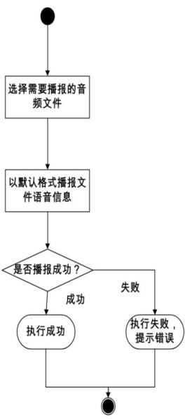
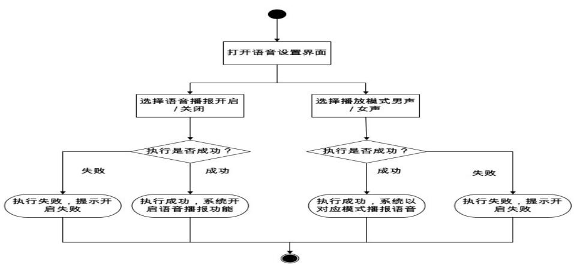
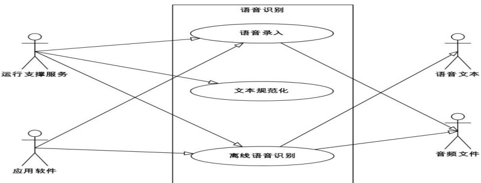
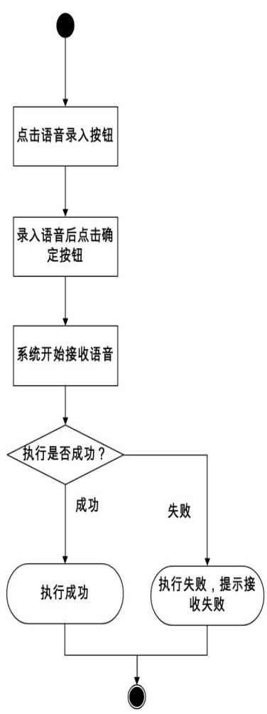
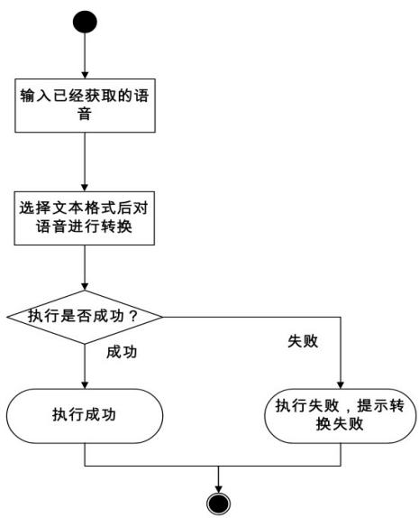
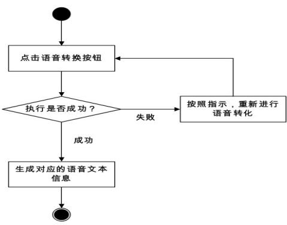
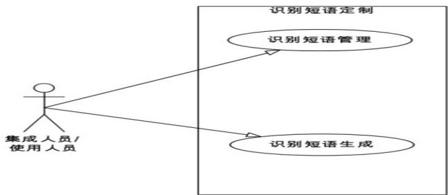

<table><tr><td rowspan=1 colspan=1>Use Case 名称：语音播报</td><td rowspan=1 colspan=2>Actors：使用人员</td></tr><tr><td rowspan=1 colspan=3>概述：本用例是语音综合处理的语音播报用例，描述用户对本地音频文件进行语音播报的过程。</td></tr><tr><td rowspan=1 colspan=3>前置条件：语音播报功能开启，wav格式的音频文件</td></tr><tr><td rowspan=1 colspan=3>主事件流</td></tr><tr><td rowspan=1 colspan=1>Actor 的动作</td><td rowspan=1 colspan=1>系统的动作</td><td rowspan=1 colspan=1>动作约束(性能、可靠性、容错等)</td></tr><tr><td rowspan=1 colspan=1>1.用户在界面选择需要语音播报的 wav格式的音频文件</td><td rowspan=1 colspan=1>2.系统以默认语音模式开始播报音频文件的语音信息，如果播放失败，执行异常流E1</td><td rowspan=1 colspan=1></td></tr><tr><td rowspan=1 colspan=2>异常流E1：系统提示播报失败，用例结束。</td><td rowspan=1 colspan=1></td></tr><tr><td rowspan=1 colspan=2>后置条件：无。</td><td rowspan=1 colspan=1></td></tr></table>

语音播报用例流程图如图7所示：

  
图7 语音播报用例流程图

## 3.2.1.4 语音设置（PZXQ-GN-YYZHCL-YYHC-YYSZ）

语音设置的用例场景，见表7。

表7 语音设置用例描述
<table><tr><td rowspan=1 colspan=1>Use Case 名称:语音设置</td><td rowspan=1 colspan=2>Actors：使用人员</td></tr><tr><td rowspan=1 colspan=3>概述：本用例是语音综合处理的语音设置用例，描述用户在语音播放过程中进行语音设置的过程。</td></tr><tr><td rowspan=1 colspan=3>前置条件：无。</td></tr><tr><td rowspan=1 colspan=3>主事件流</td></tr><tr><td rowspan=1 colspan=1>Actor 的动作</td><td rowspan=1 colspan=1>系统的动作</td><td rowspan=1 colspan=1>动作约束(性能、可靠性、容错等)</td></tr><tr><td rowspan=1 colspan=1>1.用户在主界面打开语音设置页面3.选择语音播报开启/关闭单选框5.人声选择单选框中选择男声/女声</td><td rowspan=1 colspan=1>2.弹出语音设置界面4.系统会根据单选框状态开启或关闭语音播报功能，若开启/关闭失败，执行异常流E16.系统根据单选框内容在语音播报时通过男声/女声进行播报，若设置失败，执行异常流 E2</td><td rowspan=1 colspan=1></td></tr><tr><td rowspan=1 colspan=2>异常流E1：系统提示开启/关闭失败</td><td rowspan=1 colspan=1></td></tr><tr><td rowspan=1 colspan=2>异常流E2：系统提示执行失败</td><td rowspan=1 colspan=1></td></tr><tr><td rowspan=1 colspan=2>后置条件：无。</td><td rowspan=1 colspan=1></td></tr></table>

语音设置用例流程图如图 8所示：

图 8语音设置用例流程图

## 3.2.2 语音识别（PZXQ-GN-YYZHCL-YYSB）

语音识别的主要功能包括：语音录入、文本规范化、离线语音识别，功能用例如图 9所示。

  
图 9语音识别用例图

语音识别所有能力标识表，见表 8表 8。

表 8语音识别能力标识
<table><tr><td rowspan=1 colspan=1>序号</td><td rowspan=1 colspan=1>Usecase名称</td><td rowspan=1 colspan=1>项目唯一标识符</td><td rowspan=1 colspan=1>需求描述</td><td rowspan=1 colspan=1>需求重用</td><td rowspan=1 colspan=1>方式名称</td><td rowspan=1 colspan=1>运行状态</td><td rowspan=1 colspan=1>对应的任务书功能/性能</td></tr><tr><td rowspan=1 colspan=1>1</td><td rowspan=1 colspan=1>语音录入</td><td rowspan=1 colspan=1>PZXQ-GN-YYZHCL-YYSB-YYLR</td><td rowspan=1 colspan=1>提供语音录入的功能</td><td rowspan=1 colspan=1>新研</td><td rowspan=1 colspan=1>桌面、平板、手持</td><td rowspan=1 colspan=1>运行阶段</td><td rowspan=1 colspan=1>4.1.2a)</td></tr><tr><td rowspan=1 colspan=1>2</td><td rowspan=1 colspan=1>文本规范化</td><td rowspan=1 colspan=1>PZXQ-GN-YYZHCL-YYSB-WBGFH</td><td rowspan=1 colspan=1>对语音转换成的文本格式进行规范化定义，实现格式化输出</td><td rowspan=1 colspan=1>新研</td><td rowspan=1 colspan=1>桌面、平板、手持</td><td rowspan=1 colspan=1>运行阶段</td><td rowspan=1 colspan=1>4.1.2c)</td></tr><tr><td rowspan=1 colspan=1>3</td><td rowspan=1 colspan=1>离线语音识别</td><td rowspan=1 colspan=1>PZXQ-GN-YYZHCL-YYSB-LXYYSB</td><td rowspan=1 colspan=1>支持离线条件下实时语音识别</td><td rowspan=1 colspan=1>新研</td><td rowspan=1 colspan=1>桌面、平板、手持</td><td rowspan=1 colspan=1>运行阶段</td><td rowspan=1 colspan=1>4.1.2b)</td></tr></table>

语音识别用例图如图 10所示。

  
图 10 语音识别流程图

## 3.2.2.1 语音录入（PZXQ-GN-YYZHCL-YYSB-YYLR）

用户进行语音录入的用例场景，见表9。

表9 语音录入用例描述
<table><tr><td rowspan=1 colspan=1>Use Case 名称:语音录入</td><td rowspan=1 colspan=2>Actors：使用人员</td></tr><tr><td rowspan=1 colspan=3>概述：本用例是语音综合处理的语音录入用例，描述用户进行语音录入的过程。</td></tr><tr><td rowspan=1 colspan=3>前置条件：无。</td></tr><tr><td rowspan=1 colspan=3>主事件流</td></tr><tr><td rowspan=1 colspan=1>Actor 的动作</td><td rowspan=1 colspan=1>系统的动作</td><td rowspan=1 colspan=1>动作约束(性能、可靠性、容错等)</td></tr><tr><td rowspan=1 colspan=1>1.用户在界面点击语音录入按钮3.用户对着话筒开始录入语音，完成后点击确定按钮</td><td rowspan=1 colspan=1>2.系统出现开始接收语音的界面4.系统提示接收成功；若接收失败，执行异常流E15.系统生成 wav 格式的音频文件保存到指定位置</td><td rowspan=1 colspan=1></td></tr></table>

<table><tr><td>异常流E1:系统提示接收语音失败；</td><td></td></tr><tr><td>后置条件：生成 wav格式的音频文件。</td><td></td></tr></table>

用户执行语音录入用例流程图如图11所示：

  
图11 语音录入用例流程图

## 3.2.2.2 离线语音识别（PZXQ-GN-YYZHCL-YYSB-LXYYSB）

用户离线条件下语音识别的用例场景，见表 10。

表 10离线语音识别用例描述
<table><tr><td>Use Case 名称：离线语音识别</td><td colspan="2">Actors：使用人员</td></tr><tr><td colspan="3">概述：本用例是语音综合处理的离线语音识别的用例，描述用户在离线环境下进行语音识别的过程。</td></tr><tr><td colspan="3">前置条件：识别短语已配置</td></tr><tr><td colspan="3">主事件流</td></tr><tr><td>Actor 的动作</td><td>系统的动作</td><td>动作约束 (性能、可靠性、容错等)</td></tr><tr><td>1. 离线条件下.用户在界面点击语音录 入按钮</td><td></td><td></td></tr><tr><td rowspan="2">3. 用户对着话筒开始录入语音，完成后 点击确定按钮</td><td>2. 系统出现开始接收语音的界面</td><td></td></tr><tr><td>4. 系统提示接收成功；若接收失败，执 行异常流E1</td><td></td></tr><tr><td>5. 用户点击语音转换按钮</td><td>6. 系统出现将录入的语音转为指定格式 化文本；如果转换失败，执行异常流E2</td><td></td></tr><tr><td>7. 离线条件下，用户在界面点击语音录 入按钮</td><td>8. 系统出现开始接收语音的界面</td><td></td></tr><tr><td>9. 用户对着话筒开始录入语音，完成后 点击确定按钮</td><td>10. 系统提示接收成功；若接收失败，执 行异常流E1</td><td></td></tr><tr><td>11. 用户点击语音转换按钮 流E2</td><td>12. 系统出现将录入的语音转为指定格式 化文本信息；如果转换失败，执行异常</td><td></td></tr><tr><td>13. 离线条件下.用户在界面点击语音 录入按钮</td><td>14. 系统出现开始接收语音的界面</td><td></td></tr><tr><td>15. 用户对着话筒开始录入语音，完成 后点击确定按钮</td><td>16. 系统提示接收成功；若接收失败，执</td><td></td></tr><tr><td rowspan="2">17. 用户点击语音转换按钮</td><td>行异常流E1 18. 系统出现将录入的语音转为指定格式</td><td></td></tr><tr><td>化文本信息；如果转换失败，执行异常</td><td></td></tr><tr><td colspan="2">流E2 异常流E1:系统提示语音接收失败，需重新录入 异常流E2：系统提示语音转换失败，用例结束</td><td></td></tr><tr><td colspan="2">后置条件：无。</td><td></td></tr><tr><td colspan="2"></td><td></td></tr></table>

离线语音识别用例流程图如图12所示：

  
图12 离线语音识别用例流程图

## 3.2.2.3 文本规范化（PZXQ-GN-YYZHCL-YYSB-WBGFH）

用户将语音转为固定格式的文本用例场景，见表11。

表11 文本规范化用例描述
<table><tr><td rowspan=1 colspan=1>Use Case 名称:文本规范化</td><td rowspan=1 colspan=2>Actors：使用人员</td></tr><tr><td rowspan=1 colspan=3>概述：本用例是语音综合处理的文本规范化用例，描述用户将录入语音转化固定格式文本信息的过程。</td></tr><tr><td rowspan=1 colspan=3>前置条件：用户已经完成语音录入操作，识别短语已配置</td></tr><tr><td rowspan=1 colspan=3>主事件流</td></tr><tr><td rowspan=1 colspan=1>Actor 的动作</td><td rowspan=1 colspan=1>系统的动作</td><td rowspan=1 colspan=1>动作约束(性能、可靠性、容错等)</td></tr><tr><td rowspan=1 colspan=1>1. 使用人员在成功录入语音后，选择文本格式后点击语音转换按钮</td><td rowspan=1 colspan=1>2.系统出现将录入的语音转为指定格式化数据信息；如果转换失败，执行异常流E1</td><td rowspan=1 colspan=1>输出在界面显示</td></tr></table>

<table><tr><td>异常流E1：系统提示转换失败，用例结束</td><td></td></tr><tr><td>后置条件：无。</td><td></td></tr></table>

文本规范化用例示意图如图13所示：

  
图13 文本规范化用例流程图

## 3.2.3 识别短语定制（PZXQ-GN-YYZHCL-SBDYDZ）

识别短语定制的主要功能包括：识别短语管理、识别短语生成，功能用例如图14所示。

  
图14 识别短语定制功能用例图  
识别短语定制所有能力标识表，见表12。

表12 识别短语定制能力标识
<table><tr><td rowspan=1 colspan=1>序号</td><td rowspan=1 colspan=1>Usecase名称</td><td rowspan=1 colspan=1>项目唯一标识符</td><td rowspan=1 colspan=1>需求描述</td><td rowspan=1 colspan=1>需求重用</td><td rowspan=1 colspan=1>方式名称</td><td rowspan=1 colspan=1>运行状态</td><td rowspan=1 colspan=1>对应的任务书功能/性能</td></tr><tr><td rowspan=1 colspan=1>1</td><td rowspan=1 colspan=1>识别短语管理</td><td rowspan=1 colspan=1>PZXQ-GN-YYZHCL-YYSB-SBDYGL</td><td rowspan=1 colspan=1>提供识别短语的管理功能，支持用户按照需求进行识别短语的配置和扩展</td><td rowspan=1 colspan=1>新研</td><td rowspan=1 colspan=1>桌面</td><td rowspan=1 colspan=1>集成阶段、运行阶段</td><td rowspan=1 colspan=1>4.1.3a)</td></tr><tr><td rowspan=1 colspan=1>2</td><td rowspan=1 colspan=1>识别短语生成</td><td rowspan=1 colspan=1>PZXQ-GN-YYZHCL-YYSB-SBDYSC</td><td rowspan=1 colspan=1>依据语法规则构建用于语言解码的 BNF 文件</td><td rowspan=1 colspan=1>新研</td><td rowspan=1 colspan=1>桌面</td><td rowspan=1 colspan=1>集成阶段、运行阶段</td><td rowspan=1 colspan=1>4.1.3b)</td></tr></table>

识别短语定制流程图如图 15所示。

  
图 15 语音短语识别流程图

## 3.2.3.1 识别短语管理（PZXQ-GN-YYZHCL-YYSB-SBDYGL）

用户进行识别短语管理的用例场景，见表13。

表13 识别短语管理用例描述
<table><tr><td>Use Case 名称:识别短语管理</td><td colspan="2">Actors：使用人员</td></tr><tr><td colspan="3">概述：本用例是语音综合处理的识别短语管理用例，描述用户进行识别短语管理的过程。</td></tr><tr><td colspan="3">前置条件：无。</td></tr><tr><td colspan="3">主事件流</td></tr><tr><td>Actor 的动作</td><td>系统的动作</td><td>动作约束 (性能、可靠性、容错等)</td></tr><tr><td>1. 打开语法规则文件 2. 用户添加识别短语“今天天气真不错”</td><td>3. 系统加载识别短语文件并添加“今天天</td><td rowspan="3">支持本地特定命令词数不小于 200条。</td></tr><tr><td>4. 用户对着话筒开始录入语音：“今天天 气真不错”，完成后击确定按钮</td><td>气真不错” 5. 系统给出识别结果：今天天气真不</td></tr><tr><td>6. 用户修改“今天天气真不错”为“今天天 气不太好” 7. 系统加载识别短语文件并将“今天天气</td><td>错，若识别失败，进入异常流E1</td></tr></table>