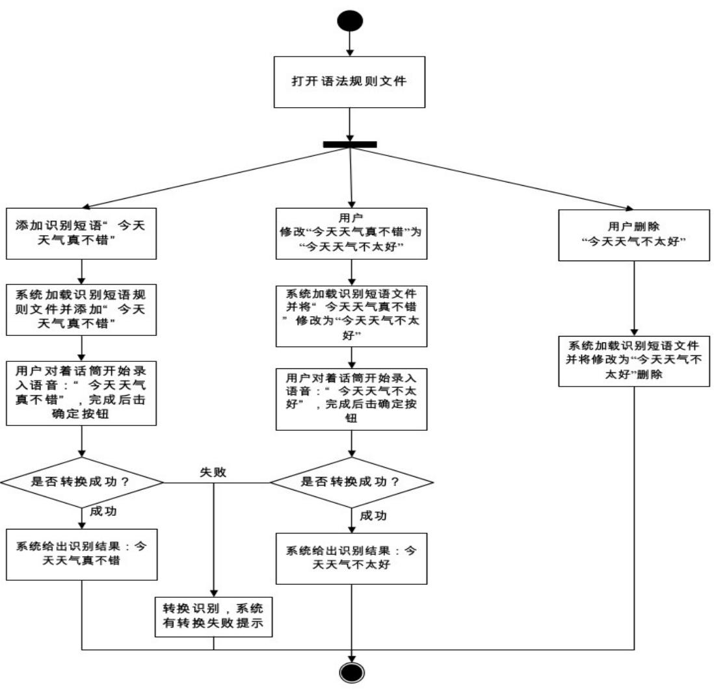
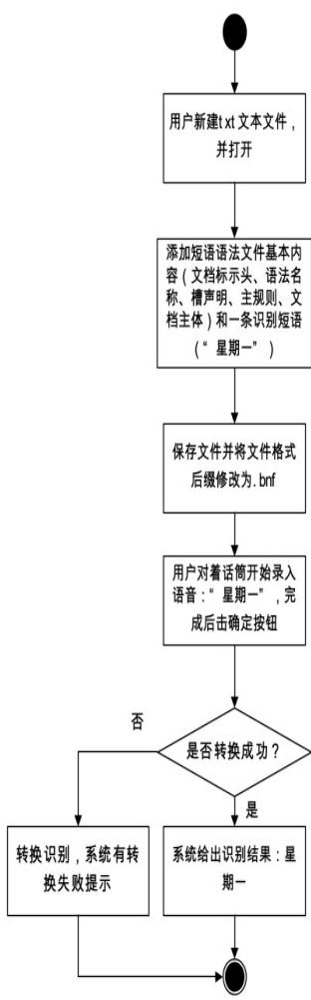
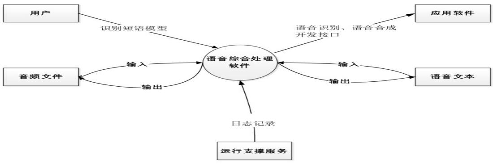

<table><tr><td>8.用户对着话筒开始录入语音：“今天天 气不太好”，完成后击确定按钮</td><td>真不错”修改为“今天天气不太好” 9. 系统给出识别结果：今天天气不太</td><td></td></tr><tr><td>10. 用户删除“今天天气不太好”</td><td>好，若识别失败，进入异常流E1 11. 系统加载识别短语文件并将“今天天</td><td></td></tr><tr><td>异常流E1：系统提示语音识别失败；</td><td>气不太好”删除</td><td></td></tr><tr><td>后置条件：无。</td><td></td><td></td></tr></table>

识别短语管理用例流程图如图16所示：

  
图16 识别短语管理用例图

## 3.2.3.2 识别短语生成（PZXQ-GN-YYZHCL-YYSB-SBDYSC）

用户进行识别短语生成的用例场景，见表14。

表14 识别短语生成用例描述
<table><tr><td>Use Case 名称:识别短语语法文件生 成</td><td colspan="2">Actors：使用人员</td></tr><tr><td colspan="3">概述：本用例是语音综合处理的识别短语语法文件生成用例，描述用户进行识别短语语法文件生成的过程。</td></tr><tr><td colspan="3" rowspan="1">前置条件：无。</td></tr><tr><td colspan="3" rowspan="1">主事件流</td></tr><tr><td colspan="1" rowspan="1">Actor 的动作</td><td colspan="1" rowspan="1">系统的动作</td><td colspan="1" rowspan="1">动作约束(性能、可靠性、容错等)</td></tr><tr><td colspan="1" rowspan="1">1. 用户在前端输入需要添加的识别2. 添加短语语法文件基本内容(文档标示头、语法名称、槽声明、主规则、文档主体）和一条识别短语（“星期一”）3.保存文件并将文件格式后缀修改为.bnf4. 用户对着话筒开始录入语音:“星期一”，完成后击确定按钮</td><td colspan="1" rowspan="1">5. 系统给出识别结果：星期一，若识别失败，进入异常流E1</td><td colspan="1" rowspan="1"></td></tr><tr><td colspan="2" rowspan="1">异常流E1：系统提示语音识别失败；</td><td colspan="1" rowspan="1"></td></tr><tr><td colspan="2" rowspan="1">后置条件：生成识别短语bnf 文件。</td><td colspan="1" rowspan="1"></td></tr></table>

识别短语生成用例流程图如图17所示：

  
图17 识别短语生成用例图

## 3.3 CSCI 外部接口需求

## 3.3.1 接口标识和接口图

语音综合处理软件对外接口包括与用户的接口、与语音应用软件的接口、与运行支持服务软件的接口，外部接口关系图如图18所示。

  
图18 语音综合处理软件外部接口需求图  
语音综合处理软件外部接口需求表见表15。

表15 语音综合处理软件外部接口需求
<table><tr><td rowspan=1 colspan=1>序号</td><td rowspan=1 colspan=1>接口需求名称</td><td rowspan=1 colspan=1>接口需求标识</td><td rowspan=1 colspan=1>接口类型</td><td rowspan=1 colspan=1>发送方</td><td rowspan=1 colspan=1>接收方</td><td rowspan=1 colspan=1>接口内容</td><td rowspan=1 colspan=1>接口优先级</td></tr><tr><td rowspan=2 colspan=1>1</td><td rowspan=2 colspan=1>与用户的接口</td><td rowspan=2 colspan=1>PZXQ-WBJK-YYZHCL-RJJK</td><td rowspan=2 colspan=1>人机接口</td><td rowspan=1 colspan=1>用户</td><td rowspan=1 colspan=1>本软件</td><td rowspan=2 colspan=1>语音录入、文本输入、语音播放</td><td rowspan=2 colspan=1>中</td></tr><tr><td rowspan=1 colspan=1>本软件</td><td rowspan=1 colspan=1>用户</td></tr><tr><td rowspan=1 colspan=1>2</td><td rowspan=1 colspan=1>与应用软件的接口</td><td rowspan=1 colspan=1>PZXQ-WBJK-YYZHCL-YYRJ</td><td rowspan=1 colspan=1>API接口</td><td rowspan=1 colspan=1>本软件</td><td rowspan=1 colspan=1>语音应用软件</td><td rowspan=1 colspan=1>语音识别、语音合成二次开发接口</td><td rowspan=1 colspan=1>中</td></tr><tr><td rowspan=1 colspan=1>3</td><td rowspan=1 colspan=1>与运行支撑服务的接口</td><td rowspan=1 colspan=1>PZXQ-WBJK-YYZHCL-YXZC</td><td rowspan=1 colspan=1>Restful 接口</td><td rowspan=1 colspan=1>运行支撑服务</td><td rowspan=1 colspan=1>本软件</td><td rowspan=1 colspan=1>日志记录</td><td rowspan=1 colspan=1>中</td></tr><tr><td rowspan=2 colspan=1>4</td><td rowspan=2 colspan=1>与文件的接口</td><td rowspan=2 colspan=1>PZXQ-WBJK-YYZHCL-WJJK</td><td rowspan=2 colspan=1>文件接口</td><td rowspan=1 colspan=1>本软件</td><td rowspan=1 colspan=1>音频文件</td><td rowspan=2 colspan=1>音频文件</td><td rowspan=2 colspan=1>中</td></tr><tr><td rowspan=1 colspan=1>音频文件</td><td rowspan=1 colspan=1>本软件</td></tr><tr><td rowspan=2 colspan=1>5</td><td rowspan=2 colspan=1>与文本的接口</td><td rowspan=2 colspan=1>PZXQ-WBJK-YYZHCL-WBJK</td><td rowspan=2 colspan=1>文件接口</td><td rowspan=1 colspan=1>本软件</td><td rowspan=1 colspan=1>文本文件</td><td rowspan=2 colspan=1>文本</td><td rowspan=2 colspan=1>中</td></tr><tr><td rowspan=1 colspan=1>文本文件</td><td rowspan=1 colspan=1>本软件</td></tr></table>

## 3.3.2 与用户的接口（PZXQ-WBJK-YYZHCL-RJJK）

与用户的接口数据元素说明表，见表16。

表16 与用户的接口数据元素说明
<table><tr><td rowspan=1 colspan=1>序号</td><td rowspan=1 colspan=1>数据集名称</td><td rowspan=1 colspan=1>数据组成</td><td rowspan=1 colspan=1>数据约束</td><td rowspan=1 colspan=1>数据标准</td></tr><tr><td rowspan=1 colspan=1>1</td><td rowspan=1 colspan=1>识别短语模型</td><td rowspan=1 colspan=1>格式化的文本信息</td><td rowspan=1 colspan=1>字符串</td><td rowspan=1 colspan=1>试点建设装备配套科研信息交换格式</td></tr></table>

## 3.3.3 与应用软件的接口（PZXQ-WBJK-YYZHCL-YYRJ）

与应用软件的接口数据元素说明表，见表17。

表17 与应用软件的接口数据元素说明
<table><tr><td rowspan=1 colspan=1>序号</td><td rowspan=1 colspan=1>数据集名称</td><td rowspan=1 colspan=1>数据组成</td><td rowspan=1 colspan=1>数据约束</td><td rowspan=1 colspan=1>数据标准</td></tr><tr><td rowspan=1 colspan=1>1</td><td rowspan=1 colspan=1>文本信息</td><td rowspan=1 colspan=1>格式化的文本信息</td><td rowspan=1 colspan=1>字符串</td><td rowspan=1 colspan=1>1</td></tr><tr><td rowspan=1 colspan=1>2</td><td rowspan=1 colspan=1>语音信息</td><td rowspan=1 colspan=1>语音短语</td><td rowspan=1 colspan=1>字符串</td><td rowspan=1 colspan=1>--</td></tr><tr><td rowspan=1 colspan=1>3</td><td rowspan=1 colspan=1>音频文件</td><td rowspan=1 colspan=1>wav 格式的音频文件</td><td rowspan=1 colspan=1>wav 格式</td><td rowspan=1 colspan=1>wav 格式</td></tr></table>

## 3.3.4 与运行支撑服务的接口（PZXQ-WBJK-YYZHCL-YXZC）

与运行支撑服务的接口数据元素说明表，见表18。

表18 与运行支撑服务的接口数据元素说明
<table><tr><td rowspan=1 colspan=1>序号</td><td rowspan=1 colspan=1>数据集名称</td><td rowspan=1 colspan=1>数据组成</td><td rowspan=1 colspan=1>数据约束</td><td rowspan=1 colspan=1>数据标准</td></tr><tr><td rowspan=3 colspan=1>1</td><td rowspan=3 colspan=1>日志信息</td><td rowspan=1 colspan=1>日志级别</td><td rowspan=1 colspan=1>字符串</td><td rowspan=3 colspan=1>试点建设装备配套科研软件集成运维规范</td></tr><tr><td rowspan=1 colspan=1>日志消息</td><td rowspan=1 colspan=1>字符串</td></tr><tr><td rowspan=1 colspan=1>格式信息</td><td rowspan=1 colspan=1>字符串</td></tr></table>

## 3.3.5 与文件的接口（PZXQ-WBJK-YYZHCL-WJJK）

与文件的接口数据元素说明表，见表19。

表19 与文件的接口数据元素说明
<table><tr><td rowspan=1 colspan=1>序号</td><td rowspan=1 colspan=1>数据集名称</td><td rowspan=1 colspan=1>数据组成</td><td rowspan=1 colspan=1>数据约束</td><td rowspan=1 colspan=1>数据标准</td></tr><tr><td rowspan=1 colspan=1>1</td><td rowspan=1 colspan=1>音频文件</td><td rowspan=1 colspan=1>音频文件</td><td rowspan=1 colspan=1>Wav文件</td><td rowspan=1 colspan=1>WAV格式</td></tr><tr><td rowspan=1 colspan=1>2</td><td rowspan=1 colspan=1>录音文件</td><td rowspan=1 colspan=1>录音文件</td><td rowspan=1 colspan=1>Wav文件</td><td rowspan=1 colspan=1>WAV 格式</td></tr></table>

## 3.3.6 与文本的接口（PZXQ-WBJK-YYZHCL-WBJK）

与文本的接口数据元素说明表，见表20。

表20 与文本的接口数据元素说明
<table><tr><td rowspan=1 colspan=1>序号</td><td rowspan=1 colspan=1>数据集名称</td><td rowspan=1 colspan=1>数据组成</td><td rowspan=1 colspan=1>数据约束</td><td rowspan=1 colspan=1>数据标准</td></tr><tr><td rowspan=2 colspan=1>1</td><td rowspan=2 colspan=1>文本数据</td><td rowspan=1 colspan=1>识别结果</td><td rowspan=1 colspan=1>字符串</td><td rowspan=1 colspan=1>--</td></tr><tr><td rowspan=1 colspan=1>语音合成所需的文本</td><td rowspan=1 colspan=1>字符串</td><td rowspan=1 colspan=1>--</td></tr></table>

## 3.4 CSCI 内部接口需求

## 3.4.1 接口标识和接口图

语音综合处理软件的内部就接口主要应用于语音识别、识别短语定制等功能，语音综合处理软件的内部接口如图19所示：

图19 语音综合处理软件内部接口图

语音综合处理软件内部接口需求表见表21。

表21 语音综合处理软件内部接口需求
<table><tr><td rowspan=1 colspan=1>序号</td><td rowspan=1 colspan=1>接口需求名称</td><td rowspan=1 colspan=1>接口需求标识</td><td rowspan=1 colspan=1>接口类型</td><td rowspan=1 colspan=1>发送方</td><td rowspan=1 colspan=1>接收方</td><td rowspan=1 colspan=1>接口内容</td><td rowspan=1 colspan=1>接口优先级</td></tr><tr><td rowspan=1 colspan=1>1</td><td rowspan=1 colspan=1>语音识别与识别短语定制的接口</td><td rowspan=1 colspan=1>PZXQ-YYSB-DYDZ</td><td rowspan=1 colspan=1>文件</td><td rowspan=1 colspan=1>识别短语定制</td><td rowspan=1 colspan=1>语音识别</td><td rowspan=1 colspan=1>识别短语生成的 Bnf 文件</td><td rowspan=1 colspan=1>高</td></tr><tr><td rowspan=2 colspan=1>2</td><td rowspan=2 colspan=1>语音识别与语音合成的接口</td><td rowspan=2 colspan=1>PZXQ-YYSB-YYHC</td><td rowspan=2 colspan=1>文件</td><td rowspan=1 colspan=1>语音合成</td><td rowspan=1 colspan=1>语音识别</td><td rowspan=1 colspan=1>音频文件</td><td rowspan=1 colspan=1>中</td></tr><tr><td rowspan=1 colspan=1>语音识别</td><td rowspan=1 colspan=1>语音合成</td><td rowspan=1 colspan=1>语音文本</td><td rowspan=1 colspan=1>中</td></tr></table>

## 3.4.2 语音识别与语音合成的接口

此接口数据元素说明见表 22。

表 22 语音识别与语音合成的接口数据描述说明
<table><tr><td rowspan=1 colspan=1>序号</td><td rowspan=1 colspan=1>数据集名称</td><td rowspan=1 colspan=1>数据组成</td><td rowspan=1 colspan=1>数据约束</td><td rowspan=1 colspan=1>数据标准</td></tr><tr><td rowspan=1 colspan=1>1</td><td rowspan=1 colspan=1>语音文本</td><td rowspan=1 colspan=1>存放识别结果或准备合成的文字</td><td rowspan=1 colspan=1>文件</td><td rowspan=1 colspan=1></td></tr><tr><td rowspan=1 colspan=1>2</td><td rowspan=1 colspan=1>音频文件</td><td rowspan=1 colspan=1>录音文件</td><td rowspan=1 colspan=1>文件</td><td rowspan=1 colspan=1></td></tr></table>

## 3.4.3 语音合成与语音识别的接口

此接口数据元素说明见表 23。

表 23 语音合成与语音识别的接口数据描述说明
<table><tr><td rowspan=1 colspan=1>序号</td><td rowspan=1 colspan=1>数据集名称</td><td rowspan=1 colspan=1>数据组成</td><td rowspan=1 colspan=1>数据约束</td><td rowspan=1 colspan=1>数据标准</td></tr><tr><td rowspan=1 colspan=1>1</td><td rowspan=1 colspan=1>音频文件</td><td rowspan=1 colspan=1>录音文件</td><td rowspan=1 colspan=1>文件</td><td rowspan=1 colspan=1></td></tr><tr><td rowspan=1 colspan=1>2</td><td rowspan=1 colspan=1>语音文本</td><td rowspan=1 colspan=1>存放识别结果或准备合成的文字</td><td rowspan=1 colspan=1>文件</td><td rowspan=1 colspan=1></td></tr></table>

## 3.4.4 语音识别与识别短语定制接口

此接口数据元素说明见表 24。

表 24语音识别与识别短语定制的接口数据描述说明
<table><tr><td rowspan=1 colspan=1>序号</td><td rowspan=1 colspan=1>数据集名称</td><td rowspan=1 colspan=1>数据组成</td><td rowspan=1 colspan=1>数据约束</td><td rowspan=1 colspan=1>数据标准</td></tr><tr><td rowspan=1 colspan=1>1</td><td rowspan=1 colspan=1>Bnf 文件</td><td rowspan=1 colspan=1>文档标示头、语法名称、槽声明、主规则、文档主题</td><td rowspan=1 colspan=1>文件</td><td rowspan=1 colspan=1></td></tr></table>

## 3.5 CSCI 内部数据需求

语音综合处理软件CSCI内部数据见表25。

表25 语音综合处理软件内部数据汇总表
<table><tr><td rowspan=1 colspan=1>序号</td><td rowspan=1 colspan=1>数据名称</td><td rowspan=1 colspan=1>数据内容</td><td rowspan=1 colspan=1>相关功能及标识</td><td rowspan=1 colspan=1>备注</td></tr><tr><td rowspan=1 colspan=1>1</td><td rowspan=1 colspan=1>Bnf文件</td><td rowspan=1 colspan=1>文档标示头、语法名称、槽声明、主规则、文档主题</td><td rowspan=1 colspan=1>以供语音识别匹配使用</td><td rowspan=1 colspan=1></td></tr><tr><td rowspan=1 colspan=1>2</td><td rowspan=1 colspan=1>语音文本</td><td rowspan=1 colspan=1>存放识别结果或准备合成的文字</td><td rowspan=1 colspan=1>语音合成将语音文本合成为音频文件</td><td rowspan=1 colspan=1></td></tr><tr><td rowspan=1 colspan=1>3</td><td rowspan=1 colspan=1>音频文件</td><td rowspan=1 colspan=1>录音文件</td><td rowspan=1 colspan=1>语音识别将音频文件中的内容识别成文字</td><td rowspan=1 colspan=1></td></tr></table>

Bnf文件数据描述表见表26。

表26 Bnf文件数据描述表

<table><tr><td rowspan=1 colspan=1>序号</td><td rowspan=1 colspan=1>数据项</td><td rowspan=1 colspan=1>内容示例</td><td rowspan=1 colspan=1>是否必须</td><td rowspan=1 colspan=1>数量</td><td rowspan=1 colspan=1>备注</td></tr><tr><td rowspan=1 colspan=1>1</td><td rowspan=1 colspan=1>文档标示头</td><td rowspan=1 colspan=1>#BNF+IAT 1.0 UTF-8</td><td rowspan=1 colspan=1>是</td><td rowspan=1 colspan=1>1</td><td rowspan=1 colspan=1></td></tr><tr><td rowspan=1 colspan=1>2</td><td rowspan=1 colspan=1>语法名称</td><td rowspan=1 colspan=1>!grammar name</td><td rowspan=1 colspan=1>是</td><td rowspan=1 colspan=1>1</td><td rowspan=1 colspan=1></td></tr><tr><td rowspan=1 colspan=1>3</td><td rowspan=1 colspan=1>槽声明</td><td rowspan=1 colspan=1>!solt &lt;name&gt;</td><td rowspan=1 colspan=1>是</td><td rowspan=1 colspan=1>&gt;=1</td><td rowspan=1 colspan=1></td></tr><tr><td rowspan=1 colspan=1>4</td><td rowspan=1 colspan=1>主规则</td><td rowspan=1 colspan=1>!start &lt;rulename&gt;&lt;rulename&gt;:&lt;controlTV&gt;|&lt;controlAir&gt;</td><td rowspan=1 colspan=1>是</td><td rowspan=1 colspan=1>1</td><td rowspan=1 colspan=1></td></tr><tr><td rowspan=1 colspan=1>5</td><td rowspan=1 colspan=1>文档主题</td><td rowspan=1 colspan=1>&lt;controlTV&gt;:&lt;open&gt;&lt;TV&gt;&lt;TV&gt;：电视|电视机；&lt;open&gt;:打开|开了|开起来|开|开一下</td><td rowspan=1 colspan=1>是</td><td rowspan=1 colspan=1>&gt;=1</td><td rowspan=1 colspan=1></td></tr></table>

语音文本数据描述表见表 27。

表 27 语音文本数据描述表
<table><tr><td rowspan=1 colspan=1>序号</td><td rowspan=1 colspan=1>数据项</td><td rowspan=1 colspan=1>内容示例</td><td rowspan=1 colspan=1>是否必须</td><td rowspan=1 colspan=1>数量</td><td rowspan=1 colspan=1>备注</td></tr><tr><td rowspan=1 colspan=1>1</td><td rowspan=1 colspan=1>字符串</td><td rowspan=1 colspan=1>“天气好”</td><td rowspan=1 colspan=1>是</td><td rowspan=1 colspan=1>1</td><td rowspan=1 colspan=1></td></tr></table>

音频文件数据描述表见表 28。

表 28 音频文件数据描述表
<table><tr><td rowspan=1 colspan=1>序号</td><td rowspan=1 colspan=1>数据项</td><td rowspan=1 colspan=1>内容示例</td><td rowspan=1 colspan=1>是否必须</td><td rowspan=1 colspan=1>数量</td><td rowspan=1 colspan=1>备注</td></tr><tr><td rowspan=1 colspan=1>1</td><td rowspan=1 colspan=1>wav文件</td><td rowspan=1 colspan=1>上传 wav 文件</td><td rowspan=1 colspan=1>是</td><td rowspan=1 colspan=1>1</td><td rowspan=1 colspan=1></td></tr></table>

## 3.6 适应性需求

a）采用跨平台开发工具及开发环境，确保软件能适应不同硬件环境（如桌面平台、手持平台等），具有在多种国产操作系统运行适配能力；

b）语音识别以及语音合成服务按照处理器、操作系统的运行条件，根据自身功能要求分别编译生成桌面、平板、手持等不同形态；

c)界面展现按照《界面设计规范》中桌面、平板、手持界面风格进行界面展现的设计，按照《界面开发规范》中的界面自适应规则进行设计，便于在不同尺寸和分辨率的显控终端下实现界面自适应调整；

d）系统运行时能够根据系统登录者席位身份，加载不同的界面和服务，支持业务功能灵活重组；

e）提供服务的负载均衡功能，在服务出现异常或访问拥堵时不影响指挥系统正常运转；

f）依据在桌面、平板、手持不同硬件形态，通过软件部署管理自动下载、安装相应环境的软件包，实现多平台运行。

## 3.7 安全性需求

为保障软件的运行安全，防止用户误操作或其他原因给系统软件的运行和重要数据造成破坏，语音综合处理软件应采取的防护错误如下：

a）语音综合处理软件在对输入输出信息进行加工处理时应检验其是否符合数据处理的范围、规则；

b）语音综合处理软件应对用户输入的信息进行边界值、数据类型进行控制，应能识别异常值，据此判断判断用户的输入操作是否合理；

c）语音综合处理软件在遇到不正确的输入操作时拒绝该操作的执行并提示用户；

d）在语音综合处理软件中，设置专门的异常处理模块，识别运行中产生的错误信息或信息中断，设计错误信息隔离或数据还原等容错设计措施（如数据库连接中断后，需进行保护，并给出信息提示，软件不能异常退出）；

e）语音综合处理软件应使用运维支撑服务提供的日志接口，记录软件的运行过程关键处理功能和运行情况；

f）语音综合处理软件异常时，可根据日志中记录的失效原因、标识等，定位软件异常位置、原因；

g）删除确认设计：对于重要参数的删除增加确认要求，避免人员的误操作；

h）系统重要工作参数需要及时保存，避免系统意外掉电时重要工作参数不丢失；

i）接口调用应保持数据的一致性和完整性；

j）数据的处理严格遵循协议和设计约束；

k）用户误操作防护；

l) 信息删除警示；

m) 关键操作的提示。

## 3.8 保密性需求

无。

## 3.9 CSCI 环境需求

## 3.9.1 运行环境需求

语音综合处理软件运行环境要求见表29：

表29 软件运行环境