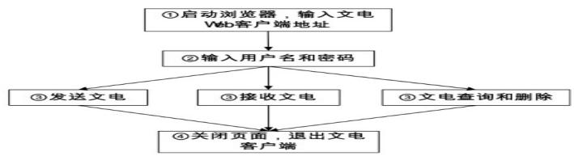
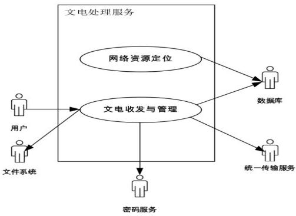
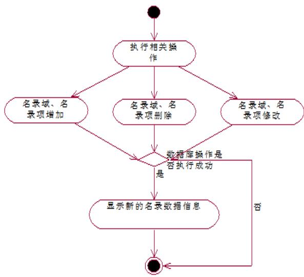

## 目 录

1 范围...  
1.1 标识.  
1.2 系统概述.  
1.2.1 系统和软件的用途..  
1.2.2 系统与软件的一般特性...  
1.3 文档概述.  
2 引用文档.  
3 需求....  
3.1 要求的状态和方式.. .2  
3.2 CSCI 能力需求.. .3  
3.2.1 网络资源定位（PZXQ-GN-ZYDW） .4  
3.2.2 文电收发与管理（PZXQ-GN-SFGL）. ..7  
3.2.3 性能需求.. ..20  
3.3 CSCI 外部接口需求.. ..20  
3.3.1 接口标识和接口图. ..20  
3.3.2 登录和退出用户接口（PZXQ-WBJK-WDCLFW-RJJH-DLTC） ..21  
3.3.3 发送报文接口（PZXQ-WBJK-WDCLFW-RJJH-FSBW） ..22  
3.3.4 下载主件和附件接口（PZXQ-WBJK-WDCLFW-RJJH-XZZF） ..23  
3.3.5 查询收件箱和发件箱接口（PZXQ-WBJK-WDCLFW-RJJH-CXSF）...... .......24  
3.3.6 查询报文信息接口（PZXQ-WBJK-WDCLFW-RJJH-CXBW） ..24  
3.3.7 删除报文接口（PZXQ-WBJK-WDCLFW-RJJH-SCBW） ..25  
3.4 CSCI 内部接口需求. ..26  
3.4.1 接口标识和接口图.. ..26  
3.4.2 名录解析接口（PZXQ-NBJK-WDCLFW -WLZYWDSF）. ..27  
3.4.3 增加名录实体接口（PZXQ-NBJK-WDCLFW –GJWLZY-ZJML） ......28  
3.4.4 修改名录实体接口（PZXQ-NBJK-WDCLFW –GJWLZY-XGML） ...28  
3.4.5 删除名录实体接口（PZXQ-NBJK-WDCLFW –GJWLZY-SCML） ..29  
3.4.6 域挂接接口（PZXQ-NBJK-WDCLFW –GJWLZY-YGJ） ...30  
3.4.7 管理用户接口（PZXQ-NBJK-WDCLFW -GJWDSF）. ..31  
3.5 CSCI 内部数据需求.. ...31  
3.5.1 内部数据元素需求. ..31  
3.6 适应性需求... ..32  
3.7 安全性需求. ..32  
3.8 保密性需求.. ..33  
3.9 CSCI 环境需求. ...33  
3.9.1 运行环境需求. ..33  
3.9.2 开发环境需求.. ..34  
3.10 计算机资源需求.. ...34  
3.10.1 计算机硬件需求. ...34  
3.10.2 计算机硬件资源利用需求. ..35  
3.10.3 计算机软件需求. ..35  
3.10.4 计算机通信需求. ..35  
3.11 软件质量因素.... ..35  
3.12 设计和构造的约束.. ...36  
3.13 人员需求.. ..36  
3.14 培训需求. ..36  
3.15 软件保障需求.. ...37  
3.16 其它需求.. ...37  
3.17 验收、交付和包装需求. ...37  
3.18 需求的优先顺序和关键程度.. ...37  
4 合格性规定. ...37  
5 需求可追踪性. ..38  
5.1 正向追踪.. ..38  
5.2 逆向追踪.. ..40  
6 注释... ..42

## 1 范围

## 1.1 标识

本文档所适用的系统和软件的完整标识：

a) 本文档已被批准的标识号：AZ6932.490.0113 SRS；

b) 本文档所适用的软件名称为：文电处理；

c) 本文档的版本号为 V1.00.02/2020 年 01 月 03 日；

d) 本文档所适用的软件所属系统为：某级信息系统软件。

## 1.2 系统概述

## 1.2.1 系统和软件的用途

某级信息系统软件按照国产自主可控要求，进行基础软件环境选型，以及应用软件的新研和国产化迁移改造，对功能要素分散、流程独立的业务功能进行整合优化，研制适应不同使用需求、使用场景的软件，实现信息系统软件的融合、型谱优化和业务提能，推动某信息系统软件向“国产化、服务化、轻量化”方向发展。

某信息服务环境软件是某信息系统软件的重要组成，是连接底层各类硬件信息基础设施与上层各种应用系统的桥梁，通过基础平台融合汇聚底层资源，规范技术体制、支撑体系运行、促进互通互联等，是支撑构建某信息系统的重要支撑，其软件主要部署运行在各级机构的信息处理设备上，提供系统运维、数据运维、信息传输、信息处理、信息展现等功能，支撑应用软件和用户完成开发、集成、运维、运行全流程的使用。

文电处理提供桌面、平板两种形态的软件，提供收发、处理、管理的能力支撑，其基于统一传输服务和动态名录服务等服务的支撑下构成完成的文电管理处理服务，提供收件箱、发件箱、草稿箱、文电模板拟制、文电流转管理的功能。

文电处理的运行环境包括轻量化服务器、便携式服务器、便携式计算机、便携式计算机（国产化）和携行作业设备。

## 1.2.2 系统与软件的一般特性

a) 需方：某单位；

b) 使用方：某单位；

c) 开发方：某单位；

d) 保障机构：某单位；

e) 运行方案：系统开机后，通过服务集成框架启动文电处理和传输服务，为信息系统的数据交互提供能力；

## 1.3 文档概述

本文档描述了文电处理配置项的需求，包括功能、性能、接口等需求，描述了确保满足每个需求所使用的方法。第2章列出了本文档中引用的其它文档的信息，第3章详细描述了文电处理软件的各种需求以及实现方式，第4章规定了确认第3章各项需求正确实现的合格性验证方法，第5章描述本文档列出的各项需求与相应的系统需求规格说明文档列出的需求的对应关系。其中，第3章是本文档的主要部分。

## 2 引用文档

在本文的正文中引用了以下文档，见表1。

表1 引用文档
<table><tr><td rowspan=1 colspan=1>文档编号</td><td rowspan=1 colspan=1>标题</td><td rowspan=1 colspan=1>修订版本</td><td rowspan=1 colspan=1>修订日期</td><td rowspan=1 colspan=1>编写单位</td></tr><tr><td rowspan=1 colspan=1>GJB 438B-2009</td><td rowspan=1 colspan=1>《软件开发文档编制规范》</td><td rowspan=1 colspan=1>一</td><td rowspan=1 colspan=1>2009年5月</td><td rowspan=1 colspan=1>总装备部</td></tr><tr><td rowspan=1 colspan=1>GJB 439A-2013</td><td rowspan=1 colspan=1>《军品软件质量保证通用要求》</td><td rowspan=1 colspan=1></td><td rowspan=1 colspan=1>2013年7月</td><td rowspan=1 colspan=1>国防科学技术工业委员会</td></tr><tr><td rowspan=1 colspan=1>GJB 450A-2004</td><td rowspan=1 colspan=1>《装备可靠性工作通用要求》</td><td rowspan=1 colspan=1></td><td rowspan=1 colspan=1>2004年7月</td><td rowspan=1 colspan=1>总装备部</td></tr><tr><td rowspan=1 colspan=1>GJB 2786A-2009</td><td rowspan=1 colspan=1>《软件开发通用要求》</td><td rowspan=1 colspan=1></td><td rowspan=1 colspan=1>2009年5月</td><td rowspan=1 colspan=1>总装备部</td></tr><tr><td rowspan=1 colspan=1>GJB 5235-2004</td><td rowspan=1 colspan=1>《软件配置管理》</td><td rowspan=1 colspan=1></td><td rowspan=1 colspan=1>2004年9月</td><td rowspan=1 colspan=1>总装备部</td></tr><tr><td rowspan=1 colspan=1>GJB/Z 102A-2012</td><td rowspan=1 colspan=1>《软件安全性设计指南》</td><td rowspan=1 colspan=1></td><td rowspan=1 colspan=1>2012年7月</td><td rowspan=1 colspan=1>总装备部</td></tr></table>

## 3 需求

## 3.1 要求的状态和方式

文电用户利用文电客户端访问文电处理，进行文电发送、文电接收、通知、下载、查询和文电管理等操作，如图 1所示：

  
图 1 使用模式流程

Step1：文电用户在浏览器页面中输入文电处理Web客户端地址；

Step2：文电用户输入用户名和密码，通过认证，登录到文电主界面；

Step3：文电用户撰写文电，添加附件，指定接收方，发送文电。文电处理Web客户端提示文电发送状态的变化；文电客户端提示来报，用户查看未处理的文电，下载附件，发送回执；用户在文电客户端中进行文电查询和删除文电等操作；

Step4：文电用户关闭浏览器页面，退出文电客户端。

## 3.2 CSCI 能力需求

文电处理是一个为文书和数据提供可靠传输的邮件系统，提供一种通用信息交换手段。为保证与各文电版本互连互通，文电处理在向提交报文和从接收报文时，完全遵循同样的数据格式，各版本文电处理通过服务进行信息交换，收发时都遵循同样的格式，保证了各版本间的互连互通，

文电处理按照其功能需求，提供网络资源定位功能和文电收发与管理功能，同时根据功能需求提供插件式和B/S架构的名录管理工具功能和文电管理工具。

文电处理软件功能图如图 2所示。

  
图 2 文电处理功能图

文电处理软件的用例图如图 3所示。

  
图 3 文电处理软件用例图

文电处理的所有能力标识表见表 2。

表 2 文电处理所有能力标识
<table><tr><td rowspan=1 colspan=1>序号</td><td rowspan=1 colspan=1>Use case名称</td><td rowspan=1 colspan=1>项目唯一标识符</td><td rowspan=1 colspan=1>需求描述</td><td rowspan=1 colspan=1>需求重用</td><td rowspan=1 colspan=1>方式</td><td rowspan=1 colspan=1>运行状态</td><td rowspan=1 colspan=1>对应的任务书功能/性能</td></tr><tr><td rowspan=1 colspan=1>1.</td><td rowspan=1 colspan=1>网络资源定位</td><td rowspan=1 colspan=1>PZXQ-GN-ZYDW</td><td rowspan=1 colspan=1>信息处理系统和用户可以快速、高效的按照名字获取对象（如文电用户、服务等)属性（比如说IP地址、工作单位等）。</td><td rowspan=1 colspan=1>新研</td><td rowspan=1 colspan=1>桌面版</td><td rowspan=1 colspan=1>运行阶段</td><td rowspan=1 colspan=1></td></tr><tr><td rowspan=1 colspan=1>2.</td><td rowspan=1 colspan=1>文电收发与管理</td><td rowspan=1 colspan=1>PZXQ-GN-SFGL</td><td rowspan=1 colspan=1>在广域网环境下进行格式化文电的发送、加密、传输、接收、解密、查看和追踪。</td><td rowspan=1 colspan=1>新研</td><td rowspan=1 colspan=1>桌面版、平板版</td><td rowspan=1 colspan=1>运行阶段</td><td rowspan=1 colspan=1></td></tr></table>

## 3.2.1 网络资源定位（PZXQ-GN-ZYDW）

文电处理软件提供网络资源定位功能，包括名录访问、名录影像和名录管理功能，其功能用例如图 4所示。

图 4 网络资源定位功能用例图  
网络资源定位功能所有能力标识表见表 3。  
表 3 网络资源定位功能所有能力标识
<table><tr><td rowspan=1 colspan=1>序号</td><td rowspan=1 colspan=1>Use case名称</td><td rowspan=1 colspan=1>项目唯一标识符</td><td rowspan=1 colspan=1>需求描述</td><td rowspan=1 colspan=1>需求重用</td><td rowspan=1 colspan=1>方式</td><td rowspan=1 colspan=1>运行状态</td><td rowspan=1 colspan=1>对应的任务书功能/性能</td></tr><tr><td rowspan=1 colspan=1>1.</td><td rowspan=1 colspan=1>名录访问</td><td rowspan=1 colspan=1>PZXQ-GN-ZYDW-MLFW</td><td rowspan=1 colspan=1>按名字检索和列表名录项及名录域。</td><td rowspan=1 colspan=1>新研</td><td rowspan=1 colspan=1>桌面版</td><td rowspan=1 colspan=1>运行阶段</td><td rowspan=1 colspan=1>4.1e)</td></tr><tr><td rowspan=1 colspan=1>2.</td><td rowspan=1 colspan=1>名录影像</td><td rowspan=1 colspan=1>PZXQ-GN-ZYDW-MLYX</td><td rowspan=1 colspan=1>提供名录影像功能，提供远程名录域的名录项影像存储能力，支持名录信息自动影像并维护其一致性。</td><td rowspan=1 colspan=1>新研</td><td rowspan=1 colspan=1>桌面版</td><td rowspan=1 colspan=1>运行阶段</td><td rowspan=1 colspan=1>4.1f)</td></tr><tr><td rowspan=1 colspan=1>3.</td><td rowspan=1 colspan=1>名录管理</td><td rowspan=1 colspan=1>PZXQ-GN-ZYDW-MLGL</td><td rowspan=1 colspan=1>使用数据库存储名录域和名录项信息，提供增加、删除、修改本地名录域和名录项信息的功能。</td><td rowspan=1 colspan=1>新研</td><td rowspan=1 colspan=1>桌面版</td><td rowspan=1 colspan=1>运行阶段</td><td rowspan=1 colspan=1>4.1e)、g)</td></tr></table>

## 3.2.1.1 名录访问（PZXQ-GN-ZYDW-MLFW）

名录访问用例场景，见表 4。

表 4 名录访问用例描述
<table><tr><td colspan="1" rowspan="1">Use Case 名称：名录访问</td><td colspan="2" rowspan="1">Actors：用户</td></tr><tr><td colspan="3" rowspan="1">概述：按节点名称完成名录域或名录项信息解析。</td></tr><tr><td colspan="3" rowspan="1">前置条件：文电处理正常启动。</td></tr><tr><td colspan="3" rowspan="1">主事件流</td></tr><tr><td colspan="1" rowspan="1">Actor 的动作</td><td colspan="1" rowspan="1">系统的动作</td><td colspan="1" rowspan="1">动作约束(性能、可靠性、容错等)</td></tr><tr><td colspan="1" rowspan="1">1.用户设置名录域或名录项检索条件调用名录解析接口；</td><td colspan="1" rowspan="1"></td><td colspan="1" rowspan="1">校验访问条件的合法性，并在</td></tr><tr><td colspan="1" rowspan="1">6.用户获得名录项信息；</td><td colspan="1" rowspan="1">2.系统解析访问条件，并对访问条件的正确性进行验证，验证失败进入异常流E1;3.根据名字在名录数据库进行名录域或名录项信息查询；4.查询过程中，如果本地(即当前节点名录服务)未查询到满足检索条件的目标则继续向上一级(即当前节点名录服务的父亲节点名录服务)进行查询，如果上一级也没有查询到满足检索条件的目标则逐级向上解析，直到查询到否满足检索条件的目标或查询到根节点时结束，中间结果遇到错误则进入异常流E2 ;5.查询成功后，将查询结果反馈给用户；</td><td colspan="1" rowspan="1">错误发生时，提供详细的错误信息</td></tr><tr><td colspan="2" rowspan="1">异常流E1：提示用户检索条件错误，并进行日志记录。</td><td colspan="1" rowspan="1"></td></tr><tr><td colspan="2" rowspan="1">异常流E2：能够处理运行时发生的错误，包括名录域解析失败信息、名录项解析失败信息、非法过滤信息等。</td><td colspan="1" rowspan="1"></td></tr><tr><td colspan="2" rowspan="1">后置条件：无。</td><td colspan="1" rowspan="1"></td></tr></table>

## 3.2.1.2 名录影像（PZXQ-GN-ZYDW-MLYX）

名录影像用例场景，见表 5。

表 5 名录影像用例描述
<table><tr><td colspan="1" rowspan="1">Use Case 名称:名录影像</td><td colspan="2" rowspan="1">Actors：用户</td></tr><tr><td colspan="3" rowspan="1">概述：增加或变更名录影像。</td></tr><tr><td colspan="3" rowspan="1">前置条件：文电处理正常启动。</td></tr><tr><td colspan="3" rowspan="1">主事件流</td></tr><tr><td colspan="1" rowspan="1">Actor 的动作</td><td colspan="1" rowspan="1">系统的动作</td><td colspan="1" rowspan="1">动作约束(性能、可靠性、容错等)</td></tr><tr><td colspan="1" rowspan="1">1.用户调用名录解析接口进行名录解析；4.用户调用增加/修改/删除操作；</td><td colspan="1" rowspan="1">2. 系统除了响应解析操作外，凡是通过向上级域解析成功的操作都会从上级域拉取最新的影像信息，存储在本地；3.本地定期向中心拉取最新影像信息。操作失败进入异常流E1。</td><td colspan="1" rowspan="1">校验访问条件的合法性，并在错误发生时，提供详细的错误信息</td></tr><tr><td colspan="1" rowspan="1">6.用户调用域挂接操作；</td><td colspan="1" rowspan="1">5.系统除了响应增加/修改/删除操作外，还产生一个类似全网广播的更新通知，通知自己的下级域和上级域进行影像数据更新；上级域和下级域收到更新通知后，会继续把更新通知进行广播，直到广播到全网。收到更新通知的域会拉取最新影像信息。更新过程遇到异常或错误则进入异常流E2。7. 系统除了响应域名挂接或者重新挂接操作外，还触发影像信息全网更新，新挂接时重建本地用户信息，并进行全网广播，触发影像信息全网更新。更新过程遇到异常或错误则进入异常流E2。</td><td colspan="1" rowspan="1"></td></tr><tr><td colspan="2" rowspan="1">异常流E1：提示请求信息错误，并进行日志记录。</td><td colspan="1" rowspan="1"></td></tr><tr><td colspan="2" rowspan="1">异常流E2：能够处理运行时发生的错误，包括更新失败、影像信息拉取失败等。</td><td colspan="1" rowspan="1"></td></tr><tr><td colspan="2" rowspan="1">后置条件：无。</td><td colspan="1" rowspan="1"></td></tr></table>

## 3.2.1.3 名录管理（PZXQ-GN-ZYDW-MLGL）

名录管理的流程图如图 5所示

  
图 5 名录管理流程图

名录管理用例场景，见表 6。

表 6 名录管理用例描述
<table><tr><td>Use Case 名称：名录管理</td><td>Actors：用户</td></tr></table>

<table><tr><td colspan="3">概述：对本地名录域或名录项信息进行增加、删除、修改等操作。</td></tr><tr><td colspan="3">前置条件：文电处理正常启动。</td></tr><tr><td colspan="3">主事件流</td></tr><tr><td>Actor 的动作</td><td>系统的动作</td><td>动作约束 (性能、可靠性、容错等)</td></tr><tr><td>1. 用户打开名录管理工具，点击增加 名录域/名录项信息按钮； 3.用户查看到增加结果； 4. 用户点击删除名录域/名录项信息按 钮；</td><td>2.系统查询数据库是否存在该名录域或 名录项信息，如果存在该信息则抛出增 加名录域或名录项失败的信息；如果不 存在该信息，则在当前登录的名录服务 器上进行增加操作，操作执行成功后数 据库新增一条名录信息，并可以成功解 析该信息，失败则进入异常流E1； 5.系统查询数据库是否存在该名录域或 名录项信息，如果不存在该信息则进入 异常流E2；如果存在该信息，则进行 删除操作，操作执行成功后数据库删除</td><td></td></tr><tr><td>6.用户查看到删除结果； 7. 用户点击修改名录域/名录项信息按 钮；</td><td>一条名录信息，失败则进入异常流 E2; 8.系统先查询数据库是否存在该名录域 或名录项信息，如果不存在该信息则进 入异常流E3；如果存在该信息，则在 当前登录的名录服务器上进行修改操 作，操作执行成功后数据库更新该名录 信息，并可以成功解析该信息，失败则 进入异常流E3；</td><td></td></tr><tr><td>9.用户查看到修改结果；</td><td></td><td></td></tr><tr><td colspan="3">异常流E1：提示用户增加名录域或名录项失败的信息。</td></tr><tr><td colspan="2">异常流E2：提示用户删除名录域或名录项失败的信息。</td></tr></table>