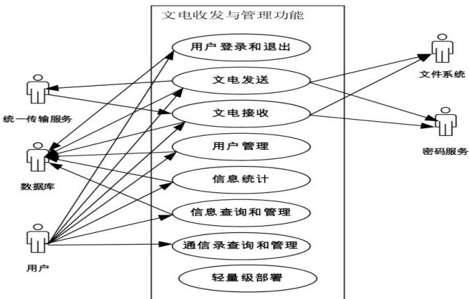
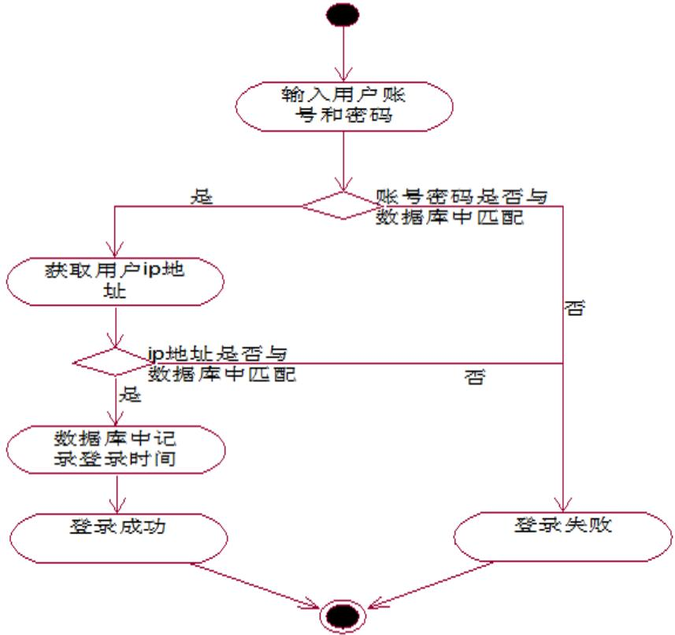
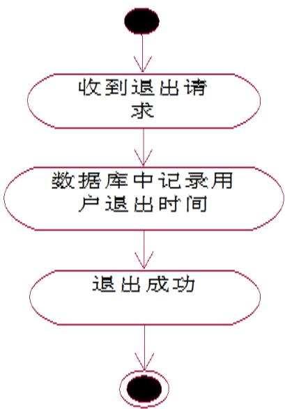
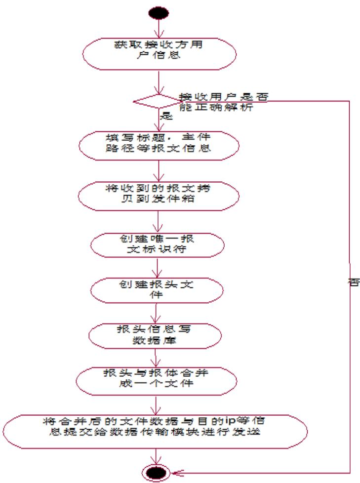
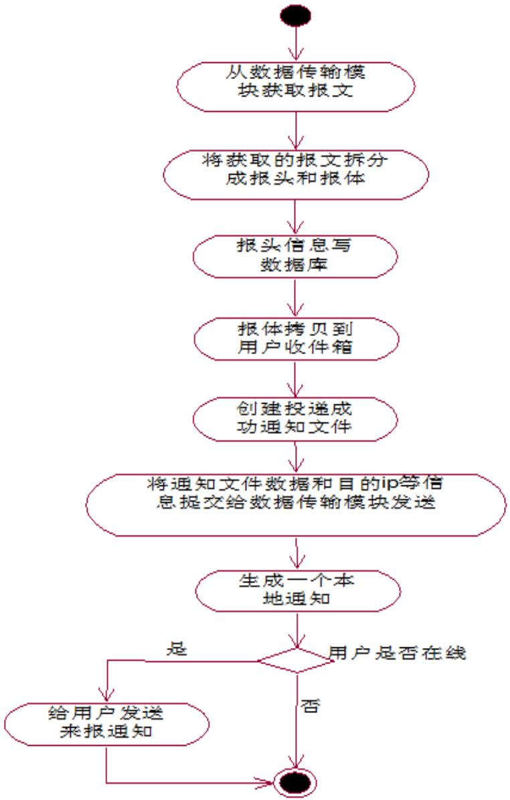
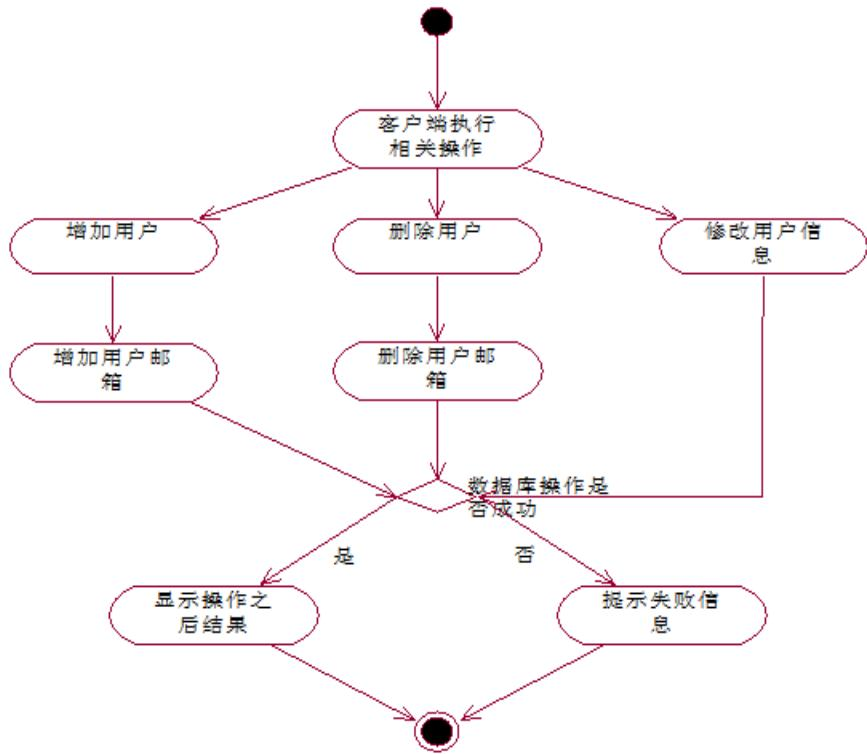
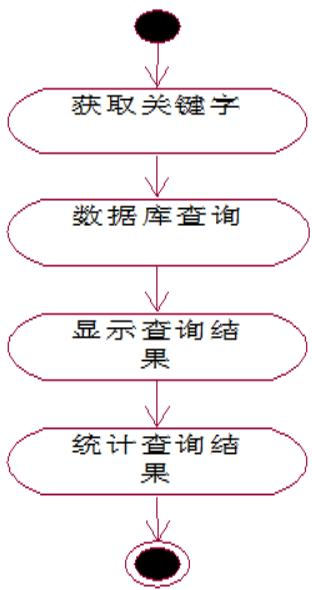

<table><tr><td>异常流E3：提示用户修改名录域或名录项失败的信息</td><td></td></tr><tr><td>后置条件：无。</td><td></td></tr></table>

## 3.2.2 文电收发与管理（PZXQ-GN-SFGL）

文电处理软件提供文电收发与管理功能，支持插件式应用和B/S客户端应用，包括用户登录和退出、文电发送、文电接收、用户管理、信息统计、信息查询和管理功能，其功能用例如图 6所示。

  
图 6 文电收发与管理功能用例图

文电收发与管理功能所有能力标识表见表 7。

表 7 文电收发与管理功能所有能力标识
<table><tr><td colspan="1" rowspan="1">序号</td><td colspan="1" rowspan="1">Use case名称</td><td colspan="1" rowspan="1">项目唯一标识符</td><td colspan="1" rowspan="1">需求描述</td><td colspan="1" rowspan="1">需求重用</td><td colspan="1" rowspan="1">方式</td><td colspan="1" rowspan="1">运行状态</td><td colspan="1" rowspan="1">对应的任务书功能/性能</td></tr><tr><td colspan="1" rowspan="1">1.</td><td colspan="1" rowspan="1">用户登录和退出</td><td colspan="1" rowspan="1">PZXQ-GN-SFGL-DLTC</td><td colspan="1" rowspan="1">支持用户使用用户名/口令认证进行登录，以及退出功能。</td><td colspan="1" rowspan="1">新研</td><td colspan="1" rowspan="1">桌面版、平板版</td><td colspan="1" rowspan="1">运行阶段</td><td colspan="1" rowspan="1"></td></tr><tr><td colspan="1" rowspan="1">2.</td><td colspan="1" rowspan="1">文电发送</td><td colspan="1" rowspan="1">PZXQ-GN-SFGL-WDFS</td><td colspan="1" rowspan="1">合法用户发送文电，一次发送可以包含多个接收者和多个抄送者，包括一个标题、一个主件和多个附件。</td><td colspan="1" rowspan="1">新研</td><td colspan="1" rowspan="1">桌面版、平板版</td><td colspan="1" rowspan="1">运行阶段</td><td colspan="1" rowspan="1"></td></tr><tr><td colspan="1" rowspan="1">3.</td><td colspan="1" rowspan="1">文电接收</td><td colspan="1" rowspan="1">PZXQ-GN-SFGL-WDJS</td><td colspan="1" rowspan="1">保存接收的文电，并发送投递成功的通知和来报通知。支持报文下载，</td><td colspan="1" rowspan="1">新研</td><td colspan="1" rowspan="1">桌面版、平板版</td><td colspan="1" rowspan="1">运行阶段</td><td colspan="1" rowspan="1">3.1</td></tr><tr><td colspan="1" rowspan="1">4.</td><td colspan="1" rowspan="1">用户管理</td><td colspan="1" rowspan="1">PZXQ-GN-SFGL-YHGL</td><td colspan="1" rowspan="1">增加、删除、修改文电用户的名录信息和文电信息。</td><td colspan="1" rowspan="1">新研</td><td colspan="1" rowspan="1">桌面版</td><td colspan="1" rowspan="1">运行阶段</td><td colspan="1" rowspan="1"></td></tr><tr><td colspan="1" rowspan="1">5.</td><td colspan="1" rowspan="1">信息查询和管理</td><td colspan="1" rowspan="1">PZXQ-GN-SFGL-CXGL</td><td colspan="1" rowspan="1">按用户名、发送时间范围、接收时间范围和标题等关键字匹配查询用户发送或者接收的报文。可以对相应的报文进行删除和清除操作</td><td colspan="1" rowspan="1">新研</td><td colspan="1" rowspan="1">桌面版、平板版</td><td colspan="1" rowspan="1">运行阶段</td><td colspan="1" rowspan="1"></td></tr><tr><td colspan="1" rowspan="1">6.</td><td colspan="1" rowspan="1">通讯录查询和管理</td><td colspan="1" rowspan="1">PZXQ-GN-SFGL-TXL</td><td colspan="1" rowspan="1">提供通讯录对联系人进行查询和管理。</td><td colspan="1" rowspan="1">新研</td><td colspan="1" rowspan="1">桌面版、平板版</td><td colspan="1" rowspan="1">运行阶段</td><td colspan="1" rowspan="1"></td></tr><tr><td colspan="1" rowspan="1">7.</td><td colspan="1" rowspan="1">轻量化部署</td><td colspan="1" rowspan="1">PZXQ-GN-SFGL-QLGBS</td><td colspan="1" rowspan="1">在不超过两台服务器上完成整套系统的轻量级部署。</td><td colspan="1" rowspan="1">新研</td><td colspan="1" rowspan="1">桌面版</td><td colspan="1" rowspan="1">运行阶段</td><td colspan="1" rowspan="1"></td></tr></table>

## 3.2.2.1 用户登录和退出（PZXQ-GN-SFGL-DLTC）

用户登录和退出的流程图如图 7、图 8所示。

  
图 7 用户登录的流程图

  
图 8 用户退出的流程图

用户登录和退出用例场景，见表 8。

表 8 用户登录和退出用例描述
<table><tr><td colspan="1" rowspan="1">Use Case 名称:用户登录和退出</td><td colspan="2" rowspan="1">Actors：用户</td></tr><tr><td colspan="3" rowspan="1">概述：支持用户登录和退出</td></tr><tr><td colspan="3" rowspan="1">前置条件：文电处理正常启动，文电客户端页面正常启动。</td></tr><tr><td colspan="3" rowspan="1">主事件流</td></tr><tr><td colspan="1" rowspan="1">Actor 的动作</td><td colspan="1" rowspan="1">系统的动作</td><td colspan="1" rowspan="1">动作约束(性能、可靠性、容错等)</td></tr><tr><td colspan="1" rowspan="1">1.用户通过文电客户端页面输入用户名或密码，点击登录按钮进行登录；4. 用户登录后，文电客户端页面显示用户地址、头像和邮箱空间大小；支持显示当前时钟和邮件服务器运行状态5.用户点击注销按钮或者用户长时间未</td><td colspan="1" rowspan="1">2.根据用户收到的用户账号和密码，以及机器的ip地址，用户登录和退出模块根据用户信息数据表里面的数据判断用户信息是否正确，如果不正确，则执行异常流E1；3.如果正确，则在用户登录的数据表中增加用户登录信息，返回用户登录成功信息，否则返回用户登录失败信息；6. 用户登录和退出模块在用户登录的数据表中增加用户的退出信息，并退</td><td colspan="1" rowspan="1">校验用户名和密码的合法性，并在错误发生时，提供详细的错误信息</td></tr><tr><td colspan="1" rowspan="1">操作主动注销；7.用户成功登录和退出。</td><td colspan="1" rowspan="1">出；</td><td colspan="1" rowspan="1"></td></tr><tr><td colspan="2" rowspan="1">异常流E1：能够处理用户填写信息时发生的错误，包括账号错误和密码错误。</td><td colspan="1" rowspan="1"></td></tr><tr><td colspan="2" rowspan="1">后置条件：无。</td><td colspan="1" rowspan="1"></td></tr></table>

## 3.2.2.2 文电发送（PZXQ-GN-SFGL-WDFS）

文电发送的流程图如图 9所示。

  
图 9 文电发送的流程图  
文电发送用例场景，见表 9。

表 9 文电发送用例描述

<table><tr><td colspan="1" rowspan="1">Use Case 名称:文电发送</td><td colspan="2" rowspan="1">Actors：用户</td></tr><tr><td colspan="3" rowspan="1">概述：将文电投递到接收方用户的收件箱。</td></tr><tr><td colspan="3" rowspan="1">前置条件：文电处理正常启动，发送方和接收方用户已经存在；用户正常登陆。</td></tr><tr><td colspan="3" rowspan="1">主事件流</td></tr><tr><td colspan="1" rowspan="1">Actor 的动作</td><td colspan="1" rowspan="1">系统的动作</td><td colspan="1" rowspan="1">动作约束(性能、可靠性、容错等)</td></tr><tr><td colspan="1" rowspan="1">1.用户进入文电客户端页面，撰写文电。支持标题、收件人、等级等必填项的填写，支持主题词、承办单位、文档类别、联系人、联系电话等可选项的填写。支持输入单个/多个收件人或是从通讯录选择多个收件人；从通信录选择收件人时，支持树状显示现有通信录，支持多选，支持对收件人姓名、邮件地址、单位、部门所有栏目进行搜索。支持以“上传已写好的主件”和“撰写主件正文”两种方式生成证件；支持主件和附件的上传，单个文件大小&lt;2GB，允许最多添加15个附件。正在上传的文件支持进度显示，支持取消上传，支持删除已上传的文件。撰写主件正文时允许对字体、字号、颜色、对齐方式等进行设置。2.用户点击发送按钮；已发送的文电保存在发件箱。</td><td colspan="1" rowspan="1">3.调用网络资源定位接口解析接收用户，文电发送模块将接收的报文存储到发送用户的发件箱，创建唯一的报文标识符，这个时候返回给用户提交成功的状态；4.将发送方用户信息、接收方用户信息等信息创建成一个报头文件，并将报头信息记录到发送方发件箱数据表中；5.将报头文件和报体文件拼接成一个文件，将文件数据和目的IP等信息一起推送给数据传输模块进行发送，这个时候返回传送提交的状态，在发送过程中捕获到异常，则执行异常流E1；6.通过获取数据传输模块返回的 ACK</td><td colspan="1" rowspan="1"></td></tr><tr><td colspan="1" rowspan="1">7. 已发送的文电保存在发件箱，文电的报文状态跟踪自动更新。</td><td colspan="1" rowspan="1">来追踪报文的发送状态，通过获取接收方返回的通知来追踪报文的投递状态。</td><td colspan="1" rowspan="1"></td></tr><tr><td colspan="2" rowspan="1">异常流E1：报文投递失败时有相应的失败原因，有些投递失败的情况（例如网络中断）会通过恢复线程将报文重新投递。</td><td colspan="1" rowspan="1"></td></tr><tr><td colspan="2" rowspan="1">后置条件：无。</td><td colspan="1" rowspan="1"></td></tr></table>

## 3.2.2.3 文电接收（PZXQ-GN-SFGL-WDJS）

文电接收的流程图如图 10所示。

  
图 10 文电接收的流程图

文电接收用例场景，见表 10。

表 10 文电接收用例描述
<table><tr><td colspan="1" rowspan="1">Use Case 名称：文电接收</td><td colspan="2" rowspan="1">Actors：用户</td></tr><tr><td colspan="3" rowspan="1">概述：用户接收文电信息。</td></tr><tr><td colspan="3" rowspan="1">前置条件：文电处理正常启动，发送方和接收方用户已经存在；用户正常登陆。</td></tr><tr><td colspan="3" rowspan="1">主事件流</td></tr><tr><td colspan="1" rowspan="1">Actor 的动作</td><td colspan="1" rowspan="1">系统的动作</td><td colspan="1" rowspan="1">动作约束(性能、可靠性、容错等)</td></tr><tr><td colspan="1" rowspan="1">4.用户收件箱收到来报通知。5.接收方用户可以在未处理收件箱中查看新接收的文电：选中相应文电可以查看文电标题、发送者等信息，下载文电主附件。支持发送接收确认或接收否认回执；支持回执附言，回执附言可从已有模板中选取，也可以临时撰写。6.回执之后文电存放到已处理收件箱中。7.用户通过文电客户端页面回复或转发文电。支持自动插入相应字段/内容，自动添加“回复”和“转发”标志。回复时原邮件附件不包含在新邮件中，转发时原邮件附件包含在新邮件中。回复时支持“仅回复发件人”或“回复所有人”，后者不仅回复发件人也回复所有其它收件人。所撰写的部份邮件允许保存到草稿箱中，所有必填项撰写完</td><td></td><td></td></tr><tr><td colspan="1" rowspan="1">毕的邮件允许直接发送。当用户输入部分内容后，又通过关闭窗口方式退出撰写界面时，提示未保存邮件、需用户进行确认。显式按取消按钮时无需确认。</td><td colspan="1" rowspan="1"></td><td colspan="1" rowspan="1"></td></tr><tr><td colspan="2" rowspan="1">异常流E1：数据传输模块将报文拷贝到接收用户收件箱时失败，文电接收模块向发送方用户发送投递失败的状态通知。</td><td colspan="1" rowspan="1"></td></tr><tr><td colspan="2" rowspan="1">后置条件：无。</td><td colspan="1" rowspan="1"></td></tr></table>

## 3.2.2.4 用户管理（PZXQ-GN-SFGL-YHGL）

用户管理的流程图如图 11所示。

  
图 11 用户管理的流程图

用户管理用例场景，见表 4。

表 11 用户管理用例描述
<table><tr><td colspan="1" rowspan="1">Use Case 名称：用户管理</td><td colspan="2" rowspan="1">Actors：用户</td></tr><tr><td colspan="3" rowspan="1">概述:获取用户的中文名等信息，获取用户的删除等操作信息。</td></tr><tr><td colspan="3" rowspan="1">前置条件：文电处理正常启动。</td></tr><tr><td colspan="3" rowspan="1">主事件流</td></tr><tr><td colspan="1" rowspan="1">Actor 的动作</td><td colspan="1" rowspan="1">系统的动作</td><td colspan="1" rowspan="1">动作约束(性能、可靠性、容错等)</td></tr><tr><td colspan="1" rowspan="1">1.用户打开文电管理工具，点击增加用</td><td colspan="1" rowspan="1"></td><td colspan="1" rowspan="1"></td></tr><tr><td>户按钮； 3.用户收到增加成功的提示； 4. 用户点击删除用户按钮；</td><td>2.系统对比用户信息状态，如果用户已 存在，则进入异常流E1，如果待增加 用户信息不存在，则将用户通过客户端 输入的用户信息录入到用户数据表中， 并创建用户的邮箱，同时向用户反馈处 理结果； 5.系统对比用户信息状态，如果用户不 存在，则进入异常流E2，如果待删除 用户信息存在，则将从用户数据表中把 相应用户信息删除，同时删除用户邮 箱，如果删除失败，则进入异常流</td><td></td></tr><tr><td>6.用户收到增加成功的提示； 7. 用户点击修改用户信息按钮； 9.用户收到修改成功的提示；</td><td>E2，如果删除成果，则向用户反馈处 理结果； 8.系统对用户信息进行修改操作，并完 成数据库相关数据的更新；</td><td></td></tr><tr><td colspan="2"></td><td></td></tr><tr><td colspan="2">异常流E1：提示已经存在的用户不能增加。</td><td></td></tr><tr><td colspan="2">异常流E2：提示不存在的用户不能修改和删除，在线的用户不允许删除。 后置条件：无。</td><td></td></tr></table>

## 3.2.2.5 信息统计（PZXQ-GN-SFGL-XXTJ）

信息统计的流程图如图 12所示。

  
图 12 信息统计的流程图

信息统计用例场景，见表 12。

表 12 信息统计用例描述
<table><tr><td rowspan=1 colspan=1>Use Case 名称:信息统计</td><td rowspan=1 colspan=2>Actors：用户</td></tr><tr><td rowspan=1 colspan=3>概述：根据用户输入的条件统计出某用户或某密级等在某时间的收发报文的统计。</td></tr><tr><td rowspan=1 colspan=3>前置条件：文电处理正常启动。</td></tr><tr><td rowspan=1 colspan=3>主事件流</td></tr><tr><td rowspan=1 colspan=1>Actor 的动作</td><td rowspan=1 colspan=1>系统的动作</td><td rowspan=1 colspan=1>动作约束(性能、可靠性、容错等)</td></tr><tr><td rowspan=1 colspan=1>1.用户打开名录应用，填写查询条件，点击查询统计按钮；3.用户通过展示界面查看到查询统计结果；</td><td rowspan=1 colspan=1>2.系统根据用户提供的条件在发件箱数据表和收件箱数据表中进行匹配查询解析访问条件，并对访问条件的正确性进行验证，验证失败进入异常流E1，如果解析成果则进行数据统计，并进行信息反馈；</td><td rowspan=1 colspan=1>校验访问条件的合法性，并在错误发生时，提供详细的错误信息</td></tr><tr><td rowspan=1 colspan=2>异常流E1：提示用户检索条件错误，并进行日志记录。</td><td rowspan=1 colspan=1></td></tr><tr><td rowspan=1 colspan=2>后置条件：无。</td><td rowspan=1 colspan=1></td></tr></table>

## 3.2.2.6 信息查询和管理（PZXQ-GN-SFGL-CXGL）

信息查询和管理的流程图如图 13所示。