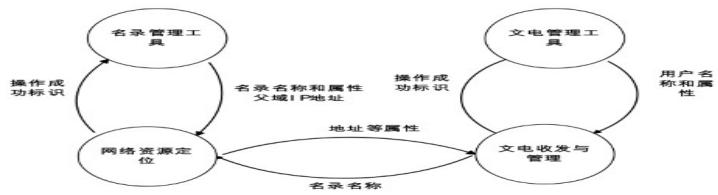

<table><tr><td rowspan=1 colspan=1>接口唯一标识符</td><td rowspan=1 colspan=1>PZXQ-WBJK-WDCLFW-RJJH-SCBW</td></tr><tr><td rowspan=1 colspan=1>接口名称</td><td rowspan=1 colspan=1>删除报文接口</td></tr><tr><td rowspan=1 colspan=1>接口需求描述</td><td rowspan=1 colspan=1>删除某个报文信息</td></tr><tr><td rowspan=1 colspan=1>接口类型</td><td rowspan=1 colspan=1>API接口</td></tr><tr><td rowspan=1 colspan=1>接口优先级</td><td rowspan=1 colspan=1>高</td></tr></table>

## 3.3.7.2 通信方法特性

无。

## 3.3.7.3 协议特性

使用 TCP/IP 协议簇，包含基于流式的、面向连接的、可靠的 TCP 传输协议。

## 3.3.7.4 数据元素特性

删除报文接口的数据元素特性见表 30。

表 30 删除报文接口的数据元素特性
<table><tr><td rowspan=1 colspan=1>序号</td><td rowspan=1 colspan=1>数据元素名称</td><td rowspan=1 colspan=1>数据元素标识</td><td rowspan=1 colspan=1>数据类型</td><td rowspan=1 colspan=1>大小和格式/单位</td><td rowspan=1 colspan=1>范围/枚举</td><td rowspan=1 colspan=1>准确性/精度</td><td rowspan=1 colspan=1>其它特性</td></tr><tr><td rowspan=1 colspan=1>1</td><td rowspan=1 colspan=1>文电服务句柄</td><td rowspan=1 colspan=1>p</td><td rowspan=1 colspan=1>const void*</td><td rowspan=1 colspan=1>一</td><td rowspan=1 colspan=1>一</td><td rowspan=1 colspan=1>一</td><td rowspan=1 colspan=1>一</td></tr><tr><td rowspan=1 colspan=1>2</td><td rowspan=1 colspan=1>邮箱类型</td><td rowspan=1 colspan=1>mail_box_kind</td><td rowspan=1 colspan=1>_MailboxKinds</td><td rowspan=1 colspan=1>一</td><td rowspan=1 colspan=1>一</td><td rowspan=1 colspan=1>一</td><td rowspan=1 colspan=1>一</td></tr><tr><td rowspan=1 colspan=1>3</td><td rowspan=1 colspan=1>报文标识符</td><td rowspan=1 colspan=1>ipm_identifier</td><td rowspan=1 colspan=1>const char*</td><td rowspan=1 colspan=1>一</td><td rowspan=1 colspan=1>一</td><td rowspan=1 colspan=1>一</td><td rowspan=1 colspan=1>一</td></tr></table>

## 3.3.7.5 数据元素集合体特性

无。

## 3.4 CSCI 内部接口需求

## 3.4.1 接口标识和接口图

文电处理内部接口需求图，如图 15所示。

  
图 15 文电处理的内部接口需求

文电处理的内部接口包括：名录管理工具与网络资源定位的接口、网络资源定位与文电收发与管理接口、文电管理工具与文电收发与管理接口。文电管理工具与文电收发与管理接口即是文电处理提供的外部接口，在此不再赘述。

文电处理内部接口需求表见表 31。

表 31 文电处理内部接口需求
<table><tr><td rowspan=1 colspan=1>序号</td><td rowspan=1 colspan=1>接口需求名称</td><td rowspan=1 colspan=1>接口需求标识</td><td rowspan=1 colspan=1>接口类型</td><td rowspan=1 colspan=1>发送方</td><td rowspan=1 colspan=1>接收方</td><td rowspan=1 colspan=1>接口内容</td><td rowspan=1 colspan=1>接口优先级</td></tr><tr><td rowspan=2 colspan=1>1</td><td rowspan=2 colspan=1>名录管理工具与网络资源定位的接口</td><td rowspan=2 colspan=1>PZXQ-NBJK-WDCLFW-GJWLZY</td><td rowspan=2 colspan=1>API接口</td><td rowspan=1 colspan=1>名录管理工具</td><td rowspan=1 colspan=1>网络资源定位模块</td><td rowspan=1 colspan=1>域和名录项的名称、属性、域IP地址</td><td rowspan=1 colspan=1>低</td></tr><tr><td rowspan=1 colspan=1>网络资源定位模块</td><td rowspan=1 colspan=1>名录管理工具</td><td rowspan=1 colspan=1>操作成功标识</td><td rowspan=1 colspan=1>低</td></tr><tr><td rowspan=2 colspan=1>2</td><td rowspan=2 colspan=1>网络资源定位与文电收发与管理接口</td><td rowspan=2 colspan=1>PZXQ-NBJK-WDCLFW-WLZYWDSF</td><td rowspan=2 colspan=1>API接口</td><td rowspan=1 colspan=1>文电收发与管理模块</td><td rowspan=1 colspan=1>网络资源定位模块</td><td rowspan=1 colspan=1>域和名录项的名称</td><td rowspan=1 colspan=1>高</td></tr><tr><td rowspan=1 colspan=1>网络资源定位模块</td><td rowspan=1 colspan=1>文电收发与管理模块</td><td rowspan=1 colspan=1>域和名录项的属性</td><td rowspan=1 colspan=1>高</td></tr><tr><td rowspan=2 colspan=1>3</td><td rowspan=2 colspan=1>文电管理工具与文电收发与管理接口</td><td rowspan=2 colspan=1>PZXQ-NBJK-WDCLFW-GJWDSF</td><td rowspan=2 colspan=1>API接口</td><td rowspan=1 colspan=1>文电管理工具</td><td rowspan=1 colspan=1>文电收发与管理模块</td><td rowspan=1 colspan=1>用户名称、属性</td><td rowspan=1 colspan=1>低</td></tr><tr><td rowspan=1 colspan=1>文电收发与管理模块</td><td rowspan=1 colspan=1>文电管理工具</td><td rowspan=1 colspan=1>操作成功标识</td><td rowspan=1 colspan=1>低</td></tr></table>

## 3.4.2 名录解析接口（PZXQ-NBJK-WDCLFW -WLZYWDSF）

## 3.4.2.1 内部接口描述

名录解析接口描述见表 32。

表 32 名录解析接口描述
<table><tr><td rowspan=1 colspan=1>接口唯一标识符</td><td rowspan=1 colspan=1>PZXQ-NBJK-WDCLFW -WLZYWDSF</td></tr><tr><td rowspan=1 colspan=1>接口名称</td><td rowspan=1 colspan=1>名录解析接口</td></tr><tr><td rowspan=1 colspan=1>接口需求描述</td><td rowspan=1 colspan=1>解析名录实体，包括域和名录项的信息。</td></tr><tr><td rowspan=1 colspan=1>接口类型</td><td rowspan=1 colspan=1>API接口</td></tr><tr><td rowspan=1 colspan=1>接口优先级</td><td rowspan=1 colspan=1>高</td></tr></table>

## 3.4.2.2 通信方法特性无。

## 3.4.2.3 协议特性

使用 TCP/IP 协议簇，包含基于流式的、面向连接的、可靠的 TCP 传输协议。

## 3.4.2.4 数据元素特性

名录解析接口的数据元素特性见表 33

表 33 名录解析接口的数据元素特性
<table><tr><td rowspan=1 colspan=1>序号</td><td rowspan=1 colspan=1>数据元素名称</td><td rowspan=1 colspan=1>数据元素标识</td><td rowspan=1 colspan=1>数据类型</td><td rowspan=1 colspan=1>大小和格式/单位</td><td rowspan=1 colspan=1>范围/枚举</td><td rowspan=1 colspan=1>准确性/精度</td><td rowspan=1 colspan=1>其它特性</td></tr><tr><td rowspan=1 colspan=1>1</td><td rowspan=1 colspan=1>服务信息</td><td rowspan=1 colspan=1>server_info</td><td rowspan=1 colspan=1>Serverlnfo*</td><td rowspan=1 colspan=1>一</td><td rowspan=1 colspan=1>一</td><td rowspan=1 colspan=1>一</td><td rowspan=1 colspan=1>一</td></tr><tr><td rowspan=1 colspan=1>2</td><td rowspan=1 colspan=1>服务令牌</td><td rowspan=1 colspan=1>token</td><td rowspan=1 colspan=1>Passport*</td><td rowspan=1 colspan=1>一</td><td rowspan=1 colspan=1>一</td><td rowspan=1 colspan=1>一</td><td rowspan=1 colspan=1>一</td></tr><tr><td rowspan=1 colspan=1>3</td><td rowspan=1 colspan=1>名录实体</td><td rowspan=1 colspan=1>entry_name</td><td rowspan=1 colspan=1>char*</td><td rowspan=1 colspan=1>200</td><td rowspan=1 colspan=1>一</td><td rowspan=1 colspan=1>一</td><td rowspan=1 colspan=1>一</td></tr><tr><td rowspan=1 colspan=1>4</td><td rowspan=1 colspan=1>返回该实体的属性列表</td><td rowspan=1 colspan=1>ds_entry_attribute_seq</td><td rowspan=1 colspan=1>DSEntryAttributeSeq*</td><td rowspan=1 colspan=1>一</td><td rowspan=1 colspan=1>一</td><td rowspan=1 colspan=1>一</td><td rowspan=1 colspan=1></td></tr></table>

## 3.4.2.5 数据元素集合体特性

无。

## 3.4.3 增加名录实体接口（PZXQ-NBJK-WDCLFW –GJWLZY-ZJML）

## 3.4.3.1 内部接口描述

增加名录实体接口描述见表 34。

表 34 增加名录实体接口描述
<table><tr><td rowspan=1 colspan=1>接口唯一标识符</td><td rowspan=1 colspan=1>PZXQ-NBJK-WDCLFW-GJWLZY-ZJML</td></tr><tr><td rowspan=1 colspan=1>接口名称</td><td rowspan=1 colspan=1>增加名录实体接口</td></tr><tr><td rowspan=1 colspan=1>接口需求描述</td><td rowspan=1 colspan=1>添加名录实体，包括名录域和名录项。</td></tr><tr><td rowspan=1 colspan=1>接口类型</td><td rowspan=1 colspan=1>API接口</td></tr><tr><td rowspan=1 colspan=1>接口优先级</td><td rowspan=1 colspan=1>高</td></tr></table>

## 3.4.3.2 通信方法特性

无。

## 3.4.3.3 协议特性

使用TCP/IP协议簇，包含基于流式的、面向连接的、可靠的TCP传输协议。

## 3.4.3.4 数据元素特性

增加名录实接口的数据元素特性见表 35。

表 35 增加名录实接口的数据元素特性
<table><tr><td colspan="1" rowspan="1">序号</td><td colspan="1" rowspan="1">数据元素名称</td><td colspan="1" rowspan="1">数据元素标识</td><td colspan="1" rowspan="1">数据类型</td><td colspan="1" rowspan="1">大小和格式/单位</td><td colspan="1" rowspan="1">范围/枚举</td><td colspan="1" rowspan="1">准确性/精度</td><td colspan="1" rowspan="1">其它特性</td></tr><tr><td colspan="1" rowspan="1">1</td><td colspan="1" rowspan="1">服务信息</td><td colspan="1" rowspan="1">server_info</td><td colspan="1" rowspan="1">Serverlnfo*</td><td colspan="1" rowspan="1">一</td><td colspan="1" rowspan="1">一</td><td colspan="1" rowspan="1">二</td><td colspan="1" rowspan="1">二</td></tr><tr><td colspan="1" rowspan="1">2</td><td colspan="1" rowspan="1">服务令牌</td><td colspan="1" rowspan="1">token</td><td colspan="1" rowspan="1">Passport*</td><td colspan="1" rowspan="1">一</td><td colspan="1" rowspan="1">一</td><td colspan="1" rowspan="1">一</td><td colspan="1" rowspan="1"></td></tr><tr><td colspan="1" rowspan="1">3</td><td colspan="1" rowspan="1">名录实体名称</td><td colspan="1" rowspan="1">entry_name</td><td colspan="1" rowspan="1">char*</td><td colspan="1" rowspan="1">200</td><td colspan="1" rowspan="1"></td><td colspan="1" rowspan="1"></td><td colspan="1" rowspan="1"></td></tr><tr><td colspan="1" rowspan="1">4</td><td colspan="1" rowspan="1">名录实体类型</td><td colspan="1" rowspan="1">is_entry</td><td colspan="1" rowspan="1">short</td><td colspan="1" rowspan="1"></td><td colspan="1" rowspan="1">一</td><td colspan="1" rowspan="1"></td><td colspan="1" rowspan="1"></td></tr><tr><td colspan="1" rowspan="1">5</td><td colspan="1" rowspan="1">属性列表</td><td colspan="1" rowspan="1">ds_entry_attribute_seq</td><td colspan="1" rowspan="1">DSEntryAttributeSeq*</td><td colspan="1" rowspan="1"></td><td colspan="1" rowspan="1"></td><td colspan="1" rowspan="1"></td><td colspan="1" rowspan="1">_</td></tr></table>

## 3.4.3.5 数据元素集合体特性

无。

## 3.4.4 修改名录实体接口（PZXQ-NBJK-WDCLFW –GJWLZY-XGML）

## 3.4.4.1 内部接口描述

修改名录实体接口描述见表 36。

表 36 修改名录实体接口描述
<table><tr><td rowspan=1 colspan=1>接口唯一标识符</td><td rowspan=1 colspan=1>PZXQ-NBJK-WDCLFW -GJWLZY-XGML</td></tr><tr><td rowspan=1 colspan=1>接口名称</td><td rowspan=1 colspan=1>修改名录实体接口</td></tr><tr><td rowspan=1 colspan=1>接口需求描述</td><td rowspan=1 colspan=1>修改名录实体，包括名录域和名录项。</td></tr><tr><td rowspan=1 colspan=1>接口类型</td><td rowspan=1 colspan=1>API接口</td></tr><tr><td rowspan=1 colspan=1>接口优先级</td><td rowspan=1 colspan=1>高</td></tr></table>

## 3.4.4.2 通信方法特性

无。

## 3.4.4.3 协议特性

使用 TCP/IP 协议簇，包含基于流式的、面向连接的、可靠的 TCP 传输协议。

## 3.4.4.4 数据元素特性

修改名录实接口的数据元素特性见表 37。

表 37 修改名录实接口的数据元素特性
<table><tr><td rowspan=1 colspan=1>序号</td><td rowspan=1 colspan=1>数据元素名称</td><td rowspan=1 colspan=1>数据元素标识</td><td rowspan=1 colspan=1>数据类型</td><td rowspan=1 colspan=1>大小和格式/单位</td><td rowspan=1 colspan=1>范围/枚举</td><td rowspan=1 colspan=1>准确性/精度</td><td rowspan=1 colspan=1>其它特性</td></tr><tr><td rowspan=1 colspan=1>1</td><td rowspan=1 colspan=1>服务信息</td><td rowspan=1 colspan=1>server_info</td><td rowspan=1 colspan=1>Serverlnfo*</td><td rowspan=1 colspan=1>一</td><td rowspan=1 colspan=1>一</td><td rowspan=1 colspan=1>一</td><td rowspan=1 colspan=1></td></tr><tr><td rowspan=1 colspan=1>2</td><td rowspan=1 colspan=1>服务令牌</td><td rowspan=1 colspan=1>token</td><td rowspan=1 colspan=1>Passport*</td><td rowspan=1 colspan=1>一</td><td rowspan=1 colspan=1>一</td><td rowspan=1 colspan=1>一</td><td rowspan=1 colspan=1>一</td></tr><tr><td rowspan=1 colspan=1>3</td><td rowspan=1 colspan=1>名录实体名称</td><td rowspan=1 colspan=1>entry_name</td><td rowspan=1 colspan=1>char*</td><td rowspan=1 colspan=1>200</td><td rowspan=1 colspan=1>一</td><td rowspan=1 colspan=1>一</td><td rowspan=1 colspan=1>一</td></tr><tr><td rowspan=1 colspan=1>4</td><td rowspan=1 colspan=1>名录实体类型</td><td rowspan=1 colspan=1>is_entry</td><td rowspan=1 colspan=1>short</td><td rowspan=1 colspan=1>一</td><td rowspan=1 colspan=1>一</td><td rowspan=1 colspan=1>一</td><td rowspan=1 colspan=1>一</td></tr><tr><td rowspan=1 colspan=1>5</td><td rowspan=1 colspan=1>属性列表</td><td rowspan=1 colspan=1>ds_entry_attribute_seq</td><td rowspan=1 colspan=1>DSEntryAttributeSeq*</td><td rowspan=1 colspan=1>一</td><td rowspan=1 colspan=1>一</td><td rowspan=1 colspan=1>一</td><td rowspan=1 colspan=1></td></tr></table>

## 3.4.4.5 数据元素集合体特性

无。

## 3.4.5 删除名录实体接口（PZXQ-NBJK-WDCLFW –GJWLZY-SCML）

## 3.4.5.1 内部接口描述

删除名录实体接口描述见表 38。

表 38 删除名录实体接口描述
<table><tr><td rowspan=1 colspan=1>接口唯一标识符</td><td rowspan=1 colspan=1>PZXQ-NBJK-WDCLFW —GJWLZY-SCML</td></tr><tr><td rowspan=1 colspan=1>接口名称</td><td rowspan=1 colspan=1>删除名录实体接口</td></tr><tr><td rowspan=1 colspan=1>接口需求描述</td><td rowspan=1 colspan=1>删除名录实体，包括名录域和名录项。</td></tr><tr><td rowspan=1 colspan=1>接口类型</td><td rowspan=1 colspan=1>API接口</td></tr><tr><td rowspan=1 colspan=1>接口优先级</td><td rowspan=1 colspan=1>高</td></tr></table>

## 3.4.5.2 通信方法特性

无。

## 3.4.5.3 协议特性

使用TCP/IP协议簇，包含基于流式的、面向连接的、可靠的TCP传输协议。

## 3.4.5.4 数据元素特性

删除名录实接口的数据元素特性见表 39。

表 39 删除名录实接口的数据元素特性
<table><tr><td rowspan=1 colspan=1>序号</td><td rowspan=1 colspan=1>数据元素名称</td><td rowspan=1 colspan=1>数据元素标识</td><td rowspan=1 colspan=1>数据类型</td><td rowspan=1 colspan=1>大小和格式/单位</td><td rowspan=1 colspan=1>范围1枚举</td><td rowspan=1 colspan=1>准确性/精度</td><td rowspan=1 colspan=1>其它特性</td></tr><tr><td rowspan=1 colspan=1>1</td><td rowspan=1 colspan=1>服务信息</td><td rowspan=1 colspan=1>server_info</td><td rowspan=1 colspan=1>Serverlnfo*</td><td rowspan=1 colspan=1>一</td><td rowspan=1 colspan=1>一</td><td rowspan=1 colspan=1>一</td><td rowspan=1 colspan=1>一</td></tr><tr><td rowspan=1 colspan=1>2</td><td rowspan=1 colspan=1>服务令牌</td><td rowspan=1 colspan=1>token</td><td rowspan=1 colspan=1>Passport*</td><td rowspan=1 colspan=1>一</td><td rowspan=1 colspan=1>一</td><td rowspan=1 colspan=1>一</td><td rowspan=1 colspan=1>一</td></tr><tr><td rowspan=1 colspan=1>3</td><td rowspan=1 colspan=1>名录实体名称</td><td rowspan=1 colspan=1>entry_name</td><td rowspan=1 colspan=1>char*</td><td rowspan=1 colspan=1>200</td><td rowspan=1 colspan=1>二</td><td rowspan=1 colspan=1>一</td><td rowspan=1 colspan=1>一</td></tr><tr><td rowspan=1 colspan=1>4</td><td rowspan=1 colspan=1>名录实体类型</td><td rowspan=1 colspan=1>is_entry</td><td rowspan=1 colspan=1>short</td><td rowspan=1 colspan=1></td><td rowspan=1 colspan=1>一</td><td rowspan=1 colspan=1>一</td><td rowspan=1 colspan=1></td></tr></table>

## 3.4.5.5 数据元素集合体特性

无。

## 3.4.6 域挂接接口（PZXQ-NBJK-WDCLFW –GJWLZY-YGJ）

## 3.4.6.1 内部接口描述

域挂接接口描述见表 40。

表 40 域挂接接口描述
<table><tr><td rowspan=1 colspan=1>接口唯一标识符</td><td rowspan=1 colspan=1>PZXQ-NBJK-WDCLFW —GJWLZY-YGJ</td></tr><tr><td rowspan=1 colspan=1>接口名称</td><td rowspan=1 colspan=1>域挂接接口</td></tr><tr><td rowspan=1 colspan=1>接口需求描述</td><td rowspan=1 colspan=1>挂接父域。</td></tr><tr><td rowspan=1 colspan=1>接口类型</td><td rowspan=1 colspan=1>API接口</td></tr><tr><td rowspan=1 colspan=1>接口优先级</td><td rowspan=1 colspan=1>高</td></tr></table>

## 3.4.6.2 通信方法特性

无。

## 3.4.6.3 协议特性

使用TCP/IP协议簇，包含基于流式的、面向连接的、可靠的TCP传输协议。

## 3.4.6.4 数据元素特性

域挂接接口的数据元素特性见表 41 。

表 41 域挂接接口的数据元素特性
<table><tr><td rowspan=1 colspan=1>序号</td><td rowspan=1 colspan=1>数据元素名称</td><td rowspan=1 colspan=1>数据元素标识</td><td rowspan=1 colspan=1>数据类型</td><td rowspan=1 colspan=1>大小和格式/单位</td><td rowspan=1 colspan=1>范围/枚举</td><td rowspan=1 colspan=1>准确性/精度</td><td rowspan=1 colspan=1>其它特性</td></tr><tr><td rowspan=1 colspan=1>1</td><td rowspan=1 colspan=1>服务信息</td><td rowspan=1 colspan=1>server_info</td><td rowspan=1 colspan=1>Serverlnfo*</td><td rowspan=1 colspan=1>一</td><td rowspan=1 colspan=1>一</td><td rowspan=1 colspan=1>二</td><td rowspan=1 colspan=1>一</td></tr><tr><td rowspan=1 colspan=1>2</td><td rowspan=1 colspan=1>服务令牌</td><td rowspan=1 colspan=1>token</td><td rowspan=1 colspan=1>Passport*</td><td rowspan=1 colspan=1>一</td><td rowspan=1 colspan=1>一</td><td rowspan=1 colspan=1>一</td><td rowspan=1 colspan=1>一</td></tr><tr><td rowspan=1 colspan=1>3</td><td rowspan=1 colspan=1>父域IP地址</td><td rowspan=1 colspan=1>ip</td><td rowspan=1 colspan=1>char *</td><td rowspan=1 colspan=1>一</td><td rowspan=1 colspan=1>一</td><td rowspan=1 colspan=1>一</td><td rowspan=1 colspan=1>一</td></tr></table>

## 3.4.6.5 数据元素集合体特性

无。

3.4.7 管理用户接口（PZXQ-NBJK-WDCLFW -GJWDSF）

## 3.4.7.1 内部接口描述

管理用户接口描述见表 42。

表 42 管理用户接口描述
<table><tr><td rowspan=1 colspan=1>接口唯一标识符</td><td rowspan=1 colspan=1>PZXQ-NBJK-WDCLFW -GJWDSF</td></tr><tr><td rowspan=1 colspan=1>接口名称</td><td rowspan=1 colspan=1>管理用户接口</td></tr><tr><td rowspan=1 colspan=1>接口需求描述</td><td rowspan=1 colspan=1>根据提供的中文名等信息创建用户、修改用户和删除用户。</td></tr><tr><td rowspan=1 colspan=1>接口类型</td><td rowspan=1 colspan=1>API接口</td></tr><tr><td rowspan=1 colspan=1>接口优先级</td><td rowspan=1 colspan=1>高</td></tr></table>

## 3.4.7.2 通信方法特性

无。

## 3.4.7.3 协议特性

使用TCP/IP协议簇，包含基于流式的、面向连接的、可靠的TCP传输协议。

## 3.4.7.4 数据元素特性

管理用户接口的数据元素特性见表 43。

表 43 管理用户接口的数据元素特性
<table><tr><td colspan="1" rowspan="1">序</td><td colspan="1" rowspan="1">数据元素名称</td><td colspan="1" rowspan="1">数据元素标识</td><td colspan="1" rowspan="1">数据类型</td><td colspan="1" rowspan="1">大小和格式</td><td colspan="1" rowspan="1">范围</td><td colspan="1" rowspan="1">准确性</td><td colspan="1" rowspan="1">其它特性</td></tr><tr><td colspan="1" rowspan="1">号</td><td colspan="1" rowspan="1"></td><td colspan="1" rowspan="1"></td><td colspan="1" rowspan="1"></td><td colspan="1" rowspan="1">/单位</td><td colspan="1" rowspan="1">/枚举</td><td colspan="1" rowspan="1">/精度</td><td colspan="1" rowspan="1"></td></tr><tr><td colspan="1" rowspan="1">1</td><td colspan="1" rowspan="1">服务令牌</td><td colspan="1" rowspan="1">token</td><td colspan="1" rowspan="1">Passport</td><td colspan="1" rowspan="1">一</td><td colspan="1" rowspan="1">一</td><td colspan="1" rowspan="1">一</td><td colspan="1" rowspan="1">一</td></tr><tr><td colspan="1" rowspan="1">2</td><td colspan="1" rowspan="1">用户名</td><td colspan="1" rowspan="1">user_name</td><td colspan="1" rowspan="1">string</td><td colspan="1" rowspan="1">一</td><td colspan="1" rowspan="1">一</td><td colspan="1" rowspan="1">一</td><td colspan="1" rowspan="1">一</td></tr><tr><td colspan="1" rowspan="1">3</td><td colspan="1" rowspan="1">用户信息</td><td colspan="1" rowspan="1">user_info</td><td colspan="1" rowspan="1">struct Userlnfo</td><td colspan="1" rowspan="1"></td><td colspan="1" rowspan="1"></td><td colspan="1" rowspan="1"></td><td colspan="1" rowspan="1"></td></tr></table>

## 3.4.7.5 数据元素集合体特性

管理用户接口的数据元素集合体特性见表 44。

表 44 管理用户接口的数据元素集合体特性
<table><tr><td rowspan=1 colspan=2>序号</td><td rowspan=1 colspan=2>数据元素集合体名称</td><td rowspan=1 colspan=1>项目唯一标识</td><td rowspan=1 colspan=1>集合体类型</td><td rowspan=1 colspan=1>包含的数据元素名称</td><td rowspan=1 colspan=1>其它特性</td><td rowspan=1 colspan=1>说明</td></tr><tr><td rowspan=1 colspan=2>1</td><td rowspan=6 colspan=2>用户信息</td><td rowspan=6 colspan=1>user_info</td><td rowspan=6 colspan=1>结构</td><td rowspan=1 colspan=1>终端ip</td><td rowspan=6 colspan=1></td><td rowspan=6 colspan=1></td></tr><tr><td rowspan=3 colspan=2>2</td><td></td></tr><tr><td rowspan=2 colspan=2></td><td></td></tr><tr><td rowspan=1 colspan=1>用户密码</td></tr><tr><td rowspan=1 colspan=2>3</td><td rowspan=1 colspan=1>邮箱路径</td></tr><tr><td rowspan=1 colspan=2>4</td><td rowspan=1 colspan=1>邮箱大小</td></tr></table>

## 3.5 CSCI 内部数据需求

## 3.5.1 内部数据元素需求

文电处理内部数据元素需求见表 45。

表 45 内部数据元素需求
<table><tr><td colspan="1" rowspan="1">序号</td><td colspan="1" rowspan="1">数据元素名称</td><td colspan="1" rowspan="1">标识符</td><td colspan="1" rowspan="1">数据类型</td><td colspan="1" rowspan="1">长度</td><td colspan="1" rowspan="1">范围/枚举</td><td colspan="1" rowspan="1">准确性/精度</td><td colspan="1" rowspan="1">其它特性</td></tr><tr><td colspan="1" rowspan="1">1.</td><td colspan="1" rowspan="1">名录调度服务ID</td><td colspan="1" rowspan="1">SERVERID</td><td colspan="1" rowspan="1">VARCHAR2</td><td colspan="1" rowspan="1">-</td><td colspan="1" rowspan="1"></td><td colspan="1" rowspan="1"></td><td colspan="1" rowspan="1"></td></tr><tr><td colspan="1" rowspan="1">2.</td><td colspan="1" rowspan="1">名录调度服务IP</td><td colspan="1" rowspan="1">SERVERIP</td><td colspan="1" rowspan="1">VARCHAR2</td><td colspan="1" rowspan="1">7-15</td><td colspan="1" rowspan="1"></td><td colspan="1" rowspan="1"></td><td colspan="1" rowspan="1">四个数字（0-255)，用小数点（.）间隔</td></tr><tr><td colspan="1" rowspan="1">3.</td><td colspan="1" rowspan="1">名录域名</td><td colspan="1" rowspan="1">DOMAIN_NAME</td><td colspan="1" rowspan="1">VARCHAR2</td><td colspan="1" rowspan="1">–</td><td colspan="1" rowspan="1"></td><td colspan="1" rowspan="1"></td><td colspan="1" rowspan="1"></td></tr><tr><td colspan="1" rowspan="1">4.</td><td colspan="1" rowspan="1">名录域IP</td><td colspan="1" rowspan="1">IP_ADDRESS</td><td colspan="1" rowspan="1">VARCHAR2</td><td colspan="1" rowspan="1">7-15</td><td colspan="1" rowspan="1"></td><td colspan="1" rowspan="1"></td><td colspan="1" rowspan="1">四个数字（0-255)，用小数点（.）间隔</td></tr><tr><td colspan="1" rowspan="1">5.</td><td colspan="1" rowspan="1">名录名称</td><td colspan="1" rowspan="1">RND_NAME</td><td colspan="1" rowspan="1">VARCHAR2</td><td colspan="1" rowspan="1">1</td><td colspan="1" rowspan="1"></td><td colspan="1" rowspan="1"></td><td colspan="1" rowspan="1"></td></tr><tr><td colspan="1" rowspan="1">6.</td><td colspan="1" rowspan="1">密钥信息</td><td colspan="1" rowspan="1">PUBLIC_KEY</td><td colspan="1" rowspan="1">VARCHAR2</td><td colspan="1" rowspan="1">-</td><td colspan="1" rowspan="1">-</td><td colspan="1" rowspan="1"></td><td colspan="1" rowspan="1"></td></tr><tr><td colspan="1" rowspan="1">7.</td><td colspan="1" rowspan="1">单位名</td><td colspan="1" rowspan="1">UNIT_NAME</td><td colspan="1" rowspan="1">VARCHAR2</td><td colspan="1" rowspan="1">-</td><td colspan="1" rowspan="1">-</td><td colspan="1" rowspan="1">一</td><td colspan="1" rowspan="1"></td></tr><tr><td colspan="1" rowspan="1">8.</td><td colspan="1" rowspan="1">本地编号</td><td colspan="1" rowspan="1">LOCAL_ID</td><td colspan="1" rowspan="1">NUMBER</td><td colspan="1" rowspan="1">-</td><td colspan="1" rowspan="1">-</td><td colspan="1" rowspan="1"></td><td colspan="1" rowspan="1"></td></tr><tr><td colspan="1" rowspan="1">9.</td><td colspan="1" rowspan="1">同步信息</td><td colspan="1" rowspan="1">SYN_POINT</td><td colspan="1" rowspan="1">VARCHAR2</td><td colspan="1" rowspan="1">-</td><td colspan="1" rowspan="1">一</td><td colspan="1" rowspan="1"></td><td colspan="1" rowspan="1"></td></tr><tr><td colspan="1" rowspan="1">10.</td><td colspan="1" rowspan="1">中文名</td><td colspan="1" rowspan="1">CHINESE_NAME</td><td colspan="1" rowspan="1">VARCHAR2</td><td colspan="1" rowspan="1">一</td><td colspan="1" rowspan="1"></td><td colspan="1" rowspan="1"></td><td colspan="1" rowspan="1"></td></tr><tr><td colspan="1" rowspan="1">11.</td><td colspan="1" rowspan="1">部门名</td><td colspan="1" rowspan="1">DEPARTMENT_NAME</td><td colspan="1" rowspan="1">VARCHAR2</td><td colspan="1" rowspan="1">-</td><td colspan="1" rowspan="1"></td><td colspan="1" rowspan="1"></td><td colspan="1" rowspan="1"></td></tr><tr><td colspan="1" rowspan="1">12.</td><td colspan="1" rowspan="1">服务类型</td><td colspan="1" rowspan="1">SERVERTYPE</td><td colspan="1" rowspan="1">NUMBER</td><td colspan="1" rowspan="1">一</td><td colspan="1" rowspan="1"></td><td colspan="1" rowspan="1"></td><td colspan="1" rowspan="1"></td></tr><tr><td colspan="1" rowspan="1">13.</td><td colspan="1" rowspan="1">对象类型</td><td colspan="1" rowspan="1">OBJECT_TYPE</td><td colspan="1" rowspan="1">NUMBER</td><td colspan="1" rowspan="1"></td><td colspan="1" rowspan="1"></td><td colspan="1" rowspan="1"></td><td colspan="1" rowspan="1"></td></tr><tr><td colspan="1" rowspan="1">14.</td><td colspan="1" rowspan="1">邮箱路径</td><td colspan="1" rowspan="1">MAIL_DIRECTORY</td><td colspan="1" rowspan="1">VARCHAR</td><td colspan="1" rowspan="1">1</td><td colspan="1" rowspan="1"></td><td colspan="1" rowspan="1"></td><td colspan="1" rowspan="1"></td></tr><tr><td colspan="1" rowspan="1">15.</td><td colspan="1" rowspan="1">邮箱大小</td><td colspan="1" rowspan="1">DISK_QUOTA</td><td colspan="1" rowspan="1">NUMBER</td><td colspan="1" rowspan="1">–</td><td colspan="1" rowspan="1"></td><td colspan="1" rowspan="1">一</td><td colspan="1" rowspan="1"></td></tr><tr><td colspan="1" rowspan="1">16.</td><td colspan="1" rowspan="1">通知ID</td><td colspan="1" rowspan="1">LAERT_NO</td><td colspan="1" rowspan="1">NUMBER</td><td colspan="1" rowspan="1">13</td><td colspan="1" rowspan="1">一</td><td colspan="1" rowspan="1">13</td><td colspan="1" rowspan="1"></td></tr><tr><td colspan="1" rowspan="1">17.</td><td colspan="1" rowspan="1">通知类型</td><td colspan="1" rowspan="1">ALERT_TYPE</td><td colspan="1" rowspan="1">NUMBER</td><td colspan="1" rowspan="1">–</td><td colspan="1" rowspan="1"></td><td colspan="1" rowspan="1"></td><td colspan="1" rowspan="1"></td></tr><tr><td colspan="1" rowspan="1">18.</td><td colspan="1" rowspan="1">报文标识符</td><td colspan="1" rowspan="1">IPM_IDENTIFIER</td><td colspan="1" rowspan="1">VARCHAR</td><td colspan="1" rowspan="1">一</td><td colspan="1" rowspan="1"></td><td colspan="1" rowspan="1"></td><td colspan="1" rowspan="1"></td></tr><tr><td colspan="1" rowspan="1">19.</td><td colspan="1" rowspan="1">报文标题</td><td colspan="1" rowspan="1">SUBJECT</td><td colspan="1" rowspan="1">VARCHAR</td><td colspan="1" rowspan="1">1</td><td colspan="1" rowspan="1"></td><td colspan="1" rowspan="1"></td><td colspan="1" rowspan="1"></td></tr><tr><td colspan="1" rowspan="1">20.</td><td colspan="1" rowspan="1">主件文件名</td><td colspan="1" rowspan="1">PRIMARY_FILE_NAME</td><td colspan="1" rowspan="1">VARCHAR</td><td colspan="1" rowspan="1">一</td><td colspan="1" rowspan="1"></td><td colspan="1" rowspan="1"></td><td colspan="1" rowspan="1"></td></tr><tr><td colspan="1" rowspan="1">21.</td><td colspan="1" rowspan="1">报文状态</td><td colspan="1" rowspan="1">MAIL_STATE</td><td colspan="1" rowspan="1">VARCHAR</td><td colspan="1" rowspan="1"></td><td colspan="1" rowspan="1"></td><td colspan="1" rowspan="1"></td><td colspan="1" rowspan="1"></td></tr><tr><td colspan="1" rowspan="1">22.</td><td colspan="1" rowspan="1">报文优先级</td><td colspan="1" rowspan="1">IMPORTANCE_CODE</td><td colspan="1" rowspan="1">NUMBER</td><td colspan="1" rowspan="1"></td><td colspan="1" rowspan="1"></td><td colspan="1" rowspan="1"></td><td colspan="1" rowspan="1"></td></tr><tr><td colspan="1" rowspan="1">23.</td><td colspan="1" rowspan="1">发送时间</td><td colspan="1" rowspan="1">SEND_TIME</td><td colspan="1" rowspan="1">TIMESTAMP</td><td colspan="1" rowspan="1">=</td><td colspan="1" rowspan="1"></td><td colspan="1" rowspan="1"></td><td colspan="1" rowspan="1"></td></tr></table>

## 3.6 适应性需求

文电处理软件无需特殊适应性需求。

## 3.7 安全性需求

文电处理软件安全性需求见表46。

表46文电处理软件安全性需求
<table><tr><td colspan="1" rowspan="1">序号</td><td colspan="1" rowspan="1">安全性需求</td><td colspan="1" rowspan="1">详细说明</td></tr><tr><td colspan="1" rowspan="1">1</td><td colspan="1" rowspan="1">输入信息的合法性检查</td><td colspan="1" rowspan="1">软件应对编制信息等需要用户编辑的信息具有合法性检查功能，避免用户输入无效数据。具体包括：1.管理员使用名录管理工具、文电配置管理工具和文电客户端登录时，进行用户认证；2.文电配置管理工具和名录管理工具只能修改本域用户的文电属性，不能修改其他域用户的文电属性；3.在 B/S 方式下，文电用户使用浏览器登录时进行超时控制；4.名录管理工具、文电配置管理工具和文电客户端在输入时进行字段长度和合法性校验；5.对请求参数的格式进行合法性检查。</td></tr><tr><td colspan="1" rowspan="1">2</td><td colspan="1" rowspan="1">关键操作的提示</td><td colspan="1" rowspan="1">软件应具有修改、删除文电用户和文电等关键操作的提示功能。</td></tr><tr><td colspan="1" rowspan="1">3</td><td colspan="1" rowspan="1">信息删除警示</td><td colspan="1" rowspan="1">信息删除时给用户提示信息。</td></tr><tr><td colspan="1" rowspan="1">4</td><td colspan="1" rowspan="1">对关键数据的保护和校核</td><td colspan="1" rowspan="1">1. 对提交的报文数据进行检验，评价是否符合要求，不符合要求的不</td></tr><tr><td colspan="1" rowspan="1"></td><td colspan="1" rowspan="1"></td><td colspan="1" rowspan="1">允许发送；2. 提供数据备份恢复脚本。</td></tr><tr><td colspan="1" rowspan="1">5</td><td colspan="1" rowspan="1">数据存储访问功能应设计为本地存储和服务器存储两个存储模块，离线时使用本地存储功能，保证数据能够安全进行存储访问</td><td colspan="1" rowspan="1">数据库可以安装在本地，也可以安装在其他服务器上，服务有能力连接本地数据库或远程数据库。</td></tr></table>

## 3.8 保密性需求

文电处理应遵循安全保密体制，并且在传递过程中使用符合规定的文件传递通道。

## 3.9 CSCI 环境需求

## 3.9.1 运行环境需求

文电服务软件环境需求见表47。

表47 软件运行环境
<table><tr><td colspan="1" rowspan="1">序号</td><td colspan="1" rowspan="1">设备名称</td><td colspan="1" rowspan="1">硬件要求</td><td colspan="1" rowspan="1">软件要求</td></tr><tr><td colspan="1" rowspan="1">1</td><td colspan="1" rowspan="1">轻量化服务器</td><td colspan="1" rowspan="1">处理器：16核CPU 主频：不低于 1.5GHz内存:不小于16GB存储：不小于512GB</td><td colspan="1" rowspan="1">操作系统：银河麒麟V4.0.2数据库：达梦数据库V7.6办公软件：WPS V10.1</td></tr><tr><td colspan="1" rowspan="1">2</td><td colspan="1" rowspan="1">便携式服务器</td><td colspan="1" rowspan="1">便携式服务器具有2个服务器单元。每个服务单元的处理器：i7四核CPU 主频：不低于 2.0GHz内存：不低于8GB存储：不低于500GB。显示分辨率：不低于1280×1024(VGA)</td><td colspan="1" rowspan="1">操作系统：银河麒麟V4.0.2数据库:达梦数据库V7.6办公软件：WPS V10.1</td></tr><tr><td colspan="1" rowspan="1">3</td><td colspan="1" rowspan="1">便携式计算机</td><td colspan="1" rowspan="1">处理器：i7 双核CPU 主频：不低于 2.5GHz内存：不低于8GB存储：不低于500GB。显示分辨率:不低于1280×1024</td><td colspan="1" rowspan="1">操作系统：银河麒麟V4.0.2办公软件：WPS V10.1</td></tr><tr><td colspan="1" rowspan="1">4</td><td colspan="1" rowspan="1">携行作业设备</td><td colspan="1" rowspan="1">处理器：四核CPU 主频：不低于 1.2GHz内存：不小于3GB存储：不小于256GB显示分辨率：10时分辨率不低于1920×1080，14时分辨率不低于1920×1080</td><td colspan="1" rowspan="1">操作系统：元心V4.1.1/银河锐华V4.0.0.0数据库：SQLite V3.0.0办公软件：WPS V10.1</td></tr><tr><td colspan="1" rowspan="1">5</td><td colspan="1" rowspan="1">便携式计算机（国产化）</td><td colspan="1" rowspan="1">处理器：不低于4核CPU 主频:不低于 2.2Hz内存:不小于8GB存储：不小于512GB显示分辨率：15吋LED背光屏，分辨率</td><td colspan="1" rowspan="1">操作系统：银河麒麟V4.0.2办公软件：WPS V10.1</td></tr><tr><td colspan="1" rowspan="1"></td><td colspan="1" rowspan="1"></td><td colspan="1" rowspan="1">不低于1920*1080显存：不低于2GB</td><td colspan="1" rowspan="1"></td></tr></table>

## 3.9.2 开发环境需求

a）操作系统：银河麒麟 4.0.2；编译器：gcc 4.9.1-16kord6、SunJDK1.6。

b）数据库管理系统：达梦数据库7.1.5.81；

c）开发工具：eclipse3.8.1 和 PHPstorm（2019.3.3 版）；

d）办公软件：wps-office\_10.1.0.7490.professional.preload。

## 3.10 计算机资源需求

## 3.10.1 计算机硬件需求

文电传输服务软件计算机硬件配置需求见表48。

表48 计算机硬件配置需求
<table><tr><td rowspan=1 colspan=1>序号</td><td rowspan=1 colspan=1>设备名称</td><td rowspan=1 colspan=1>硬件要求</td></tr><tr><td rowspan=1 colspan=1>1</td><td rowspan=1 colspan=1>轻量化服务器</td><td rowspan=1 colspan=1>处理器：16核CPU 主频：不低于 1.5GHz内存：不小于16GB存储：不小于512GB</td></tr><tr><td rowspan=1 colspan=1>2</td><td rowspan=1 colspan=1>便携式服务器</td><td rowspan=1 colspan=1>便携式服务器具有2个服务器单元。每个服务单元的处理器：i7四核CPU 主频:不低于 2.0GHz内存：不低于8GB存储：不低于500GB。显示分辨率：不低于1280×1024（VGA）</td></tr><tr><td rowspan=1 colspan=1>3</td><td rowspan=1 colspan=1>便携式计算机</td><td rowspan=1 colspan=1>处理器：i7 双核CPU 主频：不低于 2.5GHz内存：不低于8GB存储：不低于500GB。显示分辨率:不低于1280×1024</td></tr><tr><td rowspan=1 colspan=1>4</td><td rowspan=1 colspan=1>携行作业设备</td><td rowspan=1 colspan=1>处理器：四核CPU 主频：不低于 1.2GHz内存：不小于3GB存储：不小于256GB显示分辨率：10时分辨率不低于1920×1080，14吋分辨率不低于1920×1080</td></tr><tr><td rowspan=1 colspan=1>5</td><td rowspan=1 colspan=1>便携式计算机（国产化）</td><td rowspan=1 colspan=1>处理器：不低于4核CPU 主频:不低于 2.2Hz内存：不小于8GB存储：不小于512GB显示分辨率：15吋LED背光屏，分辨率不低于1920*1080</td></tr></table>