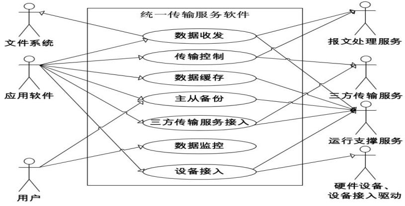
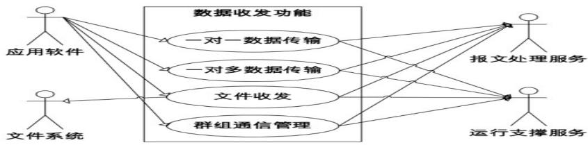

## 目 录

1 范围...  
1.1 标识.  
1.2 系统概述.  
1.2.1 系统和软件的用途.  
1.2.2 系统与软件的一般特性.  
1.3 文档概述.. ..2  
2 引用文档.. ..2  
3 需求... ..2  
3.1 要求的状态和方式.. ..2  
3.2 CSCI 能力需求. ..2  
3.2.1 数据收发（PZXQ-GN-SJSF） ..5  
3.2.2 传输控制（PZXQ-GN-CSKZ） ..13  
3.2.3 数据缓存（PZXQ-GN-SJHC）. ..16  
3.2.4 主从备份（PZXQ-GN-ZCBF） ..18  
3.2.5 三方传输服务接入（PZXQ-GN-SFCSFWJR）. ..21  
3.2.6 设备接入（PZXQ-GN-SBJR） .24  
3.2.7 数据监控（PZXQ-GN-SJJK） ..27  
3.3 CSCI 外部接口需求. ..32  
3.3.1 接口标识和接口图.. ..32  
3.3.2 与应用软件接口（PZXQ-WBJK-TYCSFW-YYRJ）.. ..33  
3.3.3 与三方传输服务接口（PZXQ-WBJK-TYCSFW-SFCSFW） ..35  
3.3.4 与运行支撑服务接口（PZXQ-WBJK-TYCSFW-YXZCFW） ..36  
3.3.5 与文件系统接口（PZXQ-WBJK-TYCSFW-WJXT） ..36  
3.3.6 与报文处理服务接口（PZXQ-WBJK-TYCSFW-BWCLFW）. ..36  
3.4 CSCI 内部接口需求.. ..37  
3.4.1 接口标识和接口图... ..37  
3.4.2 传输控制模块与数据收发模块接口（PZXQ-NBJK-TYCSFW-CKSJSF）..............39  
3.4.3 传输控制模块与数据缓存模块接口（PZXQ-NBJK-TYCSFW-CKSJHC） ..40  
3.4.4 传输控制模块与主从备份模块接口（PZXQ-NBJK-TYCSFW-CKZCBF）....... .....40  
3.4.5 传输控制模块与三方传输服务接入模块接口（PZXQ-NBJK-TYCSFW-  
CKSFFWJR）.. ..41  
3.4.6 传输控制模块与数据监控模块接口（PZXQ-NBJK-TYCSFW-CKSJJK）...............41  
3.5 CSCI 内部数据需求.. ..42  
3.6 适应性需求.. ..44  
3.7 安全性需求. ..44  
3.8 保密性需求... ..44  
3.9 CSCI 环境需求. ...44  
3.9.1 运行环境需求. ..44  
3.9.2 开发环境需求. ..45  
3.10 计算机资源需求.. ..45  
3.10.1 计算机硬件需求. .45  
3.10.2 计算机硬件资源利用需求.. ..46  
3.10.3 计算机软件需求.. ..46  
3.10.4 计算机通信需求. ..47  
3.11 软件质量因素.... ..47  
3.12 设计和构造的约束. .47  
3.13 人员需求. ..47  
3.14 培训需求... ..48  
3.15 软件保障需求. ..48  
3.16 其他需求. ..48  
3.17 验收、交付和包装需求.. ..48  
3.18 需求的优先顺序和关键性.. ..49  
4 合格性规定. ..50  
5 需求可追踪性. ..51  
6 注释... ..55

## 1 范围

## 1.1 标识

a) 本文档已被批准的标识号： $\mathrm { A } Z _ { 6 9 3 } 2 . 4 9 0 . 0 1 1 4 \mathrm { S R S }$

b) 本文档所适用的软件名称为：统一传输服务

c) 本文档的版本号为：V1.00.04/2020 年 12 月 31 日；

d) 本文档所适用的软件所属系统为：某信息系统软件。

## 1.2 系统概述

## 1.2.1系统和软件的用途

某级信息系统软件按照国产自主可控要求，进行基础软件环境选型，以及应用软件的新研和国产化迁移改造，对功能要素分散、流程独立的业务功能进行整合优化，研制适应不同使用需求、使用场景的软件，实现信息系统软件的融合、型谱优化和业务提能，推动某信息系统软件向“国产化、服务化、轻量化”方向发展。

某信息服务环境软件是某信息系统软件的重要组成，是连接底层各类硬件信息基础设施与上层各种应用系统的桥梁，通过基础平台融合汇聚底层资源，规范技术体制、支撑体系运行、促进互通互联等，是支撑构建某信息系统的重要支撑，其软件主要部署运行在各级机构的信息处理设备上，提供系统运维、数据运维、信息传输、信息处理、信息展现等功能，支撑应用软件和用户完成开发、集成、运维、运行全流程的使用。

统一传输服务完成信息服务环境软件功能域数据传输的功能，在系统运行阶段提供格式化、实时、流媒体、文件等格式数据的收发功能；提供数据传输控制功能，根据应用需求进行传输策略控制、选择不同传输信道；提供数据缓存功能，支持非结构化数据的本地缓存；提供主从备份功能，支持局域网内服务自动发现，互为备份；提供三方传输服务接入功能，提供通用传输接入接口供第三方传输服务接入；提供设备接入功能，支持网络设备物理接入和专用设备驱动软件接入；提供数据监控功能，实现对局域网内传输服务状态信息的采集，对局域网内数据流量信息、传输服务间通联状态、三方传输服务数据交互状态的采集和监控。其中数据分布式缓存功能和主从备份功能仅提供桌面版。

## 1.2.2系统与软件的一般特性

a) 需方：某单位；

b) 使用方：某单位；

c) 开发方：某单位；

d) 保障机构：某单位；

e) 运行方案：在系统开机后，随操作系统自启动；

## 1.3 文档概述

在本文档中，第2章列出了本文档中引用的其它文档的信息，第3章详细描述了统一传输服务软各种需求以及实现方式，第4章规定了确认第3章各项需求正确实现的合格性验证方法，第5章描述本文档列出的各项需求与相应的系统需求规格说明文档列出的需求的对应关系。其中，第3章是本文档的主要部分。

## 2 引用文档

本文档的引用文档见表1。

表1 引用文档
<table><tr><td rowspan=1 colspan=1>文档编号</td><td rowspan=1 colspan=1>标题</td><td rowspan=1 colspan=1>修订版本</td><td rowspan=1 colspan=1>修订日期</td><td rowspan=1 colspan=1>编写单位</td></tr><tr><td rowspan=1 colspan=1>GJB 438B-2009</td><td rowspan=1 colspan=1>《军用软件开发文档编制规范》</td><td rowspan=1 colspan=1>一</td><td rowspan=1 colspan=1>2009年5月</td><td rowspan=1 colspan=1>总装备部</td></tr><tr><td rowspan=1 colspan=1>GJB 439A-2013</td><td rowspan=1 colspan=1>《军品软件质量保证通用要求》</td><td rowspan=1 colspan=1></td><td rowspan=1 colspan=1>2013年7月</td><td rowspan=1 colspan=1>国防科学技术工业委员会</td></tr><tr><td rowspan=1 colspan=1>GJB 450A-2004</td><td rowspan=1 colspan=1>《装备可靠性工作通用要求》</td><td rowspan=1 colspan=1></td><td rowspan=1 colspan=1>2004年7月</td><td rowspan=1 colspan=1>总装备部</td></tr><tr><td rowspan=1 colspan=1>GJB 2786A-2009</td><td rowspan=1 colspan=1>《军用软件开发通用要求》</td><td rowspan=1 colspan=1></td><td rowspan=1 colspan=1>2009年5月</td><td rowspan=1 colspan=1>总装备部</td></tr><tr><td rowspan=1 colspan=1>GJB 5235-2004</td><td rowspan=1 colspan=1>《军用软件配置管理》</td><td rowspan=1 colspan=1></td><td rowspan=1 colspan=1>2004年9月</td><td rowspan=1 colspan=1>总装备部</td></tr><tr><td rowspan=1 colspan=1>GJB/Z 102A-2012</td><td rowspan=1 colspan=1>《军用软件安全性设计指南》</td><td rowspan=1 colspan=1></td><td rowspan=1 colspan=1>2012年7月</td><td rowspan=1 colspan=1>总装备部</td></tr></table>

## 3 需求

## 3.1 要求的状态和方式

统一传输服务软件只有一个运行状态，无需多个运行状态和运行方式。统一传输服务软件部署在服务器上，当软件启动后，进入运行阶段状态，在该状态下等待应用程序接入；各终端机上的应用程序通过加载统一传输服务二次开发接口库访问服务器，连接服务器成功后即可完成数据收发、传输控制、数据缓存、主从备份、三方传输服务接入、设备接入、数据监控功能。

## 3.2 CSCI 能力需求

统一传输服务软件按照其供功能需求，包含数据收发功能、传输控制功能、数据缓存功能、主从备份功能、三方传输服务接入功能、设备接入功能、数据监控功能。统一传输服务软件功能图，如图1所示。

  
图1 统一传输服务软件功能图  
统一传输服务软件用例图，如图2 所示。

  
图2 统一传输服务软件用例图  
统一传输服务软件所有能力标识表，见表2。

表2 统一传输服务软件所有能力标识
<table><tr><td colspan="1" rowspan="1">序号</td><td colspan="1" rowspan="1">Usecase 名称</td><td colspan="1" rowspan="1">项目唯一标识符</td><td colspan="1" rowspan="1">需求描述</td><td colspan="1" rowspan="1">需求重用</td><td colspan="1" rowspan="1">方式名称</td><td colspan="1" rowspan="1">运行状态</td><td colspan="1" rowspan="1">对应的任务书功能/性能</td></tr><tr><td colspan="1" rowspan="1">1</td><td colspan="1" rowspan="1">数据收发</td><td colspan="1" rowspan="1">PZXQ-GN-SJSF</td><td colspan="1" rowspan="1">提供话音业务数据的收发功能；提供流媒体业务数据的收发功能；</td><td colspan="1" rowspan="1">沿用</td><td colspan="1" rowspan="1">桌面版、平板版、手持版</td><td colspan="1" rowspan="1">运行状态</td><td colspan="1" rowspan="1">4.1.1/4.2 a)</td></tr><tr><td colspan="1" rowspan="1"></td><td colspan="1" rowspan="1"></td><td colspan="1" rowspan="1"></td><td colspan="1" rowspan="1">提供实时数据的收发功能；提供格式化数据的收发功能；提供不同格式的文件收发功能，支持文件发送进度获取、文件断点续传，提供文件收发二次开发接口；提供一对一、一对多的数据传输功能，支持应用软件按照用户标识、软件标识、通信标识发送数据，支持应用软件根据数据来源、数据类型订阅数据，提供数据订阅发送二次开发接口；提供群组通信管理功能，支持应用软件创建群组、注销群组、加入群组、退出群组、收发群组消息、查询群组成员在线状态和成员列表，并提供二次开发接口。</td><td colspan="1" rowspan="1"></td><td colspan="1" rowspan="1"></td><td colspan="1" rowspan="1"></td><td colspan="1" rowspan="1"></td></tr><tr><td colspan="1" rowspan="1">2</td><td colspan="1" rowspan="1">传输控制</td><td colspan="1" rowspan="1">PZXQ-GN-CSKZ</td><td colspan="1" rowspan="1">提供根据应用需求选择传输策略（可靠性、优先级、流控策略等）发送数据的功能；提供根据应用需求、网络状态选择三方传输服务软件和传输信道的功能；提供传输策略外部配置功能，支持应用软件根据需求修改传输策略（如重传次数、数据包拆包大小、流控等级等)参数；提供数据可靠传输功能，具备通过部分确认和完全确认的机制，完成可靠传输数据的丢包重传功能的功能；提供数据包拆包组包功能，具备根据传输配置参数对数据包进行拆包和按序重组的能力。提供根据数据优先级完成高优先级数据优先发送的功能；提供根据不同流控策略调节发</td><td colspan="1" rowspan="1">沿用</td><td colspan="1" rowspan="1">桌面版、平板版、手持版</td><td colspan="1" rowspan="1">运行状态</td><td colspan="1" rowspan="1">4.1.2</td></tr><tr><td colspan="1" rowspan="1"></td><td colspan="1" rowspan="1"></td><td colspan="1" rowspan="1"></td><td colspan="1" rowspan="1">送速率的功能；</td><td colspan="1" rowspan="1"></td><td colspan="1" rowspan="1"></td><td colspan="1" rowspan="1"></td><td colspan="1" rowspan="1"></td></tr><tr><td colspan="1" rowspan="1">3</td><td colspan="1" rowspan="1">数据缓存</td><td colspan="1" rowspan="1">PZXQ-GN-SJHC</td><td colspan="1" rowspan="1">提供非结构化数据的本地临时缓存功能，支持数据按照用户标识、软件标识、数据类型、业务标识等进行存取，支持按照指定队列名称、指定时间段获取指定数量条数数据的功能；</td><td colspan="1" rowspan="1">改进</td><td colspan="1" rowspan="1">桌面版、平板版、手持版</td><td colspan="1" rowspan="1">运行状态</td><td colspan="1" rowspan="1">4.1.3/4.2b)</td></tr><tr><td colspan="1" rowspan="1">4</td><td colspan="1" rowspan="1">主从备份</td><td colspan="1" rowspan="1">PZXQ-GN-ZCBF</td><td colspan="1" rowspan="1">提供主从服务器上传输服务之间互为备份的功能；提供主从服务器上传输服务之间自动发现的功能，支持静态配置和广播的发现模式。</td><td colspan="1" rowspan="1">新研</td><td colspan="1" rowspan="1">桌面版、平板版、手持版</td><td colspan="1" rowspan="1">运行状态</td><td colspan="1" rowspan="1">4.1.4</td></tr><tr><td colspan="1" rowspan="1">5</td><td colspan="1" rowspan="1">三方传输服务接入</td><td colspan="1" rowspan="1">PZXQ-GN-SFCSFWJR</td><td colspan="1" rowspan="1">提供三方传输服务接入的功能，提供通用传输接入接口，支持第三方传输服务通过接口实现第三方传输服务的接入。</td><td colspan="1" rowspan="1">改进</td><td colspan="1" rowspan="1">桌面版、平板版、手持版</td><td colspan="1" rowspan="1">运行状态</td><td colspan="1" rowspan="1">4.1.5</td></tr><tr><td colspan="1" rowspan="1">6</td><td colspan="1" rowspan="1">设备接入</td><td colspan="1" rowspan="1">PZXQ-GN-SBJR</td><td colspan="1" rowspan="1">提供网络设备物理接入的功能，支持以UDP、TCP的方式接入网络通信设备；提供专用设备驱动软件接入的功能，支持专用设备驱动软件通过专用接口接入的方式接入；提供北斗设备接入服务软件接入的功能。</td><td colspan="1" rowspan="1">沿用</td><td colspan="1" rowspan="1">桌面版、平板版、手持版</td><td colspan="1" rowspan="1">运行状态</td><td colspan="1" rowspan="1">4.1.6</td></tr><tr><td colspan="1" rowspan="1">7</td><td colspan="1" rowspan="1">数据监控</td><td colspan="1" rowspan="1">PZXQ-GN-SJJK</td><td colspan="1" rowspan="1">提供对局域网内传输服务状态信息的采集功能；提供对局域网内数据流量信息的采集和统计显示功能；提供对局域网内传输服务间通联状态的采集和可视化显示功能；提供对三方传输服务数据交互状态的监控功能，包括统一传输服务与传输服务、第三方传输服务之间数据交互状态的监控。</td><td colspan="1" rowspan="1">沿用</td><td colspan="1" rowspan="1">桌面版、平板版</td><td colspan="1" rowspan="1">运行状态</td><td colspan="1" rowspan="1">4.1.7</td></tr></table>

## 3.2.1数据收发（PZXQ-GN-SJSF）

统一传输服务软件对应用软件提供数据收发功能，包含话音业务数据、流媒体业务

数据、实时数据、格式化数据和文件收发功能，支持一对一、一对多的数据传输功能和群组通信管理功能，其功能用例如图3所示。

  
图3 数据收发功能用例图  
数据收发功能所有能力标识表，见表3。

表3 数据收发功能所有能力标识
<table><tr><td colspan="1" rowspan="1">序号</td><td colspan="1" rowspan="1">Use case 名称</td><td colspan="1" rowspan="1">项目唯一标识符</td><td colspan="1" rowspan="1">需求描述</td><td colspan="1" rowspan="1">需求重用</td><td colspan="1" rowspan="1">方式名称</td><td colspan="1" rowspan="1">运行状态</td><td colspan="1" rowspan="1">对应的任务书功能/性能</td></tr><tr><td colspan="1" rowspan="1">1</td><td colspan="1" rowspan="1">一对一数据传输</td><td colspan="1" rowspan="1">PZXQ-GN-SJSF-YDYSJCS</td><td colspan="1" rowspan="1">提供一对一的数据传输功能，支持应用软件按照用户标识、软件标识、通信标识发送数据，支持应用软件根据数据来源、数据类型订阅数据，提供数据订阅发送二次开发接口；</td><td colspan="1" rowspan="1">沿用</td><td colspan="1" rowspan="1">桌面版、平板版、手持版</td><td colspan="1" rowspan="1">运行阶段</td><td colspan="1" rowspan="1"></td></tr><tr><td colspan="1" rowspan="1">2</td><td colspan="1" rowspan="1">一对多数据传输</td><td colspan="1" rowspan="1">PZXQ-GN-SJSF-YDDSJCS</td><td colspan="1" rowspan="1">提供一对多的数据传输功能，支持应用软件按照用户标识、软件标识、通信标识发送数据，支持应用软件根据数据来源、数据类型订阅数据，提供数据订阅发送二次开发接口；</td><td colspan="1" rowspan="1">沿用</td><td colspan="1" rowspan="1">桌面版、平板版、手持版</td><td colspan="1" rowspan="1">运行阶段</td><td colspan="1" rowspan="1"></td></tr><tr><td colspan="1" rowspan="1">3</td><td colspan="1" rowspan="1">文件收发</td><td colspan="1" rowspan="1">PZXQ-GN-SJSF-WJSF</td><td colspan="1" rowspan="1">提供不同格式的文件收发功能，支持文件发送进度获取、文件断点续传，提供文件收发二次开发接口；</td><td colspan="1" rowspan="1">沿用</td><td colspan="1" rowspan="1">桌面版、平板版、手持版</td><td colspan="1" rowspan="1">运行阶段</td><td colspan="1" rowspan="1"></td></tr><tr><td colspan="1" rowspan="1">4</td><td colspan="1" rowspan="1">群组通信管理</td><td colspan="1" rowspan="1">PZXQ-GN-SJSF-</td><td colspan="1" rowspan="1">提供群组通信管理功能，支</td><td colspan="1" rowspan="1">沿用</td><td colspan="1" rowspan="1">桌面</td><td colspan="1" rowspan="1">运行阶段</td><td colspan="1" rowspan="1"></td></tr><tr><td colspan="1" rowspan="1"></td><td colspan="1" rowspan="1"></td><td colspan="1" rowspan="1">QZTXGL</td><td colspan="1" rowspan="1">持应用软件创建群组、注销群组、加入群组、退出群组、收发群组消息、查询群组成员在线状态和成员列表，并提供二次开发接口；</td><td colspan="1" rowspan="1"></td><td colspan="1" rowspan="1">版、平板版、手持版</td><td colspan="1" rowspan="1"></td><td colspan="1" rowspan="1"></td></tr></table>

## 3.2.1.1 一对一数据传输（PZXQ-GN-SJSF-YDYSJCS）

一对一数据传输用例场景，见表4。

表4 一对一数据传输用例描述
<table><tr><td rowspan=1 colspan=1>Use Case 名称：一对一数据传输</td><td rowspan=1 colspan=2>Actors:应用软件</td></tr><tr><td rowspan=1 colspan=3>概述：本用例是一对一数据传输的用例，描述应用软件一对一收发数据的过程；</td></tr><tr><td rowspan=1 colspan=3>前置条件：(1)统一传输服务启动正常。(2)应用软件收发端网络连接正常。</td></tr><tr><td rowspan=1 colspan=3>主事件流</td></tr><tr><td rowspan=1 colspan=1>Actor 的动作</td><td rowspan=1 colspan=1>系统的动作</td><td rowspan=1 colspan=1>动作约束(性能、可靠性、容错等)</td></tr><tr><td rowspan=1 colspan=1>1. 应用软件调用统一传输服务初始化接口，进行初始化；3.应用软件调用注册接口，按照接口要求完成用户标识、软件标识、数据接收回调函数参数填写；5.应用软件调用数据发送接口，按照接口要求完成源用户信息、单个目的用户信息、数据类型、数据内容、数据长度、传输属性等参数的填写，发送数据；</td><td rowspan=1 colspan=1>2. 系统将应用软件与统一传输服务服务端建立连接，如果连接成功，即时将初始化结果反馈给应用软件；如果连接失败，向应用软件反馈失败原因，执行异常流E1；4.系统按照用户标识、软件标识对用户软件进行注册，并建立用户标识、软件标识到数据接收回调函数的映射关系并存储，如果映射成功，即时将注册结果反馈给应用软件；如果失败，向应用软件反馈失败原因，执行异常流E2，并在映射关系表中删除对应的映射关系；</td><td rowspan=1 colspan=1></td></tr></table>

<table><tr><td rowspan=2 colspan=1>8.应用软件在数据接收回调函数中处理接收到的数据。</td><td></td></tr><tr><td rowspan=1 colspan=1>6.系统按照应用软件要求，按照数据类型对数据进行报文编解码处理，若处理失败，则将失败结果返回给应用软件，执行异常流E3；若处理成功，按照传输属性选择传输策略和信道，若传入传输属性等参数有误，则将发送失败结果反馈给应用软件，执行异常流E4；若传入参数无误，则根据传入参数选择信道传输服务/三方传输服务将数据发送至指定目的用户，并将数据发送结果即时反馈给应用软件；7.系统收到数据后解析其目的用户、目的软件标识信息，在用户标识、软件标识到数据接收回调函数的映射关系表中查找对应的数据接收回调首地址，若未找到，则不处理该数据；若找到，则根据数据类型调用报文编解码将数据解码后通过回调函数回传给应用软件；</td></tr><tr><td rowspan=1 colspan=2>异常流E1：系统提示初始化失败，向运行支撑服务写入错误日志，用例结束。</td></tr><tr><td rowspan=1 colspan=2>异常流E2：系统提示注册失败，向运行支撑服务写入错误日志，用例结束。</td></tr><tr><td rowspan=1 colspan=2>异常流E3：系统提示数据处理失败，向运行支撑服务写入错误日志，用例结束。</td></tr><tr><td rowspan=1 colspan=2>异常流E4：系统提示传入参数无效，向运行支撑服务写入错误日志，用例结束。</td></tr><tr><td rowspan=1 colspan=2>后置条件：无。</td></tr></table>

## 3.2.1.2 一对多数据传输（PZXQ-GN-SJSF-YDDSJCS）

一对多数据传输用例场景，见表5。

表5 一对多数据传输用例描述
<table><tr><td rowspan=1 colspan=1>Use Case 名称:一对多数据传输</td><td rowspan=1 colspan=2>Actors：应用软件</td></tr><tr><td rowspan=1 colspan=3>概述：本用例是一对多数据传输的用例，描述应用软件一对多收发数据的过程；</td></tr><tr><td rowspan=1 colspan=3>前置条件：(1)统一传输服务启动正常。(2)所有应用软件收发端网络连接正常。</td></tr><tr><td rowspan=1 colspan=3>主事件流</td></tr><tr><td rowspan=1 colspan=1>Actor 的动作</td><td rowspan=1 colspan=1>系统的动作</td><td rowspan=1 colspan=1>动作约束(性能、可靠性、容错等)</td></tr></table>