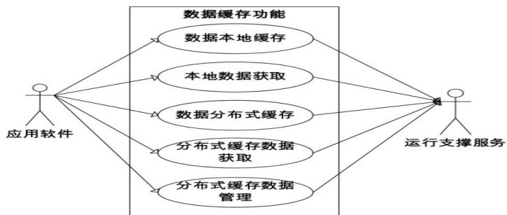
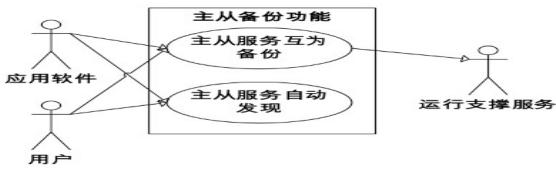
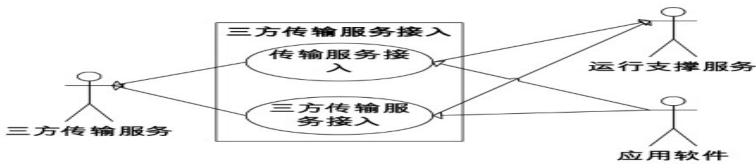

<table><tr><td rowspan=1 colspan=1>8.应用软件调用数据发送接口，按照接口要求完成源用户信息、目的用户信息、数据类型、数据内容、数据长度、传输属性等参数的填写，填写完成后发送数据；11. 应用软件在数据接收回调函数中处理接收到的数据。</td><td rowspan=1 colspan=1>9.系统按照应用软件要求，按照数据类型调用报文处理服务对数据进行编码处理，若处理失败，则将发送失败结果返回给应用软件，执行异常流E3；若处理成功，按照传输属性选择对应的传输策略，将数据发送至目的用户，并将数据发送结果即时反馈给应用软件；10. 系统收到数据后解析其目的用户、目的软件标识信息，在用户标识、软件标识到数据接收回调函数的映射关系表中查找对应的数据接收回调首地址，若未找到，则不处理该数据；若找到，则根据数据类型调用报文处理服务将数据解码后通过回调函数回传给应用软件；</td><td rowspan=1 colspan=1></td></tr><tr><td rowspan=1 colspan=2>异常流E1：系统提示初始化失败，向运行支撑服务写入错误日志，用例结束。</td><td rowspan=1 colspan=1></td></tr><tr><td rowspan=1 colspan=2>异常流E2：系统提示注册失败，向运行支撑服务写入错误日志，用例结束。</td><td rowspan=1 colspan=1></td></tr><tr><td rowspan=1 colspan=2>异常流E3：系统提示数据处理失败，向运行支撑服务写入错误日志，用例结束。</td><td rowspan=1 colspan=1></td></tr><tr><td rowspan=1 colspan=2>后置条件：无。</td><td rowspan=1 colspan=1></td></tr></table>

## 3.2.3数据缓存（PZXQ-GN-SJHC）

数据缓存功能主要完成业务数据的缓存和获取，包含数据本地缓存、本地数据获取，其功能用例如图5所示。

  
图5 数据缓存功能用例图

数据缓存功能所有能力标识表，见表10。

表10 数据缓存功能所有能力标识
<table><tr><td rowspan=1 colspan=1>序号</td><td rowspan=1 colspan=1>Use case 名称</td><td rowspan=1 colspan=1>项目唯一标识符</td><td rowspan=1 colspan=1>需求描述</td><td rowspan=1 colspan=1>需求重用</td><td rowspan=1 colspan=1>方式名称</td><td rowspan=1 colspan=1>运行状态</td><td rowspan=1 colspan=1>对应的任务书功能/性能</td></tr><tr><td rowspan=1 colspan=1>1</td><td rowspan=1 colspan=1>数据本地缓存</td><td rowspan=1 colspan=1>PZXQ-GN-SJHC-SJBDHC</td><td rowspan=1 colspan=1>提供非结构化数据的本地临时缓存功能，支持数据按照用户标识、软件标识、数据类型、业务标识等进行缓存；</td><td rowspan=1 colspan=1>改进</td><td rowspan=1 colspan=1>桌面版、平板版、手持版</td><td rowspan=1 colspan=1>运行阶段</td><td rowspan=1 colspan=1>4.1.3a)/4.2b)</td></tr><tr><td rowspan=1 colspan=1>2</td><td rowspan=1 colspan=1>本地数据获取</td><td rowspan=1 colspan=1>PZXQ-GN-SJHC-BDSJHQ</td><td rowspan=1 colspan=1>提供非结构化数据的本地临时缓存功能，支持数据按照用户标识、软件标识、数据类型、业务标识等进行获取；</td><td rowspan=1 colspan=1>改进</td><td rowspan=1 colspan=1>桌面版、平板版、手持版</td><td rowspan=1 colspan=1>运行阶段</td><td rowspan=1 colspan=1>4.1.3 a)/4.2b)</td></tr></table>

## 3.2.3.1 数据本地缓存（PZXQ-GN-SJHC-SJBDHC）

数据本地缓存用例场景，见表11。

表11 数据本地缓存用例描述
<table><tr><td>Use Case 名称:数据本地缓存</td><td colspan="2">Actors:应用软件</td></tr><tr><td colspan="3">概述：本用例是数据本地缓存的用例，描述应用软件按照用户标识、软件标识、数据类型、业务标识等进行数据本地 缓存的过程；</td></tr><tr><td colspan="3">前置条件：(1)统一传输服务启动正常。</td></tr><tr><td colspan="3">(2)应用软件与统一传输服务网络连接正常。</td></tr><tr><td colspan="3" rowspan="1">主事件流</td></tr><tr><td colspan="1" rowspan="1">Actor 的动作</td><td colspan="1" rowspan="1">系统的动作</td><td colspan="1" rowspan="1">动作约束(性能、可靠性、容错等)</td></tr><tr><td colspan="1" rowspan="1">1. 应用软件调用统一传输服务初始化接口，进行初始化；3.应用软件调用数据存储接口，按照接口要求完成用户标识、软件标识、数据类型、业务标识、缓存数据内容、数据长度参数的填写，缓存标志位填为false,填写完成后发送缓存请求；</td><td colspan="1" rowspan="1">2.系统将应用软件与统一传输服务服务端建立连接，如果连接成功，即时将初始化结果反馈给应用软件；如果连接失败，向应用软件反馈失败原因，执行异常流E1；4.系统按照应用软件要求，按照用户标识、软件标识、数据类型、业务标识对数据进行本地缓存，将缓存结果及时返回给应用软件，若缓存失败，则将失败结果返回给应用软件，执行异常流E2 ;</td><td colspan="1" rowspan="1">支持缓存数据的硬盘存.支持服务器异常断电或宕机的状态下存储数据不会丢失；</td></tr><tr><td colspan="2" rowspan="1">异常流E1：系统提示初始化失败，向运行支撑服务写入错误日志，用例结束。</td><td colspan="1" rowspan="1"></td></tr><tr><td colspan="2" rowspan="1">异常流E2：系统提示数据缓存失败，向运行支撑服务写入错误日志，用例结束。</td><td colspan="1" rowspan="1"></td></tr><tr><td colspan="2" rowspan="1">后置条件：无。</td><td colspan="1" rowspan="1"></td></tr></table>

## 3.2.3.2 本地数据获取（PZXQ-GN-SJHC-BDSJHQ）

本地数据获取用例场景，见表12。

表12 本地数据获取用例描述
<table><tr><td colspan="1" rowspan="1">Use Case 名称:本地数据获取</td><td colspan="2" rowspan="1">Actors:应用软件</td></tr><tr><td colspan="3" rowspan="1">概述：本用例是本地数据获取的用例，描述应用软件从本地获取数据的过程；</td></tr><tr><td colspan="3" rowspan="1">前置条件：(1)统一传输服务启动正常。(2)应用软件与统一传输服务网络连接正常。</td></tr><tr><td colspan="3" rowspan="1">主事件流</td></tr><tr><td colspan="1" rowspan="1">Actor 的动作</td><td colspan="1" rowspan="1">系统的动作</td><td colspan="1" rowspan="1">动作约束(性能、可靠性、容错等)</td></tr><tr><td colspan="1" rowspan="1">1.应用软件调用统一传输服务初始化接口，进行初始化；</td><td colspan="1" rowspan="1">2. 系统将应用软件与统一传输服务服务端建立连接，如果连接成功，即时将</td><td colspan="1" rowspan="1">支持缓存数据的硬盘存,支持服务器异常断电或宕机的状态下存储数据不会丢失；</td></tr><tr><td colspan="1" rowspan="1">3.应用软件调用数据获取接口，按照接口要求完成用户标识、软件标识、数据类型、业务标识、输出数据内容指针、输出数据长度等参数的填写，获取标志位填为false,填写完成后发送获取数据请求；</td><td colspan="1" rowspan="1">初始化结果反馈给应用软件；如果连接失败，向应用软件反馈失败原因，执行异常流E1；4.系统按照应用软件要求，按照用户标识、软件标识、数据类型、业务标识在本地缓存队列中查找满足条件的数据，若查找成功，则将数据内容和长度及时返回给应用软件；若获取失败，则将失败结果返回给应用软件，执行异常流E2;</td><td colspan="1" rowspan="1"></td></tr><tr><td colspan="2" rowspan="1">异常流E1：系统提示初始化失败，向运行支撑服务写入错误日志，用例结束。</td><td colspan="1" rowspan="1"></td></tr><tr><td colspan="2" rowspan="1">异常流E2：系统提示数据获取失败，向运行支撑服务写入错误日志，用例结束。</td><td colspan="1" rowspan="1"></td></tr><tr><td colspan="2" rowspan="1">后置条件：无。</td><td colspan="1" rowspan="1"></td></tr></table>

## 3.2.4主从备份（PZXQ-GN-ZCBF）

主从备份功能包含主从服务互为备份和主从服务自动发现功能，其功能用例如图6所示。

  
图6 主从备份功能用例图

主从备份功能所有能力标识表，见表13。

表13 主从备份功能所有能力标识

<table><tr><td rowspan=1 colspan=1>序号</td><td rowspan=1 colspan=1>Use case 名称</td><td rowspan=1 colspan=1>项目唯一标识符</td><td rowspan=1 colspan=1>需求描述</td><td rowspan=1 colspan=1>需求重用</td><td rowspan=1 colspan=1>方式名称</td><td rowspan=1 colspan=1>运行状态</td><td rowspan=1 colspan=1>对应的任务书功能/性能</td></tr><tr><td rowspan=1 colspan=1>1</td><td rowspan=1 colspan=1>主从服务互为备份</td><td rowspan=1 colspan=1>PZXQ-GN-ZCBF-ZCFWHWBF</td><td rowspan=1 colspan=1>提供主从服务器上传输服务之间互为备份的功能；</td><td rowspan=1 colspan=1>新研</td><td rowspan=1 colspan=1>桌面版、平板版、手持版</td><td rowspan=1 colspan=1>运行阶段</td><td rowspan=1 colspan=1>4.1.4 a)</td></tr><tr><td rowspan=1 colspan=1>2</td><td rowspan=1 colspan=1>主从服务自动发现</td><td rowspan=1 colspan=1>PZXQ-GN-ZCBF-ZCFWZDFX</td><td rowspan=1 colspan=1>提供主从服务器上传输服务之间自动发现的功能，支持静态配置和广播的发现模式；</td><td rowspan=1 colspan=1>新研</td><td rowspan=1 colspan=1>桌面版、平板版、手持版</td><td rowspan=1 colspan=1>运行阶段</td><td rowspan=1 colspan=1>4.1.4 b)</td></tr></table>

## 3.2.4.0 主从服务互为备份（PZXQ-GN-SJHC-SJBDHC）

主从服务互为备份用例场景，见表14。

表14 主从服务互为备份用例描述
<table><tr><td colspan="1" rowspan="1">Use Case 名称：主从服务互为备份</td><td colspan="2" rowspan="1">Actors：应用软件、用户</td></tr><tr><td colspan="3" rowspan="1">概述：本用例是主从服务互为备份的用例，描述在主从服务器上传输服务之间互为备份的功能；</td></tr><tr><td colspan="3" rowspan="1">前置条件：(1)主备服务器上的统一传输服务均启动正常。(2)应用软件和主备服务器之间网络连接正常。(3)主备服务器之间网络连接正常。(4)统一传输服务客户端配置文件中主备服务器IP配置正常。</td></tr><tr><td colspan="3" rowspan="1">主事件流</td></tr><tr><td colspan="1" rowspan="1">Actor 的动作</td><td colspan="1" rowspan="1">系统的动作</td><td colspan="1" rowspan="1">动作约束(性能、可靠性、容错等)</td></tr><tr><td colspan="1" rowspan="1">1.应用软件调用统一传输服务初始化接口，进行初始化；3.应用软件调用注册接口，按照接口要求完成用户标识、软件标识、数据接收回调函数参数填写；</td><td colspan="1" rowspan="1">2. 系统将应用软件与统一传输服务服务端建立连接，如果连接成功，即时将初始化结果反馈给应用软件；如果连接失败，向应用软件反馈失败原因，执行异常流E1；4.系统按照用户标识、软件标识对用户软件进行注册，并建立用户标识、软件标识到数据接收回调函数的映射关系并存储，如果映射成功，即时将注册结果反馈给应用软件；如果失败，向应用</td><td colspan="1" rowspan="1"></td></tr><tr><td colspan="1" rowspan="1">5.应用软件调用数据发送接口，按照接口要求完成源用户信息、目的用户信息、数据类型、数据内容、数据长度、传输属性等参数的填写，发送数据；8.应用软件在数据接收回调函数中处理接收到的数据；9.用户关闭主服务器上的统一传输服务；11. 应用软件调用数据发送接口能够继续正常发送数据。</td><td colspan="1" rowspan="1">软件反馈失败原因，执行异常流E2，并在映射关系表中删除对应的映射关系；6.系统按照应用软件要求，按照数据类型对数据进行处理，若处理失败，则将发送失败结果返回给应用软件，执行异常流E3；若处理成功，则按照传输属性将数据发送至目的用户，并将数据发送结果即时反馈给应用软件；7.系统收到数据后解析其目的用户、目的软件标识信息，在用户标识、软件标识到数据接收回调函数的映射关系表中查找对应的数据接收回调首地址，若未找到，则不处理该数据；若找到，则将接收到的数据和相关信息通过回调函数回传给应用软件；10. 系统将应用软件的连接切换到备份服务器；</td><td colspan="1" rowspan="1"></td></tr><tr><td colspan="2" rowspan="1">异常流E1：系统提示初始化失败，向运行支撑服务写入错误日志，用例结束。</td><td colspan="1" rowspan="1"></td></tr><tr><td colspan="2" rowspan="1">异常流E2：系统提示注册失败，向运行支撑服务写入错误日志，用例结束。</td><td colspan="1" rowspan="1"></td></tr><tr><td colspan="2" rowspan="1">异常流E3：系统提示数据处理失败，向运行支撑服务写入错误日志，用例结束。</td><td colspan="1" rowspan="1"></td></tr><tr><td colspan="2" rowspan="1">后置条件：无。</td><td colspan="1" rowspan="1"></td></tr></table>

## 3.2.4.1 主从服务自动发现（PZXQ-GN-SJHC-SJBDHC）

主从服务自动发现用例场景，见表15。

表15 主从服务自动发现用例描述
<table><tr><td>Use Case 名称：主从服务自动发现</td><td colspan="2">Actors：应用软件、用户</td></tr><tr><td colspan="3">概述：本用例是主从服务自动发现的用例，描述在主从服务器上传输服务之间静态配置和广播发现的过程；</td></tr><tr><td colspan="3">前置条件：(1)主备服务器上的统一传输服务均启动正常。</td></tr><tr><td colspan="3">(2)应用软件和主备服务器之间网络连接正常。 (3)主备服务器之间网络连接正常。</td></tr><tr><td colspan="3">(4)统一传输服务客户端配置文件中主备服务器IP配置正常。</td></tr><tr><td colspan="3">主事件流</td></tr><tr><td>Actor 的动作 1.用户将主备服务器上的传输服务均 配置为静态发现模式，静态发现节点IP</td><td>系统的动作</td><td>动作约束 (性能、可靠性、容错等)</td></tr><tr><td>均填为另外一台服务器的IP地址，分别 启动主备服务器上的传输服务；</td><td></td><td></td></tr><tr><td>3.用户打开统一传输服务辅助工具查</td><td>2. 系统根据配置文件中配置周期性向 配置的另外一台服务器发送心跳包，并 携带自身相关信息以便相互发现；</td><td></td></tr><tr><td>看当前网络中存在两个传输服务，且分 别为主备传输服务； 4.用户关闭备份服务器上的传输服</td><td></td><td></td></tr><tr><td>务；</td><td>5.系统一段时间接收不到备份服务器 的心跳包，将备份服务器从自身维护的 服务列表中删除；</td><td></td></tr><tr><td>6.用户在统一传输服务辅助工具查看 到当前网络中只有一个传输服务，且为</td><td></td><td></td></tr><tr><td>主服务器； 7.用户关闭主服务器上的传输服务，</td><td></td><td></td></tr><tr><td>在统一传输服务辅助工具看到服务异常 的提示；</td><td></td><td></td></tr><tr><td>8.用户修改主备服务器上的发现模式 为广播发现，然后分别启动主备服务器</td><td></td><td></td></tr><tr><td></td><td></td><td></td></tr><tr><td></td><td></td><td></td></tr><tr><td></td><td></td><td></td></tr><tr><td></td><td></td><td></td></tr><tr><td>上的传输服务；</td><td></td><td></td></tr><tr><td></td><td></td><td></td></tr><tr><td></td><td></td><td></td></tr><tr><td></td><td></td><td></td></tr><tr><td></td><td></td><td></td></tr><tr><td></td><td>9.系统根据配置文件中配置周期性向</td><td></td></tr><tr><td></td><td></td><td></td></tr><tr><td></td><td>广播发送心跳包，并携带自身相关信息</td><td></td></tr><tr><td></td><td></td><td></td></tr><tr><td></td><td></td><td></td></tr><tr><td></td><td>以便其他服务发现自身；</td><td></td></tr><tr><td></td><td></td><td></td></tr><tr><td>10. 用户打开统一传输服务辅助工具查</td><td></td><td></td></tr><tr><td>别为主备传输服务；</td><td></td><td></td></tr><tr><td>异常流E1：无。</td><td></td><td></td></tr><tr><td>后置条件：无。</td><td></td><td></td></tr></table>

## 3.2.5三方传输服务接入（PZXQ-GN-SFCSFWJR）

三方传输服务接入功能主要提供与传输接入和与三方传输接入的功能，其功能用例如图7所示。

  
图7 三方传输服务接入功能用例图

三方传输服务接入功能所有能力标识表，见表16。

表16 三方传输服务接入功能所有能力标识
<table><tr><td rowspan=1 colspan=1>序号</td><td rowspan=1 colspan=1>Use case 名称</td><td rowspan=1 colspan=1>项目唯一标识符</td><td rowspan=1 colspan=1>需求描述</td><td rowspan=1 colspan=1>需求重用</td><td rowspan=1 colspan=1>方式名称</td><td rowspan=1 colspan=1>运行状态</td><td rowspan=1 colspan=1>对应的任务书功能/性能</td></tr><tr><td rowspan=1 colspan=1>1</td><td rowspan=1 colspan=1>传输服务接入</td><td rowspan=1 colspan=1>PZXQ-GN-SFCSFWJR-XYCSFWJR</td><td rowspan=1 colspan=1>提供传输服务接入的功能，支持等传输服务的接入；</td><td rowspan=1 colspan=1>改进</td><td rowspan=1 colspan=1>桌面版、平板版、手持版</td><td rowspan=1 colspan=1>运行阶段</td><td rowspan=1 colspan=1>4.1.5 a)</td></tr><tr><td rowspan=1 colspan=1>2</td><td rowspan=1 colspan=1>三方传输服务接入</td><td rowspan=1 colspan=1>PZXQ-GN-SFCSFWJR-SFCSFWJR</td><td rowspan=1 colspan=1>提供三方传输服务接入的功能，提供通用传输接入接口，支持第三方传输服务通过接口实现第三方传输服务的接入；</td><td rowspan=1 colspan=1>改进</td><td rowspan=1 colspan=1>桌面版、平板版、手持版</td><td rowspan=1 colspan=1>运行阶段</td><td rowspan=1 colspan=1>4.1.5 b)</td></tr></table>

## 3.2.5.1 传输服务接入（PZXQ-GN-SFCSFWJR-XYCSFWJR）

传输服务接入用例场景，见表17。

表17 传输服务接入用例描述
<table><tr><td>Use Case 名称：传输服务接入</td><td colspan="2">Actors:应用软件</td></tr><tr><td colspan="3">概述：本用例是传输服务接入的用例，描述等传输服务接入到统一传输服务后与系统互通的过程； 前置条件：(1)统一传输服务启动正常。 (2)传输服务（传输服务/短报文传输服务等）正常启动。 (3)应用软件收发端网络连接正常。</td></tr><tr><td colspan="4">主事件流</td></tr><tr><td>Actor 的动作</td><td>系统的动作</td><td>动作约束 (性能、可靠性、容错等)</td><td></td></tr><tr><td>1.启动传输服务传输服务；</td><td>2. 系统将传输服务接入统一传输服务 底层；</td><td colspan="2"></td></tr><tr><td>3. 应用软件调用统一传输服务初始化 接口，进行初始化； 5.应用软件调用注册接口，按照接口 要求完成用户标识、软件标识、数据接 收回调函数参数填写；</td><td>4.系统将应用软件与统一传输服务服 务端建立连接，如果连接成功，即时将 初始化结果反馈给应用软件；如果连接 失败，向应用软件反馈失败原因，执行 异常流E1； 6.系统按照用户标识、软件标识对用</td><td rowspan="2"></td></tr><tr><td>7.应用软件调用数据发送接口，按照 接口要求完成源用户信息、目的用户信 息、数据类型、数据内容、数据长度、 传输属性等参数的填写，其中传输属性 参数可根据应用自身需求进行填写，优 先级填为0，可靠性填为1，填写完成后 发送数据；</td><td>户软件进行注册，并建立用户标识、软 件标识到数据接收回调函数的映射关系 并存储，如果映射成功，即时将注册结 果反馈给应用软件：如果失败，向应用 软件反馈失败原因，执行异常流E2，并 在映射关系表中删除对应的映射关系； 8.系统按照应用软件要求，按照数据 类型对数据进行处理，若处理失败，则</td></tr><tr><td colspan="1" rowspan="1">10. 应用软件在数据接收回调函数中处理接收到的数据。</td><td colspan="1" rowspan="1">将发送失败结果返回给应用软件，执行异常流E3；若处理成功，则将数据进行封装后发送至传输服务，并将数据发送结果即时反馈给应用软件。传输服务根据目的用户信息将数据发送至目的用户；9. 传输服务收到数据后将数据发送给统一传输服务，统一传输服务收到数据后解析其目的用户、目的软件标识信息，在用户标识、软件标识到数据接收回调函数的映射关系表中查找对应的数据接收回调首地址，若未找到，则不处理该数据；若找到，则将接收到的数据和相关信息通过回调函数回传给应用软件；</td><td colspan="2" rowspan="1"></td></tr><tr><td colspan="2" rowspan="1">异常流E1：系统提示初始化失败，向运行支撑服务写入错误日志，用例结束。</td><td colspan="2" rowspan="1"></td></tr><tr><td colspan="2" rowspan="1">异常流E2：系统提示注册失败，向运行支撑服务写入错误日志，用例结束。</td><td colspan="2" rowspan="1"></td></tr><tr><td colspan="2" rowspan="1">异常流E3：系统提示数据处理失败，向运行支撑服务写入错误日志，用例结束。</td><td colspan="2" rowspan="1"></td></tr><tr><td colspan="2" rowspan="1">后置条件：无。</td><td colspan="2" rowspan="1"></td></tr></table>

## 3.2.5.2 三方传输服务接入（PZXQ-GN-SFCSFWJR-SFCSFWJR）

三方传输服务接入用例场景，见表18。

表18 三方传输服务接入用例描述
<table><tr><td rowspan=1 colspan=1>Use Case 名称:三方传输服务接入</td><td rowspan=1 colspan=2>Actors:应用软件</td></tr><tr><td rowspan=1 colspan=3>概述：本用例是三方传输服务接入的用例，描述第三方传输服务通过接口实现第三方传输服务接入的过程；</td></tr><tr><td rowspan=1 colspan=3>前置条件：(1)统一传输服务启动正常。(2) 三方传输服务正常启动。(3)应用软件收发端网络连接正常。</td></tr><tr><td rowspan=1 colspan=3>主事件流</td></tr><tr><td rowspan=1 colspan=1>Actor 的动作</td><td rowspan=1 colspan=1>系统的动作</td><td rowspan=1 colspan=1>动作约束(性能、可靠性、容错等)</td></tr><tr><td rowspan=1 colspan=1>1.  应用软件调用统一传输服务初始化</td><td rowspan=1 colspan=1></td><td rowspan=1 colspan=1></td></tr></table>