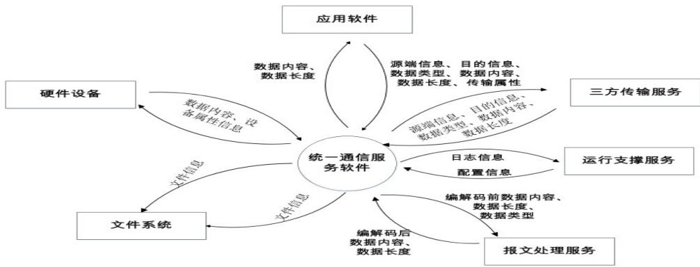
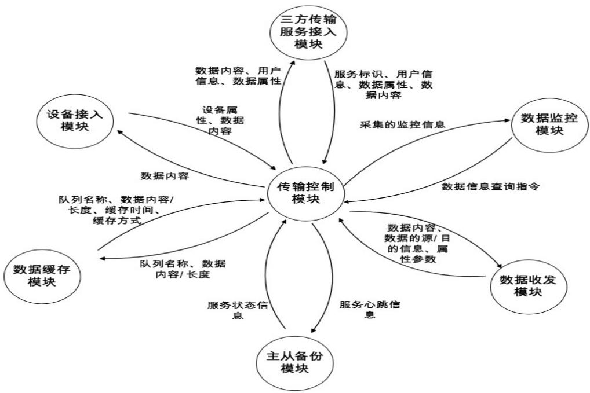

<table><tr><td>异常流 E1：无。</td><td></td></tr><tr><td>后置条件：无。</td><td></td></tr></table>

## 3.3 CSCI 外部接口需求

## 3.3.1接口标识和接口图

统一传输服务软件外部接口需求图，如图10所示。

  
图10 统一传输服务软件外部接口需求

统一传输服务软件外部接口包括：与应用软件接口、与三方传输服务接口、与硬件设备接口、与运行支撑服务接口、与用户接口、与文件系统接口、与报文处理服务接口。

统一传输服务软件外部接口需求表见表28。

表28 统一传输服务软件外部接口需求
<table><tr><td colspan="1" rowspan="1">序号</td><td colspan="1" rowspan="1">接口需求名称</td><td colspan="1" rowspan="1">接口需求标识</td><td colspan="1" rowspan="1">接口类型</td><td colspan="1" rowspan="1">发送方</td><td colspan="1" rowspan="1">接收方</td><td colspan="1" rowspan="1">接口内容</td><td colspan="1" rowspan="1">接口优先级</td></tr><tr><td colspan="1" rowspan="1">1</td><td colspan="1" rowspan="1">与应用软件接口</td><td colspan="1" rowspan="1">PZXQ-WBJK-TYCSFW-YYRJ</td><td colspan="1" rowspan="1">API接口</td><td colspan="1" rowspan="1">本系统</td><td colspan="1" rowspan="1">应用软件</td><td colspan="1" rowspan="1">数据内容、数据长度</td><td colspan="1" rowspan="1">高</td></tr><tr><td colspan="1" rowspan="1"></td><td colspan="1" rowspan="1"></td><td colspan="1" rowspan="1"></td><td colspan="1" rowspan="1"></td><td colspan="1" rowspan="1">应用软件</td><td colspan="1" rowspan="1">本系统</td><td colspan="1" rowspan="1">源端信息、目的信息、数据类型、数据内容、数据长度、传输属性</td><td colspan="1" rowspan="1">高</td></tr><tr><td colspan="1" rowspan="2">2</td><td colspan="1" rowspan="2">与三方传输服务接口</td><td colspan="1" rowspan="2">PZXQ-WBJK-TYCSFW-SFCSFW</td><td colspan="1" rowspan="2">API接口</td><td colspan="1" rowspan="1">本系统</td><td colspan="1" rowspan="1">三方传输服务</td><td colspan="1" rowspan="1">源端信息、目的信息、数据类型、数据内容、数据长度、传输属性</td><td colspan="1" rowspan="1">高</td></tr><tr><td colspan="1" rowspan="1">三方传输服务</td><td colspan="1" rowspan="1">本系统</td><td colspan="1" rowspan="1">源端信息、目的信息、数据类型、数据内容、数据长度</td><td colspan="1" rowspan="1">高</td></tr><tr><td colspan="1" rowspan="2">3</td><td colspan="1" rowspan="2">与硬件设备接口</td><td colspan="1" rowspan="2">PZXQ-WBJK-TYCSFW-YJSB</td><td colspan="1" rowspan="2">硬件接口</td><td colspan="1" rowspan="1">本系统</td><td colspan="1" rowspan="1">硬件设备</td><td colspan="1" rowspan="1">数据内容、设备属性信息</td><td colspan="1" rowspan="1">中</td></tr><tr><td colspan="1" rowspan="1">硬件设备</td><td colspan="1" rowspan="1">本系统</td><td colspan="1" rowspan="1">数据内容、设备属性信息</td><td colspan="1" rowspan="1">中</td></tr><tr><td colspan="1" rowspan="2">4</td><td colspan="1" rowspan="2">与运行支撑服务接口</td><td colspan="1" rowspan="2">PZXQ-WBJK-TYCSFW-YXZCFW</td><td colspan="1" rowspan="2">API接口</td><td colspan="1" rowspan="1">本系统</td><td colspan="1" rowspan="1">运行支撑服务</td><td colspan="1" rowspan="1">日志信息</td><td colspan="1" rowspan="1">中</td></tr><tr><td colspan="1" rowspan="1">运行支撑服务</td><td colspan="1" rowspan="1">本系统</td><td colspan="1" rowspan="1">系统配置信息</td><td colspan="1" rowspan="1">中</td></tr><tr><td colspan="1" rowspan="2">5</td><td colspan="1" rowspan="2">人机交互接口</td><td colspan="1" rowspan="2">PZXQ-WBJK-TYCSFW-RJJH</td><td colspan="1" rowspan="2">人机接口</td><td colspan="1" rowspan="1">本系统</td><td colspan="1" rowspan="1">用户</td><td colspan="1" rowspan="1">数据监控信息、服务状态信息</td><td colspan="1" rowspan="1">低</td></tr><tr><td colspan="1" rowspan="1">用户</td><td colspan="1" rowspan="1">本系统</td><td colspan="1" rowspan="1">参数设置操作、状态查询操作</td><td colspan="1" rowspan="1">低</td></tr><tr><td colspan="1" rowspan="1">6</td><td colspan="1" rowspan="1">与文件系统接口</td><td colspan="1" rowspan="1">PZXQ-WBJK-TYCSFW-WJXT</td><td colspan="1" rowspan="1">文件接口</td><td colspan="1" rowspan="1">本系统</td><td colspan="1" rowspan="1">文件系统</td><td colspan="1" rowspan="1">文件</td><td colspan="1" rowspan="1">低</td></tr><tr><td colspan="1" rowspan="2">7</td><td colspan="1" rowspan="2">与报文处理服务接口</td><td colspan="1" rowspan="2">PZXQ-WBJK-TYCSFW-BWCLFW</td><td colspan="1" rowspan="2">API接口</td><td colspan="1" rowspan="1">本系统</td><td colspan="1" rowspan="1">报文处理服务</td><td colspan="1" rowspan="1">编解码前的数据内容、数据长度、数据类型</td><td colspan="1" rowspan="1">中</td></tr><tr><td colspan="1" rowspan="1">报文处理服务</td><td colspan="1" rowspan="1">本系统</td><td colspan="1" rowspan="1">编解码后的数据内容、数据长度</td><td colspan="1" rowspan="1">中</td></tr></table>

## 3.3.2与应用软件接口（PZXQ-WBJK-TYCSFW-YYRJ）

与应用软件接口数据元素说明表，见表29。

表29 与应用软件接口数据元素说明
<table><tr><td colspan="1" rowspan="1">序号</td><td colspan="1" rowspan="1">数据集名称</td><td colspan="1" rowspan="1">数据组成</td><td colspan="1" rowspan="1">数据约束</td><td colspan="1" rowspan="1">数据标准</td></tr><tr><td colspan="1" rowspan="4">1</td><td colspan="1" rowspan="4">源用户信息</td><td colspan="1" rowspan="1">用户标识</td><td colspan="1" rowspan="1">整型</td><td colspan="1" rowspan="4"></td></tr><tr><td colspan="1" rowspan="1">软件标识</td><td colspan="1" rowspan="1">整型</td></tr><tr><td colspan="1" rowspan="1">用户IP</td><td colspan="1" rowspan="1">整型</td></tr><tr><td colspan="1" rowspan="1">单元编号</td><td colspan="1" rowspan="1">整型</td></tr><tr><td colspan="1" rowspan="4">2</td><td colspan="1" rowspan="4">目的用户信息</td><td colspan="1" rowspan="1">用户标识</td><td colspan="1" rowspan="1">整型</td><td colspan="1" rowspan="4"></td></tr><tr><td colspan="1" rowspan="1">软件标识</td><td colspan="1" rowspan="1">整型</td></tr><tr><td colspan="1" rowspan="1">用户IP</td><td colspan="1" rowspan="1">整型</td></tr><tr><td colspan="1" rowspan="1">单元编号</td><td colspan="1" rowspan="1">整型</td></tr><tr><td colspan="1" rowspan="4">3</td><td colspan="1" rowspan="4">数据类型</td><td colspan="1" rowspan="1">用户消息类型</td><td colspan="1" rowspan="1">整型</td><td colspan="1" rowspan="4"></td></tr><tr><td colspan="1" rowspan="1">消息功能域分类</td><td colspan="1" rowspan="1">整型</td></tr><tr><td colspan="1" rowspan="1">消息编号</td><td colspan="1" rowspan="1">整型</td></tr><tr><td colspan="1" rowspan="1">消息子类型</td><td colspan="1" rowspan="1">整型</td></tr><tr><td colspan="1" rowspan="11">4</td><td colspan="1" rowspan="11">传输属性</td><td colspan="1" rowspan="1">策略号</td><td colspan="1" rowspan="1">整型</td><td colspan="1" rowspan="11"></td></tr><tr><td colspan="1" rowspan="1">服务质量</td><td colspan="1" rowspan="1">整型</td></tr><tr><td colspan="1" rowspan="1">优先级</td><td colspan="1" rowspan="1">枚举型</td></tr><tr><td colspan="1" rowspan="1">可靠性</td><td colspan="1" rowspan="1">枚举型</td></tr><tr><td colspan="1" rowspan="1">报文版本类型</td><td colspan="1" rowspan="1">整型</td></tr><tr><td colspan="1" rowspan="1">业务类型</td><td colspan="1" rowspan="1">整型</td></tr><tr><td colspan="1" rowspan="1">加密类型</td><td colspan="1" rowspan="1">整型</td></tr><tr><td colspan="1" rowspan="1">系统标识</td><td colspan="1" rowspan="1">整型</td></tr><tr><td colspan="1" rowspan="1">信道标识</td><td colspan="1" rowspan="1">枚举型</td></tr><tr><td colspan="1" rowspan="1">协议类型</td><td colspan="1" rowspan="1">枚举型</td></tr><tr><td colspan="1" rowspan="1">压缩类型</td><td colspan="1" rowspan="1">枚举型</td></tr><tr><td colspan="1" rowspan="1">5</td><td colspan="1" rowspan="1">数据内容</td><td colspan="1" rowspan="1">数据内容</td><td colspan="1" rowspan="1">字符串</td><td colspan="1" rowspan="1"></td></tr><tr><td colspan="1" rowspan="1">6</td><td colspan="1" rowspan="1">数据长度</td><td colspan="1" rowspan="1">数据长度</td><td colspan="1" rowspan="1">整型</td><td colspan="1" rowspan="1"></td></tr><tr><td colspan="1" rowspan="1">7</td><td colspan="1" rowspan="1">文件名</td><td colspan="1" rowspan="1">文件名信息</td><td colspan="1" rowspan="1">字符串</td><td colspan="1" rowspan="1"></td></tr><tr><td colspan="1" rowspan="1">8</td><td colspan="1" rowspan="1">文件名长度</td><td colspan="1" rowspan="1">文件名的长度</td><td colspan="1" rowspan="1">整型</td><td colspan="1" rowspan="1"></td></tr><tr><td colspan="1" rowspan="4">9</td><td colspan="1" rowspan="4">回执请求</td><td colspan="1" rowspan="1">回执报文类型</td><td colspan="1" rowspan="1">布尔型</td><td colspan="1" rowspan="4"></td></tr><tr><td colspan="1" rowspan="1">回执类型</td><td colspan="1" rowspan="1">枚举型</td></tr><tr><td colspan="1" rowspan="1">回执原因</td><td colspan="1" rowspan="1">枚举型</td></tr><tr><td colspan="1" rowspan="1">数据产生时间</td><td colspan="1" rowspan="1">整型</td></tr><tr><td colspan="1" rowspan="1">10</td><td colspan="1" rowspan="1">队列名</td><td colspan="1" rowspan="1">队列名称</td><td colspan="1" rowspan="1">字符串</td><td colspan="1" rowspan="1"></td></tr><tr><td colspan="1" rowspan="1">11</td><td colspan="1" rowspan="1">存储时间</td><td colspan="1" rowspan="1">缓存在队列中的有效时间</td><td colspan="1" rowspan="1">整型</td><td colspan="1" rowspan="1"></td></tr><tr><td colspan="1" rowspan="1">12</td><td colspan="1" rowspan="1">缓存标志</td><td colspan="1" rowspan="1">本地缓存和分布式缓存标志</td><td colspan="1" rowspan="1">布尔型</td><td colspan="1" rowspan="1"></td></tr></table>

## 3.3.3与三方传输服务接口（PZXQ-WBJK-TYCSFW-SFCSFW）

与三方传输服务接口数据元素说明表，见表30。

表30 与三方传输服务接口数据元素说明
<table><tr><td colspan="1" rowspan="1">序号</td><td colspan="1" rowspan="1">数据集名称</td><td colspan="1" rowspan="1">数据组成</td><td colspan="1" rowspan="1">数据约束</td><td colspan="1" rowspan="1">数据标准</td></tr><tr><td colspan="1" rowspan="4">1</td><td colspan="1" rowspan="4">源用户信息</td><td colspan="1" rowspan="1">用户标识</td><td colspan="1" rowspan="1">整型</td><td colspan="1" rowspan="1"></td></tr><tr><td colspan="1" rowspan="1">软件标识</td><td colspan="1" rowspan="1">整型</td><td colspan="1" rowspan="1"></td></tr><tr><td colspan="1" rowspan="1">用户IP</td><td colspan="1" rowspan="1">整型</td><td colspan="1" rowspan="1"></td></tr><tr><td colspan="1" rowspan="1">单元编号</td><td colspan="1" rowspan="1">整型</td><td colspan="1" rowspan="1"></td></tr><tr><td colspan="1" rowspan="4">2</td><td colspan="1" rowspan="4">目的用户信息</td><td colspan="1" rowspan="1">用户标识</td><td colspan="1" rowspan="1">整型</td><td colspan="1" rowspan="1"></td></tr><tr><td colspan="1" rowspan="1">软件标识</td><td colspan="1" rowspan="1">整型</td><td colspan="1" rowspan="1"></td></tr><tr><td colspan="1" rowspan="1">用户IP</td><td colspan="1" rowspan="1">整型</td><td colspan="1" rowspan="1"></td></tr><tr><td colspan="1" rowspan="1">单元编号</td><td colspan="1" rowspan="1">整型</td><td colspan="1" rowspan="1"></td></tr><tr><td colspan="1" rowspan="4">3</td><td colspan="1" rowspan="4">数据类型</td><td colspan="1" rowspan="1">用户消息类型</td><td colspan="1" rowspan="1">整型</td><td colspan="1" rowspan="1"></td></tr><tr><td colspan="1" rowspan="1">消息功能域分类</td><td colspan="1" rowspan="1">整型</td><td colspan="1" rowspan="1"></td></tr><tr><td colspan="1" rowspan="1">消息编号</td><td colspan="1" rowspan="1">整型</td><td colspan="1" rowspan="1"></td></tr><tr><td colspan="1" rowspan="1">消息子类型</td><td colspan="1" rowspan="1">整型</td><td colspan="1" rowspan="1"></td></tr><tr><td colspan="1" rowspan="8">4</td><td colspan="1" rowspan="8">传输属性</td><td colspan="1" rowspan="1">策略号</td><td colspan="1" rowspan="1">整型</td><td colspan="1" rowspan="1"></td></tr><tr><td colspan="1" rowspan="1">服务质量</td><td colspan="1" rowspan="1">整型</td><td colspan="1" rowspan="1"></td></tr><tr><td colspan="1" rowspan="1">优先级</td><td colspan="1" rowspan="1">枚举型</td><td colspan="1" rowspan="1"></td></tr><tr><td colspan="1" rowspan="1">可靠性</td><td colspan="1" rowspan="1">枚举型</td><td colspan="1" rowspan="1"></td></tr><tr><td colspan="1" rowspan="1">报文版本类型</td><td colspan="1" rowspan="1">整型</td><td colspan="1" rowspan="1"></td></tr><tr><td colspan="1" rowspan="1">业务类型</td><td colspan="1" rowspan="1">整型</td><td colspan="1" rowspan="1"></td></tr><tr><td colspan="1" rowspan="1">加密类型</td><td colspan="1" rowspan="1">整型</td><td colspan="1" rowspan="1"></td></tr><tr><td colspan="1" rowspan="1">系统标识</td><td colspan="1" rowspan="1">整型</td><td colspan="1" rowspan="1"></td></tr><tr><td colspan="1" rowspan="3"></td><td colspan="1" rowspan="3"></td><td colspan="1" rowspan="1">信道标识</td><td colspan="1" rowspan="1">枚举型</td><td colspan="1" rowspan="1"></td></tr><tr><td colspan="1" rowspan="1">协议类型</td><td colspan="1" rowspan="1">枚举型</td><td colspan="1" rowspan="1"></td></tr><tr><td colspan="1" rowspan="1">压缩类型</td><td colspan="1" rowspan="1">枚举型</td><td colspan="1" rowspan="1"></td></tr><tr><td colspan="1" rowspan="1">5</td><td colspan="1" rowspan="1">数据内容</td><td colspan="1" rowspan="1">数据内容</td><td colspan="1" rowspan="1">字符串</td><td colspan="1" rowspan="1"></td></tr><tr><td colspan="1" rowspan="1">6</td><td colspan="1" rowspan="1">数据长度</td><td colspan="1" rowspan="1">数据长度</td><td colspan="1" rowspan="1">整型</td><td colspan="1" rowspan="1"></td></tr></table>

## 3.3.4与运行支撑服务接口（PZXQ-WBJK-TYCSFW-YXZCFW）

与运行支撑服务接口数据元素说明表，见表31。

表31 与运行支撑服务接口数据元素说明
<table><tr><td rowspan=1 colspan=1>序号</td><td rowspan=1 colspan=1>数据集名称</td><td rowspan=1 colspan=1>数据组成</td><td rowspan=1 colspan=1>数据约束</td><td rowspan=1 colspan=1>数据标准</td></tr><tr><td rowspan=1 colspan=1>1</td><td rowspan=1 colspan=1>日志信息</td><td rowspan=1 colspan=1>日志记录信息</td><td rowspan=1 colspan=1>字符串</td><td rowspan=2 colspan=1></td></tr><tr><td rowspan=1 colspan=1>2</td><td rowspan=1 colspan=1>配置信息</td><td rowspan=1 colspan=1>系统配置参数</td><td rowspan=1 colspan=1>字符串</td></tr></table>

## 3.3.5与文件系统接口（PZXQ-WBJK-TYCSFW-WJXT）

与文件系统接口数据元素说明表，见表32。

表32 与文件系统接口数据元素说明
<table><tr><td rowspan=1 colspan=1>序号</td><td rowspan=1 colspan=1>数据集名称</td><td rowspan=1 colspan=1>数据组成</td><td rowspan=1 colspan=1>数据约束</td><td rowspan=1 colspan=1>数据标准</td></tr><tr><td rowspan=3 colspan=1>1</td><td rowspan=3 colspan=1>文件信息</td><td rowspan=1 colspan=1>文件全路径</td><td rowspan=1 colspan=1>字符串</td><td rowspan=1 colspan=1>二</td></tr><tr><td rowspan=1 colspan=1>文件名长度</td><td rowspan=1 colspan=1>整型</td><td rowspan=1 colspan=1>二</td></tr><tr><td rowspan=1 colspan=1>源文件名</td><td rowspan=1 colspan=1>字符串</td><td rowspan=1 colspan=1>1</td></tr><tr><td rowspan=1 colspan=1>2</td><td rowspan=1 colspan=1>文件描述</td><td rowspan=1 colspan=1>文件描述信息</td><td rowspan=1 colspan=1>字符串</td><td rowspan=1 colspan=1>二</td></tr><tr><td rowspan=1 colspan=1>3</td><td rowspan=1 colspan=1>文件描述数据类型</td><td rowspan=1 colspan=1>文件描述信息数据类型</td><td rowspan=1 colspan=1>字符串</td><td rowspan=1 colspan=1>--</td></tr></table>

3.3.6与报文处理服务接口（PZXQ-WBJK-TYCSFW-BWCLFW）与报文处理服务接口数据元素说明表，见表33。

表33 与报文处理服务接口数据元素说明

<table><tr><td rowspan=1 colspan=1>序号</td><td rowspan=1 colspan=1>数据集名称</td><td rowspan=1 colspan=1>数据组成</td><td rowspan=1 colspan=1>数据约束</td><td rowspan=1 colspan=1>数据标准</td></tr><tr><td rowspan=4 colspan=1>1</td><td rowspan=4 colspan=1>数据类型</td><td rowspan=1 colspan=1>用户消息类型</td><td rowspan=1 colspan=1>整型</td><td rowspan=4 colspan=1></td></tr><tr><td rowspan=1 colspan=1>消息功能域分类</td><td rowspan=1 colspan=1>整型</td></tr><tr><td rowspan=1 colspan=1>消息编号</td><td rowspan=1 colspan=1>整型</td></tr><tr><td rowspan=1 colspan=1>消息子类型</td><td rowspan=1 colspan=1>整型</td></tr><tr><td rowspan=1 colspan=1>2</td><td rowspan=1 colspan=1>数据内容</td><td rowspan=1 colspan=1>数据内容</td><td rowspan=1 colspan=1>字符串</td><td rowspan=1 colspan=1></td></tr><tr><td rowspan=1 colspan=1>3</td><td rowspan=1 colspan=1>数据长度</td><td rowspan=1 colspan=1>数据长度</td><td rowspan=1 colspan=1>整型</td><td rowspan=1 colspan=1></td></tr></table>

## 3.4 CSCI 内部接口需求

## 3.4.1接口标识和接口图

统一传输服务软件内部接口需求图，如图11所示。

图11 统一传输服务软件内部接口需求

统一传输服务软件内部接口包括：传输控制模块与数据收发模块接口、传输控制模块与数据缓存模块接口、传输控制模块与设备接入模块接口、传输控制模块与主从备份模块接口、传输控制模块与三方传输服务接入模块接口、传输控制模块与数据监控模块接口。

统一传输服务软件内部接口需求表见表34。

表34 统一传输服务软件内部接口需求
<table><tr><td colspan="1" rowspan="1">序号</td><td colspan="1" rowspan="1">接口需求名称</td><td colspan="1" rowspan="1">接口需求标识</td><td colspan="1" rowspan="1">接口类型</td><td colspan="1" rowspan="1">发送方</td><td colspan="1" rowspan="1">接收方</td><td colspan="1" rowspan="1">接口内容</td><td colspan="1" rowspan="1">接口优先级</td></tr><tr><td colspan="1" rowspan="2">1</td><td colspan="1" rowspan="2">传输控制模块与数据收发模块接口</td><td colspan="1" rowspan="2">PZXQ-NBJK-TYCSFW-CKSJSF</td><td colspan="1" rowspan="2">API接口</td><td colspan="1" rowspan="1">传输控制模块</td><td colspan="1" rowspan="1">数据收发模块</td><td colspan="1" rowspan="1">数据内容、数据的源/目的信息、属性参数</td><td colspan="1" rowspan="1">高</td></tr><tr><td colspan="1" rowspan="1">数据收发模块</td><td colspan="1" rowspan="1">传输控制模块</td><td colspan="1" rowspan="1">数据内容、数据的源/目的信息、属性参数</td><td colspan="1" rowspan="1">高</td></tr><tr><td colspan="1" rowspan="2">2</td><td colspan="1" rowspan="2">传输控制模块与数据缓存模块接口</td><td colspan="1" rowspan="2">PZXQ-NBJK-TYCSFW-CKSJHC</td><td colspan="1" rowspan="2">API接口</td><td colspan="1" rowspan="1">传输控制模块</td><td colspan="1" rowspan="1">数据缓存模块</td><td colspan="1" rowspan="1">数据内容、数据长度</td><td colspan="1" rowspan="1">中</td></tr><tr><td colspan="1" rowspan="1">数据缓存模块</td><td colspan="1" rowspan="1">传输控制模块</td><td colspan="1" rowspan="1">数据内容、数据长度、缓存时间、缓存方式</td><td colspan="1" rowspan="1">中</td></tr><tr><td colspan="1" rowspan="2">3</td><td colspan="1" rowspan="2">传输控制模块与设备接入模块接口</td><td colspan="1" rowspan="2">PZXQ-NBJK-TYCSFW-CKSBJR</td><td colspan="1" rowspan="2">API接口</td><td colspan="1" rowspan="1">传输控制模块</td><td colspan="1" rowspan="1">设备接入模块</td><td colspan="1" rowspan="1">数据内容</td><td colspan="1" rowspan="1">低</td></tr><tr><td colspan="1" rowspan="1">设备接入模块</td><td colspan="1" rowspan="1">传输控制模块</td><td colspan="1" rowspan="1">设备属性、数据内容</td><td colspan="1" rowspan="1">低</td></tr><tr><td colspan="1" rowspan="2">4</td><td colspan="1" rowspan="2">传输控制模块与与主从备份模块接口</td><td colspan="1" rowspan="2">PZXQ-NBJK-TYCSFW-CKZCBF</td><td colspan="1" rowspan="2">API接口</td><td colspan="1" rowspan="1">传输控制模块</td><td colspan="1" rowspan="1">主从备份模块</td><td colspan="1" rowspan="1">服务状态信息</td><td colspan="1" rowspan="1">中</td></tr><tr><td colspan="1" rowspan="1">主从备份</td><td colspan="1" rowspan="1">传输控制</td><td colspan="1" rowspan="1">服务心跳信息</td><td colspan="1" rowspan="1">中</td></tr><tr><td colspan="1" rowspan="1"></td><td colspan="1" rowspan="1"></td><td colspan="1" rowspan="1"></td><td colspan="1" rowspan="1"></td><td colspan="1" rowspan="1">模块</td><td colspan="1" rowspan="1">模块</td><td colspan="1" rowspan="1"></td><td colspan="1" rowspan="1"></td></tr><tr><td colspan="1" rowspan="2">5</td><td colspan="1" rowspan="2">传输控制模块与三方传输服务接入模块接口</td><td colspan="1" rowspan="2">PZXQ-NBJK-TYCSFW-CKSFFWJR</td><td colspan="1" rowspan="2">API接口</td><td colspan="1" rowspan="1">传输控制模块</td><td colspan="1" rowspan="1">三方传输服务接入模块</td><td colspan="1" rowspan="1">数据内容、用户信息、数据属性信息</td><td colspan="1" rowspan="1">中</td></tr><tr><td colspan="1" rowspan="1">三方传输服务接入模块</td><td colspan="1" rowspan="1">传输控制模块</td><td colspan="1" rowspan="1">服务标识、用户信息、数据属性信息、数据内容</td><td colspan="1" rowspan="1">中</td></tr><tr><td colspan="1" rowspan="2">6</td><td colspan="1" rowspan="2">传输控制模块与数据监控模块接口</td><td colspan="1" rowspan="2">PZXQ-NBJK-TYCSFW-CKSJJK</td><td colspan="1" rowspan="2">API接口</td><td colspan="1" rowspan="1">传输控制模块</td><td colspan="1" rowspan="1">数据监控模块</td><td colspan="1" rowspan="1">采集的监控信息</td><td colspan="1" rowspan="1">低</td></tr><tr><td colspan="1" rowspan="1">数据监控模块</td><td colspan="1" rowspan="1">传输控制模块</td><td colspan="1" rowspan="1">数据信息查询指令</td><td colspan="1" rowspan="1">低</td></tr></table>

## 3.4.2传输控制模块与数据收发模块接口（PZXQ-NBJK-TYCSFW-CKSJSF）

传输控制模块与数据收发模块接口数据元素说明表，见表35。

表35 传输控制模块与数据收发模块接口数据元素说明
<table><tr><td colspan="1" rowspan="1">序号</td><td colspan="1" rowspan="1">数据集名称</td><td colspan="1" rowspan="1">数据组成</td><td colspan="1" rowspan="1">数据约束</td><td colspan="1" rowspan="1">数据标准</td></tr><tr><td colspan="1" rowspan="4">1</td><td colspan="1" rowspan="4">源用户信息</td><td colspan="1" rowspan="1">用户标识</td><td colspan="1" rowspan="1">整型</td><td colspan="1" rowspan="4"></td></tr><tr><td colspan="1" rowspan="1">软件标识</td><td colspan="1" rowspan="1">整型</td></tr><tr><td colspan="1" rowspan="1">用户IP</td><td colspan="1" rowspan="1">整型</td></tr><tr><td colspan="1" rowspan="1">单元编号</td><td colspan="1" rowspan="1">整型</td></tr><tr><td colspan="1" rowspan="4">2</td><td colspan="1" rowspan="4">目的用户信息</td><td colspan="1" rowspan="1">用户标识</td><td colspan="1" rowspan="1">整型</td><td colspan="1" rowspan="4"></td></tr><tr><td colspan="1" rowspan="1">软件标识</td><td colspan="1" rowspan="1">整型</td></tr><tr><td colspan="1" rowspan="1">用户IP</td><td colspan="1" rowspan="1">整型</td></tr><tr><td colspan="1" rowspan="1">单元编号</td><td colspan="1" rowspan="1">整型</td></tr><tr><td colspan="1" rowspan="4">3</td><td colspan="1" rowspan="4">数据类型</td><td colspan="1" rowspan="1">用户消息类型</td><td colspan="1" rowspan="1">整型</td><td colspan="1" rowspan="4"></td></tr><tr><td colspan="1" rowspan="1">消息功能域分类</td><td colspan="1" rowspan="1">整型</td></tr><tr><td colspan="1" rowspan="1">消息编号</td><td colspan="1" rowspan="1">整型</td></tr><tr><td colspan="1" rowspan="1">消息子类型</td><td colspan="1" rowspan="1">整型</td></tr><tr><td colspan="1" rowspan="11">4</td><td colspan="1" rowspan="11">传输属性</td><td colspan="1" rowspan="1">策略号</td><td colspan="1" rowspan="1">整型</td><td colspan="1" rowspan="11"></td></tr><tr><td colspan="1" rowspan="1">服务质量</td><td colspan="1" rowspan="1">整型</td></tr><tr><td colspan="1" rowspan="1">优先级</td><td colspan="1" rowspan="1">枚举型</td></tr><tr><td colspan="1" rowspan="1">可靠性</td><td colspan="1" rowspan="1">枚举型</td></tr><tr><td colspan="1" rowspan="1">报文版本类型</td><td colspan="1" rowspan="1">整型</td></tr><tr><td colspan="1" rowspan="1">业务类型</td><td colspan="1" rowspan="1">整型</td></tr><tr><td colspan="1" rowspan="1">加密类型</td><td colspan="1" rowspan="1">整型</td></tr><tr><td colspan="1" rowspan="1">系统标识</td><td colspan="1" rowspan="1">整型</td></tr><tr><td colspan="1" rowspan="1">信道标识</td><td colspan="1" rowspan="1">枚举型</td></tr><tr><td colspan="1" rowspan="1">协议类型</td><td colspan="1" rowspan="1">枚举型</td></tr><tr><td colspan="1" rowspan="1">压缩类型</td><td colspan="1" rowspan="1">枚举型</td></tr><tr><td colspan="1" rowspan="1">5</td><td colspan="1" rowspan="1">数据内容</td><td colspan="1" rowspan="1">数据内容</td><td colspan="1" rowspan="1">字符串</td><td colspan="1" rowspan="1"></td></tr><tr><td colspan="1" rowspan="1">6</td><td colspan="1" rowspan="1">数据长度</td><td colspan="1" rowspan="1">数据长度</td><td colspan="1" rowspan="1">整型</td><td colspan="1" rowspan="1"></td></tr><tr><td colspan="1" rowspan="1">7</td><td colspan="1" rowspan="1">文件名</td><td colspan="1" rowspan="1">文件名信息</td><td colspan="1" rowspan="1">字符串</td><td colspan="1" rowspan="1"></td></tr><tr><td colspan="1" rowspan="1">8</td><td colspan="1" rowspan="1">文件名长度</td><td colspan="1" rowspan="1">文件名的长度</td><td colspan="1" rowspan="1">整型</td><td colspan="1" rowspan="1"></td></tr><tr><td colspan="1" rowspan="4">9</td><td colspan="1" rowspan="4">回执请求</td><td colspan="1" rowspan="1">回执报文类型</td><td colspan="1" rowspan="1">布尔型</td><td colspan="1" rowspan="4"></td></tr><tr><td colspan="1" rowspan="1">回执类型</td><td colspan="1" rowspan="1">枚举型</td></tr><tr><td colspan="1" rowspan="1">回执原因</td><td colspan="1" rowspan="1">枚举型</td></tr><tr><td colspan="1" rowspan="1">数据产生时间</td><td colspan="1" rowspan="1">整型</td></tr></table>

## 3.4.3传输控制模块与数据缓存模块接口（PZXQ-NBJK-TYCSFW-CKSJHC）

传输控制模块与数据缓存模块接口数据元素说明表，见表36。

表36 传输控制模块与数据缓存模块接口数据元素说明

<table><tr><td rowspan=1 colspan=1>序号</td><td rowspan=1 colspan=1>数据集名称</td><td rowspan=1 colspan=1>数据组成</td><td rowspan=1 colspan=1>数据约束</td><td rowspan=1 colspan=1>数据标准</td></tr><tr><td rowspan=1 colspan=1>1</td><td rowspan=1 colspan=1>数据内容</td><td rowspan=1 colspan=1>数据内容</td><td rowspan=1 colspan=1>字符串</td><td rowspan=1 colspan=1>1</td></tr><tr><td rowspan=1 colspan=1>2</td><td rowspan=1 colspan=1>数据长度</td><td rowspan=1 colspan=1>数据长度</td><td rowspan=1 colspan=1>整型</td><td rowspan=1 colspan=1>1</td></tr><tr><td rowspan=1 colspan=1>3</td><td rowspan=1 colspan=1>队列名</td><td rowspan=1 colspan=1>队列名称</td><td rowspan=1 colspan=1>字符串</td><td rowspan=1 colspan=1>1</td></tr><tr><td rowspan=1 colspan=1>4</td><td rowspan=1 colspan=1>存储时间</td><td rowspan=1 colspan=1>缓存在队列中的有效时间</td><td rowspan=1 colspan=1>整型</td><td rowspan=1 colspan=1>1</td></tr><tr><td rowspan=1 colspan=1>5</td><td rowspan=1 colspan=1>缓存标志</td><td rowspan=1 colspan=1>本地缓存和分布式缓存标志</td><td rowspan=1 colspan=1>布尔型</td><td rowspan=1 colspan=1>--</td></tr></table>

## 3.4.4传输控制模块与主从备份模块接口（PZXQ-NBJK-TYCSFW-CKZCBF）

传输控制模块与主从备份模块接口数据元素说明表，见表37。

表37 传输控制模块与主从备份模块接口数据元素说明
<table><tr><td rowspan=1 colspan=1>序号</td><td rowspan=1 colspan=1>数据集名称</td><td rowspan=1 colspan=1>数据组成</td><td rowspan=1 colspan=1>数据约束</td><td rowspan=1 colspan=1>数据标准</td></tr><tr><td rowspan=1 colspan=1>1</td><td rowspan=1 colspan=1>服务心跳信息</td><td rowspan=1 colspan=1>服务状态、服务连接信息</td><td rowspan=1 colspan=1>字符串</td><td rowspan=1 colspan=1>1</td></tr><tr><td rowspan=1 colspan=1>2</td><td rowspan=1 colspan=1>服务状态信息</td><td rowspan=1 colspan=1>服务状态</td><td rowspan=1 colspan=1>字符串</td><td rowspan=1 colspan=1>--</td></tr></table>

## 3.4.5传输控制模块与三方传输服务接入模块接口（PZXQ-NBJK-TYCSFW-CKSFFWJR）

传输控制模块与三方传输服务接入模块接口数据元素说明表，见表38。

表38 传输控制模块与三方传输服务接入模块接口数据元素说明
<table><tr><td rowspan=1 colspan=1>序号</td><td rowspan=1 colspan=1>数据集名称</td><td rowspan=1 colspan=1>数据组成</td><td rowspan=1 colspan=1>数据约束</td><td rowspan=1 colspan=1>数据标准</td></tr><tr><td rowspan=1 colspan=1>1</td><td rowspan=1 colspan=1>服务标识</td><td rowspan=1 colspan=1>三方传输服务标识</td><td rowspan=1 colspan=1>整型</td><td rowspan=1 colspan=1>1</td></tr><tr><td rowspan=4 colspan=1>2</td><td rowspan=4 colspan=1>用户信息</td><td rowspan=1 colspan=1>用户标识</td><td rowspan=1 colspan=1>整型</td><td rowspan=1 colspan=1>1</td></tr><tr><td rowspan=1 colspan=1>软件标识</td><td rowspan=1 colspan=1>整型</td><td rowspan=1 colspan=1>-</td></tr><tr><td rowspan=1 colspan=1>用户IP</td><td rowspan=1 colspan=1>整型</td><td rowspan=1 colspan=1>-</td></tr><tr><td rowspan=1 colspan=1>单元编号</td><td rowspan=1 colspan=1>整型</td><td rowspan=1 colspan=1>-</td></tr><tr><td rowspan=3 colspan=1>3</td><td rowspan=3 colspan=1>数据类型</td><td rowspan=1 colspan=1>用户消息类型</td><td rowspan=1 colspan=1>整型</td><td rowspan=1 colspan=1>--</td></tr><tr><td rowspan=1 colspan=1>消息功能域分类</td><td rowspan=1 colspan=1>整型</td><td rowspan=1 colspan=1>--</td></tr><tr><td rowspan=1 colspan=1>消息编号</td><td rowspan=1 colspan=1>整型</td><td rowspan=1 colspan=1>--</td></tr></table>