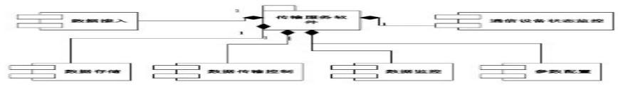
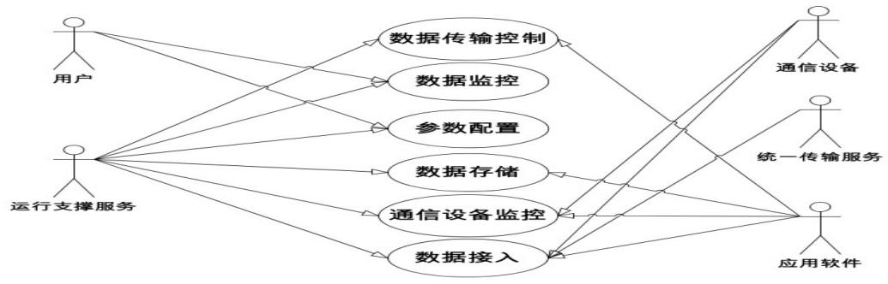
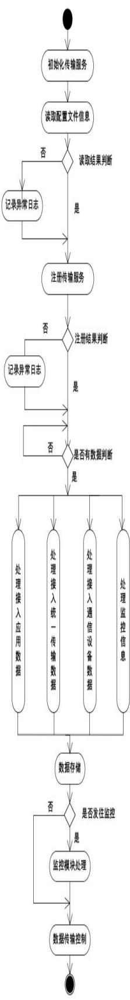
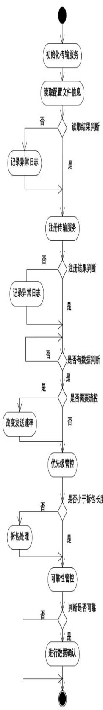

## 目 录

1 范围..  
1.1 标识.  
1.2 系统概述.  
1.2.1 系统和软件的用途.  
1.2.2 系统与软件的一般特性.  
1.3 文档概述.  
2 引用文档.. .2  
3 需求... ..2  
3.1 要求的状态和方式.. ..2  
3.2 CSCI 能力需求. ..2  
3.2.1 数据传输控制（PZXQ-GN-SJCSKZ） .5  
3.2.2 数据监控（PZXQ-GN-SJJK）. ..18  
3.2.3 参数配置（PZXQ-GN-CSPZ） ..25  
3.2.4 数据存储功能（PZXQ-GN-SJCC） ..31  
3.2.5 通信设备状态监控（PZXQ-GN-ZTJK） ..33  
3.2.6 数据接入（PZXQ-GN-SJJR） ..34  
3.3 CSCI 外部接口需求. ..39  
3.3.1 接口标识和接口图. ..39  
3.3.2 与统一传输服务接口（PZXQ-WBJK-ZKLCSFW-TYCS） ..41  
3.3.3 与通信设备接口（PZXQ-WBJK-ZKLCSFW-TXSB）. ..42  
3.3.4 与运行支撑服务接口（PZXQ-WBJK-ZKLCSFW-YXZCFW）. ..42  
3.3.5 人机交互接口（PZXQ-WBJK-ZKLCSFW-RJJH） ..43  
3.4 CSCI 内部接口需求. ..43  
3.4.1 接口标识和接口图.. ..43  
3.4.2 编解码业务报头接口（PZXQ-NBJK-ZKLCSFW-BJMYWBT） ..45  
3.4.3 监控接口（PZXQ-NBJK-ZKLCSFW-JK） ..46  
3.4.4 编解码协议接口（PZXQ-NBJK-ZKLCSFW-BJMZKLXY）. ..46  
3.4.5 校验数据包接口（PZXQ-NBJK-ZKLCSFW-JYSJ） .47  
3.4.6 判定长数据包接收完全接口（PZXQ-NBJK-ZKLCSFW-PDCSJ）. ..47  
3.4.7 重传检测接口（PZXQ-NBJK-ZKLCSFW-CCJC） ..48  
3.4.8 数据放置发送队列接口（PZXQ-NBJK-ZKLCSFW-FZFSDL） ..48  
3.4.9 发送数据接口（PZXQ-NBJK-ZKLCSFW-FSSJ）. ..48  
3.5 CSCI 内部数据需求.. ..48  
3.6 适应性需求. ..50  
3.7 安全性需求.. ..50  
3.8 保密性需求.. ..50  
3.9 CSCI 环境需求. ..50  
3.9.1 运行环境需求. ..51  
3.9.2 开发环境需求. ..51  
3.10 计算机资源需求. ..51  
3.10.1 计算机硬件需求. ..51  
3.10.2 计算机硬件资源利用需求. ..52  
3.10.3 计算机软件需求.. ..52  
3.10.4 计算机通信需求.. ..53  
3.11 软件质量因素.... ..53  
3.12 设计和构造的约束. ..54  
3.13 人员需求. ..54  
3.14 培训需求.. ...54  
3.15 软件保障需求. ..55  
3.16 其他需求. ..55  
3.17 验收、交付和包装需求. ..55  
3.18 需求的优先顺序和关键性.. ..55  
4 合格性规定. ..57  
5 需求可追踪性. ..58  
6 注释... ...61

## 1 范围

## 1.1 标识

a) 本文档已被批准的标识号： $\mathrm { A } Z _ { 6 9 3 } 2 . 4 9 9 . 0 1 1 5 \mathrm { S R S }$

b) 本文档所适用的软件名称为：传输服务；

c) 本文档的版本号为：V1.00.04/2020 年 12 月 31 日；

d) 本文档所适用的软件所属系统为：某信息系统软件。

## 1.2 系统概述

## 1.2.1 系统和软件的用途

某级信息系统软件按照国产自主可控要求，进行基础软件环境选型，以及应用软件的新研和国产化迁移改造，对功能要素分散、流程独立的业务功能进行整合优化，研制适应不同使用需求、使用场景的软件，实现信息系统软件的融合、型谱优化和业务提能，推动某信息系统软件向“国产化、服务化、轻量化”方向发展。

某信息服务环境软件是某信息系统软件的重要组成，是连接底层各类硬件信息基础设施与上层各种应用系统的桥梁，通过基础平台融合汇聚底层资源，规范技术体制、支撑体系运行、促进互通互联等，是支撑构建某信息系统的重要支撑，其软件主要部署运行在各级机构的信息处理设备上，提供系统运维、数据运维、信息传输、信息处理、信息展现等功能，支撑应用软件和用户完成开发、集成、运维、运行全流程的使用。

传输服务完成信息服务环境软件功能域传输的功能，提供桌面、平板、手持版三种形态的软件，提供传输支撑，能够根据通信链路状况实时调整传输策略，提供数据接入功能，支持对应用软件、通信设备、统一传输服务数据接入；提供数据存储功能，支持数据临时缓存；提供通信设备状态监控功能，支持根据设备状态调整数据收发速率；提供数据传输功能，支持多种传输策略；提供参数配置功能，支持服务运行时动态配置运行参数；提供平台互通功能，支持与多种系统数据互通。

## 1.2.2 系统与软件的一般特性

a) 需方：某单位；

b) 使用方：某单位；

c) 开发方：某单位；

d) 保障机构：某单位；

e) 运行方案：随操作系统自启动；

## 1.3 文档概述

在本文档中，第2章列出了本文档中引用的其它文档的信息，第3章详细描述了传输服务软件的各种需求以及实现方式，第4章规定了确认第3章各项需求正确实现的合格性验证方法，第5章描述本文档列出的各项需求与相应的系统需求规格说明文档列出的需求的对应关系。其中，第3章是本文档的主要部分。

## 2 引用文档

本文档的引用文档见表1。

表1 引用文档
<table><tr><td rowspan=1 colspan=1>文档编号</td><td rowspan=1 colspan=1>标题</td><td rowspan=1 colspan=1>修订版本</td><td rowspan=1 colspan=1>修订日期</td><td rowspan=1 colspan=1>编写单位</td></tr><tr><td rowspan=1 colspan=1>GJB 438B-2009</td><td rowspan=1 colspan=1>《军用软件开发文档编制规范》</td><td rowspan=1 colspan=1>一</td><td rowspan=1 colspan=1>2009年5月</td><td rowspan=1 colspan=1>总装备部</td></tr><tr><td rowspan=1 colspan=1>GJB 439A-2013</td><td rowspan=1 colspan=1>《军品软件质量保证通用要求》</td><td rowspan=1 colspan=1>一</td><td rowspan=1 colspan=1>2013年7月</td><td rowspan=1 colspan=1>国防科学技术工业委员会</td></tr><tr><td rowspan=1 colspan=1>GJB 450A-2004</td><td rowspan=1 colspan=1>《装备可靠性工作通用要求》</td><td rowspan=1 colspan=1>一</td><td rowspan=1 colspan=1>2004年7月</td><td rowspan=1 colspan=1>总装备部</td></tr><tr><td rowspan=1 colspan=1>GJB 2786A-2009</td><td rowspan=1 colspan=1>《军用软件开发通用要求》</td><td rowspan=1 colspan=1>一</td><td rowspan=1 colspan=1>2009年5月</td><td rowspan=1 colspan=1>总装备部</td></tr><tr><td rowspan=1 colspan=1>GJB 5235-2004</td><td rowspan=1 colspan=1>《军用软件配置管理》</td><td rowspan=1 colspan=1>一</td><td rowspan=1 colspan=1>2004年9月</td><td rowspan=1 colspan=1>总装备部</td></tr><tr><td rowspan=1 colspan=1>GJB/Z 102A-2012</td><td rowspan=1 colspan=1>《军用软件安全性设计指南》</td><td rowspan=1 colspan=1>一</td><td rowspan=1 colspan=1>2012年7月</td><td rowspan=1 colspan=1>总装备部</td></tr></table>

## 3 需求

## 3.1 要求的状态和方式

传输服务软件只有一个服务运行状态，无需多个运行状态和运行方式。传输服务软件部署在服务器上，当软件启动后，进入工作状态，在该状态下等待应用程序接入；各终端机上的应用程序通过加载传输服务二次开发接口库访问服务器，连接服务器成功后即可完成数据传输控制、数据监控、参数配置、数据存储、通信设备状态监控、数据接入。

## 3.2 CSCI 能力需求

传输服务软件按照其功能需求，包含数据传输控制、数据监控、参数配置、数据存储、通信设备状态监控、数据接入功能。传输服务软件功能图，见图1所示。

  
图1 传输服务软件功能图  
传输服务软件用例图，如图2所示。

  
图2 传输服务软件用例图  
传输服务软件流程图，见图3所示。

  
图3 传输服务软件流程图

传输服务软件所有能力标识表，见表2所示。

表2 传输服务软件所有能力标识
<table><tr><td rowspan=1 colspan=1>序号</td><td rowspan=1 colspan=1>Use case名称</td><td rowspan=1 colspan=1>项目唯一标识符</td><td rowspan=1 colspan=1>需求描述</td><td rowspan=1 colspan=1>需求重用</td><td rowspan=1 colspan=1>方式</td><td rowspan=1 colspan=1>对应的任务书功能/性能</td></tr><tr><td rowspan=1 colspan=1>1</td><td rowspan=1 colspan=1>数据传输</td><td rowspan=1 colspan=1>PZXQ-GN-SJCS</td><td rowspan=1 colspan=1>应用软件可进行格式化数据收发，具有数据优先级、可靠性和流量管控能力，具有数据拆分、按序重组能力，具备与统一传输服务交互能力。</td><td rowspan=1 colspan=1>沿用</td><td rowspan=1 colspan=1>桌面版、平板版、手持版</td><td rowspan=1 colspan=1>4.1.4/4.2a)b)</td></tr><tr><td rowspan=1 colspan=1>2</td><td rowspan=1 colspan=1>数据监控</td><td rowspan=1 colspan=1>PZXQ-GN-SJJK</td><td rowspan=1 colspan=1>具备监控收发端数据传输协议信息和正文信息的能力，并对各协议字段进行解析，具备将监控记录存储到本地用于历史信息查询的能力，具备对收发数据的实时流量监控能力，具备根据传输协议中关键字段筛选相关报文信息的能力。</td><td rowspan=1 colspan=1>沿用</td><td rowspan=1 colspan=1>桌面版、平板版、手持版</td><td rowspan=1 colspan=1>4.1.5/4.2a)b)</td></tr><tr><td rowspan=1 colspan=1>3</td><td rowspan=1 colspan=1>参数配置</td><td rowspan=1 colspan=1>PZXQ-GN-CSPZ</td><td rowspan=1 colspan=1>应用软件可在传输服务运行条件下，对传输时间、传输次数、端口、目的通信设备信息、拆包大小进行动态配置。</td><td rowspan=1 colspan=1>沿用</td><td rowspan=1 colspan=1>桌面版、平板版、手持版</td><td rowspan=1 colspan=1>4.1.6/4.2a)b)</td></tr><tr><td rowspan=1 colspan=1>4</td><td rowspan=1 colspan=1>数据存储</td><td rowspan=1 colspan=1>PZXQ-GN-SJCC</td><td rowspan=1 colspan=1>具备在带宽拥堵的状态下，对数据进行缓存，待网络环境恢复后重新发送缓存的数据的能力。</td><td rowspan=1 colspan=1>沿用</td><td rowspan=1 colspan=1>桌面版、平板版、手持版</td><td rowspan=1 colspan=1>4.1.2/4.2a)b)</td></tr><tr><td rowspan=1 colspan=1>5</td><td rowspan=1 colspan=1>通信设备状态监控</td><td rowspan=1 colspan=1>PZXQ-GN-ZTJK</td><td rowspan=1 colspan=1>具备监控通信设备状态情况的能力，动态响应通信设备变化，调整数据发送能力。</td><td rowspan=1 colspan=1>沿用</td><td rowspan=1 colspan=1>桌面版、平板版、手持版</td><td rowspan=1 colspan=1>4.1.3/4.2a)b)</td></tr><tr><td rowspan=1 colspan=1>6</td><td rowspan=1 colspan=1>数据接入</td><td rowspan=1 colspan=1>PZXQ-GN-SJJR</td><td rowspan=1 colspan=1>支持将业务软件数据报文根据通信设备协议，利用用户信息、数据类型、传输属性构建协议头信息，并将添加协议头信息的数据发送至通信设备；支持解析通信设备发往应用软件的数据，并将解析后的数据发往应用；支持接收统一传输服务发送的数据并对外发送，支持将接收到的数据发送至统一传输服务。</td><td rowspan=1 colspan=1>沿用</td><td rowspan=1 colspan=1>桌面版、平板版、手持版</td><td rowspan=1 colspan=1>4.1.1/4.2a)b)</td></tr></table>

## 3.2.1 数据传输控制（PZXQ-GN-SJCSKZ）

数据收发功能包括格式化数据收发、优先级管控、可靠性管控、流量管控、拆包重组、与统一传输服务互通，其功能用例如图4所示。

  
图4 数据传输控制用例图  
数据传输控制流程图如图5所示。

  
图5 数据传输控制流程图

数据收发所有能力标识表，见表3所示。

表3 数据收发所有能力标识
<table><tr><td rowspan=1 colspan=1>序号</td><td rowspan=1 colspan=1>Use case 名称</td><td rowspan=1 colspan=1>项目唯一标识符</td><td rowspan=1 colspan=1>需求描述</td><td rowspan=1 colspan=1>需求重用</td><td rowspan=1 colspan=1>方式</td><td rowspan=1 colspan=1>运行状态</td><td rowspan=1 colspan=1>对应的任务书功能/性能</td></tr><tr><td rowspan=1 colspan=1>1</td><td rowspan=1 colspan=1>优先级管控</td><td rowspan=1 colspan=1>PZXQ-GN-SJCSKZ-YXJGK</td><td rowspan=1 colspan=1>能够根据发送数据的优先级，保证高优先级数据优先发送；</td><td rowspan=1 colspan=1>沿用</td><td rowspan=1 colspan=1>桌面版、平板版、手持版</td><td rowspan=1 colspan=1>运行阶段</td><td rowspan=1 colspan=1>4.1.4a) /4.2a)b)</td></tr><tr><td rowspan=1 colspan=1>2</td><td rowspan=1 colspan=1>可靠性管控</td><td rowspan=1 colspan=1>PZXQ-GN-SJCSKZ-KKXGK</td><td rowspan=1 colspan=1>能够通过部分确认和完全确认的机制，完成可靠数据的丢包重传；</td><td rowspan=1 colspan=1>沿用</td><td rowspan=1 colspan=1>桌面版、平板版、手持版</td><td rowspan=1 colspan=1>运行阶段</td><td rowspan=1 colspan=1>4.1.4b) /4.2a)b)</td></tr><tr><td rowspan=1 colspan=1>3</td><td rowspan=1 colspan=1>流量管控</td><td rowspan=1 colspan=1>PZXQ-GN-SJCSKZ-LLGK</td><td rowspan=1 colspan=1>能够根据通信设备流量管控能力，自动调节数据发送速率；</td><td rowspan=1 colspan=1>沿用</td><td rowspan=1 colspan=1>桌面版、平板版、手持版</td><td rowspan=1 colspan=1>运行阶段</td><td rowspan=1 colspan=1>4.1.4 c)/4.2 a)b)</td></tr><tr><td rowspan=1 colspan=1>4</td><td rowspan=1 colspan=1>拆包重组</td><td rowspan=1 colspan=1>PZXQ-GN-SJCSKZ-CBCZ</td><td rowspan=1 colspan=1>能够根据报文长度进行数据拆包、按序重组；</td><td rowspan=1 colspan=1>沿用</td><td rowspan=1 colspan=1>桌面版、平板版、手持版</td><td rowspan=1 colspan=1>运行阶段</td><td rowspan=1 colspan=1>4.1.4d) /4.2a)b)</td></tr></table>

## 3.2.1.1 优先级管控（PZXQ-GN-SJSF-YXJGK）

优先级管控功能用例场景，见表4所示。

表4 优先级管控功能用例描述
<table><tr><td rowspan=1 colspan=1>Use Case 名称：优先级管控功能</td><td rowspan=1 colspan=2>Actors:应用软件</td></tr><tr><td rowspan=1 colspan=3>概述：本用例是优先级管控功能的用例，描述应用软件发送不同优先级数据时对优先级管控的过程，数据优先级分为4个级别，优先级0、优先级1、优先级2、优先级3，其中优先级0为最高优先级，优先级3为最低优先级，在网络畅通时，几乎优先级队列中是没有数据的，数据来一条发一条，当流控减半时，优先级队列中缓存数据，数据按照优先级0、1、2、3级别几次发送数据保证高优先级数据优先发送，完全流控时数据不发送按优先级依次排列等待流控正常后发送；</td></tr><tr><td rowspan=1 colspan=3>前置条件：网络连接正常、传输服务运行正常、流控模拟软件正常、至少接入三个应用软件。</td></tr><tr><td rowspan=1 colspan=3>主事件流</td></tr><tr><td rowspan=1 colspan=1>Actor 的动作</td><td rowspan=1 colspan=1>系统的动作</td><td rowspan=1 colspan=1>动作约束(性能、可靠性、容错等)</td></tr><tr><td rowspan=1 colspan=1>1.服务集成框架进行传输服务初始化；</td><td rowspan=1 colspan=1></td><td rowspan=1 colspan=1>检测数据优先级、可靠性、数据大小、服务配置信息合法性，当</td></tr></table>