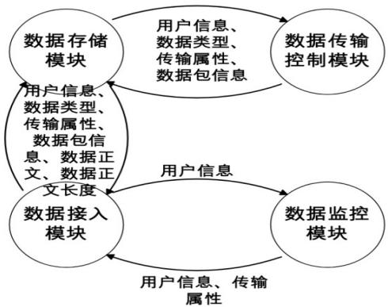

<table><tr><td rowspan=10 colspan=1></td><td rowspan=10 colspan=1></td><td rowspan=1 colspan=1>服务质量</td><td rowspan=1 colspan=1>unsigned int</td><td rowspan=1 colspan=1></td></tr><tr><td rowspan=1 colspan=1>优先级</td><td rowspan=1 colspan=1>unsigned char</td><td rowspan=1 colspan=1></td></tr><tr><td rowspan=1 colspan=1>可靠性</td><td rowspan=1 colspan=1>unsigned int</td><td rowspan=1 colspan=1></td></tr><tr><td rowspan=1 colspan=1>报文版本类型</td><td rowspan=1 colspan=1>unsigned char</td><td rowspan=1 colspan=1></td></tr><tr><td rowspan=1 colspan=1>业务类型</td><td rowspan=1 colspan=1>unsigned char</td><td rowspan=1 colspan=1></td></tr><tr><td rowspan=1 colspan=1>加密类型</td><td rowspan=1 colspan=1>unsigned char</td><td rowspan=1 colspan=1></td></tr><tr><td rowspan=1 colspan=1>系统标识</td><td rowspan=1 colspan=1>unsigned char</td><td rowspan=1 colspan=1></td></tr><tr><td rowspan=1 colspan=1>信道标识</td><td rowspan=1 colspan=1>unsigned char</td><td rowspan=1 colspan=1></td></tr><tr><td rowspan=1 colspan=1>协议类型</td><td rowspan=1 colspan=1>unsigned char</td><td rowspan=1 colspan=1></td></tr><tr><td rowspan=1 colspan=1>压缩类型</td><td rowspan=1 colspan=1>unsigned char</td><td rowspan=1 colspan=1></td></tr><tr><td rowspan=1 colspan=1>5</td><td rowspan=1 colspan=1>数据内容</td><td rowspan=1 colspan=1>数据内容</td><td rowspan=1 colspan=1>char *</td><td rowspan=1 colspan=1></td></tr><tr><td rowspan=1 colspan=1>6</td><td rowspan=1 colspan=1>数据长度</td><td rowspan=1 colspan=1>数据长度</td><td rowspan=1 colspan=1>size_t</td><td rowspan=1 colspan=1></td></tr></table>

## 3.3.3 与通信设备接口（PZXQ-WBJK-ZKLCSFW-TXSB）

与通信设备接口数据元素说明表，见表29所示。

表29与通信设备接口数据元素说明
<table><tr><td rowspan=1 colspan=1>序号</td><td rowspan=1 colspan=1>数据集名称</td><td rowspan=1 colspan=1>数据组成</td><td rowspan=1 colspan=1>数据约束</td><td rowspan=1 colspan=1>数据标准</td></tr><tr><td rowspan=1 colspan=1>1</td><td rowspan=1 colspan=1>源用户信息</td><td rowspan=1 colspan=1>用户IP</td><td rowspan=1 colspan=1>unsigned int</td><td rowspan=1 colspan=1>传输标准</td></tr><tr><td rowspan=1 colspan=1>2</td><td rowspan=1 colspan=1>目的用户信息</td><td rowspan=1 colspan=1>用户IP</td><td rowspan=1 colspan=1>unsigned int</td><td rowspan=1 colspan=1>传输标准</td></tr><tr><td rowspan=5 colspan=1>3</td><td rowspan=5 colspan=1>传输属性</td><td rowspan=1 colspan=1>优先级</td><td rowspan=1 colspan=1>unsigned char</td><td rowspan=1 colspan=1>传输标准</td></tr><tr><td rowspan=1 colspan=1>可靠性</td><td rowspan=1 colspan=1>unsigned int</td><td rowspan=1 colspan=1>传输标准</td></tr><tr><td rowspan=1 colspan=1>报文版本类型</td><td rowspan=1 colspan=1>unsigned char</td><td rowspan=1 colspan=1>传输标准</td></tr><tr><td rowspan=1 colspan=1>业务类型</td><td rowspan=1 colspan=1>unsigned char</td><td rowspan=1 colspan=1>传输标准</td></tr><tr><td rowspan=1 colspan=1>信道标识</td><td rowspan=1 colspan=1>unsigned char</td><td rowspan=1 colspan=1>传输标准</td></tr><tr><td rowspan=1 colspan=1>4</td><td rowspan=1 colspan=1>数据内容</td><td rowspan=1 colspan=1>数据内容</td><td rowspan=1 colspan=1>char *</td><td rowspan=1 colspan=1>传输标准</td></tr><tr><td rowspan=1 colspan=1>5</td><td rowspan=1 colspan=1>数据长度</td><td rowspan=1 colspan=1>数据长度</td><td rowspan=1 colspan=1>size_t</td><td rowspan=1 colspan=1>传输标准</td></tr></table>

## 3.3.4 与运行支撑服务接口（PZXQ-WBJK-ZKLCSFW-YXZCFW）

与服务集成框架接口数据元素说明表，见表30所示。

## 表30与服务集成框架接口数据元素说明

<table><tr><td rowspan=1 colspan=1>序号</td><td rowspan=1 colspan=1>数据集名称</td><td rowspan=1 colspan=1>数据组成</td><td rowspan=1 colspan=1>数据约束</td><td rowspan=1 colspan=1>数据标准</td></tr><tr><td rowspan=4 colspan=1>1</td><td rowspan=4 colspan=1>日志信息</td><td rowspan=1 colspan=1>ERROR 级别日志信息</td><td rowspan=1 colspan=1>char *</td><td rowspan=1 colspan=1></td></tr><tr><td rowspan=1 colspan=1>WARN 级别日志信息</td><td rowspan=1 colspan=1>char *</td><td rowspan=1 colspan=1></td></tr><tr><td rowspan=1 colspan=1>INFO 级别日志信息</td><td rowspan=1 colspan=1>char *</td><td rowspan=1 colspan=1></td></tr><tr><td rowspan=1 colspan=1>DEBUG 级别日志信息</td><td rowspan=1 colspan=1>char *</td><td rowspan=1 colspan=1></td></tr></table>

## 3.3.5 人机交互接口（PZXQ-WBJK-ZKLCSFW-RJJH）

人机交互接口数据元素说明表，见表31所示。

表31人机交互接口数据元素说明
<table><tr><td colspan="1" rowspan="1">序号</td><td colspan="1" rowspan="1">数据集名称</td><td colspan="1" rowspan="1">数据组成</td><td colspan="1" rowspan="1">数据约束</td><td colspan="1" rowspan="1">数据标准</td></tr><tr><td colspan="1" rowspan="10">1</td><td colspan="1" rowspan="10">数据监控信息</td><td colspan="1" rowspan="1">源用户IP</td><td colspan="1" rowspan="1">unsigned int</td><td colspan="1" rowspan="1">传输标准</td></tr><tr><td colspan="1" rowspan="1">目的用户IP</td><td colspan="1" rowspan="1">unsigned int</td><td colspan="1" rowspan="1">传输标准</td></tr><tr><td colspan="1" rowspan="1">优先级</td><td colspan="1" rowspan="1">unsigned char</td><td colspan="1" rowspan="1">传输标准</td></tr><tr><td colspan="1" rowspan="1">可靠性</td><td colspan="1" rowspan="1">unsigned int</td><td colspan="1" rowspan="1">传输标准</td></tr><tr><td colspan="1" rowspan="1">报文版本类型</td><td colspan="1" rowspan="1">unsigned char</td><td colspan="1" rowspan="1">传输标准</td></tr><tr><td colspan="1" rowspan="1">业务类型</td><td colspan="1" rowspan="1">unsigned char</td><td colspan="1" rowspan="1">传输标准</td></tr><tr><td colspan="1" rowspan="1">信道标识</td><td colspan="1" rowspan="1">unsigned char</td><td colspan="1" rowspan="1">传输标准</td></tr><tr><td colspan="1" rowspan="1">数据内容</td><td colspan="1" rowspan="1">char *</td><td colspan="1" rowspan="1">传输标准</td></tr><tr><td colspan="1" rowspan="1">数据长度</td><td colspan="1" rowspan="1">size_t</td><td colspan="1" rowspan="1">传输标准</td></tr><tr><td colspan="1" rowspan="1">数据流量</td><td colspan="1" rowspan="1">Int</td><td colspan="1" rowspan="1"></td></tr><tr><td colspan="1" rowspan="7">2</td><td colspan="1" rowspan="7">软件配置信息</td><td colspan="1" rowspan="1">最大传输次数</td><td colspan="1" rowspan="1">Int</td><td colspan="1" rowspan="1"></td></tr><tr><td colspan="1" rowspan="1">最大重传次数</td><td colspan="1" rowspan="1">Int</td><td colspan="1" rowspan="1"></td></tr><tr><td colspan="1" rowspan="1">接收超时时间</td><td colspan="1" rowspan="1">Int</td><td colspan="1" rowspan="1"></td></tr><tr><td colspan="1" rowspan="1">重传检测时间</td><td colspan="1" rowspan="1">Int</td><td colspan="1" rowspan="1"></td></tr><tr><td colspan="1" rowspan="1">发送超时时间</td><td colspan="1" rowspan="1">Int</td><td colspan="1" rowspan="1"></td></tr><tr><td colspan="1" rowspan="1">是否发往通信设备</td><td colspan="1" rowspan="1">Int</td><td colspan="1" rowspan="1"></td></tr><tr><td colspan="1" rowspan="1">目的通信设备ip地址</td><td colspan="1" rowspan="1">Int</td><td colspan="1" rowspan="1"></td></tr><tr><td colspan="1" rowspan="1"></td><td colspan="1" rowspan="1"></td><td colspan="1" rowspan="1">拆包长度</td><td colspan="1" rowspan="1">Int</td><td colspan="1" rowspan="1"></td></tr></table>

## 3.4 CSCI 内部接口需求

## 3.4.1 接口标识和接口图

传输服务软件内部接口需求图，见图10所示。

  
图10 传输服务软件内部接口需求

传输服务软件内部接口包括：编解码业务报头接口、监控接口、编解码协议头接口、编解码传控协议头接口、校验数据包接口、判定长数据包接收完全接口、重传检测接口、数据放置发送队列接口、发送数据接口。

传输服务软件内部接口需求表见表32。

表32 传输服务软件内部接口需求
<table><tr><td colspan="1" rowspan="1">序号</td><td colspan="1" rowspan="1">接口需求名称</td><td colspan="1" rowspan="1">接口需求标识</td><td colspan="1" rowspan="1">接口类型</td><td colspan="1" rowspan="1">发送方</td><td colspan="1" rowspan="1">接收方</td><td colspan="1" rowspan="1">接口内容</td><td colspan="1" rowspan="1">接口优先级</td></tr><tr><td colspan="1" rowspan="1">1</td><td colspan="1" rowspan="1">编解码业务报头接口</td><td colspan="1" rowspan="1">PZXQ-NBJK-ZKLCSFW-BJMYWBT</td><td colspan="1" rowspan="1">API接口</td><td colspan="1" rowspan="1">数据存储模块</td><td colspan="1" rowspan="1">数据接入模块</td><td colspan="1" rowspan="1">用户信息、数据类型、传输属性</td><td colspan="1" rowspan="1">高</td></tr><tr><td colspan="1" rowspan="1">2</td><td colspan="1" rowspan="1">监控接口</td><td colspan="1" rowspan="1">PZXQ-NBJK-ZKLCSFW-JK</td><td colspan="1" rowspan="1">API接口</td><td colspan="1" rowspan="1">数据接入模块</td><td colspan="1" rowspan="1">数据监控模块</td><td colspan="1" rowspan="1">用户信息、传输属性</td><td colspan="1" rowspan="1">中</td></tr><tr><td colspan="1" rowspan="1">3</td><td colspan="1" rowspan="1">编解码协议头接口</td><td colspan="1" rowspan="1">PZXQ-NBJK-ZKLCSFW-BJMZKLXY</td><td colspan="1" rowspan="1">API接口</td><td colspan="1" rowspan="1">数据存储模块</td><td colspan="1" rowspan="1">与某平台互通模块</td><td colspan="1" rowspan="1">用户信息、传输属性</td><td colspan="1" rowspan="1">高</td></tr><tr><td colspan="1" rowspan="1">4</td><td colspan="1" rowspan="1">校验数据包接口</td><td colspan="1" rowspan="1">PZXQ-NBJK-ZKLCSFW-JYSJ</td><td colspan="1" rowspan="1">API接口</td><td colspan="1" rowspan="1">与某平台互通模块</td><td colspan="1" rowspan="1">数据存储模块</td><td colspan="1" rowspan="1">传输属性</td><td colspan="1" rowspan="1">高</td></tr><tr><td colspan="1" rowspan="1">5</td><td colspan="1" rowspan="1">判定长数据包接收完全接口</td><td colspan="1" rowspan="1">PZXQ-NBJK-ZKLCSFW-PDCSJ</td><td colspan="1" rowspan="1">API接口</td><td colspan="1" rowspan="1">数据接入、与某平台互通</td><td colspan="1" rowspan="1">数据存储模块</td><td colspan="1" rowspan="1">数据包信息</td><td colspan="1" rowspan="1">中</td></tr><tr><td colspan="1" rowspan="1">6</td><td colspan="1" rowspan="1">重传检测接口</td><td colspan="1" rowspan="1">PZXQ-NBJK-ZKLCSFW-CCJC</td><td colspan="1" rowspan="1">API接口</td><td colspan="1" rowspan="1">数据存储模块</td><td colspan="1" rowspan="1">数据接入、与某平台互通</td><td colspan="1" rowspan="1">数据包信息</td><td colspan="1" rowspan="1">中</td></tr><tr><td colspan="1" rowspan="1">7</td><td colspan="1" rowspan="1">数据放置发送队列接口</td><td colspan="1" rowspan="1">PZXQ-NBJK-ZKLCSFW-FZFSDL</td><td colspan="1" rowspan="1">API接口</td><td colspan="1" rowspan="1">数据传输控制、与某平台互通模块、数据接入模块</td><td colspan="1" rowspan="1">数据存储模块</td><td colspan="1" rowspan="1">用户信息、数据类型、传输属性、数据正文、数据正文长度</td><td colspan="1" rowspan="1">中</td></tr><tr><td colspan="1" rowspan="1">8</td><td colspan="1" rowspan="1">发送数据接口</td><td colspan="1" rowspan="1">PZXQ-NBJK-ZKLCSFW-FSSJ</td><td colspan="1" rowspan="1">API接口</td><td colspan="1" rowspan="1">数据存储模块</td><td colspan="1" rowspan="1">数据传输控制、与某平台互通模块、数据接入模块</td><td colspan="1" rowspan="1">用户信息、数据类型、传输属性、数据正文、数据正文长度</td><td colspan="1" rowspan="1">高</td></tr></table>

## 3.4.2 编解码业务报头接口（PZXQ-NBJK-ZKLCSFW-BJMYWBT）

编码业务报头接口数据元素说明表，见表33所示。

表33 编码业务报头接口数据元素说明
<table><tr><td colspan="1" rowspan="1">序号</td><td colspan="1" rowspan="1">数据集名称</td><td colspan="1" rowspan="1">数据组成</td><td colspan="1" rowspan="1">数据约束</td><td colspan="1" rowspan="1">数据标准</td></tr><tr><td colspan="1" rowspan="4">1</td><td colspan="1" rowspan="4">源用户信息</td><td colspan="1" rowspan="1">用户标识</td><td colspan="1" rowspan="1">unsigned int</td><td colspan="1" rowspan="1"></td></tr><tr><td colspan="1" rowspan="1">软件标识</td><td colspan="1" rowspan="1">unsigned int</td><td colspan="1" rowspan="1"></td></tr><tr><td colspan="1" rowspan="1">用户IP</td><td colspan="1" rowspan="1">unsigned int</td><td colspan="1" rowspan="1"></td></tr><tr><td colspan="1" rowspan="1">单元编号</td><td colspan="1" rowspan="1">usigned long</td><td colspan="1" rowspan="1"></td></tr><tr><td colspan="1" rowspan="4">2</td><td colspan="1" rowspan="4">目的用户信息</td><td colspan="1" rowspan="1">用户标识</td><td colspan="1" rowspan="1">unsigned int</td><td colspan="1" rowspan="1"></td></tr><tr><td colspan="1" rowspan="1">软件标识</td><td colspan="1" rowspan="1">unsigned int</td><td colspan="1" rowspan="1"></td></tr><tr><td colspan="1" rowspan="1">用户IP</td><td colspan="1" rowspan="1">unsigned int</td><td colspan="1" rowspan="1"></td></tr><tr><td colspan="1" rowspan="1">单元编号</td><td colspan="1" rowspan="1">usigned long</td><td colspan="1" rowspan="1"></td></tr><tr><td colspan="1" rowspan="4">3</td><td colspan="1" rowspan="4">数据类型</td><td colspan="1" rowspan="1">用户消息类型</td><td colspan="1" rowspan="1">unsigned char</td><td colspan="1" rowspan="1"></td></tr><tr><td colspan="1" rowspan="1">消息功能域分类</td><td colspan="1" rowspan="1">unsigned char</td><td colspan="1" rowspan="1"></td></tr><tr><td colspan="1" rowspan="1">消息编号</td><td colspan="1" rowspan="1">unsigned char</td><td colspan="1" rowspan="1"></td></tr><tr><td colspan="1" rowspan="1">消息子类型</td><td colspan="1" rowspan="1">unsigned char</td><td colspan="1" rowspan="1"></td></tr><tr><td colspan="1" rowspan="10">4</td><td colspan="1" rowspan="10">传输属性</td><td colspan="1" rowspan="1">策略号</td><td colspan="1" rowspan="1">unsigned int</td><td colspan="1" rowspan="1"></td></tr><tr><td colspan="1" rowspan="1">服务质量</td><td colspan="1" rowspan="1">unsigned int</td><td colspan="1" rowspan="1"></td></tr><tr><td colspan="1" rowspan="1">优先级</td><td colspan="1" rowspan="1">unsigned char</td><td colspan="1" rowspan="1"></td></tr><tr><td colspan="1" rowspan="1">可靠性</td><td colspan="1" rowspan="1">unsigned int</td><td colspan="1" rowspan="1"></td></tr><tr><td colspan="1" rowspan="1">报文版本类型</td><td colspan="1" rowspan="1">unsigned char</td><td colspan="1" rowspan="1"></td></tr><tr><td colspan="1" rowspan="1">业务类型</td><td colspan="1" rowspan="1">unsigned char</td><td colspan="1" rowspan="1"></td></tr><tr><td colspan="1" rowspan="1">加密类型</td><td colspan="1" rowspan="1">unsigned char</td><td colspan="1" rowspan="1"></td></tr><tr><td colspan="1" rowspan="1">系统标识</td><td colspan="1" rowspan="1">unsigned char</td><td colspan="1" rowspan="1"></td></tr><tr><td colspan="1" rowspan="1">信道标识</td><td colspan="1" rowspan="1">unsigned char</td><td colspan="1" rowspan="1"></td></tr><tr><td colspan="1" rowspan="1">协议类型</td><td colspan="1" rowspan="1">unsigned char</td><td colspan="1" rowspan="1"></td></tr><tr><td colspan="2" rowspan="1"></td><td colspan="1" rowspan="1">压缩类型</td><td colspan="1" rowspan="1">unsigned char</td><td colspan="1" rowspan="1"></td></tr><tr><td colspan="1" rowspan="1">5</td><td colspan="1" rowspan="1">数据内容</td><td colspan="1" rowspan="1">数据内容</td><td colspan="1" rowspan="1">char *</td><td colspan="1" rowspan="1"></td></tr><tr><td colspan="1" rowspan="1">6</td><td colspan="1" rowspan="1">数据长度</td><td colspan="1" rowspan="1">数据长度</td><td colspan="1" rowspan="1">size_t</td><td colspan="1" rowspan="1"></td></tr></table>

## 3.4.3 监控接口（PZXQ-NBJK-ZKLCSFW-JK）

监控接口数据元素说明表，见表34所示。

表34监控接口数据元素说明
<table><tr><td colspan="1" rowspan="1">序号</td><td colspan="1" rowspan="1">数据集名称</td><td colspan="1" rowspan="1">数据组成</td><td colspan="1" rowspan="1">数据约束</td><td colspan="1" rowspan="1">数据标准</td></tr><tr><td colspan="1" rowspan="6">1</td><td colspan="1" rowspan="6">数据监控信息</td><td colspan="1" rowspan="1">用户IP</td><td colspan="1" rowspan="1">unsigned int</td><td colspan="1" rowspan="1">传输标准</td></tr><tr><td colspan="1" rowspan="1">用户IP</td><td colspan="1" rowspan="1">unsigned int</td><td colspan="1" rowspan="1">传输标准</td></tr><tr><td colspan="1" rowspan="1">优先级</td><td colspan="1" rowspan="1">unsigned char</td><td colspan="1" rowspan="1">传输标准</td></tr><tr><td colspan="1" rowspan="1">可靠性</td><td colspan="1" rowspan="1">unsigned int</td><td colspan="1" rowspan="1">传输标准</td></tr><tr><td colspan="1" rowspan="1">报文版本类型</td><td colspan="1" rowspan="1">unsigned char</td><td colspan="1" rowspan="1">传输标准</td></tr><tr><td colspan="1" rowspan="1">业务类型</td><td colspan="1" rowspan="1">unsigned char</td><td colspan="1" rowspan="1">传输标准</td></tr><tr><td colspan="1" rowspan="4"></td><td colspan="1" rowspan="4"></td><td colspan="1" rowspan="1">信道标识</td><td colspan="1" rowspan="1">unsigned char</td><td colspan="1" rowspan="1">传输标准</td></tr><tr><td colspan="1" rowspan="1">数据内容</td><td colspan="1" rowspan="1">char*</td><td colspan="1" rowspan="1">传输标准</td></tr><tr><td colspan="1" rowspan="1">数据长度</td><td colspan="1" rowspan="1">size_t</td><td colspan="1" rowspan="1">传输标准</td></tr><tr><td colspan="1" rowspan="1">数据流量</td><td colspan="1" rowspan="1">Int</td><td colspan="1" rowspan="1"></td></tr></table>

## 3.4.4 编解码协议接口（PZXQ-NBJK-ZKLCSFW-BJMZKLXY）

构建协议接口数据元素说明表，见表35所示。

表35构建协议接口数据元素说明
<table><tr><td rowspan=1 colspan=1>序号</td><td rowspan=1 colspan=1>数据集名称</td><td rowspan=1 colspan=1>数据组成</td><td rowspan=1 colspan=1>数据约束</td><td rowspan=1 colspan=1>数据标准</td></tr><tr><td rowspan=1 colspan=1>1</td><td rowspan=1 colspan=1>源用户信息</td><td rowspan=1 colspan=1>用户IP</td><td rowspan=1 colspan=1>unsigned int</td><td rowspan=1 colspan=1>传输标准</td></tr><tr><td rowspan=1 colspan=1>2</td><td rowspan=1 colspan=1>目的用户信息</td><td rowspan=1 colspan=1>用户IP</td><td rowspan=1 colspan=1>unsigned int</td><td rowspan=1 colspan=1>传输标准</td></tr><tr><td rowspan=5 colspan=1>3</td><td rowspan=5 colspan=1>传输属性</td><td rowspan=1 colspan=1>优先级</td><td rowspan=1 colspan=1>unsigned char</td><td rowspan=1 colspan=1>传输标准</td></tr><tr><td rowspan=1 colspan=1>可靠性</td><td rowspan=1 colspan=1>unsigned int</td><td rowspan=1 colspan=1>传输标准</td></tr><tr><td rowspan=1 colspan=1>报文版本类型</td><td rowspan=1 colspan=1>unsigned char</td><td rowspan=1 colspan=1>传输标准</td></tr><tr><td rowspan=1 colspan=1>业务类型</td><td rowspan=1 colspan=1>unsigned char</td><td rowspan=1 colspan=1>传输标准</td></tr><tr><td rowspan=1 colspan=1>信道标识</td><td rowspan=1 colspan=1>unsigned char</td><td rowspan=1 colspan=1>传输标准</td></tr><tr><td rowspan=1 colspan=1>4</td><td rowspan=1 colspan=1>数据内容</td><td rowspan=1 colspan=1>数据内容</td><td rowspan=1 colspan=1>char *</td><td rowspan=1 colspan=1>传输标准</td></tr><tr><td rowspan=1 colspan=1>5</td><td rowspan=1 colspan=1>数据长度</td><td rowspan=1 colspan=1>数据长度</td><td rowspan=1 colspan=1>size_t</td><td rowspan=1 colspan=1>传输标准</td></tr></table>

## 3.4.5 校验数据包接口（PZXQ-NBJK-ZKLCSFW-JYSJ）

校验数据包接口数据元素说明表，见表36所示。

表36校验数据包接口数据元素说明
<table><tr><td colspan="1" rowspan="1">序号</td><td colspan="1" rowspan="1">数据集名称</td><td colspan="1" rowspan="1">数据组成</td><td colspan="1" rowspan="1">数据约束</td><td colspan="1" rowspan="1">数据标准</td></tr><tr><td colspan="1" rowspan="1">1</td><td colspan="1" rowspan="1">源用户信息</td><td colspan="1" rowspan="1">用户IP</td><td colspan="1" rowspan="1">unsigned int</td><td colspan="1" rowspan="1">传输标准</td></tr><tr><td colspan="1" rowspan="1">2</td><td colspan="1" rowspan="1">目的用户信息</td><td colspan="1" rowspan="1">用户IP</td><td colspan="1" rowspan="1">unsigned int</td><td colspan="1" rowspan="1">传输标准</td></tr><tr><td colspan="1" rowspan="3">3</td><td colspan="1" rowspan="3">传输属性</td><td colspan="1" rowspan="1">优先级</td><td colspan="1" rowspan="1">unsigned char</td><td colspan="1" rowspan="1">传输标准</td></tr><tr><td colspan="1" rowspan="1">可靠性</td><td colspan="1" rowspan="1">unsigned int</td><td colspan="1" rowspan="1">传输标准</td></tr><tr><td colspan="1" rowspan="1">报文版本类型</td><td colspan="1" rowspan="1">unsigned char</td><td colspan="1" rowspan="1">传输标准</td></tr><tr><td colspan="1" rowspan="2"></td><td colspan="1" rowspan="2"></td><td colspan="1" rowspan="1">业务类型</td><td colspan="1" rowspan="1">unsigned char</td><td colspan="1" rowspan="1">传输标准</td></tr><tr><td colspan="1" rowspan="1">信道标识</td><td colspan="1" rowspan="1">unsigned char</td><td colspan="1" rowspan="1">传输标准</td></tr><tr><td colspan="1" rowspan="1">4</td><td colspan="1" rowspan="1">数据内容</td><td colspan="1" rowspan="1">数据内容</td><td colspan="1" rowspan="1">char *</td><td colspan="1" rowspan="1">传输标准</td></tr><tr><td colspan="1" rowspan="1">5</td><td colspan="1" rowspan="1">数据长度</td><td colspan="1" rowspan="1">数据长度</td><td colspan="1" rowspan="1">size_t</td><td colspan="1" rowspan="1">传输标准</td></tr></table>

## 3.4.6 判定长数据包接收完全接口（PZXQ-NBJK-ZKLCSFW-PDCSJ）

判定长数据包接收完全接口数据元素说明表，见表37所示。

表37判定长数据包接收完全接口数据元素说明
<table><tr><td rowspan=1 colspan=1>序号</td><td rowspan=1 colspan=1>数据集名称</td><td rowspan=1 colspan=1>数据组成</td><td rowspan=1 colspan=1>数据约束</td><td rowspan=1 colspan=1>数据标准</td></tr><tr><td rowspan=2 colspan=1>1</td><td rowspan=2 colspan=1>数据包信息</td><td rowspan=1 colspan=1>数据id</td><td rowspan=1 colspan=1>unsigned int</td><td rowspan=1 colspan=1></td></tr><tr><td rowspan=1 colspan=1>未成功接收数据包编号</td><td rowspan=1 colspan=1>unsigned int</td><td rowspan=1 colspan=1></td></tr></table>

## 3.4.7 重传检测接口（PZXQ-NBJK-ZKLCSFW-CCJC）

重传检测接口数据元素说明表，见表38所示。

表38重传检测接口数据元素说明
<table><tr><td rowspan=1 colspan=1>序号</td><td rowspan=1 colspan=1>数据集名称</td><td rowspan=1 colspan=1>数据组成</td><td rowspan=1 colspan=1>数据约束</td><td rowspan=1 colspan=1>数据标准</td></tr><tr><td rowspan=2 colspan=1>1</td><td rowspan=2 colspan=1>数据包信息</td><td rowspan=1 colspan=1>传输状态</td><td rowspan=1 colspan=1>unsigned char</td><td rowspan=1 colspan=1></td></tr><tr><td rowspan=1 colspan=1>数据包编号</td><td rowspan=1 colspan=1>unsigned int</td><td rowspan=1 colspan=1></td></tr></table>

## 3.4.8 数据放置发送队列接口（PZXQ-NBJK-ZKLCSFW-FZFSDL）

数据放置发送队列接口数据元素说明表，见表33所示。

## 3.4.9 发送数据接口（PZXQ-NBJK-ZKLCSFW-FSSJ）

发送数据接口数据元素说明表，见表33所示。

## 3.5 CSCI 内部数据需求

对CSCI所有内部数据元素进行汇总。

表39 传输服务软件内部数据汇总表
<table><tr><td colspan="1" rowspan="1">序号</td><td colspan="1" rowspan="1">数据名称</td><td colspan="1" rowspan="1">数据内容</td><td colspan="1" rowspan="1">相关功能及标识</td></tr><tr><td colspan="1" rowspan="1">1</td><td colspan="1" rowspan="1">用户信息</td><td colspan="1" rowspan="1">用户标识、软件标识、用户ip、单元编号</td><td colspan="1" rowspan="1">定义源、目的用户和软件信息</td></tr><tr><td colspan="1" rowspan="1">2</td><td colspan="1" rowspan="1">数据类型</td><td colspan="1" rowspan="1">用户消息类型、消息功能域分类、消息编号、消息子类型</td><td colspan="1" rowspan="1">定义传输数据的消息类型</td></tr><tr><td colspan="1" rowspan="1">3</td><td colspan="1" rowspan="1">传输属性</td><td colspan="1" rowspan="1">策略号、服务质量、优先级、可靠性、报文版本类型、业务类型、加密类型、系统标识、信道标识、协议类型、压缩类型</td><td colspan="1" rowspan="1">定义数据的传输方式</td></tr><tr><td colspan="1" rowspan="1">4</td><td colspan="1" rowspan="1">数据包信息</td><td colspan="1" rowspan="1">数据id、数据总包数、当前数据包编号</td><td colspan="1" rowspan="1">定义数据和数据拆包信息</td></tr><tr><td colspan="1" rowspan="1">5</td><td colspan="1" rowspan="1">数据正文类型</td><td colspan="1" rowspan="1">实时数据、短可靠数据、长非可靠数据、长可靠数据</td><td colspan="1" rowspan="1">定义数据正文类型</td></tr></table>

用户信息数据描述见表40所示。

表40 用户信息数据描述表
<table><tr><td rowspan=1 colspan=1>序号</td><td rowspan=1 colspan=1>数据项</td><td rowspan=1 colspan=1>最大值</td><td rowspan=1 colspan=1>最小值</td><td rowspan=1 colspan=1>精度</td><td rowspan=1 colspan=1>单位</td></tr><tr><td rowspan=1 colspan=1>1</td><td rowspan=1 colspan=1>用户标识</td><td rowspan=1 colspan=1>4294967295</td><td rowspan=1 colspan=1>1</td><td rowspan=1 colspan=1>1</td><td rowspan=1 colspan=1>1</td></tr><tr><td rowspan=1 colspan=1>2</td><td rowspan=1 colspan=1>软件标识</td><td rowspan=1 colspan=1>4294967295</td><td rowspan=1 colspan=1>0</td><td rowspan=1 colspan=1>1</td><td rowspan=1 colspan=1>1</td></tr><tr><td rowspan=1 colspan=1>3</td><td rowspan=1 colspan=1>用户ip</td><td rowspan=1 colspan=1>4294967295</td><td rowspan=1 colspan=1>0</td><td rowspan=1 colspan=1>1</td><td rowspan=1 colspan=1>1</td></tr><tr><td rowspan=1 colspan=1>4</td><td rowspan=1 colspan=1>单元编号</td><td rowspan=1 colspan=1>4294967295</td><td rowspan=1 colspan=1>0</td><td rowspan=1 colspan=1>1</td><td rowspan=1 colspan=1></td></tr></table>

数据类型数据描述见表41所示。

表41 数据类型数据描述表
<table><tr><td rowspan=1 colspan=1>序号</td><td rowspan=1 colspan=1>数据项</td><td rowspan=1 colspan=1>最大值</td><td rowspan=1 colspan=1>最小值</td><td rowspan=1 colspan=1>精度</td><td rowspan=1 colspan=1>单位</td></tr><tr><td rowspan=1 colspan=1>1</td><td rowspan=1 colspan=1>用户消息类型</td><td rowspan=1 colspan=1>15</td><td rowspan=1 colspan=1>1</td><td rowspan=1 colspan=1>1</td><td rowspan=1 colspan=1>1</td></tr><tr><td rowspan=1 colspan=1>2</td><td rowspan=1 colspan=1>消息功能域分类</td><td rowspan=1 colspan=1>31</td><td rowspan=1 colspan=1>0</td><td rowspan=1 colspan=1>1</td><td rowspan=1 colspan=1>1</td></tr><tr><td rowspan=1 colspan=1>3</td><td rowspan=1 colspan=1>消息编号</td><td rowspan=1 colspan=1>127</td><td rowspan=1 colspan=1>1</td><td rowspan=1 colspan=1>1</td><td rowspan=1 colspan=1>1</td></tr><tr><td rowspan=1 colspan=1>4</td><td rowspan=1 colspan=1>消息子类型</td><td rowspan=1 colspan=1>255</td><td rowspan=1 colspan=1>0</td><td rowspan=1 colspan=1>1</td><td rowspan=1 colspan=1>-</td></tr></table>

传输属性数据描述见表42所示。

表42 传输属性数据描述表
<table><tr><td colspan="1" rowspan="1">序号</td><td colspan="1" rowspan="1">数据项</td><td colspan="1" rowspan="1">最大值</td><td colspan="1" rowspan="1">最小值</td><td colspan="1" rowspan="1">精度</td><td colspan="1" rowspan="1">单位</td></tr><tr><td colspan="1" rowspan="1">1</td><td colspan="1" rowspan="1">策略号</td><td colspan="1" rowspan="1">4294967295</td><td colspan="1" rowspan="1">0</td><td colspan="1" rowspan="1">1</td><td colspan="1" rowspan="1">1</td></tr><tr><td colspan="1" rowspan="1">2</td><td colspan="1" rowspan="1">服务质量</td><td colspan="1" rowspan="1">4294967295</td><td colspan="1" rowspan="1">0</td><td colspan="1" rowspan="1">1</td><td colspan="1" rowspan="1">1</td></tr><tr><td colspan="1" rowspan="1">3</td><td colspan="1" rowspan="1">优先级</td><td colspan="1" rowspan="1">3</td><td colspan="1" rowspan="1">0</td><td colspan="1" rowspan="1">1</td><td colspan="1" rowspan="1">1</td></tr><tr><td colspan="1" rowspan="1">4</td><td colspan="1" rowspan="1">可靠性</td><td colspan="1" rowspan="1">1</td><td colspan="1" rowspan="1">0</td><td colspan="1" rowspan="1">1</td><td colspan="1" rowspan="1">-</td></tr><tr><td colspan="1" rowspan="1">5</td><td colspan="1" rowspan="1">报文版本类型</td><td colspan="1" rowspan="1">255</td><td colspan="1" rowspan="1">0</td><td colspan="1" rowspan="1">1</td><td colspan="1" rowspan="1"></td></tr><tr><td colspan="1" rowspan="1">6</td><td colspan="1" rowspan="1">业务类型</td><td colspan="1" rowspan="1">255</td><td colspan="1" rowspan="1">0</td><td colspan="1" rowspan="1">1</td><td colspan="1" rowspan="1">1</td></tr><tr><td colspan="1" rowspan="1">7</td><td colspan="1" rowspan="1">加密类型</td><td colspan="1" rowspan="1">1</td><td colspan="1" rowspan="1">0</td><td colspan="1" rowspan="1">1</td><td colspan="1" rowspan="1">1</td></tr><tr><td colspan="1" rowspan="1">8</td><td colspan="1" rowspan="1">系统标识</td><td colspan="1" rowspan="1">3</td><td colspan="1" rowspan="1">0</td><td colspan="1" rowspan="1">1</td><td colspan="1" rowspan="1">1</td></tr><tr><td colspan="1" rowspan="1">9</td><td colspan="1" rowspan="1">信道标识</td><td colspan="1" rowspan="1">255</td><td colspan="1" rowspan="1">0</td><td colspan="1" rowspan="1">1</td><td colspan="1" rowspan="1">1</td></tr><tr><td colspan="1" rowspan="1">10</td><td colspan="1" rowspan="1">协议类型</td><td colspan="1" rowspan="1">255</td><td colspan="1" rowspan="1">0</td><td colspan="1" rowspan="1">1</td><td colspan="1" rowspan="1">1</td></tr><tr><td colspan="1" rowspan="1">11</td><td colspan="1" rowspan="1">压缩类型</td><td colspan="1" rowspan="1">3</td><td colspan="1" rowspan="1">0</td><td colspan="1" rowspan="1">1</td><td colspan="1" rowspan="1">-</td></tr></table>

数据包信息数据描述见表43所示。

表43 数据包信息数据描述表
<table><tr><td rowspan=1 colspan=1>序号</td><td rowspan=1 colspan=1>数据项</td><td rowspan=1 colspan=1>最大值</td><td rowspan=1 colspan=1>最小值</td><td rowspan=1 colspan=1>精度</td><td rowspan=1 colspan=1>单位</td></tr><tr><td rowspan=1 colspan=1>1</td><td rowspan=1 colspan=1>数据id</td><td rowspan=1 colspan=1>65535</td><td rowspan=1 colspan=1>0</td><td rowspan=1 colspan=1>1</td><td rowspan=1 colspan=1>1</td></tr><tr><td rowspan=1 colspan=1>2</td><td rowspan=1 colspan=1>数据总包数</td><td rowspan=1 colspan=1>32</td><td rowspan=1 colspan=1>1</td><td rowspan=1 colspan=1>1</td><td rowspan=1 colspan=1>包</td></tr><tr><td rowspan=1 colspan=1>3</td><td rowspan=1 colspan=1>数据包编号</td><td rowspan=1 colspan=1>32</td><td rowspan=1 colspan=1>1</td><td rowspan=1 colspan=1>1</td><td rowspan=1 colspan=1>1</td></tr></table>

数据正文类型数据描述见表44所示。

表44 数据正文信息数据描述表
<table><tr><td rowspan=1 colspan=1>序号</td><td rowspan=1 colspan=1>数据项</td><td rowspan=1 colspan=1>最大值</td><td rowspan=1 colspan=1>最小值</td><td rowspan=1 colspan=1>精度</td><td rowspan=1 colspan=1>单位</td></tr><tr><td rowspan=1 colspan=1>1</td><td rowspan=1 colspan=1>实时数据</td><td rowspan=1 colspan=1>600</td><td rowspan=1 colspan=1>1</td><td rowspan=1 colspan=1>1</td><td rowspan=1 colspan=1>字节</td></tr><tr><td rowspan=1 colspan=1>2</td><td rowspan=1 colspan=1>短可靠数据</td><td rowspan=1 colspan=1>600</td><td rowspan=1 colspan=1>1</td><td rowspan=1 colspan=1>1</td><td rowspan=1 colspan=1>字节</td></tr><tr><td rowspan=1 colspan=1>3</td><td rowspan=1 colspan=1>长非可靠数据</td><td rowspan=1 colspan=1>6000</td><td rowspan=1 colspan=1>1</td><td rowspan=1 colspan=1>1</td><td rowspan=1 colspan=1>字节</td></tr><tr><td rowspan=1 colspan=1>4</td><td rowspan=1 colspan=1>长可靠数据</td><td rowspan=1 colspan=1>6000</td><td rowspan=1 colspan=1>1</td><td rowspan=1 colspan=1>1</td><td rowspan=1 colspan=1>字节</td></tr></table>

## 3.6 适应性需求

a）采用跨平台开发工具及开发环境，确保软件能适应不同硬件环境（如桌面平台、手持平台等），具有在多种国产操作系统运行适配能力；

b）后台服务按照处理器、操作系统的运行条件，根据自身功能要求分别编译生成桌面、平板、手持等不同形态；

c）系统运行时能够根据系统登录者席位身份，加载不同的界面和服务，支持业务功能灵活重组；

d）依据在桌面、平板、手持不同硬件形态，通过软件部署管理自动下载、安装相应环境的软件包，实现多平台运行。

## 3.7 安全性需求

传输服务软件安全性需求见表45所示。

表45 传输服务软件安全性需求
<table><tr><td rowspan=1 colspan=1>序号</td><td rowspan=1 colspan=1>安全性需求</td><td rowspan=1 colspan=1>详细说明</td></tr><tr><td rowspan=1 colspan=1>1</td><td rowspan=1 colspan=1>故障检测与诊断</td><td rowspan=1 colspan=1>软件自检，检测软件中的故障，阻止错误结果的影响</td></tr><tr><td rowspan=1 colspan=1>2</td><td rowspan=1 colspan=1>身份验证</td><td rowspan=1 colspan=1>软件具有用户身份登录验证功能，并依据登录的身份启动相应的软件功能。</td></tr><tr><td rowspan=1 colspan=1>3</td><td rowspan=1 colspan=1>输入信息的合法性检查</td><td rowspan=1 colspan=1>软件应对编制信息、格式化代码、战果战损等需要用户编辑的信息具有合法性检查功能，避免用户输入无效数据。</td></tr><tr><td rowspan=1 colspan=1>4</td><td rowspan=1 colspan=1>误操作防护</td><td rowspan=1 colspan=1>软件应具有误操作防护功能</td></tr><tr><td rowspan=1 colspan=1>5</td><td rowspan=1 colspan=1>信息删除警示</td><td rowspan=1 colspan=1>信息删除时给用户提示信息。</td></tr><tr><td rowspan=1 colspan=1>6</td><td rowspan=1 colspan=1>异常日志记录</td><td rowspan=1 colspan=1>发生异常时，通过运维支撑服务提供的日志接口记录软件的失效原因和标识、软件异常位置和原因，给用户排查问题提供支撑能力</td></tr></table>

## 3.8 保密性需求

在传输服务软件集成为系统后，随系统所集成的保密相关功能完成加密存储或加密交互，同时在系统安装和软件运行时设定权限密码。

## 3.9 CSCI 环境需求

## 3.9.1 运行环境需求

传输服务软件环境需求见表46。

表46 软件运行环境
<table><tr><td rowspan=1 colspan=1>序号</td><td rowspan=1 colspan=1>设备名称</td><td rowspan=1 colspan=1>硬件要求</td><td rowspan=1 colspan=1>软件要求</td></tr><tr><td rowspan=1 colspan=1>1</td><td rowspan=1 colspan=1>轻量化服务器</td><td rowspan=1 colspan=1>处理器：16核CPU 主频：不低于 1.5GHz内存:不小于8GB存储：不小于512GB</td><td rowspan=1 colspan=1>操作系统：银河麒麟 V4.0.2数据库管理系统：达梦数据库V7.2办公软件：WPS V10.1</td></tr><tr><td rowspan=1 colspan=1>2</td><td rowspan=1 colspan=1>便携式服务器</td><td rowspan=1 colspan=1>处理器：i7 四核CPU 主频：不低于 2.0GHz内存:不低于8GB存储：不低于1TB。显示分辨率：不低于1600×1200(DVI)、1280×1024(VGA)</td><td rowspan=1 colspan=1>操作系统：银河麒麟 V4.0.2数据库管理系统：达梦数据库V7.2办公软件：WPS V10.1</td></tr><tr><td rowspan=1 colspan=1>3</td><td rowspan=1 colspan=1>便携式计算机</td><td rowspan=1 colspan=1>处理器：i7 双核CPU 主频：不低于 2.5GHz内存:不低于8GB</td><td rowspan=1 colspan=1>操作系统：银河麒麟V4.0.2数据库管理系统：达梦数据库V7.2办公软件：WPS V10.1</td></tr></table>