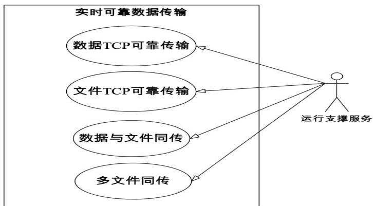
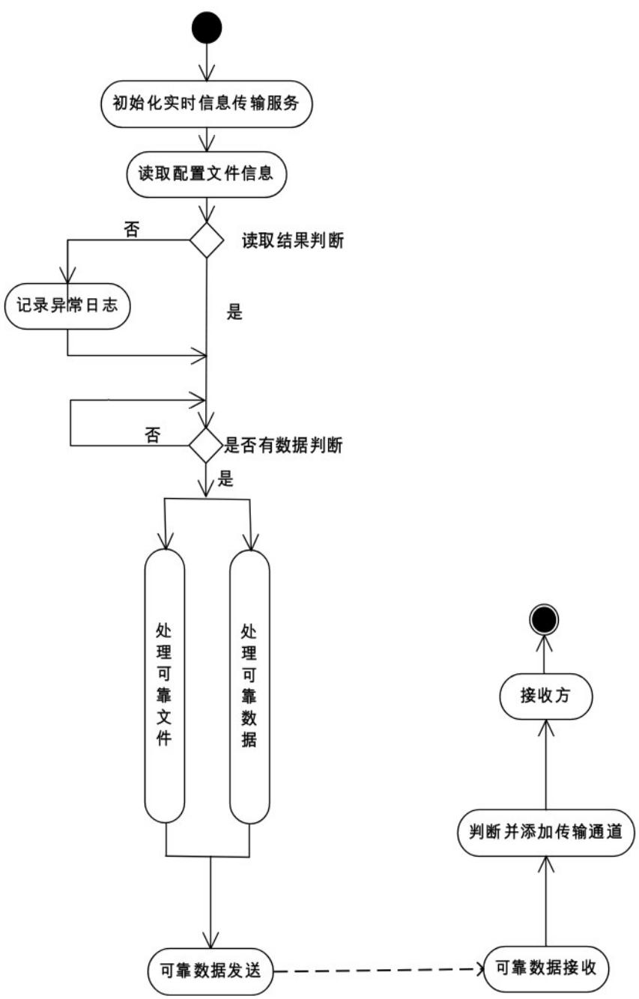

## 数据UDP分段传输用例场景，见表5所示。

表5数据UDP分段传输用例描述
<table><tr><td>Use Case 名称：实时数据 UDP 分段传 输</td><td colspan="2">Actors:应用软件</td></tr><tr><td colspan="3">概述：本用例是描述实时数据的分段UDP传输过程。。 前置条件：网络连接正常、实时信息传输服务运行正常、应用软件。</td></tr><tr><td colspan="3">主事件流</td></tr><tr><td>Actor 的动作</td><td>系统的动作</td><td>动作约束 (性能、可靠性、容错等)</td></tr><tr><td>1.在两台服务器上分别进行实时信息传 输服务初始化；</td><td>2.实时信息传输服务初始化成功，如果 实时信息传输服务启动失败，执行异常 流E1；</td><td>检测数据优先级、可靠性、数据 大小、服务配置信息合法性，当 遇到不合法输入时提示用户错误 信息，保证注释率不少于20%， 能够准确记录服务运行过程</td></tr><tr><td>4.服务器A处，应用软件A调用实时传 输服务注册接口，按照接口要求填入应 用软件注册信息，向服务进行注册； A的注册信息，完成应用软件A的注</td><td>3.实时信息传输服务读取服务配置文件 信息，如果读取失败，执行异常流E2； 5.服务器A,实时传输服务记录应用软件</td><td></td></tr><tr><td>6.服务器B处，应用软件 B 调用实时传 输服务注册接口，按照接口要求填入应 用软件注册信息，向服务进行注册；</td><td>册，如果注册失败，执行异常流E3； 7.服务器B,实时传输服务记录应用软件</td><td></td></tr><tr><td>8. 应用软件 A 调用数据发送接口，按照 接口要求输入应用软件B信息、服务器 B地址、分段传输通道、选择可靠性为 不可靠、大于1KB报文数据，循环发</td><td>B的注册信息，完成应用软件B的注 册，如果注册失败，执行异常流E3；</td><td></td></tr><tr><td>送；</td><td>9.实时信息传输服务将应用软件A 输入 的数据按用户填写的目的应用软件信 息、目的IP地址和传输通道信息，为数 据添加分段数据协议头信息，并将分段 数据包发送至目的端应用软件B，如果 协议头构建失败，执行异常流E4;如果发</td><td></td></tr><tr><td>10.目的应用软件B显示源端应用软件A 发来的数据，通过日志文件，可以查看 到实时信息传输服务接收到全部分段数 据； 11.应用软件A调用数据发送接口.按 照接口要求输入应用软件B信息、服务 器B地址、分段传输通道、选择可靠性 为可靠、大于1KB的报文数据，循环发 送；</td><td>送失败，执行异常流E5； 12. 实时信息传输服务将应用软件 A 输入 的数据按用户填写的目的应用软件信 息、目的IP地址和传输通道信息，为数 据添加分段数据协议头信息，并将分段 数据包发送至目的端应用软件B,如果协 议头构建失败，执行异常流E4;如果发送 失败，执行异常流E5； 13. 服务器A上的实时信息传输服务检测 到有分段数据在规定时间片内没有接收 到服务器B返回的应用控制报文，则将 该分段报文向服务器B再次发送；如果 重传次数超过规定的重传次数，则将该 报文丢弃。如果协议头构建失败，执行 异常流E4;如果发送失败，执行异常流 E5; 14. 服务器B 上的实时信息传输服务接收 到分段数据报文后，判断该报文为可靠 报文，则通过报文序列号、分段号组建 应用控制报文协议字节码，并向服务器 A返回，如果协议头构建失败，执行异常 流E4;如果发送失败，执行异常流E5； 15. 服务器A上的实时信息传输服务接收 到报文所有分段信息的应用控制报文 后，将该数据丢弃。 16. 服务器B上的实时信息传输服务接收 到报文的所有分段数据后，将数据向上 层应用提交。</td><td></td></tr><tr><td colspan="1" rowspan="1">分段发送过程；</td><td colspan="1" rowspan="1"></td><td colspan="1" rowspan="1"></td></tr><tr><td colspan="2" rowspan="1">异常流E1：运行支撑服务将服务启动失败信息写入日志文件，用例结束。</td><td colspan="1" rowspan="1"></td></tr><tr><td colspan="2" rowspan="1">异常流E2：运行支撑服务将读取配置文件失败信息写入日志，用例结束。</td><td colspan="1" rowspan="1"></td></tr><tr><td colspan="2" rowspan="1">异常流E3：运行支撑服务将注册失败信息写入日志，并提示应用软件重新注册，用例结束。</td><td colspan="1" rowspan="1"></td></tr><tr><td colspan="2" rowspan="1">异常流E4：运行支撑服务将构建协议头失败信息写入日志文件，用例结束。</td><td colspan="1" rowspan="1"></td></tr><tr><td colspan="2" rowspan="1">异常流E5：运行支撑服务将发送失败信息写入日志文件，用例结束。</td><td colspan="1" rowspan="1"></td></tr><tr><td colspan="2" rowspan="1">后置条件：无。</td><td colspan="1" rowspan="1"></td></tr></table>

## 3.2.2 实时数据传输控制（PZXQ-GN-SSSJCSKZ）

实时数据传输控制包含位置控制报文收发、应用控制报文收发，其功能用例如图6所示。

  
图6实时数据传输控制用例图

实时数据传输控制所有能力标识表，见表6所示。

表6实时控制报文传输功能所有能力标识
<table><tr><td rowspan=1 colspan=1>序号</td><td rowspan=1 colspan=1>Use case 名称</td><td rowspan=1 colspan=1>项目唯一标识符</td><td rowspan=1 colspan=1>需求描述</td><td rowspan=1 colspan=1>需求重用</td><td rowspan=1 colspan=1>方式名称</td><td rowspan=1 colspan=1>运行状态</td><td rowspan=1 colspan=1>对应的任务书功能/性能</td></tr><tr><td rowspan=1 colspan=1>1</td><td rowspan=1 colspan=1>位置控制报文收发</td><td rowspan=1 colspan=1>PZXQ-GN-SSSJCSKZ-WZKZBWSF</td><td rowspan=1 colspan=1>能够支撑实时位置控制报文的收发功能；</td><td rowspan=1 colspan=1>沿用</td><td rowspan=1 colspan=1>桌面版、平板版</td><td rowspan=1 colspan=1>运行阶段</td><td rowspan=1 colspan=1>4.1.2 a)</td></tr><tr><td rowspan=1 colspan=1>2</td><td rowspan=1 colspan=1>应用控制报文收发</td><td rowspan=1 colspan=1>PZXQ-GN-SSSJCSKZ-YYKZBWSF</td><td rowspan=1 colspan=1>能够支撑实时应用控制报文的收发</td><td rowspan=1 colspan=1>沿用</td><td rowspan=1 colspan=1>桌面版、平板版</td><td rowspan=1 colspan=1>运行阶段</td><td rowspan=1 colspan=1>4.1.2 b)</td></tr></table>

## 3.2.2.1 位置控制报文收发（PZXQ-GN-SSSJCSKZ-WZKZBWSF）

位置控制报文收发用例场景，见表7所示。

表7位置控制报文收发用例描述

<table><tr><td>Use Case 名称:位置控制报文收发</td><td colspan="2">Actors：应用软件</td></tr><tr><td colspan="3">概述：本用例是描述位置控制报文的收发过程。</td></tr><tr><td colspan="3">前置条件：网络连接正常、实时信息传输服务运行正常、应用软件。</td></tr><tr><td colspan="3">主事件流</td></tr><tr><td>Actor 的动作</td><td>系统的动作</td><td>动作约束 (性能、可靠性、容错等) 检测数据优先级、可靠性、数据</td></tr><tr><td>1.在两台服务器上分别进行实时信息传 输服务初始化；</td><td>2.实时信息传输服务初始化成功，如果 实时信息传输服务启动失败，执行异常 流E1； 3.实时信息传输服务读取服务配置文件</td><td>大小、服务配置信息合法性，当 遇到不合法输入时提示用户错误 信息，保证注释率不少于20%， 能够准确记录服务运行过程</td></tr><tr><td>4.服务器A处，应用软件 A调用实时传 输服务注册接口，按照接口要求填入应 用软件注册信息，向服务进行注册；</td><td>信息，如果读取失败，执行异常流E2； 5.服务器A,实时传输服务记录应用软件 A 的注册信息，完成应用软件A的注</td><td></td></tr><tr><td>6.服务器B处，应用软件 B 和应用软件 C调用实时传输服务注册接口，按照接 口要求填入应用软件注册信息，向服务 进行注册；</td><td>册，如果注册失败，执行异常流E3； 7.服务器B,实时传输服务记录应用软件 B 和应用软件C的注册信息，完成应用</td><td></td></tr><tr><td>8. 应用软件 A 调用数据发送接口，按照 接口要求输入服务器B地址、位置控制 报文传输通道、填写控制报文版本、子 版本、报文类型、扩展类型和报文数据 组成的16进制字节码，循环发送；</td><td>软件 B 和应用软件C的注册，如果注册 失败，执行异常流E3；</td><td></td></tr><tr><td></td><td>9.实时信息传输服务将应用软件 A 输入 的数据按目的IP地址和传输通道信息， 并采用UDP传输协议将数据发送至目的 端服务器B；如果协议头构建失败，执 行异常流E4;如果发送失败，执行异常流 E5;</td><td></td></tr><tr><td colspan="1" rowspan="1">11.目的应用软件B和应用软件C调用接收数据接口，显示源端应用软件A发来的位置控制报文版本、子版本、报文类型、扩展类型以及报文数据组成的16进制字节码。</td><td colspan="1" rowspan="1">10.目的端服务器B上的实时信息传输服务判断接收到位置控制报文后，遍历注册信息，将位置控制报文转发到注册的应用软件B和应用软件C处。</td><td colspan="1" rowspan="1"></td></tr><tr><td colspan="2" rowspan="1">异常流E1：运行支撑服务将服务启动失败信息写入日志文件，用例结束。</td><td colspan="1" rowspan="1"></td></tr><tr><td colspan="2" rowspan="1">异常流E2:运行支撑服务将读取配置文件失败信息写入日志，用例结束。</td><td colspan="1" rowspan="1"></td></tr><tr><td colspan="2" rowspan="1">异常流E3：运行支撑服务将注册失败信息写入日志，并提示应用软件重新注册，用例结束。</td><td colspan="1" rowspan="1"></td></tr><tr><td colspan="2" rowspan="1">异常流E4：运行支撑服务将构建协议头失败信息写入日志文件，用例结束。</td><td colspan="1" rowspan="1"></td></tr><tr><td colspan="2" rowspan="1">异常流E5：运行支撑服务将发送失败信息写入日志文件，用例结束。</td><td colspan="1" rowspan="1"></td></tr><tr><td colspan="2" rowspan="1">后置条件：无。</td><td colspan="1" rowspan="1"></td></tr></table>

## 3.2.2.2 应用控制报文收发（PZXQ-GN-SSSJCSKZ-YYKZBWSF）

应用控制报文收发用例场景，见表8所示。

表8应用控制报文收发用例描述
<table><tr><td colspan="1" rowspan="1">Use Case 名称：应用控制报文收发</td><td colspan="2" rowspan="1">Actors:应用软件</td></tr><tr><td colspan="3" rowspan="1">概述：本用例是描述应用控制报文的收发过程。。</td></tr><tr><td colspan="3" rowspan="1">前置条件：网络连接正常、实时信息传输服务运行正常、应用软件。</td></tr><tr><td colspan="3" rowspan="1">主事件流</td></tr><tr><td colspan="1" rowspan="1">Actor 的动作</td><td colspan="1" rowspan="1">系统的动作</td><td colspan="1" rowspan="1">动作约束(性能、可靠性、容错等)</td></tr><tr><td colspan="1" rowspan="1">1.在两台服务器上分别进行实时信息传输服务初始化；4.服务器A处，应用软件 A 调用实时传</td><td colspan="1" rowspan="1">2.实时信息传输服务初始化成功，如果实时信息传输服务启动失败，执行异常流E1;3.实时信息传输服务读取服务配置文件信息，如果读取失败，执行异常流E2；</td><td colspan="1" rowspan="1">检测数据优先级、可靠性、数据大小、服务配置信息合法性，当遇到不合法输入时提示用户错误信息，保证注释率不少于20%，能够准确记录服务运行过程</td></tr><tr><td>输服务注册接口，按照接口要求填入应 用软件注册信息，向服务进行注册； 6.服务器B处，应用软件B调用实时传 输服务注册接口，按照接口要求填入应 用软件注册信息，向服务进行注册；</td><td>5.服务器A,实时传输服务记录应用软件 A的注册信息，完成应用软件A的注 册，如果注册失败，执行异常流E3；</td><td></td></tr><tr><td rowspan="2">8. 应用软件A 调用数据发送接口，按照 接口要求输入应用软件B信息、服务器 B地址、分段传输通道、选择可靠性为 可靠、大于1KB报文数据，循环发送； 常流E4：如果超时未接收到全部数据，</td><td>7.服务器B,实时传输服务记录应用软件 B的注册信息，完成应用软件B的注 册，如果注册失败，执行异常流E3；</td><td></td></tr><tr><td>9.实时信息传输服务将应用软件 A输入 的数据按用户填写的目的应用软件信 息、目的IP地址和传输通道信息，为数 据添加分段数据协议头信息，并将分段 数据包发送至目的端应用软件B，如果 协议头构建失败，执行异常流E4;如果发 送失败，执行异常流E5； 10.服务器B端实时信息传输服务接收到 每一个分段数据包之后，根据接收数据 包的版本号、报文类型、扩展类型、源 信息、目的信息、序列号以及段号等信 息编码应用控制报文并返回，完成数据 的应答。如果协议头构建失败，执行异</td><td></td></tr><tr><td>看到发送应用控制报文类型的信息，包 括序列号、接收成功段号等信息。 12. 应用软件A 日志监控界面上可以看 到接收应用控制报文的信息，包括序列 号、发送成功段号等信息。 异常流E1：运行支撑服务将服务启动失败信息写入日志文件，用例结束。</td><td>11.目的应用软件B 日志监控信息中可以</td><td></td></tr></table>

<table><tr><td rowspan=1 colspan=1>异常流E2:运行支撑服务将读取配置文件失败信息写入日志，用例结束。</td><td rowspan=1 colspan=1></td></tr><tr><td rowspan=1 colspan=1>异常流E3：运行支撑服务将注册失败信息写入日志，并提示应用软件重新注册，用例结束。</td><td rowspan=1 colspan=1></td></tr><tr><td rowspan=1 colspan=1>异常流E4：运行支撑服务将构建协议头失败信息写入日志文件，用例结束。</td><td rowspan=1 colspan=1></td></tr><tr><td rowspan=1 colspan=1>异常流E5：运行支撑服务将发送失败信息写入日志文件，用例结束。</td><td rowspan=1 colspan=1></td></tr><tr><td rowspan=1 colspan=1>异常流E6: 运行支撑服务将超时未接收完全的信息写入日志文件，用例结束。</td><td rowspan=1 colspan=1></td></tr><tr><td rowspan=1 colspan=1>后置条件：无。</td><td rowspan=1 colspan=1></td></tr></table>

## 3.2.3 实时可靠数据传输（PZXQ-GN-SSKKSJCS）

实时可靠数据传输包括数据TCP可靠传输、文件TCP可靠传输、数据与文件同传、多文件同传，其功能用例如图7所示。

  
图7实时可靠数据传输用例图

实时可靠数据传输流程图如图8所示。

  
图8实时可靠数据传输流程用例图  
实时可靠数据传输所有能力标识表，见表9所示。

表9实时可靠数据传输所有能力标识

<table><tr><td rowspan=1 colspan=1>序号</td><td rowspan=1 colspan=1>Use case 名称</td><td rowspan=1 colspan=1>项目唯一标识符</td><td rowspan=1 colspan=1>需求描述</td><td rowspan=1 colspan=1>需求重用</td><td rowspan=1 colspan=1>方式名称</td><td rowspan=1 colspan=1>运行状态</td><td rowspan=1 colspan=1>对应的任务书功能/性能</td></tr><tr><td rowspan=1 colspan=1>1</td><td rowspan=1 colspan=1>数据 TCP 可靠传输</td><td rowspan=1 colspan=1>PZXQ-GN-SSKKSJCS-SJTCPKKCS</td><td rowspan=1 colspan=1>能够支撑实时数据的 TCP 可靠传输功能</td><td rowspan=1 colspan=1>沿用</td><td rowspan=1 colspan=1>桌面版、平板版</td><td rowspan=1 colspan=1>运行阶段</td><td rowspan=1 colspan=1>4.1.3 a)</td></tr><tr><td rowspan=1 colspan=1>2</td><td rowspan=1 colspan=1>文件 TCP 可靠传输</td><td rowspan=1 colspan=1>PZXQ-GN-SSKKSJCS-WJTCPKKCS</td><td rowspan=1 colspan=1>能够支撑实时信息文件TCP可靠传输功能</td><td rowspan=1 colspan=1>沿用</td><td rowspan=1 colspan=1>桌面版、平板版</td><td rowspan=1 colspan=1>运行阶段</td><td rowspan=1 colspan=1>4.1.3 b)</td></tr><tr><td rowspan=1 colspan=1>3</td><td rowspan=1 colspan=1>数据与文件同传</td><td rowspan=1 colspan=1>PZXQ-GN-SSKKSJCS-SJYWJTC</td><td rowspan=1 colspan=1>能够支撑实时信息数据和文件的同传功能；</td><td rowspan=1 colspan=1>沿用</td><td rowspan=1 colspan=1>桌面版、平板版</td><td rowspan=1 colspan=1>运行阶段</td><td rowspan=1 colspan=1>4.1.3 c)</td></tr><tr><td rowspan=1 colspan=1>4</td><td rowspan=1 colspan=1>多文件同传</td><td rowspan=1 colspan=1>PZXQ-GN-SSKKSJCS-DWJTC</td><td rowspan=1 colspan=1>能够支撑实时信息多个文件的同传功能；</td><td rowspan=1 colspan=1>沿用</td><td rowspan=1 colspan=1>桌面版、平板版</td><td rowspan=1 colspan=1>运行阶段</td><td rowspan=1 colspan=1>4.1.3 d)</td></tr></table>

## 3.2.3.1 数据 TCP 可靠传输（PZXQ-GN-SSKKSJCS-SJTCPKKCS）

数据TCP可靠传输用例场景，见表10所示。

表10数据TCP可靠传输用例描述
<table><tr><td colspan="1" rowspan="1">Use Case 名称:数据 TCP 可靠传输</td><td colspan="2" rowspan="1">Actors:应用软件</td></tr><tr><td colspan="3" rowspan="1">概述:本用例是描述实时数据的TCP可靠传输过程。</td></tr><tr><td colspan="3" rowspan="1">前置条件：网络连接正常、实时信息传输服务运行正常、应用软件。</td></tr><tr><td colspan="3" rowspan="1">主事件流</td></tr><tr><td colspan="1" rowspan="1">Actor 的动作</td><td colspan="1" rowspan="1">系统的动作</td><td colspan="1" rowspan="1">动作约束(性能、可靠性、容错等)</td></tr><tr><td colspan="1" rowspan="1">1.在两台服务器上分别进行实时信息传输服务初始化；4.服务器 A处，应用软件 A 调用实时传输服务注册接口，按照接口要求填入应用软件注册信息，向服务进行注册；</td><td colspan="1" rowspan="1">2.实时信息传输服务初始化成功，如果实时信息传输服务启动失败，执行异常流E1;3.实时信息传输服务读取服务配置文件信息，如果读取失败，执行异常流E2；5.服务器A,实时传输服务记录应用软件</td><td colspan="1" rowspan="1">检测数据优先级、可靠性、数据大小、服务配置信息合法性，当遇到不合法输入时提示用户错误信息，保证注释率不少于20%，能够准确记录服务运行过程</td></tr><tr><td>6.服务器B处，应用软件B调用实时传 输服务注册接口，按照接口要求填入应 用软件注册信息，向服务进行注册；</td><td>A的注册信息，完成应用软件A的注 册，如果注册失败，执行异常流E3； 7.服务器B,实时传输服务记录应用软件 B的注册信息，完成应用软件B的注</td><td></td></tr><tr><td>8. 应用软件A调用数据发送接口.按照 接口要求输入应用软件B信息、服务器 B地址、TCP可靠传输通道、报文数 据，循环发送；</td><td>册，如果注册失败，执行异常流E3； 9.实时信息传输服务将应用软件A输入 的数据按用户填写的目的应用软件信</td><td></td></tr><tr><td>10.目的应用软件B显示源端应用软件A</td><td>息、目的IP地址和传输通道信息，为数 据添加TCP可靠传输协议头信息，并与 服务器B端实时信息传输服务建立连 接，然后使用TCP可靠传输协议发送至 目的端应用软件B；如果协议头构建失 败，执行异常流E4;如果发送失败，执行 异常流E5；</td><td></td></tr><tr><td>发来的数据。 11.应用软件B调用数据发送接口.按 照接口要求输入应用软件A信息、服务 器A地址、TCP可靠传输通道、报文数 据，循环发送；</td><td>12. 实时信息传输服务将应用软件B输入</td><td></td></tr><tr><td></td><td>的数据按用户填写的目的应用软件信 息、目的IP地址和传输通道信息，为数</td><td></td></tr><tr><td>13. 目的应用软件A显示源端应用软件 B 发来的数据；</td><td>据添加TCP可靠传输协议头信息，并与 服务器A端实时信息传输服务建立连 接，然后使用TCP可靠传输协议发送至 目的端应用软件A；如果协议头构建失 败，执行异常流E4;如果发送失败，执行 异常流E5；</td><td></td></tr></table>