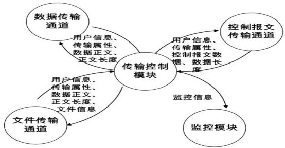

<table><tr><td></td><td></td><td></td><td rowspan="8"></td><td></td><td></td><td>属性、文件信息</td><td></td></tr><tr><td>口</td><td></td><td></td><td>通信 设备</td><td>本系 统</td><td>源端信息、目的信息、数据类 型、数据内容、数据长度、文件 信息</td><td>中</td></tr></table>

## 3.3.2 与统一传输服务接口（PZXQ-WBJK-SSXXCSFW-TYCS）

与统一传输服务接口数据元素说明表，见表18所示。

表18与统一传输服务接口数据元素说明
<table><tr><td colspan="1" rowspan="1">序号</td><td colspan="1" rowspan="1">数据集名称</td><td colspan="1" rowspan="1">数据组成</td><td colspan="1" rowspan="1">数据约束</td><td colspan="1" rowspan="1">数据标准</td></tr><tr><td colspan="1" rowspan="3">1</td><td colspan="1" rowspan="3">源用户信息</td><td colspan="1" rowspan="1">用户标识</td><td colspan="1" rowspan="1">unsigned int</td><td colspan="1" rowspan="1"></td></tr><tr><td colspan="1" rowspan="1">软件实体号</td><td colspan="1" rowspan="1">unsigned int</td><td colspan="1" rowspan="1"></td></tr><tr><td colspan="1" rowspan="1">用户IP</td><td colspan="1" rowspan="1">unsigned int</td><td colspan="1" rowspan="1"></td></tr><tr><td colspan="1" rowspan="3">2</td><td colspan="1" rowspan="3">目的用户信息</td><td colspan="1" rowspan="1">用户标识</td><td colspan="1" rowspan="1">unsigned int</td><td colspan="1" rowspan="1"></td></tr><tr><td colspan="1" rowspan="1">软件实体号</td><td colspan="1" rowspan="1">unsigned int</td><td colspan="1" rowspan="1"></td></tr><tr><td colspan="1" rowspan="1">用户IP</td><td colspan="1" rowspan="1">unsigned int</td><td colspan="1" rowspan="1"></td></tr><tr><td colspan="1" rowspan="4">3</td><td colspan="1" rowspan="4">数据类型</td><td colspan="1" rowspan="1">用户消息类型</td><td colspan="1" rowspan="1">unsigned char</td><td colspan="1" rowspan="1"></td></tr><tr><td colspan="1" rowspan="1">消息功能域分类</td><td colspan="1" rowspan="1">unsigned char</td><td colspan="1" rowspan="1"></td></tr><tr><td colspan="1" rowspan="1">消息编号</td><td colspan="1" rowspan="1">unsigned char</td><td colspan="1" rowspan="1"></td></tr><tr><td colspan="1" rowspan="1">消息子类型</td><td colspan="1" rowspan="1">unsigned char</td><td colspan="1" rowspan="1"></td></tr><tr><td colspan="1" rowspan="11">4</td><td colspan="1" rowspan="11">传输属性</td><td colspan="1" rowspan="1">策略号</td><td colspan="1" rowspan="1">unsigned int</td><td colspan="1" rowspan="1"></td></tr><tr><td colspan="1" rowspan="1">服务质量</td><td colspan="1" rowspan="1">unsigned int</td><td colspan="1" rowspan="1"></td></tr><tr><td colspan="1" rowspan="1">优先级</td><td colspan="1" rowspan="1">unsigned char</td><td colspan="1" rowspan="1"></td></tr><tr><td colspan="1" rowspan="1">可靠性</td><td colspan="1" rowspan="1">unsigned int</td><td colspan="1" rowspan="1"></td></tr><tr><td colspan="1" rowspan="1">报文版本类型</td><td colspan="1" rowspan="1">unsigned char</td><td colspan="1" rowspan="1"></td></tr><tr><td colspan="1" rowspan="1">业务类型</td><td colspan="1" rowspan="1">unsigned char</td><td colspan="1" rowspan="1"></td></tr><tr><td colspan="1" rowspan="1">加密类型</td><td colspan="1" rowspan="1">unsigned char</td><td colspan="1" rowspan="1"></td></tr><tr><td colspan="1" rowspan="1">系统标识</td><td colspan="1" rowspan="1">unsigned char</td><td colspan="1" rowspan="1"></td></tr><tr><td colspan="1" rowspan="1">信道标识</td><td colspan="1" rowspan="1">unsigned char</td><td colspan="1" rowspan="1"></td></tr><tr><td colspan="1" rowspan="1">协议类型</td><td colspan="1" rowspan="1">unsigned char</td><td colspan="1" rowspan="1"></td></tr><tr><td colspan="1" rowspan="1">压缩类型</td><td colspan="1" rowspan="1">unsigned char</td><td colspan="1" rowspan="1"></td></tr><tr><td colspan="1" rowspan="1">5</td><td colspan="1" rowspan="1">数据内容</td><td colspan="1" rowspan="1">数据内容</td><td colspan="1" rowspan="1">char *</td><td colspan="1" rowspan="1"></td></tr><tr><td colspan="1" rowspan="1">6</td><td colspan="1" rowspan="1">数据长度</td><td colspan="1" rowspan="1">数据长度</td><td colspan="1" rowspan="1"> $\mathsf { s i z e \_ t }$ </td><td colspan="1" rowspan="1"></td></tr><tr><td colspan="1" rowspan="1">7</td><td colspan="1" rowspan="1">文件信息</td><td colspan="1" rowspan="1">文件名称</td><td colspan="1" rowspan="1"> $\mathsf { c h a r } ^ { \star }$ </td><td colspan="1" rowspan="1"></td></tr></table>

## 3.3.3 与运行支撑服务接口（PZXQ-WBJK-SSXXCSFW-YXZCFW）

与运行支撑服务接口数据元素说明表，见表19所示。

表19与运行支撑服务接口数据元素说明
<table><tr><td rowspan=1 colspan=1>序号</td><td rowspan=1 colspan=1>数据集名称</td><td rowspan=1 colspan=1>数据组成</td><td rowspan=1 colspan=1>数据约束</td><td rowspan=1 colspan=1>数据标准</td></tr><tr><td rowspan=4 colspan=1>1</td><td rowspan=4 colspan=1>日志信息</td><td rowspan=1 colspan=1>ERROR级别日志信息</td><td rowspan=1 colspan=1> $\mathsf { c h a r } ^ { \star }$ </td><td rowspan=1 colspan=1></td></tr><tr><td rowspan=1 colspan=1>WARN 级别日志信息</td><td rowspan=1 colspan=1> $\mathsf { c h a r } ^ { \star }$ </td><td rowspan=1 colspan=1></td></tr><tr><td rowspan=1 colspan=1>INFO 级别日志信息</td><td rowspan=1 colspan=1> $\mathsf { c h a r } ^ { \star }$ </td><td rowspan=1 colspan=1></td></tr><tr><td rowspan=1 colspan=1>DEBUG 级别日志信息</td><td rowspan=1 colspan=1> $\mathsf { c h a r } ^ { \star }$ </td><td rowspan=1 colspan=1></td></tr></table>

## 3.3.4 与通信设备接口（PZXQ-WBJK-SSXXCSFW-TXSB）

与通信设备接口数据元素说明表，见表20所示。

表20与通信设备接口数据元素说明
<table><tr><td colspan="1" rowspan="1">序号</td><td colspan="1" rowspan="1">数据集名称</td><td colspan="1" rowspan="1">数据组成</td><td colspan="1" rowspan="1">数据约束</td><td colspan="1" rowspan="1">数据标准</td></tr><tr><td colspan="1" rowspan="5">1</td><td colspan="1" rowspan="5">源用户信息</td><td colspan="1" rowspan="1">用户标识</td><td colspan="1" rowspan="1">unsigned int</td><td colspan="1" rowspan="1"></td></tr><tr><td colspan="1" rowspan="1">软件实体号</td><td colspan="1" rowspan="1">unsigned int</td><td colspan="1" rowspan="1"></td></tr><tr><td colspan="1" rowspan="1">软件主机号</td><td colspan="1" rowspan="1">unsigned int</td><td colspan="1" rowspan="1"></td></tr><tr><td colspan="1" rowspan="1">软件系统号</td><td colspan="1" rowspan="1">unsigned int</td><td colspan="1" rowspan="1"></td></tr><tr><td colspan="1" rowspan="1">用户IP</td><td colspan="1" rowspan="1">unsigned int</td><td colspan="1" rowspan="1"></td></tr><tr><td colspan="1" rowspan="5">2</td><td colspan="1" rowspan="5">目的用户信息</td><td colspan="1" rowspan="1">用户标识</td><td colspan="1" rowspan="1">unsigned int</td><td colspan="1" rowspan="1"></td></tr><tr><td colspan="1" rowspan="1">软件实体号</td><td colspan="1" rowspan="1">unsigned int</td><td colspan="1" rowspan="1"></td></tr><tr><td colspan="1" rowspan="1">软件主机号</td><td colspan="1" rowspan="1">unsigned int</td><td colspan="1" rowspan="1"></td></tr><tr><td colspan="1" rowspan="1">软件系统号</td><td colspan="1" rowspan="1">unsigned int</td><td colspan="1" rowspan="1"></td></tr><tr><td colspan="1" rowspan="1">用户IP</td><td colspan="1" rowspan="1">unsigned int</td><td colspan="1" rowspan="1"></td></tr><tr><td colspan="1" rowspan="4">3</td><td colspan="1" rowspan="4">数据类型</td><td colspan="1" rowspan="1">用户消息类型</td><td colspan="1" rowspan="1">unsigned char</td><td colspan="1" rowspan="1"></td></tr><tr><td colspan="1" rowspan="1">消息功能域分类</td><td colspan="1" rowspan="1">unsigned char</td><td colspan="1" rowspan="1"></td></tr><tr><td colspan="1" rowspan="1">消息编号</td><td colspan="1" rowspan="1">unsigned char</td><td colspan="1" rowspan="1"></td></tr><tr><td colspan="1" rowspan="1">消息子类型</td><td colspan="1" rowspan="1">unsigned char</td><td colspan="1" rowspan="1"></td></tr><tr><td colspan="1" rowspan="11">4</td><td colspan="1" rowspan="11">传输属性</td><td colspan="1" rowspan="1">策略号</td><td colspan="1" rowspan="1">unsigned int</td><td colspan="1" rowspan="1"></td></tr><tr><td colspan="1" rowspan="1">服务质量</td><td colspan="1" rowspan="1">unsigned int</td><td colspan="1" rowspan="1"></td></tr><tr><td colspan="1" rowspan="1">优先级</td><td colspan="1" rowspan="1">unsigned char</td><td colspan="1" rowspan="1"></td></tr><tr><td colspan="1" rowspan="1">可靠性</td><td colspan="1" rowspan="1">unsigned int</td><td colspan="1" rowspan="1"></td></tr><tr><td colspan="1" rowspan="1">报文版本类型</td><td colspan="1" rowspan="1">unsigned char</td><td colspan="1" rowspan="1"></td></tr><tr><td colspan="1" rowspan="1">业务类型</td><td colspan="1" rowspan="1">unsigned char</td><td colspan="1" rowspan="1"></td></tr><tr><td colspan="1" rowspan="1">加密类型</td><td colspan="1" rowspan="1">unsigned char</td><td colspan="1" rowspan="1"></td></tr><tr><td colspan="1" rowspan="1">系统标识</td><td colspan="1" rowspan="1">unsigned char</td><td colspan="1" rowspan="1"></td></tr><tr><td colspan="1" rowspan="1">信道标识</td><td colspan="1" rowspan="1">unsigned char</td><td colspan="1" rowspan="1"></td></tr><tr><td colspan="1" rowspan="1">协议类型</td><td colspan="1" rowspan="1">unsigned char</td><td colspan="1" rowspan="1"></td></tr><tr><td colspan="1" rowspan="1">压缩类型</td><td colspan="1" rowspan="1">unsigned char</td><td colspan="1" rowspan="1"></td></tr><tr><td colspan="1" rowspan="1">5</td><td colspan="1" rowspan="1">数据内容</td><td colspan="1" rowspan="1">数据内容</td><td colspan="1" rowspan="1">char *</td><td colspan="1" rowspan="1"></td></tr><tr><td colspan="1" rowspan="1">6</td><td colspan="1" rowspan="1">数据长度</td><td colspan="1" rowspan="1">数据长度</td><td colspan="1" rowspan="1">size_t</td><td colspan="1" rowspan="1"></td></tr><tr><td colspan="1" rowspan="1">7</td><td colspan="1" rowspan="1">文件信息</td><td colspan="1" rowspan="1">文件名称</td><td colspan="1" rowspan="1">char *</td><td colspan="1" rowspan="1"></td></tr></table>

## 3.4 CSCI 内部接口需求

## 3.4.1 接口标识和接口图

实时信息传输服务软件内部接口需求图，见图11所示。

  
图11实时信息传输服务软件接口需求

实时信息传输服务软件内部接口包括：传输控制与监控接口、传输控制与数据传输通道接口、数据传输通道与传输控制接口、传输控制与控制报文传输通道接口、控制报文传输通道与传输控制接口、文件传输通道与传输控制接口、传输控制与文件传输通道接口。

实时信息传输服务软件内部接口需求表见表21。

表21实时信息传输服务软件内部接口需求
<table><tr><td rowspan=1 colspan=1>序号</td><td rowspan=1 colspan=1>接口需求名称</td><td rowspan=1 colspan=1>接口需求标识</td><td rowspan=1 colspan=1>接口类型</td><td rowspan=1 colspan=1>发送方</td><td rowspan=1 colspan=1>接收方</td><td rowspan=1 colspan=1>接口内容</td><td rowspan=1 colspan=1>接口优先级</td></tr><tr><td rowspan=1 colspan=1>1</td><td rowspan=1 colspan=1>传输控制与监控接口</td><td rowspan=1 colspan=1>PZXQ-NBJK-CSKZ-JK</td><td rowspan=1 colspan=1>API接口</td><td rowspan=1 colspan=1>传输控制模块</td><td rowspan=1 colspan=1>监控模块</td><td rowspan=1 colspan=1>用户信息、传输属性、数据内容、数据长度</td><td rowspan=1 colspan=1>中</td></tr><tr><td rowspan=1 colspan=1>2</td><td rowspan=1 colspan=1>传输控制与数据传输通道接口</td><td rowspan=1 colspan=1>PZXQ-NBJK-CSKZ-SJCSTD</td><td rowspan=1 colspan=1>API接口</td><td rowspan=1 colspan=1>传输控制模块</td><td rowspan=1 colspan=1>数据传输通道模块</td><td rowspan=1 colspan=1>用户信息、传输属性、数据内容、数据长度</td><td rowspan=1 colspan=1>高</td></tr><tr><td rowspan=1 colspan=1>3</td><td rowspan=1 colspan=1>数据传输通道与传输控制接口</td><td rowspan=1 colspan=1>PZXQ-NBJK-SJCSTD-CSKZ</td><td rowspan=1 colspan=1>API接口</td><td rowspan=1 colspan=1>数据传输通道模块</td><td rowspan=1 colspan=1>传输控制模块</td><td rowspan=1 colspan=1>用户信息、传输属性、数据内容、数据长度</td><td rowspan=1 colspan=1></td></tr><tr><td rowspan=1 colspan=1>4</td><td rowspan=1 colspan=1>传输控制与控制报文传输通道接口</td><td rowspan=1 colspan=1>PZXQ-NBJK-CSKZ-KZBWCSTD</td><td rowspan=1 colspan=1>API接口</td><td rowspan=1 colspan=1>传输控制模块</td><td rowspan=1 colspan=1>控制报文传输通道模块</td><td rowspan=1 colspan=1>传输属性、控制报文</td><td rowspan=1 colspan=1>高</td></tr><tr><td rowspan=1 colspan=1>5</td><td rowspan=1 colspan=1>控制报文传输通道与传输控制接口</td><td rowspan=1 colspan=1>PZXQ-NBJK-KZBWCSTD-CSKZ</td><td rowspan=1 colspan=1>API接口</td><td rowspan=1 colspan=1>控制报文传输通道模块</td><td rowspan=1 colspan=1>传输控制模块</td><td rowspan=1 colspan=1>传输属性、控制报文</td><td rowspan=1 colspan=1>高</td></tr><tr><td rowspan=1 colspan=1>6</td><td rowspan=1 colspan=1>传输控制与文件传输通道接口</td><td rowspan=1 colspan=1>PZXQ-NBJK-CSKZ-WJCSTD</td><td rowspan=1 colspan=1>API接口</td><td rowspan=1 colspan=1>传输控制模块</td><td rowspan=1 colspan=1>文件传输通道模块</td><td rowspan=1 colspan=1>用户信息、传输属性、数据内容、文件信息</td><td rowspan=1 colspan=1>高</td></tr><tr><td rowspan=1 colspan=1>7</td><td rowspan=1 colspan=1>文件传输通道与传输控制接口</td><td rowspan=1 colspan=1>PZXQ-NBJK-WJCSTD-CSKZ</td><td rowspan=1 colspan=1>API接口</td><td rowspan=1 colspan=1>文件传输通道模块</td><td rowspan=1 colspan=1>传输控制模块</td><td rowspan=1 colspan=1>用户信息、传输属性、数据内容、文件信息</td><td rowspan=1 colspan=1>高</td></tr></table>

## 3.4.2 传输控制与监控接口（PZXQ-NBJK-CSKZ-JK）

编解码数据传输通道协议头接口数据元素说明表，见表22所示。

表22编解码数据传输通道协议接口数据元素说明
<table><tr><td colspan="1" rowspan="1">序号</td><td colspan="1" rowspan="1">数据集名称</td><td colspan="1" rowspan="1">数据组成</td><td colspan="1" rowspan="1">数据约束</td><td colspan="1" rowspan="1">数据标准</td></tr><tr><td colspan="1" rowspan="1">1</td><td colspan="1" rowspan="1">源用户信息</td><td colspan="1" rowspan="1">源软件实体号</td><td colspan="1" rowspan="1">unsigned int</td><td colspan="1" rowspan="1"></td></tr><tr><td colspan="1" rowspan="9"></td><td colspan="1" rowspan="2"></td><td colspan="1" rowspan="1">源软件系统号</td><td colspan="1" rowspan="1">unsigned int</td><td colspan="1" rowspan="1"></td></tr><tr><td colspan="1" rowspan="1">源软件主机号</td><td colspan="1" rowspan="1">unsigned int</td><td colspan="1" rowspan="1"></td></tr><tr><td colspan="1" rowspan="3">目的用户信息</td><td colspan="1" rowspan="1">目的软件实体号</td><td colspan="1" rowspan="1">unsigned int</td><td colspan="1" rowspan="1"></td></tr><tr><td colspan="1" rowspan="1">目的软件系统号</td><td colspan="1" rowspan="1">unsigned int</td><td colspan="1" rowspan="1"></td></tr><tr><td colspan="1" rowspan="1">目的软件主机号</td><td colspan="1" rowspan="1">unsigned int</td><td colspan="1" rowspan="1"></td></tr><tr><td colspan="1" rowspan="2">传输属性</td><td colspan="1" rowspan="1">传输通道</td><td colspan="1" rowspan="1">unsigned int</td><td colspan="1" rowspan="1"></td></tr><tr><td colspan="1" rowspan="1">可靠性</td><td colspan="1" rowspan="1">unsigned int</td><td colspan="1" rowspan="1"></td></tr><tr><td colspan="1" rowspan="2">报文内容</td><td colspan="1" rowspan="1">数据内容</td><td colspan="1" rowspan="1">char *</td><td colspan="1" rowspan="1"></td></tr><tr><td colspan="1" rowspan="1">数据长度</td><td colspan="1" rowspan="1">size_t</td><td colspan="1" rowspan="1"></td></tr></table>

## 3.4.3 传输控制与数据传输通道接口(PZXQ-NBJK-CSKZ-SJCSTD）

传输控制与数据传输通道接口数据元素说明表，见表23所示。

表23传输控制与数据传输通道接口数据元素说明
<table><tr><td rowspan=1 colspan=1>序号</td><td rowspan=1 colspan=1>数据集名称</td><td rowspan=1 colspan=1>数据组成</td><td rowspan=1 colspan=1>数据约束</td><td rowspan=1 colspan=1>数据标准</td></tr><tr><td rowspan=3 colspan=1>1</td><td rowspan=3 colspan=1>源用户信息</td><td rowspan=1 colspan=1>源软件实体号</td><td rowspan=1 colspan=1>unsigned int</td><td rowspan=1 colspan=1></td></tr><tr><td rowspan=1 colspan=1>源软件系统号</td><td rowspan=1 colspan=1>unsigned int</td><td rowspan=1 colspan=1></td></tr><tr><td rowspan=1 colspan=1>源软件主机号</td><td rowspan=1 colspan=1>unsigned int</td><td rowspan=1 colspan=1></td></tr><tr><td rowspan=3 colspan=1>2</td><td rowspan=3 colspan=1>目的用户信息</td><td rowspan=1 colspan=1>目的软件实体号</td><td rowspan=1 colspan=1>unsigned int</td><td rowspan=1 colspan=1></td></tr><tr><td rowspan=1 colspan=1>目的软件系统号</td><td rowspan=1 colspan=1>unsigned int</td><td rowspan=1 colspan=1></td></tr><tr><td rowspan=1 colspan=1>目的软件主机号</td><td rowspan=1 colspan=1>unsigned int</td><td rowspan=1 colspan=1></td></tr><tr><td rowspan=1 colspan=1>3</td><td rowspan=1 colspan=1>传输属性</td><td rowspan=1 colspan=1>传输通道</td><td rowspan=1 colspan=1>unsigned int</td><td rowspan=1 colspan=1></td></tr><tr><td rowspan=1 colspan=1>3</td><td rowspan=2 colspan=1>报文内容</td><td rowspan=1 colspan=1>数据内容</td><td rowspan=1 colspan=1>char *</td><td rowspan=1 colspan=1></td></tr><tr><td rowspan=1 colspan=1>4</td><td rowspan=1 colspan=1>数据长度</td><td rowspan=1 colspan=1>size_t</td><td rowspan=1 colspan=1></td></tr></table>

## 3.4.4 数据传输通道与传输控制接口（PZXQ-NBJK-SJCSTD-CSKZ）

数据传输通道与传输控制接口数据元素说明表，见表24所示。

表24数据传输通道与传输控制接口数据元素说明
<table><tr><td rowspan=1 colspan=1>序号</td><td rowspan=1 colspan=1>数据集名称</td><td rowspan=1 colspan=1>数据组成</td><td rowspan=1 colspan=1>数据约束</td><td rowspan=1 colspan=1>数据标准</td></tr><tr><td rowspan=2 colspan=1>1</td><td rowspan=2 colspan=1>源用户信息</td><td rowspan=1 colspan=1>源软件实体号</td><td rowspan=1 colspan=1>unsigned int</td><td rowspan=1 colspan=1></td></tr><tr><td rowspan=1 colspan=1>源软件系统号</td><td rowspan=1 colspan=1>unsigned int</td><td rowspan=1 colspan=1></td></tr></table>

表26控制报文传输通道与传输控制接口数据元素说明

<table><tr><td rowspan=1 colspan=1></td><td rowspan=1 colspan=1></td><td rowspan=1 colspan=1>源软件主机号</td><td rowspan=1 colspan=1>unsigned int</td><td rowspan=1 colspan=1></td></tr><tr><td rowspan=3 colspan=1>2</td><td rowspan=3 colspan=1>目的用户信息</td><td rowspan=1 colspan=1>目的软件实体号</td><td rowspan=1 colspan=1>unsigned int</td><td rowspan=1 colspan=1></td></tr><tr><td rowspan=1 colspan=1>目的软件系统号</td><td rowspan=1 colspan=1>unsigned int</td><td rowspan=1 colspan=1></td></tr><tr><td rowspan=1 colspan=1>目的软件主机号</td><td rowspan=1 colspan=1>unsigned int</td><td rowspan=1 colspan=1></td></tr><tr><td rowspan=1 colspan=1>3</td><td rowspan=1 colspan=1>传输属性</td><td rowspan=1 colspan=1>传输通道</td><td rowspan=1 colspan=1>unsigned int</td><td rowspan=1 colspan=1></td></tr><tr><td rowspan=1 colspan=1>3</td><td rowspan=2 colspan=1>报文内容</td><td rowspan=1 colspan=1>数据内容</td><td rowspan=1 colspan=1>char *</td><td rowspan=1 colspan=1></td></tr><tr><td rowspan=1 colspan=1>4</td><td rowspan=1 colspan=1>数据长度</td><td rowspan=1 colspan=1>size_t</td><td rowspan=1 colspan=1></td></tr></table>

## 3.4.5 传输控制与控制报文传输通道接口（PZXQ-NBJK-CSKZ-KZBWCSTD）

传输控制与控制报文传输通道接口数据元素说明表，见表25所示。

表25传输控制与控制报文传输通道接口数据元素说明
<table><tr><td rowspan=1 colspan=1>序号</td><td rowspan=1 colspan=1>数据集名称</td><td rowspan=1 colspan=1>数据组成</td><td rowspan=1 colspan=1>数据约束</td><td rowspan=1 colspan=1>数据标准</td></tr><tr><td rowspan=3 colspan=1>1</td><td rowspan=3 colspan=1>源用户信息</td><td rowspan=1 colspan=1>源软件实体号</td><td rowspan=1 colspan=1>unsigned int</td><td rowspan=1 colspan=1></td></tr><tr><td rowspan=1 colspan=1>源软件系统号</td><td rowspan=1 colspan=1>unsigned int</td><td rowspan=1 colspan=1></td></tr><tr><td rowspan=1 colspan=1>源软件主机号</td><td rowspan=1 colspan=1>unsigned int</td><td rowspan=1 colspan=1></td></tr><tr><td rowspan=3 colspan=1>2</td><td rowspan=3 colspan=1>目的用户信息</td><td rowspan=1 colspan=1>目的软件实体号</td><td rowspan=1 colspan=1>unsigned int</td><td rowspan=1 colspan=1></td></tr><tr><td rowspan=1 colspan=1>目的软件系统号</td><td rowspan=1 colspan=1>unsigned int</td><td rowspan=1 colspan=1></td></tr><tr><td rowspan=1 colspan=1>目的软件主机号</td><td rowspan=1 colspan=1>unsigned int</td><td rowspan=1 colspan=1></td></tr><tr><td rowspan=2 colspan=1>3</td><td rowspan=2 colspan=1>传输属性</td><td rowspan=1 colspan=1>优先级</td><td rowspan=1 colspan=1>unsigned char</td><td rowspan=1 colspan=1></td></tr><tr><td rowspan=1 colspan=1>可靠性</td><td rowspan=1 colspan=1>unsigned int</td><td rowspan=1 colspan=1></td></tr><tr><td rowspan=2 colspan=1>4</td><td rowspan=2 colspan=1>报文内容</td><td rowspan=1 colspan=1>数据内容</td><td rowspan=1 colspan=1>char*</td><td rowspan=1 colspan=1></td></tr><tr><td rowspan=1 colspan=1>数据长度</td><td rowspan=1 colspan=1>unsigned int</td><td rowspan=1 colspan=1></td></tr></table>

## 3.4.6 控制报文传输通道与传输控制接口（PZXQ-NBJK-KZBWCSTD-CSKZ）

控制报文传输通道与传输控制接口数据元素说明表，见表26所示。

<table><tr><td colspan="1" rowspan="1">序号</td><td colspan="1" rowspan="1">数据集名称</td><td colspan="1" rowspan="1">数据组成</td><td colspan="1" rowspan="1">数据约束</td><td colspan="1" rowspan="1">数据标准</td></tr><tr><td colspan="1" rowspan="3">1</td><td colspan="1" rowspan="3">源用户信息</td><td colspan="1" rowspan="1">源软件实体号</td><td colspan="1" rowspan="1">unsigned int</td><td colspan="1" rowspan="1"></td></tr><tr><td colspan="1" rowspan="1">源软件系统号</td><td colspan="1" rowspan="1">unsigned int</td><td colspan="1" rowspan="1"></td></tr><tr><td colspan="1" rowspan="1">源软件主机号</td><td colspan="1" rowspan="1">unsigned int</td><td colspan="1" rowspan="1"></td></tr><tr><td colspan="1" rowspan="3">2</td><td colspan="1" rowspan="3">目的用户信息</td><td colspan="1" rowspan="1">目的软件实体号</td><td colspan="1" rowspan="1">unsigned int</td><td colspan="1" rowspan="1"></td></tr><tr><td colspan="1" rowspan="1">目的软件系统号</td><td colspan="1" rowspan="1">unsigned int</td><td colspan="1" rowspan="1"></td></tr><tr><td colspan="1" rowspan="1">目的软件主机号</td><td colspan="1" rowspan="1">unsigned int</td><td colspan="1" rowspan="1"></td></tr><tr><td colspan="1" rowspan="1">3</td><td colspan="1" rowspan="1">传输属性</td><td colspan="1" rowspan="1">优先级</td><td colspan="1" rowspan="1">unsigned char</td><td colspan="1" rowspan="1"></td></tr><tr><td colspan="2" rowspan="1"></td><td colspan="1" rowspan="1">可靠性</td><td colspan="1" rowspan="1">unsigned int</td><td colspan="1" rowspan="1"></td></tr><tr><td colspan="1" rowspan="2">4</td><td colspan="1" rowspan="2">报文内容</td><td colspan="1" rowspan="1">数据内容</td><td colspan="1" rowspan="1">char*</td><td colspan="1" rowspan="1"></td></tr><tr><td colspan="1" rowspan="1">数据长度</td><td colspan="1" rowspan="1">unsigned int</td><td colspan="1" rowspan="1"></td></tr></table>

## 3.4.7 传输控制与文件传输通道接口（PZXQ-NBJK-CSKZ-WJCSTD）

传输控制与文件传输通道接口数据元素说明表，见表27所示。

表27传输控制与文件传输通道接口数据元素说明
<table><tr><td rowspan=1 colspan=1>序号</td><td rowspan=1 colspan=1>数据集名称</td><td rowspan=1 colspan=1>数据组成</td><td rowspan=1 colspan=1>数据约束</td><td rowspan=1 colspan=1>数据标准</td></tr><tr><td rowspan=3 colspan=1>1</td><td rowspan=3 colspan=1>源用户信息</td><td rowspan=1 colspan=1>源软件实体号</td><td rowspan=1 colspan=1>unsigned int</td><td rowspan=1 colspan=1></td></tr><tr><td rowspan=1 colspan=1>源软件系统号</td><td rowspan=1 colspan=1>unsigned int</td><td rowspan=1 colspan=1></td></tr><tr><td rowspan=1 colspan=1>源软件主机号</td><td rowspan=1 colspan=1>unsigned int</td><td rowspan=1 colspan=1></td></tr><tr><td rowspan=3 colspan=1>2</td><td rowspan=3 colspan=1>目的用户信息</td><td rowspan=1 colspan=1>目的软件实体号</td><td rowspan=1 colspan=1>unsigned int</td><td rowspan=1 colspan=1></td></tr><tr><td rowspan=1 colspan=1>目的软件系统号</td><td rowspan=1 colspan=1>unsigned int</td><td rowspan=1 colspan=1></td></tr><tr><td rowspan=1 colspan=1>目的软件主机号</td><td rowspan=1 colspan=1>unsigned int</td><td rowspan=1 colspan=1></td></tr><tr><td rowspan=2 colspan=1>3</td><td rowspan=2 colspan=1>传输属性</td><td rowspan=1 colspan=1>优先级</td><td rowspan=1 colspan=1>unsigned char</td><td rowspan=1 colspan=1></td></tr><tr><td rowspan=1 colspan=1>可靠性</td><td rowspan=1 colspan=1>unsigned int</td><td rowspan=1 colspan=1></td></tr><tr><td rowspan=4 colspan=1>4</td><td rowspan=4 colspan=1>报文内容</td><td rowspan=1 colspan=1>数据内容</td><td rowspan=1 colspan=1>char*</td><td rowspan=1 colspan=1></td></tr><tr><td rowspan=1 colspan=1>数据长度</td><td rowspan=1 colspan=1>unsigned int</td><td rowspan=1 colspan=1></td></tr><tr><td rowspan=1 colspan=1>文件个数</td><td rowspan=1 colspan=1>unsigned int</td><td rowspan=1 colspan=1></td></tr><tr><td rowspan=1 colspan=1>文件名称</td><td rowspan=1 colspan=1>char*</td><td rowspan=1 colspan=1></td></tr></table>

## 3.4.8 文件传输通道与传输控制接口（PZXQ-NBJK-WJCSTD-CSKZ）

文件传输通道与传输控制接口数据元素说明表，见表28所示。

表28文件传输通道与传输控制接口数据元素说明
<table><tr><td rowspan=1 colspan=1>序号</td><td rowspan=1 colspan=1>数据集名称</td><td rowspan=1 colspan=1>数据组成</td><td rowspan=1 colspan=1>数据约束</td><td rowspan=1 colspan=1>数据标准</td></tr><tr><td rowspan=3 colspan=1>1</td><td rowspan=3 colspan=1>源用户信息</td><td rowspan=1 colspan=1>源软件实体号</td><td rowspan=1 colspan=1>unsigned int</td><td rowspan=1 colspan=1></td></tr><tr><td rowspan=1 colspan=1>源软件系统号</td><td rowspan=1 colspan=1>unsigned int</td><td rowspan=1 colspan=1></td></tr><tr><td rowspan=1 colspan=1>源软件主机号</td><td rowspan=1 colspan=1>unsigned int</td><td rowspan=1 colspan=1></td></tr><tr><td rowspan=3 colspan=1>2</td><td rowspan=3 colspan=1>目的用户信息</td><td rowspan=1 colspan=1>目的软件实体号</td><td rowspan=1 colspan=1>unsigned int</td><td rowspan=1 colspan=1></td></tr><tr><td rowspan=1 colspan=1>目的软件系统号</td><td rowspan=1 colspan=1>unsigned int</td><td rowspan=1 colspan=1></td></tr><tr><td rowspan=1 colspan=1>目的软件主机号</td><td rowspan=1 colspan=1>unsigned int</td><td rowspan=1 colspan=1></td></tr><tr><td rowspan=2 colspan=1>3</td><td rowspan=2 colspan=1>传输属性</td><td rowspan=1 colspan=1>优先级</td><td rowspan=1 colspan=1>unsigned char</td><td rowspan=1 colspan=1></td></tr><tr><td rowspan=1 colspan=1>可靠性</td><td rowspan=1 colspan=1>unsigned int</td><td rowspan=1 colspan=1></td></tr><tr><td rowspan=4 colspan=1>4</td><td rowspan=4 colspan=1>报文内容</td><td rowspan=1 colspan=1>数据内容</td><td rowspan=1 colspan=1>char*</td><td rowspan=1 colspan=1></td></tr><tr><td rowspan=1 colspan=1>数据长度</td><td rowspan=1 colspan=1>unsigned int</td><td rowspan=1 colspan=1></td></tr><tr><td rowspan=1 colspan=1>文件个数</td><td rowspan=1 colspan=1>unsigned int</td><td rowspan=1 colspan=1></td></tr><tr><td rowspan=1 colspan=1>文件名称</td><td rowspan=1 colspan=1>char*</td><td rowspan=1 colspan=1></td></tr></table>

## 3.5 CSCI 内部数据需求

表29对CSCI所有内部数据元素进行汇总。

表29实时信息传输服务软件内部数据汇总表
<table><tr><td rowspan=1 colspan=1>序号</td><td rowspan=1 colspan=1>数据名称</td><td rowspan=1 colspan=1>数据内容</td><td rowspan=1 colspan=1>相关功能及标识</td></tr><tr><td rowspan=1 colspan=1>1</td><td rowspan=1 colspan=1>用户信息</td><td rowspan=1 colspan=1>软件实体号、软件系统号、软件主机号、用户 ip 地址</td><td rowspan=1 colspan=1>定义源、目的用户和软件信息</td></tr><tr><td rowspan=1 colspan=1>2</td><td rowspan=1 colspan=1>传输属性</td><td rowspan=1 colspan=1>传输通道、可靠性</td><td rowspan=1 colspan=1>定义数据的传输方式</td></tr><tr><td rowspan=1 colspan=1>3</td><td rowspan=1 colspan=1>数据正文类型</td><td rowspan=1 colspan=1>实时信息数据长度、实时信息文件个数</td><td rowspan=1 colspan=1>定义数据正文类型</td></tr></table>

用户信息数据描述见表30所示。

表30用户信息数据描述表
<table><tr><td rowspan=1 colspan=1>序号</td><td rowspan=1 colspan=1>数据项</td><td rowspan=1 colspan=1>最大值</td><td rowspan=1 colspan=1>最小值</td><td rowspan=1 colspan=1>精度</td><td rowspan=1 colspan=1>单位</td></tr><tr><td rowspan=1 colspan=1>1</td><td rowspan=1 colspan=1>软件实体号</td><td rowspan=1 colspan=1>65535</td><td rowspan=1 colspan=1>1</td><td rowspan=1 colspan=1>1</td><td rowspan=1 colspan=1>1</td></tr><tr><td rowspan=1 colspan=1>2</td><td rowspan=1 colspan=1>软件系统号</td><td rowspan=1 colspan=1>65535</td><td rowspan=1 colspan=1>0</td><td rowspan=1 colspan=1>1</td><td rowspan=1 colspan=1>1</td></tr><tr><td rowspan=1 colspan=1>3</td><td rowspan=1 colspan=1>软件主机号</td><td rowspan=1 colspan=1>65535</td><td rowspan=1 colspan=1>1</td><td rowspan=1 colspan=1>1</td><td rowspan=1 colspan=1>1</td></tr><tr><td rowspan=1 colspan=1>4</td><td rowspan=1 colspan=1>用户ip</td><td rowspan=1 colspan=1>4294967295</td><td rowspan=1 colspan=1>0</td><td rowspan=1 colspan=1>1</td><td rowspan=1 colspan=1>1</td></tr></table>

传输属性数据描述见表31所示。

表31传输属性数据描述表
<table><tr><td rowspan=1 colspan=1>序号</td><td rowspan=1 colspan=1>数据项</td><td rowspan=1 colspan=1>最大值</td><td rowspan=1 colspan=1>最小值</td><td rowspan=1 colspan=1>精度</td><td rowspan=1 colspan=1>单位</td></tr><tr><td rowspan=1 colspan=1>1</td><td rowspan=1 colspan=1>传输通道</td><td rowspan=1 colspan=1>24</td><td rowspan=1 colspan=1>0</td><td rowspan=1 colspan=1>1</td><td rowspan=1 colspan=1>1</td></tr><tr><td rowspan=1 colspan=1>2</td><td rowspan=1 colspan=1>可靠性</td><td rowspan=1 colspan=1>1</td><td rowspan=1 colspan=1>0</td><td rowspan=1 colspan=1>1</td><td rowspan=1 colspan=1>1</td></tr></table>

数据正文信息描述见表32所示。

表32数据正文信息描述表
<table><tr><td rowspan=1 colspan=1>序号</td><td rowspan=1 colspan=1>数据项</td><td rowspan=1 colspan=1>最大值</td><td rowspan=1 colspan=1>最小值</td><td rowspan=1 colspan=1>精度</td><td rowspan=1 colspan=1>单位</td></tr><tr><td rowspan=1 colspan=1>1</td><td rowspan=1 colspan=1>实时信息数据长度</td><td rowspan=1 colspan=1>29696</td><td rowspan=1 colspan=1>0</td><td rowspan=1 colspan=1>1</td><td rowspan=1 colspan=1>1</td></tr><tr><td rowspan=1 colspan=1>2</td><td rowspan=1 colspan=1>实时信息文件个数</td><td rowspan=1 colspan=1>10</td><td rowspan=1 colspan=1>1</td><td rowspan=1 colspan=1>1</td><td rowspan=1 colspan=1>1</td></tr></table>

## 3.6 适应性需求

a）采用跨平台开发工具及开发环境，确保软件能适应不同硬件环境（如桌面平台、手持平台等），具有在多种国产操作系统运行适配能力；

b）后台服务按照处理器、操作系统的运行条件，根据自身功能要求分别编译生成桌面、平板、手持等不同形态；

c）系统运行时能够根据系统登录者席位身份，加载不同的界面和服务，支持业务功能灵活重组；

d）依据在桌面、平板、手持不同硬件形态，通过软件部署管理自动下载、安装相应环境的软件包，实现多平台运行。

## 3.7 安全性需求

实时信息服务软件安全性需求见表33所示。

表33实时信息传输服务软件安全性需求
<table><tr><td rowspan=1 colspan=1>序号</td><td rowspan=1 colspan=1>安全性需求</td><td rowspan=1 colspan=1>详细说明</td></tr><tr><td rowspan=1 colspan=1>1</td><td rowspan=1 colspan=1>故障检测与诊断</td><td rowspan=1 colspan=1>软件自检，检测软件中的故障，阻止错误结果的影响</td></tr><tr><td rowspan=1 colspan=1>2</td><td rowspan=1 colspan=1>异常日志记录</td><td rowspan=1 colspan=1>发生异常时，通过运维支撑服务提供的日志接口记录软件的失效原因和标识、软件异常位置和原因，给用户排查问题提供支撑能力</td></tr></table>

## 3.8 保密性需求

在实时信息传输服务软件集成为系统后，随系统所集成的保密相关功能完成加密存储或加密交互，同时在系统安装和软件运行时设定权限密码。

## 3.9 CSCI 环境需求

## 3.9.1 运行环境需求

实时信息传输服务软件环境需求见表34。

表34软件运行环境
<table><tr><td>序号</td><td>设备名称</td><td>硬件要求</td><td>软件要求</td></tr><tr><td>1</td><td>轻量化服务器</td><td>处理器：16核 CPU 主频：不低于 1.5GHz 内存：不小于16GB 存储：不小于512GB</td><td>操作系统：银河麒麟V4.0.2 数据库：达梦数据库V7.6 办公软件：WPS V10.1</td></tr><tr><td>2</td><td>便携式服务器</td><td>便携式服务器具有2个服务器单元。 每个服务单元的处理器：i7四核 CPU 主频：不低于 2.0GHz 内存：不低于8GB 存储：不低于500GB。 显示分辨率：不低于1280×1024(VGA）</td><td>操作系统：银河麒麟V4.0.2 数据库：达梦数据库V7.6 办公软件：WPS V10.1</td></tr><tr><td>3</td><td>便携式计算机</td><td>处理器：i7 双核 CPU 主频：不低于 2.5GHz 内存：不低于8GB 存储：不低于500GB。 显示分辨率：不低于1280×1024</td><td>操作系统：银河麒麟V4.0.2 办公软件：WPS V10.1</td></tr><tr><td>4</td><td>携行作业设备</td><td>处理器：四核 CPU 主频：不低于 1.2GHz 内存：不小于3GB 存储：不小于256GB 显示分辨率：10时分辨率不低于 1920×1080，14时分辨率不低于 1920×1080</td><td>操作系统：元心 V4.1.1/银河锐华 V4.0.0.0 数据库：SQLite V3.0.0 办公软件：WPS V10.1</td></tr><tr><td>5</td><td>便携式计算机（国 产化）</td><td>处理器：不低于4核 CPU 主频:不低于 2.2Hz 内存：不小于8GB 存储：不小于512GB 显示分辨率：15吋LED背光屏，分辨率不 低于 1920*1080 显存：不低于2GB</td><td>操作系统：银河麒麟V4.0.2 办公软件：WPS V10.1</td></tr></table>

## 3.9.2 开发环境需求

编程语言：C/C++；

开发编译环境：Qt 5.9.6、C/C++ x11。

## 3.10 计算机资源需求

## 3.10.1 计算机硬件需求

实时信息传输服务软件计算机硬件配置需求见表35所示。

表35计算机硬件配置需求
<table><tr><td rowspan=1 colspan=1>序号</td><td rowspan=1 colspan=1>设备名称</td><td rowspan=1 colspan=1>硬件要求</td></tr><tr><td rowspan=1 colspan=1>1</td><td rowspan=1 colspan=1>轻量化服务器</td><td rowspan=1 colspan=1>处理器：16核</td></tr></table>