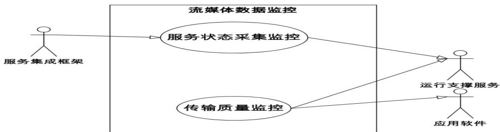
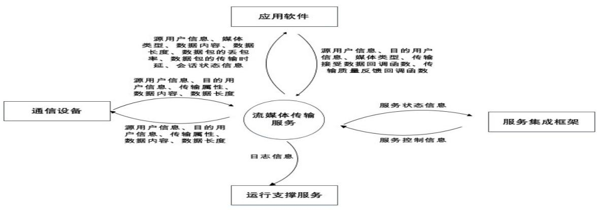

图6 流媒体传输控制用例图

流媒体传输控制所有能力标识表，见表13所示。

表13 流媒体传输控制所有能力标识
<table><tr><td rowspan=1 colspan=1>序号</td><td rowspan=1 colspan=1>Use case 名称</td><td rowspan=1 colspan=1>项目唯一标识符</td><td rowspan=1 colspan=1>需求描述</td><td rowspan=1 colspan=1>需求重用</td><td rowspan=1 colspan=1>方式</td><td rowspan=1 colspan=1>运行状态</td><td rowspan=1 colspan=1>对应的任务书功能/性能</td></tr><tr><td rowspan=1 colspan=1>1</td><td rowspan=1 colspan=1>乱序重组</td><td rowspan=1 colspan=1>PZXQ-GN-LMTCSKZ-LXCZ</td><td rowspan=1 colspan=1>提供数据接收时的乱序重组功能，将流媒体数据按源发方发送顺序提交至接收端应用软件；</td><td rowspan=1 colspan=1>沿用</td><td rowspan=1 colspan=1>桌面版、平板版</td><td rowspan=1 colspan=1>运行阶段</td><td rowspan=1 colspan=1>4.1.4 a)</td></tr><tr><td rowspan=1 colspan=1>2</td><td rowspan=1 colspan=1>传输质量控制</td><td rowspan=1 colspan=1>PZXQ-GN-LMTCSKZ-CSZLKZ</td><td rowspan=1 colspan=1>能够周期性的发送传输质量控制包</td><td rowspan=1 colspan=1>沿用</td><td rowspan=1 colspan=1>桌面版、平板版</td><td rowspan=1 colspan=1>运行阶段</td><td rowspan=1 colspan=1>4.1.4 b)</td></tr><tr><td rowspan=1 colspan=1>3</td><td rowspan=1 colspan=1>流媒体组播控制</td><td rowspan=1 colspan=1>PZXQ-GN-LMTCSKZ-LMTZBKZ</td><td rowspan=1 colspan=1>提供流媒体数据流的单播、组播能力</td><td rowspan=1 colspan=1>沿用</td><td rowspan=1 colspan=1>桌面版、平板版</td><td rowspan=1 colspan=1>运行阶段</td><td rowspan=1 colspan=1>4.1.1 c)</td></tr></table>

## 3.2.4.1 乱序重组（PZXQ-GN-LMTCSKZ-LXCZ）

乱序重组用例场景，见表14所示。

表14 乱序重组用例描述
<table><tr><td rowspan=1 colspan=1>Use Case 名称:乱序重组</td><td rowspan=1 colspan=1>Actors:应用软件</td></tr><tr><td rowspan=1 colspan=2>概述：本用例是乱序重组的用例，描述应用软件收发流媒体数据时对数据进行乱序重组的过程。</td></tr><tr><td rowspan=1 colspan=2>前置条件：网络连接正常、流媒体传输服务运行正常。</td></tr><tr><td rowspan=1 colspan=2>主事件流</td></tr></table>

<table><tr><td>Actor 的动作</td><td>系统的动作</td><td>动作约束 (性能、可靠性、容错等)</td></tr><tr><td>1.服务集成框架软件启动流媒体传输服 务； 4.应用软件A、应用软件C调用流媒体 服务初始化接口，按照接口要求填入应 用软件注册信息，以及接收数据回调函 数，向服务进行注册； 6.应用软件 A 调用设置媒体参数接口， 按照接口要求输入媒体数据的类型、媒 体数据的帧间隔等信息。</td><td>2.流媒体传输服务初始化成功，如果流 媒体传输服务启动失败，执行异常流 E1; 3.流媒体传输服务读取服务配置文件信 息，如果读取失败，执行异常流E2；</td><td>当遇到不合法输入时提示用户错 误信息，保证注释率不少于 20%，能够准确记录编程过程</td></tr><tr><td>7. 应用软件A调用设置目的地址参数接 口，按照接口要求输入目标成员的IP地 址、目标成员的IP端口号等信息。 8.应用软件A 调用数据发送接口，按照 接口要求输入流媒体数据缓冲区、流媒 体数据缓冲区长度，发送数据，发送数 据的长度大于服务配置文件中分包长度 的大小； 重组；重组完成后提交给目的端应用软</td><td>5.流媒体传输服务记录应用软件A、应用 软件C信息，完成应用软件A、应用软 件C的注册；如果注册失败，执行异常 流E3； 9.流媒体传输服务将数据按照配置文件 中的拆分包大小，将数据拆分为若干个 小数据包并编号；如果拆分包失败，执 行异常流E4，逐包发送数据，如果发送 失败，执行异常流E5； 10. 流媒体传输服务按照数据包编号进行</td><td></td></tr><tr><td colspan="1" rowspan="1">11.目的端应用软件C正确接收源端应用软件A发来的数据，数据收发成功。</td><td colspan="1" rowspan="1"></td><td colspan="1" rowspan="1"></td></tr><tr><td colspan="2" rowspan="1">异常流E1：运行支撑服务将服务启动失败信息写入日志文件，用例结束。</td><td colspan="1" rowspan="1"></td></tr><tr><td colspan="2" rowspan="1">异常流E2：运行支撑服务将读取配置文件失败信息写入日志，用例结束。</td><td colspan="1" rowspan="1"></td></tr><tr><td colspan="2" rowspan="1">异常流E3：运行支撑服务将注册失败信息写入日志，并提示应用软件重新注册，用例结束。</td><td colspan="1" rowspan="1"></td></tr><tr><td colspan="2" rowspan="1">异常流E4：运行支撑服务将拆分包失败信息写入日志文件，用例结束。</td><td colspan="1" rowspan="1"></td></tr><tr><td colspan="2" rowspan="1">异常流E5：运行支撑服务将发送失败信息写入日志文件，用例结束。</td><td colspan="1" rowspan="1"></td></tr><tr><td colspan="2" rowspan="1">后置条件：无。</td><td colspan="1" rowspan="1"></td></tr></table>

## 3.2.4.2 传输质量控制（PZXQ-GN-LMTCSKZ-CSZLKZ）

传输质量控制用例场景，见表15所示。

表15 传输质量控制用例描述
<table><tr><td colspan="1" rowspan="1">Use Case 名称：传输质量控制</td><td colspan="2" rowspan="1">Actors:应用软件</td></tr><tr><td colspan="3" rowspan="1">概述：本用例是传输质量控制的用例，描述应用软件收发流媒体数据时进行传输质量控制的过程。</td></tr><tr><td colspan="3" rowspan="1">前置条件：网络连接正常、流媒体传输服务运行正常。</td></tr><tr><td colspan="3" rowspan="1">主事件流</td></tr><tr><td colspan="1" rowspan="1">Actor 的动作</td><td colspan="1" rowspan="1">系统的动作</td><td colspan="1" rowspan="1">动作约束(性能、可靠性、容错等)</td></tr><tr><td colspan="1" rowspan="1">1.服务集成框架软件启动流媒体传输服务；4.应用软件A、应用软件C调用流媒体服务初始化接口，按照接口要求填入应用软件注册信息，以及接收数据回调函数，向服务进行注册；</td><td colspan="1" rowspan="1">2.流媒体传输服务初始化成功，如果流媒体传输服务启动失败，执行异常流E1;3.流媒体传输服务读取服务配置文件信息，如果读取失败，执行异常流E2；5.流媒体传输服务记录应用软件A、应用软件C信息，完成应用软件A、应用软件C的注册；如果注册失败，执行异常</td><td colspan="1" rowspan="1">当遇到不合法输入时提示用户错误信息，保证注释率不少于20%，能够准确记录编程过程</td></tr><tr><td colspan="1" rowspan="1">6.应用软件A调用设置媒体参数接口，按照接口要求输入媒体数据的类型、媒体数据的帧间隔等信息。7. 应用软件A调用设置目的地址参数接口，按照接口要求输入目标成员的IP地址、目标成员的IP端口号等信息。8.应用软件A调用数据发送接口，按照接口要求输入流媒体数据缓冲区、流媒体数据缓冲区长度，发送数据；10.目的应用软件C输出流媒体数据当前的传输质量，包括传输时延、传输丢包率。</td><td colspan="1" rowspan="1">流E3;9. 流媒体传输服务周期性的发送传输质量控制包。向目的端应用软件C返回流媒体数据当前的传输质量，包括传输时延、传输丢包率；</td><td colspan="1" rowspan="1"></td></tr><tr><td colspan="2" rowspan="1">异常流E1：运行支撑服务将服务启动失败信息写入日志文件，用例结束。</td><td colspan="1" rowspan="1"></td></tr><tr><td colspan="2" rowspan="1">异常流E2：运行支撑服务将读取配置文件失败信息写入日志，用例结束。</td><td colspan="1" rowspan="1"></td></tr><tr><td colspan="2" rowspan="1">异常流E3：运行支撑服务将注册失败信息写入日志，并提示应用软件重新注册，用例结束。</td><td colspan="1" rowspan="1"></td></tr><tr><td colspan="2" rowspan="1">后置条件：无。</td><td colspan="1" rowspan="1"></td></tr></table>

## 3.2.4.3 流媒体组播控制（PZXQ-GN-LMTCSKZ-LMTZBKZ）

流媒体组播控制用例场景，见表16所示。

表16 流媒体组播控制用例描述
<table><tr><td rowspan=1 colspan=1>Use Case 名称：流媒体组播控制</td><td rowspan=1 colspan=2>Actors:应用软件</td></tr><tr><td rowspan=1 colspan=3>概述：本用例是流媒体组播控制的用例，描述流媒体传输服务进行流媒体数据流的单播、组播过程。</td></tr><tr><td rowspan=1 colspan=3>前置条件：网络连接正常、流媒体传输服务运行正常。</td></tr><tr><td rowspan=1 colspan=3>主事件流</td></tr><tr><td rowspan=1 colspan=1>Actor 的动作</td><td rowspan=1 colspan=1>系统的动作</td><td rowspan=1 colspan=1>动作约束(性能、可靠性、容错等)</td></tr><tr><td rowspan=1 colspan=1>1.服务集成框架软件启动流媒体传输服务；</td><td rowspan=1 colspan=1></td><td rowspan=1 colspan=1>当遇到不合法输入时提示用户错误信息，保证注释率不少于</td></tr></table>

<table><tr><td></td><td>20%，能够准确记录编程过程</td></tr><tr><td></td><td>2.流媒体传输服务初始化成功，如果流 媒体传输服务启动失败，执行异常流</td></tr><tr><td>E1 ;</td><td></td></tr><tr><td></td><td>3.流媒体传输服务读取服务配置文件信</td></tr><tr><td>4.应用软件 A、应用软件C调用流媒体 服务初始化接口，按照接口要求填入应</td><td>息，如果读取失败，执行异常流E2；</td></tr><tr><td>用软件注册信息，以及接收数据回调函</td><td></td></tr><tr><td>数，向服务进行注册；</td><td></td></tr><tr><td></td><td>5.流媒体传输服务记录应用软件A、应用</td></tr><tr><td></td><td>软件C信息，完成应用软件A、应用软</td></tr><tr><td></td><td>件C的注册；如果注册失败，执行异常</td></tr><tr><td></td><td></td></tr><tr><td>6.应用软件 A 调用设置媒体参数接口，</td><td>流E3;</td></tr><tr><td>按照接口要求输入媒体数据的类型、媒</td><td></td></tr><tr><td>体数据的帧间隔等信息。</td><td></td></tr><tr><td>7. 应用软件A 调用设置目的地址参数接</td><td></td></tr><tr><td>口，按照接口要求输入目标成员的IP地</td><td></td></tr><tr><td>址、目标成员的IP端口号等信息。</td><td></td></tr><tr><td></td><td></td></tr><tr><td>8.应用软件A调用数据发送接口，按照</td><td></td></tr><tr><td>接口要求输入流媒体数据缓冲区、流媒 体数据缓冲区长度，发送数据；</td><td></td></tr><tr><td></td><td></td></tr><tr><td></td><td></td></tr><tr><td></td><td>9.流媒体传输服务将顺序解析接收到的</td></tr><tr><td></td><td>流媒体数据，并实时提交流媒体数据；</td></tr><tr><td>10.目的应用软件C输出源端应用软件A</td><td></td></tr><tr><td>发来的数据，数据收发成功；</td><td></td></tr><tr><td></td><td></td></tr><tr><td>11. 应用软件A 调用设置目的地址参数</td><td></td></tr><tr><td>接口，按照接口要求输入增加组播地址 o</td><td></td></tr><tr><td>目标成员的IP地址、目标成员的IP端</td><td></td></tr><tr><td>口号等信息，将应用软件C添加到组播</td><td></td></tr><tr><td>成员中。</td><td></td></tr><tr><td></td><td></td></tr><tr><td>12.应用软件A调用数据发送接口.按照</td><td></td></tr><tr><td></td><td></td></tr><tr><td></td><td></td></tr><tr><td>接口要求输入流媒体数据缓冲区、流媒</td><td></td></tr><tr><td>体数据缓冲区长度，发送数据；</td><td></td></tr></table>

<table><tr><td rowspan=1 colspan=1>14.目的应用软件C输出源端应用软件A发来的数据，数据收发成功；</td><td rowspan=1 colspan=1>13.流媒体传输服务将顺序解析接收到的流媒体数据，并实时提交流媒体数据给组播成员；</td><td rowspan=1 colspan=1></td></tr><tr><td rowspan=1 colspan=2>异常流E1：运行支撑服务将服务启动失败信息写入日志文件，用例结束。</td><td rowspan=1 colspan=1></td></tr><tr><td rowspan=1 colspan=2>异常流E2:运行支撑服务将读取配置文件失败信息写入日志，用例结束。</td><td rowspan=1 colspan=1></td></tr><tr><td rowspan=1 colspan=2>异常流E3：运行支撑服务将注册失败信息写入日志，并提示应用软件重新注册，用例结束。</td><td rowspan=1 colspan=1></td></tr><tr><td rowspan=1 colspan=2>后置条件：无。</td><td rowspan=1 colspan=1></td></tr></table>

## 3.2.5 流媒体数据监控（PZXQ-GN-LMTSJJK）

流媒体数据监控功能包括服务状态采集监控、传输质量监控，其功能用例如图7所示。

  
图7 流媒体流媒体数据监控用例图

流媒体流媒体数据监控所有能力标识表，见表17所示。

表17 流媒体流媒体数据监控所有能力标识
<table><tr><td colspan="1" rowspan="1">序号</td><td colspan="1" rowspan="1">Use case 名称</td><td colspan="1" rowspan="1">项目唯一标识符</td><td colspan="1" rowspan="1">需求描述</td><td colspan="1" rowspan="1">需求重用</td><td colspan="1" rowspan="1">方式</td><td colspan="1" rowspan="1">运行状态</td><td colspan="1" rowspan="1">对应的任务书功能/性能</td></tr><tr><td colspan="1" rowspan="1">1</td><td colspan="1" rowspan="1">服务状态采集监控</td><td colspan="1" rowspan="1">PZXQ-GN-LMTSJJK-FWZTCJJK</td><td colspan="1" rowspan="1">能够检测流媒体传输服务的内部状</td><td colspan="1" rowspan="1">沿用</td><td colspan="1" rowspan="1">桌面版、平</td><td colspan="1" rowspan="1">运行阶段</td><td colspan="1" rowspan="1">4.1.5 a)</td></tr><tr><td colspan="1" rowspan="1"></td><td colspan="1" rowspan="1"></td><td colspan="1" rowspan="1"></td><td colspan="1" rowspan="1">态；</td><td colspan="1" rowspan="1"></td><td colspan="1" rowspan="1">板版</td><td colspan="1" rowspan="1"></td><td colspan="1" rowspan="1"></td></tr><tr><td colspan="1" rowspan="1">2</td><td colspan="1" rowspan="1">传输质量监控</td><td colspan="1" rowspan="1">PZXQ-GN-LMTSJJK-CSZLJK</td><td colspan="1" rowspan="1">能够向传输服务调用者返回流媒体数据当前的传输质量，包括传输时延、传输丢包率；</td><td colspan="1" rowspan="1">沿用</td><td colspan="1" rowspan="1">桌面版、平板版</td><td colspan="1" rowspan="1">运行阶段</td><td colspan="1" rowspan="1">4.1.5 b)</td></tr></table>

## 3.2.5.1 服务状态采集监控（PZXQ-GN-LMTSJJK-FWZTCJJK）

服务状态采集监控用例场景，见表18所示。

表18 服务状态采集监控用例描述
<table><tr><td rowspan=1 colspan=1>Use Case 名称：服务状态采集监控</td><td rowspan=1 colspan=2>Actors：服务集成框架</td></tr><tr><td rowspan=1 colspan=3>概述：本用例是服务状态采集监控的用例，描述对局域网内传输服务状态信息的采集监控的过程；</td></tr><tr><td rowspan=1 colspan=3>前置条件：网络连接正常、流媒体传输服务运行正常、服务集成框架软件运行正常。</td></tr><tr><td rowspan=1 colspan=3>主事件流</td></tr><tr><td rowspan=1 colspan=1>Actor 的动作</td><td rowspan=1 colspan=1>系统的动作</td><td rowspan=1 colspan=1>动作约束(性能、可靠性、容错等)</td></tr><tr><td rowspan=1 colspan=1>1.服务集成框架启动查看服务状态，启动流媒体传输服务软件;5.在服务集成框架界面中可以看到当前网络中流媒体传输服务状态；</td><td rowspan=1 colspan=1>2.流媒体传输服务初始化成功，如果流媒体传输服务启动失败，执行异常流E1;3.流媒体传输服务读取服务配置文件信息，如果读取失败，执行异常流E2；4.流媒体传输服务将其状态发送到服务集成框架软件处；</td><td rowspan=1 colspan=1>当遇到不合法输入时提示用户错误信息，保证注释率不少于20%，能够准确记录编程过程</td></tr><tr><td rowspan=1 colspan=2>异常流E1：运行支撑服务将服务启动失败信息写入日志文件，用例结束。</td><td rowspan=1 colspan=1></td></tr><tr><td rowspan=1 colspan=2>异常流E2：运行支撑服务将读取配置文件失败信息写入日志，用例结束。</td><td rowspan=1 colspan=1></td></tr><tr><td rowspan=1 colspan=2>后置条件：无。</td><td rowspan=1 colspan=1></td></tr></table>

## 3.2.5.2 传输质量监控（PZXQ-GN-LMTSJJK-CSZLJK）

传输质量监控用例场景，见表19所示。

表19 传输质量监控用例描述
<table><tr><td>Use Case 名称:传输质量监控</td><td>Actors:应用软件</td></tr><tr><td colspan="2">概述：本用例是传输质量监控的用例，描述应用软件收发流媒体数据时进行传输质量监控的过程。</td></tr><tr><td colspan="2">前置条件：网络连接正常、流媒体传输服务运行正常。</td></tr><tr><td colspan="2">主事件流</td></tr><tr><td>Actor 的动作 1.服务集成框架软件启动流媒体传输服</td><td>动作约束 系统的动作 (性能、可靠性、容错等) 当遇到不合法输入时提示用户错</td></tr><tr><td>务； 4.应用软件 A、应用软件C调用流媒体 服务初始化接口，按照接口要求填入应 用软件注册信息，以及接收数据回调函 数，向服务进行注册；</td><td>误信息，保证注释率不少于 20%，能够准确记录编程过程 2.流媒体传输服务初始化成功，如果流 媒体传输服务启动失败，执行异常流 E1; 3.流媒体传输服务读取服务配置文件信 息，如果读取失败，执行异常流E2；</td></tr><tr><td>流E3； 6.应用软件A调用设置媒体参数接口， 按照接口要求输入媒体数据的类型、媒 体数据的帧间隔等信息。 7. 应用软件A 调用设置目的地址参数接 口，按照接口要求输入目标成员的IP地 址、目标成员的IP端口号等信息。</td><td>5.流媒体传输服务记录应用软件A、应用 软件C信息，完成应用软件A、应用软 件C的注册；如果注册失败，执行异常</td></tr><tr><td>8.应用软件 A 调用数据发送接口，按照 接口要求输入流媒体数据缓冲区、流媒</td><td></td></tr><tr><td>体数据缓冲区长度，发送数据；</td><td>9. 流媒体传输服务周期性的发送传输质</td></tr></table>

<table><tr><td rowspan=1 colspan=1>10.目的应用软件C输出流媒体数据当前的传输质量，包括传输时延、传输丢包率。</td><td rowspan=1 colspan=1>量控制包。向目的端应用软件C返回流媒体数据当前的传输质量，包括传输时延、传输丢包率；</td><td rowspan=1 colspan=1></td></tr><tr><td rowspan=1 colspan=2>异常流E1：运行支撑服务将服务启动失败信息写入日志文件，用例结束。</td><td rowspan=1 colspan=1></td></tr><tr><td rowspan=1 colspan=2>异常流E2：运行支撑服务将读取配置文件失败信息写入日志，用例结束。</td><td rowspan=1 colspan=1></td></tr><tr><td rowspan=1 colspan=2>异常流E3：运行支撑服务将注册失败信息写入日志，并提示应用软件重新注册，用例结束。</td><td rowspan=1 colspan=1></td></tr><tr><td rowspan=1 colspan=2>后置条件：无。</td><td rowspan=1 colspan=1></td></tr></table>

## 3.3 CSCI 外部接口需求

## 3.3.1 接口标识和接口图

流媒体传输服务软件外部接口需求图，见图8所示。

  
图8 流媒体传输服务软件外部接口需求  
流媒体传输服务软件外部接口包括：与服务集成框架接口、与运行支撑服务接口、

与通信设备接口、与应用软件接口。

流媒体传输服务软件外部接口需求表见表20所示。

表20 流媒体传输服务软件外部接口需求
<table><tr><td rowspan=1 colspan=1>序号</td><td rowspan=1 colspan=1>接口需求名称</td><td rowspan=1 colspan=1>接口需求标识</td><td rowspan=1 colspan=1>接口类型</td><td rowspan=1 colspan=1>发送方</td><td rowspan=1 colspan=1>接收方</td><td rowspan=1 colspan=1>接口内容</td><td rowspan=1 colspan=1>接口优先级</td></tr><tr><td rowspan=2 colspan=1>1</td><td rowspan=2 colspan=1>流媒体传输服务软件与应用软件之间接口</td><td rowspan=2 colspan=1>PZXQ-WBJK-LMTCSFW-YYRJ</td><td rowspan=2 colspan=1>函数接口</td><td rowspan=1 colspan=1>本系统</td><td rowspan=1 colspan=1>应用软件</td><td rowspan=1 colspan=1>源用户信息、媒体类型、数据内容、数据长度、数据包的丢包率、数据包的传输时延、会话状态信息</td><td rowspan=1 colspan=1>低</td></tr><tr><td rowspan=1 colspan=1>应用软件</td><td rowspan=1 colspan=1>本系统</td><td rowspan=1 colspan=1>源用户信息、目的用户信息、媒体类型、传输接受数据回调函数、传输质量反馈回调函数</td><td rowspan=1 colspan=1>低</td></tr><tr><td rowspan=2 colspan=1>2</td><td rowspan=2 colspan=1>流媒体传输服务软件与通信设备之间接口</td><td rowspan=2 colspan=1>PZXQ-WBJK-LMTCSFW-TXSB</td><td rowspan=2 colspan=1>硬件接口</td><td rowspan=1 colspan=1>本系统</td><td rowspan=1 colspan=1>通信设备</td><td rowspan=1 colspan=1>源用户信息、目的用户信息、传输属性、数据内容、数据长度</td><td rowspan=1 colspan=1>低</td></tr><tr><td rowspan=1 colspan=1>通信设备</td><td rowspan=1 colspan=1>本系统</td><td rowspan=1 colspan=1>源用户信息、目的用户信息、传输属性、数据内容、数据长度</td><td rowspan=1 colspan=1>低</td></tr><tr><td rowspan=1 colspan=1>3</td><td rowspan=1 colspan=1>流媒体传输服务软件与运行支撑服务之间接口</td><td rowspan=1 colspan=1>PZXQ-WBJK-LMTCSFW-YXZCFW</td><td rowspan=1 colspan=1>函数接口</td><td rowspan=1 colspan=1>本系统</td><td rowspan=1 colspan=1>运行支撑服务</td><td rowspan=1 colspan=1>日志信息</td><td rowspan=1 colspan=1>低</td></tr><tr><td rowspan=2 colspan=1>4</td><td rowspan=2 colspan=1>流媒体传输服务软件与服务集成框架软件之间接口</td><td rowspan=2 colspan=1>PZXQ-WBJK-LMTCSFW-FWJCKJJK</td><td rowspan=2 colspan=1>函数接口</td><td rowspan=1 colspan=1>本系统</td><td rowspan=1 colspan=1>服务集成框架</td><td rowspan=1 colspan=1>服务状态信息</td><td rowspan=1 colspan=1>中</td></tr><tr><td rowspan=1 colspan=1>服务集成框架</td><td rowspan=1 colspan=1>本系统</td><td rowspan=1 colspan=1>服务控制信息</td><td rowspan=1 colspan=1>中</td></tr></table>

## 3.3.2 与应用软件接口（PZXQ-WBJK-LMTCSFW-YYRJ）

与应用软件接口数据元素说明表，见表21所示。

表21 与应用软件接口数据元素说明
<table><tr><td rowspan=1 colspan=1>序号</td><td rowspan=1 colspan=1>数据集名称</td><td rowspan=1 colspan=1>数据组成</td><td rowspan=1 colspan=1>数据约束</td><td rowspan=1 colspan=1>数据标准</td></tr><tr><td rowspan=2 colspan=1>1</td><td rowspan=2 colspan=1>源用户信息</td><td rowspan=1 colspan=1>用户标识</td><td rowspan=1 colspan=1>unsigned int</td><td rowspan=1 colspan=1></td></tr><tr><td rowspan=1 colspan=1>软件标识</td><td rowspan=1 colspan=1>unsigned int</td><td rowspan=1 colspan=1></td></tr></table>