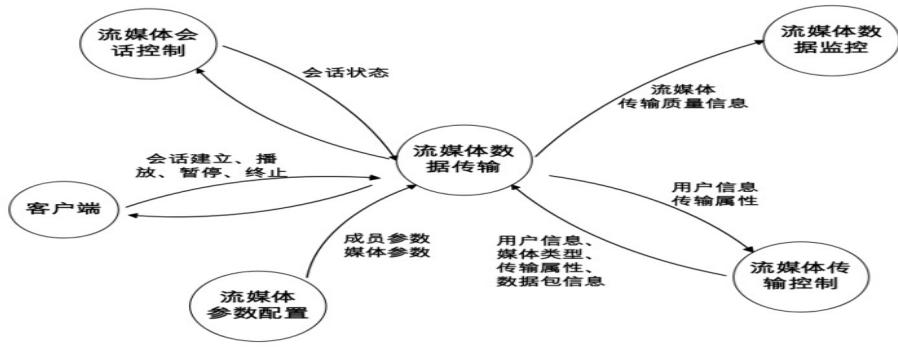

<table><tr><td rowspan=2 colspan=1></td><td rowspan=2 colspan=1></td><td rowspan=1 colspan=1>用户IP</td><td rowspan=1 colspan=1>unsigned int</td><td rowspan=1 colspan=1></td></tr><tr><td rowspan=1 colspan=1>单元编号</td><td rowspan=1 colspan=1>usigned long</td><td rowspan=1 colspan=1></td></tr><tr><td rowspan=4 colspan=1>2</td><td rowspan=4 colspan=1>目的用户信息</td><td rowspan=1 colspan=1>用户标识</td><td rowspan=1 colspan=1>unsigned int</td><td rowspan=1 colspan=1></td></tr><tr><td rowspan=1 colspan=1>软件标识</td><td rowspan=1 colspan=1>unsigned int</td><td rowspan=1 colspan=1></td></tr><tr><td rowspan=1 colspan=1>用户IP</td><td rowspan=1 colspan=1>unsigned int</td><td rowspan=1 colspan=1></td></tr><tr><td rowspan=1 colspan=1>单元编号</td><td rowspan=1 colspan=1>usigned long</td><td rowspan=1 colspan=1></td></tr><tr><td rowspan=11 colspan=1>3</td><td rowspan=11 colspan=1>传输属性</td><td rowspan=1 colspan=1>策略号</td><td rowspan=1 colspan=1>unsigned int</td><td rowspan=1 colspan=1></td></tr><tr><td rowspan=1 colspan=1>服务质量</td><td rowspan=1 colspan=1>unsigned int</td><td rowspan=1 colspan=1></td></tr><tr><td rowspan=1 colspan=1>优先级</td><td rowspan=1 colspan=1>unsigned char</td><td rowspan=1 colspan=1></td></tr><tr><td rowspan=1 colspan=1>可靠性</td><td rowspan=1 colspan=1>unsigned int</td><td rowspan=1 colspan=1></td></tr><tr><td rowspan=1 colspan=1>报文版本类型</td><td rowspan=1 colspan=1>unsigned char</td><td rowspan=1 colspan=1></td></tr><tr><td rowspan=1 colspan=1>业务类型</td><td rowspan=1 colspan=1>unsigned char</td><td rowspan=1 colspan=1></td></tr><tr><td rowspan=1 colspan=1>加密类型</td><td rowspan=1 colspan=1>unsigned char</td><td rowspan=1 colspan=1></td></tr><tr><td rowspan=1 colspan=1>系统标识</td><td rowspan=1 colspan=1>unsigned char</td><td rowspan=1 colspan=1></td></tr><tr><td rowspan=1 colspan=1>信道标识</td><td rowspan=1 colspan=1>unsigned char</td><td rowspan=1 colspan=1></td></tr><tr><td rowspan=1 colspan=1>协议类型</td><td rowspan=1 colspan=1>unsigned char</td><td rowspan=1 colspan=1></td></tr><tr><td rowspan=1 colspan=1>压缩类型</td><td rowspan=1 colspan=1>unsigned char</td><td rowspan=1 colspan=1></td></tr><tr><td rowspan=1 colspan=1>4</td><td rowspan=1 colspan=1>数据内容</td><td rowspan=1 colspan=1>数据内容</td><td rowspan=1 colspan=1>char *</td><td rowspan=1 colspan=1></td></tr><tr><td rowspan=1 colspan=1>5</td><td rowspan=1 colspan=1>数据长度</td><td rowspan=1 colspan=1>数据长度</td><td rowspan=1 colspan=1>size_t</td><td rowspan=1 colspan=1></td></tr><tr><td rowspan=1 colspan=1>6</td><td rowspan=1 colspan=1>媒体数据的采样间隔</td><td rowspan=1 colspan=1>媒体数据的采样间隔</td><td rowspan=1 colspan=1>double</td><td rowspan=1 colspan=1></td></tr><tr><td rowspan=1 colspan=1>7</td><td rowspan=1 colspan=1>媒体数据的类型</td><td rowspan=1 colspan=1>媒体数据的类型</td><td rowspan=1 colspan=1>char</td><td rowspan=1 colspan=1></td></tr><tr><td rowspan=1 colspan=1>8</td><td rowspan=1 colspan=1>媒体数据的帧间隔</td><td rowspan=1 colspan=1>媒体数据的帧间隔</td><td rowspan=1 colspan=1>unsigned long</td><td rowspan=1 colspan=1></td></tr><tr><td rowspan=1 colspan=1>9</td><td rowspan=1 colspan=1>媒体数据的标志位</td><td rowspan=1 colspan=1>媒体数据的标志位</td><td rowspan=1 colspan=1>bool</td><td rowspan=1 colspan=1></td></tr><tr><td rowspan=1 colspan=1>10</td><td rowspan=1 colspan=1>数据包的丢包率</td><td rowspan=1 colspan=1>数据包的丢包率</td><td rowspan=1 colspan=1>double</td><td rowspan=1 colspan=1></td></tr><tr><td rowspan=1 colspan=1>11</td><td rowspan=1 colspan=1>数据包的往返时延</td><td rowspan=1 colspan=1>数据包的往返时延</td><td rowspan=1 colspan=1>double</td><td rowspan=1 colspan=1></td></tr><tr><td rowspan=1 colspan=1>12</td><td rowspan=1 colspan=1>同步时间差值</td><td rowspan=1 colspan=1>同步时间差值</td><td rowspan=1 colspan=1>double</td><td rowspan=1 colspan=1></td></tr><tr><td rowspan=1 colspan=1>13</td><td rowspan=1 colspan=1>媒体传输带宽</td><td rowspan=1 colspan=1>媒体传输带宽</td><td rowspan=1 colspan=1>long</td><td rowspan=1 colspan=1></td></tr></table>

## 3.3.3 与服务集成框架接口（PZXQ-WBJK-LMTCSFW-FWJCKJJK）

与服务集成框架接口数据元素说明表，见表22所示。

表22与服务集成框架接口数据元素说明
<table><tr><td rowspan=1 colspan=1>序号</td><td rowspan=1 colspan=1>数据集名称</td><td rowspan=1 colspan=1>数据组成</td><td rowspan=1 colspan=1>数据约束</td><td rowspan=1 colspan=1>数据标准</td></tr><tr><td rowspan=1 colspan=1>1</td><td rowspan=1 colspan=1>服务状态信息</td><td rowspan=1 colspan=1>服务名称、内存占用率、CPU占用率、启动状态</td><td rowspan=1 colspan=1>String</td><td rowspan=2 colspan=1></td></tr><tr><td rowspan=1 colspan=1>2</td><td rowspan=1 colspan=1>服务控制信息</td><td rowspan=1 colspan=1>服务的启动、停止和重启</td><td rowspan=1 colspan=1>String</td></tr></table>

## 3.3.4 与运行支撑服务接口（PZXQ-WBJK-LMTCSFW-YXZCFW）

与服务集成框架接口数据元素说明表，见表23所示。

表23与服务集成框架接口数据元素说明
<table><tr><td rowspan=1 colspan=1>序号</td><td rowspan=1 colspan=1>数据集名称</td><td rowspan=1 colspan=1>数据组成</td><td rowspan=1 colspan=1>数据约束</td><td rowspan=1 colspan=1>数据标准</td></tr><tr><td rowspan=4 colspan=1>1</td><td rowspan=4 colspan=1>日志信息</td><td rowspan=1 colspan=1>ERROR 级别日志信息</td><td rowspan=1 colspan=1> $\mathsf { c h a r } ^ { \star }$ </td><td rowspan=4 colspan=1></td></tr><tr><td rowspan=1 colspan=1>WARN 级别日志信息</td><td rowspan=1 colspan=1> $\mathsf { c h a r } ^ { \star }$ </td></tr><tr><td rowspan=1 colspan=1>INFO 级别日志信息</td><td rowspan=1 colspan=1> $\mathsf { c h a r } ^ { \star }$ </td></tr><tr><td rowspan=1 colspan=1>DEBUG 级别日志信息</td><td rowspan=1 colspan=1> $\mathsf { c h a r } ^ { \star }$ </td></tr></table>

## 3.3.5 与通信设备接口（PZXQ-WBJK-LMTCSFW-TXSB）

与通信设备接口数据元素说明表，见表24所示。

表24与通信设备接口数据元素说明
<table><tr><td colspan="1" rowspan="1">序号</td><td colspan="1" rowspan="1">数据集名称</td><td colspan="1" rowspan="1">数据组成</td><td colspan="1" rowspan="1">数据约束</td><td colspan="1" rowspan="1">数据标准</td></tr><tr><td colspan="1" rowspan="1">1</td><td colspan="1" rowspan="1">源用户信息</td><td colspan="1" rowspan="1">用户IP</td><td colspan="1" rowspan="1">unsigned int</td><td colspan="1" rowspan="1"></td></tr><tr><td colspan="1" rowspan="1">2</td><td colspan="1" rowspan="1">目的用户信息</td><td colspan="1" rowspan="1">用户IP</td><td colspan="1" rowspan="1">unsigned int</td><td colspan="1" rowspan="1"></td></tr><tr><td colspan="1" rowspan="4">3</td><td colspan="1" rowspan="4">传输属性</td><td colspan="1" rowspan="1">优先级</td><td colspan="1" rowspan="1">unsigned char</td><td colspan="1" rowspan="1"></td></tr><tr><td colspan="1" rowspan="1">可靠性</td><td colspan="1" rowspan="1">unsigned int</td><td colspan="1" rowspan="1"></td></tr><tr><td colspan="1" rowspan="1">业务类型</td><td colspan="1" rowspan="1">unsigned char</td><td colspan="1" rowspan="1"></td></tr><tr><td colspan="1" rowspan="1">信道标识</td><td colspan="1" rowspan="1">unsigned char</td><td colspan="1" rowspan="1"></td></tr><tr><td colspan="1" rowspan="1">4</td><td colspan="1" rowspan="1">数据内容</td><td colspan="1" rowspan="1">数据内容</td><td colspan="1" rowspan="1">char *</td><td colspan="1" rowspan="1"></td></tr><tr><td colspan="1" rowspan="1">5</td><td colspan="1" rowspan="1">数据长度</td><td colspan="1" rowspan="1">数据长度</td><td colspan="1" rowspan="1">size_t</td><td colspan="1" rowspan="1"></td></tr><tr><td colspan="1" rowspan="1">7</td><td colspan="1" rowspan="1">媒体数据的采样间隔</td><td colspan="1" rowspan="1">媒体数据的采样间隔</td><td colspan="1" rowspan="1">double</td><td colspan="1" rowspan="1"></td></tr><tr><td colspan="1" rowspan="1">8</td><td colspan="1" rowspan="1">媒体数据的类型</td><td colspan="1" rowspan="1">媒体数据的类型</td><td colspan="1" rowspan="1">char</td><td colspan="1" rowspan="1"></td></tr><tr><td colspan="1" rowspan="1">9</td><td colspan="1" rowspan="1">媒体数据的帧间隔</td><td colspan="1" rowspan="1">媒体数据的帧间隔</td><td colspan="1" rowspan="1">unsigned long</td><td colspan="1" rowspan="1"></td></tr><tr><td colspan="1" rowspan="1">10</td><td colspan="1" rowspan="1">媒体数据的标志位</td><td colspan="1" rowspan="1">媒体数据的标志位</td><td colspan="1" rowspan="1">bool</td><td colspan="1" rowspan="1"></td></tr><tr><td colspan="1" rowspan="1">11</td><td colspan="1" rowspan="1">数据包的丢包率</td><td colspan="1" rowspan="1">数据包的丢包率</td><td colspan="1" rowspan="1">double</td><td colspan="1" rowspan="1"></td></tr><tr><td colspan="1" rowspan="1">12</td><td colspan="1" rowspan="1">数据包的往返时延</td><td colspan="1" rowspan="1">数据包的往返时延</td><td colspan="1" rowspan="1">double</td><td colspan="1" rowspan="1"></td></tr><tr><td colspan="1" rowspan="1">13</td><td colspan="1" rowspan="1">同步时间差值</td><td colspan="1" rowspan="1">同步时间差值</td><td colspan="1" rowspan="1">double</td><td colspan="1" rowspan="1"></td></tr><tr><td colspan="1" rowspan="1">14</td><td colspan="1" rowspan="1">媒体传输带宽</td><td colspan="1" rowspan="1">媒体传输带宽</td><td colspan="1" rowspan="1">long</td><td colspan="1" rowspan="1"></td></tr></table>

## 3.4 CSCI 内部接口需求

## 3.4.1 接口标识和接口图

流媒体传输服务软件内部接口需求图，见图9所示。

  
图9 流媒体传输服务软件内部接口需求

流媒体传输服务软件内部接口包括：监控接口、数据缓存接口、流媒体会话控制接口、流媒体参数配置接口、传输控制接口。

流媒体传输服务软件内部接口需求表见表25。

表25 流媒体传输服务软件内部接口需求
<table><tr><td rowspan=1 colspan=1>序号</td><td rowspan=1 colspan=1>接口需求名称</td><td rowspan=1 colspan=1>接口需求标识</td><td rowspan=1 colspan=1>接口类型</td><td rowspan=1 colspan=1>发送方</td><td rowspan=1 colspan=1>接收方</td><td rowspan=1 colspan=1>接口内容</td><td rowspan=1 colspan=1>接口优先级</td></tr><tr><td rowspan=1 colspan=1>1</td><td rowspan=1 colspan=1>监控接口</td><td rowspan=1 colspan=1>PZXQ-NBJK-LMTCSFW-JK</td><td rowspan=1 colspan=1>函数接口</td><td rowspan=1 colspan=1>流媒体数据传输模块</td><td rowspan=1 colspan=1>流媒体数据监控模块</td><td rowspan=1 colspan=1>用户信息、传输质量属性</td><td rowspan=1 colspan=1>低</td></tr><tr><td rowspan=1 colspan=1>2</td><td rowspan=1 colspan=1>流媒体会话控制接口</td><td rowspan=1 colspan=1>PZXQ-NBJK-LMTCSFW-BJMZKLXY</td><td rowspan=1 colspan=1>函数接口</td><td rowspan=1 colspan=1>流媒体数据传输模块</td><td rowspan=1 colspan=1>流媒体会话控制模块</td><td rowspan=1 colspan=1>会话状态、媒体信息</td><td rowspan=1 colspan=1>高</td></tr><tr><td rowspan=1 colspan=1>3</td><td rowspan=1 colspan=1>流媒体参数配置接口</td><td rowspan=1 colspan=1>PZXQ-NBJK-LMTCSFW-JYSJ</td><td rowspan=1 colspan=1>函数接口</td><td rowspan=1 colspan=1>流媒体参数配置</td><td rowspan=1 colspan=1>流媒体数据传输模块</td><td rowspan=1 colspan=1>成员参数信息、媒体类型</td><td rowspan=1 colspan=1>高</td></tr><tr><td rowspan=1 colspan=1>4</td><td rowspan=1 colspan=1>传输控制接口</td><td rowspan=1 colspan=1>PZXQ-NBJK-LMTCSFW-PDCSJ</td><td rowspan=1 colspan=1>函数接口</td><td rowspan=1 colspan=1>流媒体数据传输模块</td><td rowspan=1 colspan=1>流媒体传输控制模块</td><td rowspan=1 colspan=1>用户信息、媒体类型、传输属性、媒体流信息</td><td rowspan=1 colspan=1>高</td></tr><tr><td rowspan=1 colspan=1>5</td><td rowspan=1 colspan=1>客户端接口</td><td rowspan=1 colspan=1>PZXQ-NBJK-LMTCSFW-KHDJK</td><td rowspan=1 colspan=1>函数接口</td><td rowspan=1 colspan=1>流媒体数据传输模块</td><td rowspan=1 colspan=1>流媒体客户端模块</td><td rowspan=1 colspan=1>视频会话的建立、播放、暂停和终止</td><td rowspan=1 colspan=1>高</td></tr></table>

## 3.4.2 监控接口（PZXQ-NBJK-LMTCSFW-JK）

监控接口数据元素说明表，见表26所示。

表26监控接口数据元素说明
<table><tr><td colspan="1" rowspan="1">序号</td><td colspan="1" rowspan="1">数据集名称</td><td colspan="1" rowspan="1">数据组成</td><td colspan="1" rowspan="1">数据约束</td><td colspan="1" rowspan="1">数据标准</td></tr><tr><td colspan="1" rowspan="8">1</td><td colspan="1" rowspan="8">流媒体传输信息</td><td colspan="1" rowspan="1">用户IP</td><td colspan="1" rowspan="1">unsigned int</td><td colspan="1" rowspan="1"></td></tr><tr><td colspan="1" rowspan="1">优先级</td><td colspan="1" rowspan="1">unsigned char</td><td colspan="1" rowspan="1"></td></tr><tr><td colspan="1" rowspan="1">可靠性</td><td colspan="1" rowspan="1">unsigned int</td><td colspan="1" rowspan="1"></td></tr><tr><td colspan="1" rowspan="1">媒体类型</td><td colspan="1" rowspan="1">char</td><td colspan="1" rowspan="1"></td></tr><tr><td colspan="1" rowspan="1">业务类型</td><td colspan="1" rowspan="1">unsigned char</td><td colspan="1" rowspan="1"></td></tr><tr><td colspan="1" rowspan="1">数据内容</td><td colspan="1" rowspan="1">char *</td><td colspan="1" rowspan="1"></td></tr><tr><td colspan="1" rowspan="1">数据长度</td><td colspan="1" rowspan="1">size_t</td><td colspan="1" rowspan="1"></td></tr><tr><td colspan="1" rowspan="1">数据流量</td><td colspan="1" rowspan="1">Int</td><td colspan="1" rowspan="1"></td></tr><tr><td colspan="1" rowspan="1">2</td><td colspan="1" rowspan="1">流媒体传输质量信</td><td colspan="1" rowspan="1">媒体数据的压缩比</td><td colspan="1" rowspan="1">double</td><td colspan="1" rowspan="1"></td></tr><tr><td rowspan="3"></td><td rowspan="3">息</td><td></td><td></td><td></td></tr><tr><td>帧大小</td><td>double</td><td></td></tr><tr><td>分辨率</td><td>long</td><td></td></tr></table>

## 3.4.3 流媒体会话控制接口（PZXQ-NBJK-LMTCSFW-BJMZKLXY）

流媒体会话控制接口数据元素说明表，见表27所示。

表27流媒体会话控制接口数据元素说明
<table><tr><td rowspan=1 colspan=1>序号</td><td rowspan=1 colspan=1>数据集名称</td><td rowspan=1 colspan=1>数据组成</td><td rowspan=1 colspan=1>数据约束</td><td rowspan=1 colspan=1>数据标准</td></tr><tr><td rowspan=4 colspan=1>1</td><td rowspan=4 colspan=1>源用户信息</td><td rowspan=1 colspan=1>用户标识</td><td rowspan=1 colspan=1>unsigned int</td><td rowspan=1 colspan=1></td></tr><tr><td rowspan=1 colspan=1>软件标识</td><td rowspan=1 colspan=1>unsigned int</td><td rowspan=1 colspan=1></td></tr><tr><td rowspan=1 colspan=1>用户IP</td><td rowspan=1 colspan=1>unsigned int</td><td rowspan=1 colspan=1></td></tr><tr><td rowspan=1 colspan=1>单元编号</td><td rowspan=1 colspan=1>usigned long</td><td rowspan=1 colspan=1></td></tr><tr><td rowspan=4 colspan=1>2</td><td rowspan=4 colspan=1>目的用户信息</td><td rowspan=1 colspan=1>用户标识</td><td rowspan=1 colspan=1>unsigned int</td><td rowspan=1 colspan=1></td></tr><tr><td rowspan=1 colspan=1>软件标识</td><td rowspan=1 colspan=1>unsigned int</td><td rowspan=1 colspan=1></td></tr><tr><td rowspan=1 colspan=1>用户IP</td><td rowspan=1 colspan=1>unsigned int</td><td rowspan=1 colspan=1></td></tr><tr><td rowspan=1 colspan=1>单元编号</td><td rowspan=1 colspan=1>usigned long</td><td rowspan=1 colspan=1></td></tr><tr><td rowspan=7 colspan=1>3</td><td rowspan=7 colspan=1>会话控制信息</td><td rowspan=1 colspan=1>RTSP 会话控制视频的 URL</td><td rowspan=1 colspan=1>char *</td><td rowspan=1 colspan=1></td></tr><tr><td rowspan=1 colspan=1>RTSP 会话控制音频的 URL</td><td rowspan=1 colspan=1>char *</td><td rowspan=1 colspan=1></td></tr><tr><td rowspan=1 colspan=1>RTSP会话中视频的类型值</td><td rowspan=1 colspan=1>char</td><td rowspan=1 colspan=1></td></tr><tr><td rowspan=1 colspan=1>RTSP会话中音频的类型值</td><td rowspan=1 colspan=1>char</td><td rowspan=1 colspan=1></td></tr><tr><td rowspan=1 colspan=1>RTSP 会话集中控制的 URL</td><td rowspan=1 colspan=1>char *</td><td rowspan=1 colspan=1></td></tr><tr><td rowspan=1 colspan=1>播放开始时间</td><td rowspan=1 colspan=1>double</td><td rowspan=1 colspan=1></td></tr><tr><td rowspan=1 colspan=1>播放开始时间</td><td rowspan=1 colspan=1>double</td><td rowspan=1 colspan=1></td></tr></table>

## 3.4.4 流媒体参数配置接口（PZXQ-NBJK-LMTCSFW-JYSJ）

校验数据包接口数据元素说明表，见表28所示。

表28校验数据包接口数据元素说明
<table><tr><td colspan="1" rowspan="1">序号</td><td colspan="1" rowspan="1">数据集名称</td><td colspan="1" rowspan="1">数据组成</td><td colspan="1" rowspan="1">数据约束</td><td colspan="1" rowspan="1">数据标准</td></tr><tr><td colspan="1" rowspan="1">1</td><td colspan="1" rowspan="1">目的用户信息</td><td colspan="1" rowspan="1">用户IP</td><td colspan="1" rowspan="1">unsigned char</td><td colspan="1" rowspan="1"></td></tr><tr><td colspan="1" rowspan="1">2</td><td colspan="1" rowspan="1">媒体数据的类型</td><td colspan="1" rowspan="1">媒体数据的类型</td><td colspan="1" rowspan="1">char</td><td colspan="1" rowspan="1"></td></tr><tr><td colspan="1" rowspan="1">3</td><td colspan="1" rowspan="1">媒体数据的帧间隔</td><td colspan="1" rowspan="1">媒体数据的帧间隔</td><td colspan="1" rowspan="1">unsigned long</td><td colspan="1" rowspan="1"></td></tr><tr><td colspan="1" rowspan="1">4</td><td colspan="1" rowspan="1">媒体数据的标志位</td><td colspan="1" rowspan="1">媒体数据的标志位</td><td colspan="1" rowspan="1">bool</td><td colspan="1" rowspan="1"></td></tr><tr><td colspan="1" rowspan="1">5</td><td colspan="1" rowspan="1">媒体数据的类型</td><td colspan="1" rowspan="1">媒体数据的类型</td><td colspan="1" rowspan="1">char</td><td colspan="1" rowspan="1"></td></tr></table>

## 3.4.5 流媒体传输控制接口（PZXQ-NBJK-LMTCSFW-PDCSJ）

流媒体传输控制接口数据元素说明表，见表29所示。

表29流媒体传输控制接口数据元素说明
<table><tr><td rowspan=1 colspan=1>序号</td><td rowspan=1 colspan=1>数据集名称</td><td rowspan=1 colspan=1>数据组成</td><td rowspan=1 colspan=1>数据约束</td><td rowspan=1 colspan=1>数据标准</td></tr><tr><td rowspan=4 colspan=1>1</td><td rowspan=4 colspan=1>源用户信息</td><td rowspan=1 colspan=1>用户标识</td><td rowspan=1 colspan=1>unsigned int</td><td rowspan=1 colspan=1></td></tr><tr><td rowspan=1 colspan=1>软件标识</td><td rowspan=1 colspan=1>unsigned int</td><td rowspan=1 colspan=1></td></tr><tr><td rowspan=1 colspan=1>用户IP</td><td rowspan=1 colspan=1>unsigned int</td><td rowspan=1 colspan=1></td></tr><tr><td rowspan=1 colspan=1>单元编号</td><td rowspan=1 colspan=1>usigned long</td><td rowspan=1 colspan=1></td></tr><tr><td rowspan=4 colspan=1>2</td><td rowspan=4 colspan=1>目的用户信息</td><td rowspan=1 colspan=1>用户标识</td><td rowspan=1 colspan=1>unsigned int</td><td rowspan=1 colspan=1></td></tr><tr><td rowspan=1 colspan=1>软件标识</td><td rowspan=1 colspan=1>unsigned int</td><td rowspan=1 colspan=1></td></tr><tr><td rowspan=1 colspan=1>用户IP</td><td rowspan=1 colspan=1>unsigned int</td><td rowspan=1 colspan=1></td></tr><tr><td rowspan=1 colspan=1>单元编号</td><td rowspan=1 colspan=1>usigned long</td><td rowspan=1 colspan=1></td></tr><tr><td rowspan=1 colspan=1>3</td><td rowspan=1 colspan=1>媒体类型</td><td rowspan=1 colspan=1>媒体类型</td><td rowspan=1 colspan=1>char</td><td rowspan=1 colspan=1></td></tr><tr><td rowspan=1 colspan=1>4</td><td rowspan=1 colspan=1>数据内容</td><td rowspan=1 colspan=1>数据内容</td><td rowspan=1 colspan=1>char *</td><td rowspan=1 colspan=1></td></tr><tr><td rowspan=1 colspan=1>5</td><td rowspan=1 colspan=1>数据长度</td><td rowspan=1 colspan=1>数据长度</td><td rowspan=1 colspan=1>size_t</td><td rowspan=1 colspan=1></td></tr><tr><td rowspan=1 colspan=1>6</td><td rowspan=1 colspan=1>媒体数据的类型</td><td rowspan=1 colspan=1>媒体数据的类型</td><td rowspan=1 colspan=1>char</td><td rowspan=1 colspan=1></td></tr><tr><td rowspan=1 colspan=1>7</td><td rowspan=1 colspan=1>媒体数据的帧间隔</td><td rowspan=1 colspan=1>媒体数据的帧间隔</td><td rowspan=1 colspan=1>unsigned long</td><td rowspan=1 colspan=1></td></tr><tr><td rowspan=1 colspan=1>8</td><td rowspan=1 colspan=1>媒体数据的标志位</td><td rowspan=1 colspan=1>媒体数据的标志位</td><td rowspan=1 colspan=1>bool</td><td rowspan=1 colspan=1></td></tr></table>

## 3.4.6 流媒体客户端接口（PZXQ-NBJK-LMTCSFW-KHDJK）

流媒体客户端接口数据元素说明表，见表 30所示。

表 30流媒体客户端接口数据元素表
<table><tr><td colspan="1" rowspan="1">序号</td><td colspan="1" rowspan="1">数据集名称</td><td colspan="1" rowspan="1">数据组成</td><td colspan="1" rowspan="1">数据约束</td><td colspan="1" rowspan="1">数据标准</td></tr><tr><td colspan="1" rowspan="1">1</td><td colspan="1" rowspan="1">IP地址</td><td colspan="1" rowspan="1">呼叫对端的IP地址</td><td colspan="1" rowspan="1"> $\mathsf { c h a r } ^ { \star }$ </td><td colspan="1" rowspan="1"></td></tr><tr><td colspan="1" rowspan="1">2</td><td colspan="1" rowspan="1">Port端口</td><td colspan="1" rowspan="1">视频通话的的应用端口</td><td colspan="1" rowspan="1">size_t</td><td colspan="1" rowspan="1"></td></tr><tr><td colspan="1" rowspan="1">3</td><td colspan="1" rowspan="1">实体号</td><td colspan="1" rowspan="1">标识会议号使用，区分不同会议</td><td colspan="1" rowspan="1">char</td><td colspan="1" rowspan="1"></td></tr></table>

## 3.5 CSCI 内部数据需求

表31对CSCI所有内部数据元素进行汇总。

表31 流媒体传输服务软件内部数据汇总表
<table><tr><td rowspan=1 colspan=1>序号</td><td rowspan=1 colspan=1>数据名称</td><td rowspan=1 colspan=1>数据内容</td><td rowspan=1 colspan=1>相关功能及标识</td></tr><tr><td rowspan=1 colspan=1>1</td><td rowspan=1 colspan=1>用户信息</td><td rowspan=1 colspan=1>用户标识、软件标识、用户ip、单元编号</td><td rowspan=1 colspan=1>定义源、目的用户和软件信息</td></tr><tr><td rowspan=1 colspan=1>2</td><td rowspan=1 colspan=1>数据类型</td><td rowspan=1 colspan=1>用户消息类型、消息功能域分类、消息编号、消息子类型</td><td rowspan=1 colspan=1>定义传输数据的消息类型</td></tr><tr><td rowspan=1 colspan=1>3</td><td rowspan=1 colspan=1>传输属性</td><td rowspan=1 colspan=1>策略号、服务质量、优先级、可靠性、业务类型、加密类型、系统标识、信道标识、协议类型、压缩类型</td><td rowspan=1 colspan=1>定义数据的传输方式</td></tr><tr><td rowspan=1 colspan=1>4</td><td rowspan=1 colspan=1>数据包信息</td><td rowspan=1 colspan=1>数据id、数据总包数、当前数据包编号</td><td rowspan=1 colspan=1>定义数据和数据拆包信息</td></tr><tr><td rowspan=1 colspan=1>5</td><td rowspan=1 colspan=1>媒体数据信息</td><td rowspan=1 colspan=1>媒体数据类型、媒体数据的采样间隔、媒体数据的帧间隔、媒体数据的标志位、数据包的丢包率数据包的往返时延、同步时间差值、媒体传输带宽</td><td rowspan=1 colspan=1>定义媒体信息类型</td></tr><tr><td rowspan=1 colspan=1>6</td><td rowspan=1 colspan=1>流媒体传输质量信息</td><td rowspan=1 colspan=1>媒体数据的压缩比、帧大小、分辨率</td><td rowspan=1 colspan=1>定义传输质量信息</td></tr><tr><td rowspan=1 colspan=1>7</td><td rowspan=1 colspan=1>会话控制信息</td><td rowspan=1 colspan=1>RTSP 会话控制视频的URL、RTSP 会话控制音频的URL、RTSP 会话中视频的类型值、RTSP会话中音频的类型值、RTSP会话集中控制的URL、播放开始时间、播放开始时间</td><td rowspan=1 colspan=1>定义会话控制信息</td></tr></table>

用户信息数据描述见表32所示。

表32 用户信息数据描述表
<table><tr><td rowspan=1 colspan=1>序号</td><td rowspan=1 colspan=1>数据项</td><td rowspan=1 colspan=1>最大值</td><td rowspan=1 colspan=1>最小值</td><td rowspan=1 colspan=1>精度</td><td rowspan=1 colspan=1>单位</td></tr><tr><td rowspan=1 colspan=1>1</td><td rowspan=1 colspan=1>用户标识</td><td rowspan=1 colspan=1>4294967295</td><td rowspan=1 colspan=1>1</td><td rowspan=1 colspan=1>1</td><td rowspan=1 colspan=1>1</td></tr><tr><td rowspan=1 colspan=1>2</td><td rowspan=1 colspan=1>软件标识</td><td rowspan=1 colspan=1>4294967295</td><td rowspan=1 colspan=1>0</td><td rowspan=1 colspan=1>1</td><td rowspan=1 colspan=1>1</td></tr><tr><td rowspan=1 colspan=1>3</td><td rowspan=1 colspan=1>用户ip</td><td rowspan=1 colspan=1>4294967295</td><td rowspan=1 colspan=1>0</td><td rowspan=1 colspan=1>1</td><td rowspan=1 colspan=1></td></tr><tr><td rowspan=1 colspan=1>4</td><td rowspan=1 colspan=1>单元编号</td><td rowspan=1 colspan=1>4294967295</td><td rowspan=1 colspan=1>0</td><td rowspan=1 colspan=1>1</td><td rowspan=1 colspan=1>-</td></tr></table>

数据类型数据描述见表33所示。

表33 数据类型数据描述表
<table><tr><td rowspan=1 colspan=1>序号</td><td rowspan=1 colspan=1>数据项</td><td rowspan=1 colspan=1>最大值</td><td rowspan=1 colspan=1>最小值</td><td rowspan=1 colspan=1>精度</td><td rowspan=1 colspan=1>单位</td></tr><tr><td rowspan=1 colspan=1>1</td><td rowspan=1 colspan=1>用户消息类型</td><td rowspan=1 colspan=1>15</td><td rowspan=1 colspan=1>1</td><td rowspan=1 colspan=1>1</td><td rowspan=1 colspan=1>1</td></tr><tr><td rowspan=1 colspan=1>2</td><td rowspan=1 colspan=1>消息功能域分类</td><td rowspan=1 colspan=1>31</td><td rowspan=1 colspan=1>0</td><td rowspan=1 colspan=1>1</td><td rowspan=1 colspan=1>1</td></tr><tr><td rowspan=1 colspan=1>3</td><td rowspan=1 colspan=1>消息编号</td><td rowspan=1 colspan=1>127</td><td rowspan=1 colspan=1>1</td><td rowspan=1 colspan=1>1</td><td rowspan=1 colspan=1>1</td></tr><tr><td rowspan=1 colspan=1>4</td><td rowspan=1 colspan=1>消息子类型</td><td rowspan=1 colspan=1>255</td><td rowspan=1 colspan=1>0</td><td rowspan=1 colspan=1>1</td><td rowspan=1 colspan=1></td></tr></table>

传输属性数据描述见表34所示。

表34 传输属性数据描述表
<table><tr><td rowspan=1 colspan=1>序号</td><td rowspan=1 colspan=1>数据项</td><td rowspan=1 colspan=1>最大值</td><td rowspan=1 colspan=1>最小值</td><td rowspan=1 colspan=1>精度</td><td rowspan=1 colspan=1>单位</td></tr><tr><td rowspan=1 colspan=1>1</td><td rowspan=1 colspan=1>策略号</td><td rowspan=1 colspan=1>4294967295</td><td rowspan=1 colspan=1>0</td><td rowspan=1 colspan=1>1</td><td rowspan=1 colspan=1>1</td></tr><tr><td rowspan=1 colspan=1>2</td><td rowspan=1 colspan=1>服务质量</td><td rowspan=1 colspan=1>4294967295</td><td rowspan=1 colspan=1>0</td><td rowspan=1 colspan=1>1</td><td rowspan=1 colspan=1>1</td></tr><tr><td rowspan=1 colspan=1>3</td><td rowspan=1 colspan=1>优先级</td><td rowspan=1 colspan=1>3</td><td rowspan=1 colspan=1>0</td><td rowspan=1 colspan=1>1</td><td rowspan=1 colspan=1>1</td></tr><tr><td rowspan=1 colspan=1>4</td><td rowspan=1 colspan=1>可靠性</td><td rowspan=1 colspan=1>1</td><td rowspan=1 colspan=1>0</td><td rowspan=1 colspan=1>1</td><td rowspan=1 colspan=1>1</td></tr><tr><td rowspan=1 colspan=1>5</td><td rowspan=1 colspan=1>报文版本类型</td><td rowspan=1 colspan=1>255</td><td rowspan=1 colspan=1>0</td><td rowspan=1 colspan=1>1</td><td rowspan=1 colspan=1>1</td></tr><tr><td rowspan=1 colspan=1>6</td><td rowspan=1 colspan=1>业务类型</td><td rowspan=1 colspan=1>255</td><td rowspan=1 colspan=1>0</td><td rowspan=1 colspan=1>1</td><td rowspan=1 colspan=1>1</td></tr><tr><td rowspan=1 colspan=1>7</td><td rowspan=1 colspan=1>加密类型</td><td rowspan=1 colspan=1>1</td><td rowspan=1 colspan=1>0</td><td rowspan=1 colspan=1>1</td><td rowspan=1 colspan=1>1</td></tr><tr><td rowspan=1 colspan=1>8</td><td rowspan=1 colspan=1>系统标识</td><td rowspan=1 colspan=1>3</td><td rowspan=1 colspan=1>0</td><td rowspan=1 colspan=1>1</td><td rowspan=1 colspan=1>1</td></tr><tr><td rowspan=1 colspan=1>9</td><td rowspan=1 colspan=1>信道标识</td><td rowspan=1 colspan=1>255</td><td rowspan=1 colspan=1>0</td><td rowspan=1 colspan=1>1</td><td rowspan=1 colspan=1>1</td></tr><tr><td rowspan=1 colspan=1>10</td><td rowspan=1 colspan=1>协议类型</td><td rowspan=1 colspan=1>255</td><td rowspan=1 colspan=1>0</td><td rowspan=1 colspan=1>1</td><td rowspan=1 colspan=1>1</td></tr><tr><td rowspan=1 colspan=1>11</td><td rowspan=1 colspan=1>压缩类型</td><td rowspan=1 colspan=1>3</td><td rowspan=1 colspan=1>0</td><td rowspan=1 colspan=1>1</td><td rowspan=1 colspan=1></td></tr></table>

数据包信息数据描述见表35所示。

表35 数据包信息数据描述表
<table><tr><td rowspan=1 colspan=1>序号</td><td rowspan=1 colspan=1>数据项</td><td rowspan=1 colspan=1>最大值</td><td rowspan=1 colspan=1>最小值</td><td rowspan=1 colspan=1>精度</td><td rowspan=1 colspan=1>单位</td></tr><tr><td rowspan=1 colspan=1>1</td><td rowspan=1 colspan=1>数据id</td><td rowspan=1 colspan=1>65535</td><td rowspan=1 colspan=1>0</td><td rowspan=1 colspan=1>1</td><td rowspan=1 colspan=1>1</td></tr><tr><td rowspan=1 colspan=1>2</td><td rowspan=1 colspan=1>数据总包数</td><td rowspan=1 colspan=1>32</td><td rowspan=1 colspan=1>1</td><td rowspan=1 colspan=1>1</td><td rowspan=1 colspan=1>包</td></tr><tr><td rowspan=1 colspan=1>3</td><td rowspan=1 colspan=1>数据包编号</td><td rowspan=1 colspan=1>32</td><td rowspan=1 colspan=1>1</td><td rowspan=1 colspan=1>1</td><td rowspan=1 colspan=1>1</td></tr></table>

媒体数据信息描述见表36所示。

表36 媒体数据信息数据描述表
<table><tr><td rowspan=1 colspan=1>序号</td><td rowspan=1 colspan=1>数据项</td><td rowspan=1 colspan=1>最大值</td><td rowspan=1 colspan=1>最小值</td><td rowspan=1 colspan=1>精度</td><td rowspan=1 colspan=1>单位</td></tr><tr><td rowspan=1 colspan=1>1</td><td rowspan=1 colspan=1>媒体数据类型</td><td rowspan=1 colspan=1>10</td><td rowspan=1 colspan=1>1</td><td rowspan=1 colspan=1>1</td><td rowspan=1 colspan=1>1</td></tr><tr><td rowspan=1 colspan=1>2</td><td rowspan=1 colspan=1>媒体数据的采样间隔</td><td rowspan=1 colspan=1>600</td><td rowspan=1 colspan=1>1</td><td rowspan=1 colspan=1>1</td><td rowspan=1 colspan=1>ms</td></tr><tr><td rowspan=1 colspan=1>3</td><td rowspan=1 colspan=1>媒体数据的帧间隔</td><td rowspan=1 colspan=1>6000</td><td rowspan=1 colspan=1>1</td><td rowspan=1 colspan=1>1</td><td rowspan=1 colspan=1>ms</td></tr><tr><td rowspan=1 colspan=1>4</td><td rowspan=1 colspan=1>媒体数据的标志位</td><td rowspan=1 colspan=1>1</td><td rowspan=1 colspan=1>0</td><td rowspan=1 colspan=1>1</td><td rowspan=1 colspan=1>1</td></tr><tr><td rowspan=1 colspan=1>5</td><td rowspan=1 colspan=1>数据包的丢包率</td><td rowspan=1 colspan=1>100</td><td rowspan=1 colspan=1>0</td><td rowspan=1 colspan=1>1</td><td rowspan=1 colspan=1>1</td></tr></table>

## 3.6 适应性需求

a）采用跨平台开发工具及开发环境，确保软件能适应不同硬件环境（如桌面平台、手持平台等），具有在多种国产操作系统运行适配能力；

b）后台服务按照处理器、操作系统的运行条件，根据自身功能要求分别编译生成桌面、平板等不同形态；

c）系统运行时能够根据系统登录者席位身份，加载不同的界面和服务，支持业务功能灵活重组；

d）依据在桌面、平板不同硬件形态，通过软件部署管理自动下载、安装相应环境的软件包，实现多平台运行。

## 3.7 安全性需求

流媒体传输服务软件安全性需求见表37所示。

表37 流媒体传输服务软件安全性需求
<table><tr><td rowspan=1 colspan=1>序号</td><td rowspan=1 colspan=1>安全性需求</td><td rowspan=1 colspan=1>详细说明</td></tr><tr><td rowspan=1 colspan=1>1</td><td rowspan=1 colspan=1>故障检测与诊断</td><td rowspan=1 colspan=1>软件自检，检测软件中的故障，阻止错误结果的影响</td></tr><tr><td rowspan=1 colspan=1>2</td><td rowspan=1 colspan=1>输入信息的合法性检查</td><td rowspan=1 colspan=1>软件应对编制信息、格式化代码、战果战损等需要用户编辑的信息具有合法性检查功能，避免用户输入无效数据。</td></tr><tr><td rowspan=1 colspan=1>3</td><td rowspan=1 colspan=1>异常日志记录</td><td rowspan=1 colspan=1>发生异常时，通过运维支撑服务提供的日志接口记录软件的失效原因和标识、软件异常位置和原因，给用户排查问题提供支撑能力</td></tr></table>

## 3.8 保密性需求

在流媒体传输服务软件集成为系统后，随系统所集成的保密相关功能完成加密存储或加密交互，同时在系统安装和软件运行时设定权限密码。

## 3.9 CSCI 环境需求

## 3.9.1 运行环境需求

流媒体传输服务软件环境需求见表38。

表38 软件运行环境
<table><tr><td rowspan=1 colspan=1>序号</td><td rowspan=1 colspan=1>设备名称</td><td rowspan=1 colspan=1>硬件要求</td><td rowspan=1 colspan=1>软件要求</td></tr><tr><td rowspan=1 colspan=1>1</td><td rowspan=1 colspan=1>轻量化服务器</td><td rowspan=1 colspan=1>处理器：16核CPU 主频：不低于 1.5GHz内存：不小于16GB存储：不小于512GB</td><td rowspan=1 colspan=1>操作系统：银河麒麟V4.0.2数据库：达梦数据库V7.6办公软件：WPS V10.1</td></tr><tr><td rowspan=1 colspan=1>2</td><td rowspan=1 colspan=1>便携式服务器</td><td rowspan=1 colspan=1>便携式服务器具有2个服务器单元。每个服务单元的处理器：i7四核CPU 主频：不低于 2.0GHz内存：不低于8GB存储：不低于500GB。显示分辨率:不低于1280×1024(VGA）</td><td rowspan=1 colspan=1>操作系统：银河麒麟V4.0.2数据库：达梦数据库V7.6办公软件：WPS V10.1</td></tr><tr><td rowspan=1 colspan=1>3</td><td rowspan=1 colspan=1>便携式计算机</td><td rowspan=1 colspan=1>处理器：i7 双核CPU 主频：不低于 2.5GHz内存：不低于8GB存储：不低于500GB。显示分辨率:不低于1280×1024</td><td rowspan=1 colspan=1>操作系统：银河麒麟V4.0.2办公软件：WPS V10.1</td></tr><tr><td rowspan=1 colspan=1>4</td><td rowspan=1 colspan=1>携行作业设备</td><td rowspan=1 colspan=1>处理器：四核CPU主频：不低于 1.2GHz内存：不小于3GB存储：不小于256GB显示分辨率：10吋分辨率不低于1920×1080，14吋分辨率不低于 1920×1080</td><td rowspan=1 colspan=1>操作系统：元心 V4.1.1/银河锐华 V4.0.0.0数据库：SQLite V3.0.0办公软件：WPS V10.1</td></tr><tr><td rowspan=1 colspan=1>5</td><td rowspan=1 colspan=1>便携式计算机（国产化）</td><td rowspan=1 colspan=1>处理器：不低于4核CPU 主频：不低于 2.2Hz内存:不小于8GB存储：不小于512GB显示分辨率：15吋LED背光屏，分辨率不低于1920*1080显存：不低于2GB</td><td rowspan=1 colspan=1>操作系统：银河麒麟V4.0.2办公软件：WPS V10.1</td></tr></table>

## 3.9.2 开发环境需求

编程语言：C/C++；

开发编译环境：Qt 5.6.0/5.9.6、EMSS v1.0.1；

## 3.10 计算机资源需求

## 3.10.1 计算机硬件需求

流媒体传输服务软件计算机硬件配置需求见表39所示。

表39 计算机硬件配置需求
<table><tr><td>序号</td><td>设备名称</td><td>硬件要求</td></tr></table>