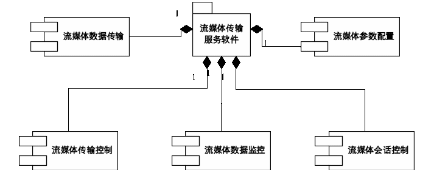
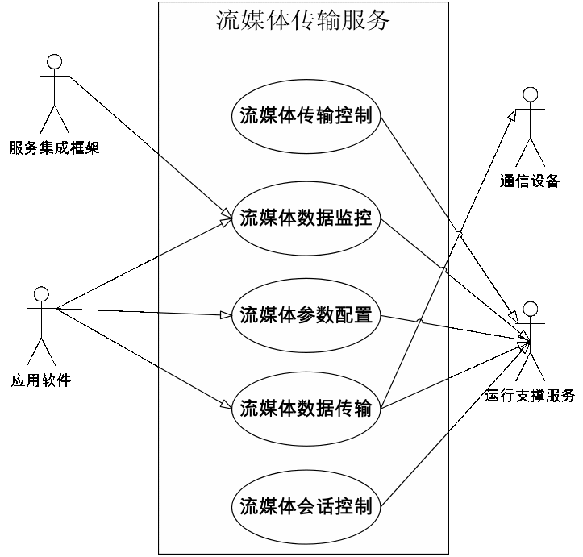
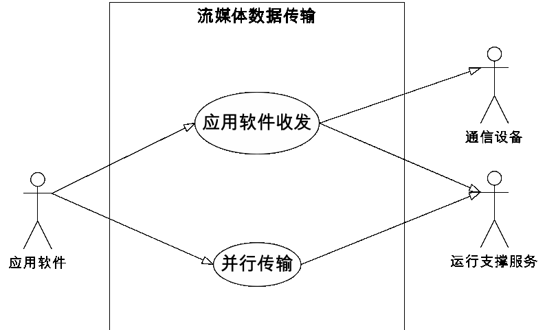
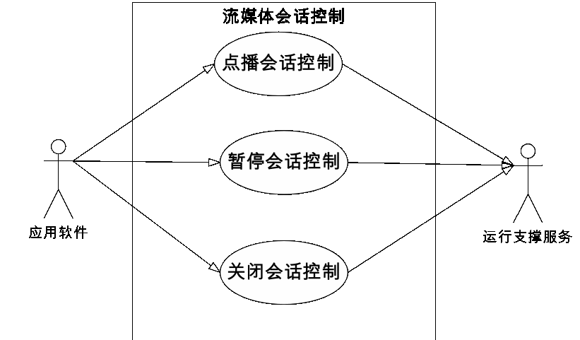
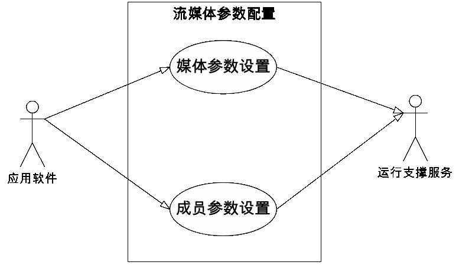
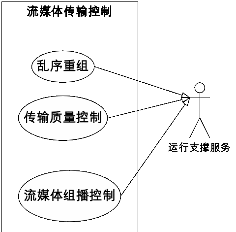
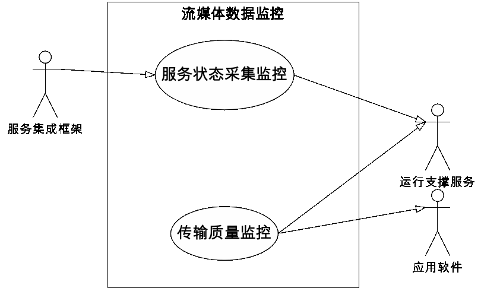
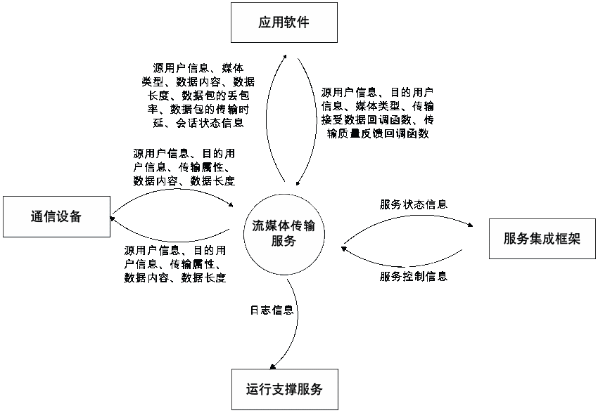
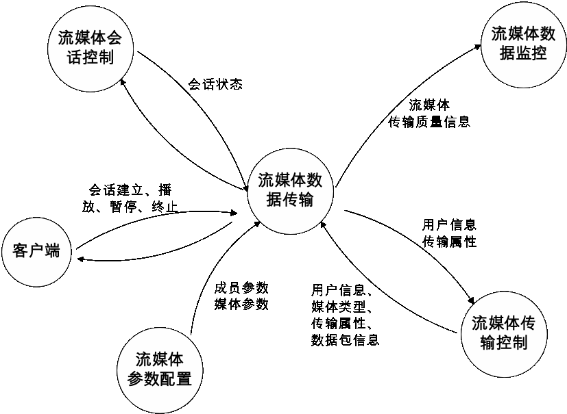

目    录

- [1](#__RefHeading___Toc27776)
    - [1.1 标识](#__RefHeading___Toc24380)
    - [1.2 系统概述](#__RefHeading___Toc20069)
        - [1.2.1 系统和软件的用途](#__RefHeading___Toc10242)
        - [1.2.2 系统与软件的一般特性](#__RefHeading___Toc28244)
    - [1.3 文档概述](#__RefHeading___Toc2190)
- [2 引用文档](#__RefHeading___Toc32314)
- [3 需求](#__RefHeading___Toc27739)
- [3.1 要求的状态和方式](#__RefHeading___Toc8189)
    - [3.2 CSCI能力需求](#__RefHeading___Toc2235)
        - [3.2.1 流媒体数据传输（PZXQ-GN-LMTSJCS）](#__RefHeading___Toc2690)
        - [3.2.1.1 应用软件收发（PZXQ-GN-LMTSJCS-JRYYRJ）](#__RefHeading___Toc15450)
        - [3.2.1.2 并行传输（PZXQ-GN-LMTSJCS-PXCS）](#__RefHeading___Toc32698)
        - [3.2.2 流媒体会话控制（PZXQ-GN-LMTHHKZ）](#__RefHeading___Toc28558)
        - [3.2.2.1 点播会话控制（PZXQ-GN-LMTHHKZ-DBHHKZ）](#__RefHeading___Toc25640)
        - [3.2.2.2 暂停会话控制（PZXQ-GN-LMTHHKZ-ZTHHKZ）](#__RefHeading___Toc9291)
        - [3.2.2.3 关闭会话控制（PZXQ-GN-LMTHHKZ-GBHHKZ）](#__RefHeading___Toc2941)
        - [3.2.3 流媒体参数配置（PZXQ-GN-CSPZ）](#__RefHeading___Toc6853)
        - [3.2.3.1 媒体参数设置（PZXQ-GN-CSPZ-MTCSPZ）](#__RefHeading___Toc11075)
        - [3.2.3.2 成员参数设置（PZXQ-GN-CSPZ-MDDZCSPZ）](#__RefHeading___Toc22524)
        - [3.2.4 流媒体传输控制（PZXQ-GN-LMTCSKZ）](#__RefHeading___Toc11178)
        - [3.2.4.1 乱序重组（PZXQ-GN-LMTCSKZ-LXCZ）](#__RefHeading___Toc1476)
        - [3.2.4.2 传输质量控制（PZXQ-GN-LMTCSKZ-CSZLKZ）](#__RefHeading___Toc4085)
        - [3.2.4.3 流媒体组播控制（PZXQ-GN-LMTCSKZ-LMTZBKZ）](#__RefHeading___Toc8211)
        - [3.2.5 流媒体数据监控（PZXQ-GN-LMTSJJK）](#__RefHeading___Toc15131)
        - [3.2.5.1 服务状态采集监控（PZXQ-GN-LMTSJJK-FWZTCJJK）](#__RefHeading___Toc16779)
        - [3.2.5.2 传输质量监控（PZXQ-GN-LMTSJJK-CSZLJK）](#__RefHeading___Toc14994)
    - [3.3 CSCI外部接口需求](#__RefHeading___Toc12708)
        - [3.3.1 接口标识和接口图](#__RefHeading___Toc20583)
        - [3.3.2 与应用软件接口（PZXQ-WBJK-LMTCSFW-YYRJ）](#__RefHeading___Toc10470)
        - [3.3.3 与服务集成框架接口（PZXQ-WBJK-LMTCSFW-FWJCKJJK）](#__RefHeading___Toc32517)
        - [3.3.4 与运行支撑服务接口（PZXQ-WBJK-LMTCSFW-YXZCFW）](#__RefHeading___Toc9219)
        - [3.3.5 与通信设备接口（PZXQ-WBJK-LMTCSFW-TXSB）](#__RefHeading___Toc11364)
    - [3.4 CSCI内部接口需求](#__RefHeading___Toc9443)
        - [3.4.1 接口标识和接口图](#__RefHeading___Toc24432)
        - [3.4.2 监控接口（PZXQ-NBJK-LMTCSFW-JK）](#__RefHeading___Toc30935)
        - [3.4.3 流媒体会话控制接口（PZXQ-NBJK-LMTCSFW-BJMZKLXY）](#__RefHeading___Toc29162)
        - [3.4.4 流媒体参数配置接口（PZXQ-NBJK-LMTCSFW-JYSJ）](#__RefHeading___Toc5513)
        - [3.4.5 流媒体传输控制接口（PZXQ-NBJK-LMTCSFW-PDCSJ）](#__RefHeading___Toc8723)
        - [3.4.6 流媒体客户端接口（PZXQ-NBJK-LMTCSFW-KHDJK）](#__RefHeading___Toc27248)
    - [3.5 CSCI内部数据需求](#__RefHeading___Toc2778)
    - [3.6 适应性需求](#__RefHeading___Toc12999)
    - [3.7 安全性需求](#__RefHeading___Toc32367)
    - [3.8 保密性需求](#__RefHeading___Toc29787)
    - [3.9 CSCI环境需求](#__RefHeading___Toc24159)
        - [3.9.1 运行环境需求](#__RefHeading___Toc31147)
        - [3.9.2 开发环境需求](#__RefHeading___Toc9643)
    - [3.10 计算机资源需求](#__RefHeading___Toc18995)
        - [3.10.1 计算机硬件需求](#__RefHeading___Toc15476)
        - [3.10.2 计算机硬件资源利用需求](#__RefHeading___Toc31189)
        - [3.10.3 计算机软件需求](#__RefHeading___Toc10806)
        - [3.10.4 计算机通信需求](#__RefHeading___Toc12473)
    - [3.11 软件质量因素](#__RefHeading___Toc8871)
    - [3.12 设计和构造的约束](#__RefHeading___Toc5930)
    - [3.13 人员需求](#__RefHeading___Toc2734)
    - [3.14 培训需求](#__RefHeading___Toc27943)
    - [3.15 软件保障需求](#__RefHeading___Toc15900)
    - [3.16 其他需求](#__RefHeading___Toc5069)
    - [3.17 验收、交付和包装需求](#__RefHeading___Toc25601)
    - [3.18 需求的优先顺序和关键性](#__RefHeading___Toc16066)
- [4 合格性规定](#__RefHeading___Toc20180)
- [5 需求可追踪性](#__RefHeading___Toc30283)
- [6 注释](#__RefHeading___Toc3794)

# 1 范围

## 1.1 标识

1. 本文档已被批准的标识号：AZ6932.499.0119 SRS；
2. 本文档所适用的软件名称为：流媒体传输服务；
3. 本文档的版本号为：V1.00.04/2020年12月31日；
4. 本文档所适用的软件所属系统为：某信息系统软件。

## 1.2 系统概述

### 1.2.1 系统和软件的用途

流媒体传输服务完成信息服务环境软件功能域软件音视频传输的功能，提供桌面、平板形态的软件，主要为信息系统业务软件提供流媒体信息的编解码和传输控制能力，能够屏蔽复杂、异构、互连的通信网络，在多种通信条件下运行；能够基于宽带网络环境下，提供基于UDP/IP协议，向服务调用者提供流媒体数据的传输服务，保证媒体数据的近实时接收和同步播放。

### 1.2.2 系统与软件的一般特性

1. 需方：某单位；
2. 使用方：某单位；
3. 开发方：某单位；
4. 保障机构：某单位；
5. 运行方案：随操作系统自启动；

## 1.3 文档概述

在本文档中，第2章列出了本文档中引用的其它文档的信息，第3章详细描述了流媒体传输服务软件的各种需求以及实现方式，第4章规定了确认第3章各项需求正确实现的合格性验证方法，第5章描述本文档列出的各项需求与相应的系统需求规格说明文档列出的需求的对应关系。其中，第3章是本文档的主要部分。

# 2 引用文档

本文档的引用文档见表1。

<table><thead><tr><th>
文档编号
</th><th>
标题
</th><th>
修订版本
</th><th>
修订日期
</th><th>
编写单位
</th></tr></thead><tbody><tr><td>
GJB 438B-2009
</td><td>
《军用软件开发文档编制规范》
</td><td>
—
</td><td>
2009年5月
</td><td>
总装备部
</td></tr><tr><td>
GJB 439A-2013
</td><td>
《军品软件质量保证通用要求》
</td><td>
—
</td><td>
2013年7月
</td><td>
国防科学技术工业委员会
</td></tr><tr><td>
GJB 450A-2004
</td><td>
《装备可靠性工作通用要求》
</td><td>
—
</td><td>
2004年7月
</td><td>
总装备部
</td></tr><tr><td>
GJB 2786A-2009
</td><td>
《军用软件开发通用要求》
</td><td>
—
</td><td>
2009年5月
</td><td>
总装备部
</td></tr><tr><td>
GJB 5235-2004
</td><td>
《军用软件配置管理》
</td><td>
—
</td><td>
2004年9月
</td><td>
总装备部
</td></tr><tr><td>
GJB/Z 102A-2012
</td><td>
《军用软件安全性设计指南》
</td><td>
—
</td><td>
2012年7月
</td><td>
总装备部
</td></tr></tbody></table>
  
表1 引用文档

# 3 需求

## 3.1 要求的状态和方式

流媒体传输服务软件是由一个后端服务和多个客户端服务同时运行的C/S架构，但视频界面在Web端展现，客户端服务将视频数据通过Websocket连接推向Web端。采取这种架构的好处不仅可以利用Sip协议的会话控制信令，还能兼容chrome的性能。具体软件的实现过程分为三部分：视频会议、P2P视屏通话和视频流数据接入显示。

流媒体服务端由会话控制模块、呼叫信令服务模块和媒体处理服务模块组成，主要负责视频信息采集、视频编解码处理、维护多路视频的数据处理。客户端由音视频会议模块和chrome浏览器组成，音视频会议由会议控制模块、呼叫信令处理模块和媒体处理模块组成。

流媒体传输服务软件部署在服务器上，当软件启动后，进入工作状态，在该状态下等待应用程序接入；各终端机上的应用程序通过加载流媒体传输服务二次开发接口库访问服务器，连接服务器成功后即可完成流媒体传输控制、流媒体数据监控、流媒体参数配置、流媒体会话控制、流媒体数据传输。

## 3.2 CSCI能力需求

流媒体传输服务软件按照其功能需求，包含流媒体传输控制、流媒体数据监控、流媒体参数配置、流媒体会话控制、流媒体数据传输功能。

流媒体传输服务软件功能图，见图1所示。流媒体传输服务软件用例图如图2所示。

  
图1 流媒体传输服务软件功能图

  
图2 流媒体传输服务软件用例图

流媒体传输服务软件所有能力标识表，见表2所示。

<table><thead><tr><th>
序号
</th><th>
Use case名称
</th><th>
项目唯一标识符
</th><th>
需求描述
</th><th>
需求重用
</th><th>
方式
</th><th>
运行状态
</th><th>
对应的任务书功能/性能
</th></tr></thead><tbody><tr><td>
1
</td><td>
流媒体数据传输
</td><td>
PZXQ-GN-LMTSJCS
</td><td>
（1）能够为上层应用提供流媒体同步信息；(2)支持多路、多方向并行传输能力； 
</td><td>
沿用
</td><td>
桌面版、平板版
</td><td>
运行阶段
</td><td>
4.1.1/4.2 a)
</td></tr><tr><td>
2
</td><td>
流媒体会话控制
</td><td>
PZXQ-GN-LMTHHKZ
</td><td>
提供流媒体会话控制，支持点播、暂停、关闭等会话控制信令的可靠传输功能，能够返回会话状态；
</td><td>
沿用
</td><td>
桌面版、平板版
</td><td>
运行阶段
</td><td>
4.1.2
</td></tr><tr><td>
3
</td><td>
流媒体参数配置
</td><td>
PZXQ-GN-CSPZ
</td><td>
提供配置信息输入能力，能够通过接口设置流媒体传输服务的配置信息；
</td><td>
沿用
</td><td>
桌面版、平板版
</td><td>
运行阶段
</td><td>
4.1.3
</td></tr><tr><td>
4
</td><td>
流媒体传输控制
</td><td>
PZXQ-GN-LMTCSKZ
</td><td>
(1)提供流媒体数据流的单播、组播能力；(2)提供数据接收时的乱序重组功能，将流媒体数据按源发方发送顺序提交至接收端应用软件；(3)能够周期性的发送传输质量控制包；
</td><td>
沿用
</td><td>
桌面版、平板版
</td><td>
运行阶段
</td><td>
4.1.4 
</td></tr><tr><td>
5
</td><td>
流媒体数据监控
</td><td>
PZXQ-GN-LMTSJJK
</td><td>
(1)能够检测流媒体传输服务运行过程中的状态信息；(2)能够向传输服务调用者返回流媒体数据当前的传输质量，包括传输时延、传输丢包率；
</td><td>
沿用
</td><td>
桌面版、平板版
</td><td>
运行阶段
</td><td>
4.1.5 
</td></tr></tbody></table>
  
表2 流媒体传输服务软件所有能力标识

### 3.2.1 流媒体数据传输（PZXQ-GN-LMTSJCS）

流媒体数据传输功能包括应用软件收发、并行传输，其功能用例如图3所示。

  
图3 流媒体数据传输用例图

流媒体数据传输所有能力标识表，见表3所示。

<table><thead><tr><th>
序号
</th><th>
Use case名称
</th><th>
项目唯一标识符
</th><th>
需求描述
</th><th>
需求重用
</th><th>
状态/方式名称
</th><th>
运行状态
</th><th>
对应的任务书功能/性能
</th></tr></thead><tbody><tr><td></td><td>
应用软件收发
</td><td>
PZXQ-GN-LMTSJCS-JRYYRJ
</td><td>
能够为上层应用提供流媒体同步信息
</td><td>
沿用
</td><td>
桌面版、平板版
</td><td>
运行阶段
</td><td>
4.1.1a)/4.2 a) 
</td></tr><tr><td></td><td>
并行传输
</td><td>
PZXQ-GN-LMTSJCS-JRTYSB
</td><td>
支持多路、多方向并行传输能力
</td><td>
沿用
</td><td>
桌面版、平板版
</td><td>
运行阶段
</td><td>
4.1.1b)/4.2 a) 
</td></tr></tbody></table>
  
表3 流媒体数据传输所有能力标识

#### 3.2.1.1 应用软件收发（PZXQ-GN-LMTSJCS-JRYYRJ）

应用软件收发用例场景，见表4所示。

<table><tr><td>
Use Case 名称：应用软件收发
</td><td colspan="2">
Actors：应用软件
</td></tr><tr><td colspan="3">
概述：本用例是应用软件收发的用例，描述流媒体传输服务应用软件收发报文数据的过程；
</td></tr><tr><td colspan="3">
前置条件：网络连接正常、流媒体传输服务运行正常。
</td></tr><tr><td colspan="3">
主事件流
</td></tr><tr><td>
Actor的动作
</td><td>
系统的动作
</td><td>
动作约束

（性能、可靠性、容错等）
</td></tr><tr><td>
1. 服务集成框架软件启动流媒体传输服务；

4.应用软件A、应用软件C调用流媒体服务初始化接口，按照接口要求填入应用软件注册信息，以及接收数据回调函数，向服务进行注册；

6.应用软件A调用设置媒体参数接口，按照接口要求输入媒体数据的类型、媒体数据的帧间隔等信息。

7. 应用软件A调用设置目的地址参数接口，按照接口要求输入目标成员的IP地址、目标成员的IP端口号等信息。

8.应用软件A调用数据发送接口，按照接口要求输入流媒体数据缓冲区、流媒体数据缓冲区长度，发送数据；

10.目的应用软件C接收应用软件A发来的数据，数据收发成功。
</td><td>
2.流媒体传输服务初始化成功，如果流媒体传输服务启动失败，执行异常流E1；

3.流媒体传输服务读取服务配置文件信息，如果读取失败，执行异常流E2； 

5.流媒体传输服务记录应用软件A、应用软件C信息，完成应用软件A、应用软件C的注册；如果注册失败，执行异常流E3；

9.流媒体传输服务收到应用软件A发来的数据，触发回调函数，按照回调函数接口要求输入源应用软件A信息、数据类型、可靠性、流媒体数据，发送数据至应用软件C；
</td><td>
当遇到不合法输入时提示用户错误信息，保证注释率不少于20%，能够准确记录编程过程
</td></tr><tr><td colspan="2">
异常流E1：运行支撑服务将服务启动失败信息写入日志文件，用例结束。
</td><td></td></tr><tr><td colspan="2">
异常流E2：运行支撑服务将读取配置文件失败信息写入日志，用例结束。
</td><td></td></tr><tr><td colspan="2">
异常流E3：运行支撑服务将注册失败信息写入日志，并提示应用软件重新注册，用例结束。
</td><td></td></tr><tr><td colspan="2">
后置条件：无。
</td><td></td></tr></table>
  
表4应用软件收发用例描述

#### 3.2.1.2 并行传输（PZXQ-GN-LMTSJCS-PXCS）

并行传输用例场景，见表5所示。

<table><tr><td>
Use Case 名称：并行传输
</td><td colspan="2">
Actors：应用软件
</td></tr><tr><td colspan="3">
概述：本用例是并行传输的用例，描述应用软件收发流媒体数据时能够多路、多方向并行传输的过程。
</td></tr><tr><td colspan="3">
前置条件：网络连接正常、流媒体传输服务运行正常。
</td></tr><tr><td colspan="3">
主事件流
</td></tr><tr><td>
Actor的动作
</td><td>
系统的动作
</td><td>
动作约束

（性能、可靠性、容错等）
</td></tr><tr><td>
1.服务集成框架软件启动流媒体传输服务；

4.应用软件A、应用软件C调用流媒体服务初始化接口，按照接口要求填入应用软件注册信息，以及接收数据回调函数，向服务进行注册； 

6.应用软件A调用设置媒体参数接口，按照接口要求输入媒体数据的类型、媒体数据的帧间隔等信息。

7. 应用软件A调用设置目的地址参数接口，按照接口要求输入目标成员的IP地址、目标成员的IP端口号等信息。

8.应用软件A调用数据发送接口，按照接口要求输入流媒体数据缓冲区、流媒体数据缓冲区长度，发送数据；

9.应用软件C调用设置媒体参数接口，按照接口要求输入媒体数据的类型、媒体数据的帧间隔等信息。

10. 应用软件C调用设置目的地址参数接口，按照接口要求输入目标成员的IP地址、目标成员的IP端口号等信息。

11.应用软件C调用数据发送接口，按照接口要求输入流媒体数据缓冲区、流媒体数据缓冲区长度，发送数据；

14.在目的应用软件A能够收到应用软件C发过来的数据，同时目的应用软件C接收源端应用软件A发来的数据，数据收发成功。
</td><td>
2.流媒体传输服务初始化成功，如果流媒体传输服务启动失败，执行异常流E1；

3.流媒体传输服务读取服务配置文件信息，如果读取失败，执行异常流E2； 

5.流媒体传输服务记录应用软件A、应用软件C信息，完成应用软件A、应用软件C的注册；如果注册失败，执行异常流E3；

12．流媒体传输服务将数据按照配置文件中的拆分包大小，将数据拆分为若干个小数据包并编号；如果拆分包失败，执行异常流E4；

13. 流媒体传输服务同时将应用软件填写的目的应用软件信息和数据相关属性信息，为数据添加协议头信息，逐包发送至目的端应用软件；如果协议头构建失败，执行异常流E5;如果发送失败，执行异常流E6；
</td><td>
当遇到不合法输入时提示用户错误信息，保证注释率不少于20%，能够准确记录编程过程
</td></tr><tr><td colspan="2">
异常流E1：运行支撑服务将服务启动失败信息写入日志文件，用例结束。
</td><td></td></tr><tr><td colspan="2">
异常流E2：运行支撑服务将读取配置文件失败信息写入日志，用例结束。
</td><td></td></tr><tr><td colspan="2">
异常流E3：运行支撑服务将注册失败信息写入日志，并提示应用软件重新注册，用例结束。
</td><td></td></tr><tr><td colspan="2">
异常流E4：运行支撑服务将拆分包失败信息写入日志文件，用例结束。
</td><td></td></tr><tr><td colspan="2">
异常流E5：运行支撑服务将构建协议头失败信息写入日志文件，用例结束。
</td><td></td></tr><tr><td colspan="2">
异常流E6：运行支撑服务将发送失败信息写入日志文件，用例结束。
</td><td></td></tr><tr><td colspan="2">
后置条件：无。
</td><td></td></tr></table>
  
表5 并行传输例描述

### 3.2.2 流媒体会话控制（PZXQ-GN-LMTHHKZ）

流媒体会话控制功能包括点播会话控制、暂停会话控制、关闭会话控制，其功能用例如图4所示。

  
图4 流媒体数据传输用例图

流媒体会话控制所有能力标识表，见表6所示。

<table><thead><tr><th>
序号
</th><th>
Use case名称
</th><th>
项目唯一标识符
</th><th>
需求描述
</th><th>
需求重用
</th><th>
状态/方式名称
</th><th>
运行状态
</th><th>
对应的任务书功能/性能
</th></tr></thead><tbody><tr><td></td><td>
点播会话控制
</td><td>
PZXQ-GN-LMTHHKZ-DBHHKZ
</td><td>
提供流媒体会话控制，支持点播会话控制信令的可靠传输功能
</td><td>
沿用
</td><td>
桌面版、平板版
</td><td>
运行阶段
</td><td>
4.1.2
</td></tr><tr><td></td><td>
暂停会话控制
</td><td>
PZXQ-GN-LMTHHKZ-ZTHHKZ
</td><td>
提供流媒体会话控制，支持暂停会话控制信令的可靠传输功能
</td><td>
沿用
</td><td>
桌面版、平板版
</td><td>
运行阶段
</td><td>
4.1.2 
</td></tr><tr><td></td><td>
关闭会话控制
</td><td>
PZXQ-GN-LMTHHKZ-GBHHKZ
</td><td>
提供流媒体会话控制，支持关闭会话控制信令的可靠传输功能
</td><td>
沿用
</td><td>
桌面版、平板版
</td><td>
运行阶段
</td><td>
4.1.2 
</td></tr></tbody></table>
  
表6 流媒体数据传输所有能力标识

#### 3.2.2.1 点播会话控制（PZXQ-GN-LMTHHKZ-DBHHKZ）

点播会话控制用例场景，见表7所示。

<table><tr><td>
Use Case 名称：点播会话控制
</td><td colspan="2">
Actors：应用软件
</td></tr><tr><td colspan="3">
概述：本用例是点播会话控制的用例，描述流媒体传输服务点播会话控制的过程；
</td></tr><tr><td colspan="3">
前置条件：网络连接正常、流媒体传输服务运行正常。
</td></tr><tr><td colspan="3">
主事件流
</td></tr><tr><td>
Actor的动作
</td><td>
系统的动作
</td><td>
动作约束

（性能、可靠性、容错等）
</td></tr><tr><td>
1.服务集成框架软件启动流媒体传输服务；

4.应用软件A、应用软件C调用RTSP会话实体初始化接口，按照接口要求填入应用初始化会话时指定的实体号以及处理会话状态数据的回调函数等信息； 

5.应用软件A调用会话表示请求接口；

7.应用软件C调用会话表示响应接口，输入相应的参数，如媒体对应的RTSP URL；

9.应用软件A调用会话建立请求接口；

11.应用软件C调用会话建立响应接口，输入相应的参数，如媒体对应的RTSP URL；

13. 应用软件A调用会话播放请求，输入相应的参数，如媒体对应的RTSP URL、播放开始时间；

15. 应用软件C调用会话播放响应，输入相应的参数，如媒体对应的RTSP URL；

17.应用软件A的会话状态输出为正在播放。
</td><td>
2.流媒体传输服务初始化成功，如果流媒体传输服务启动失败，执行异常流E1；

3.流媒体传输服务读取服务配置文件信息，如果读取失败，执行异常流E2； 

6.流媒体传输服务发起会话表示请求，过程中根据对应会话通道的状态判断能否发起会话表示请求，若能发起会话表示请求则封装相应会话描述信息并发送，同时维护会话通道的状态，并通知应用软件C；

8.流媒体传输服务根据会话通道的状态判断能否进行表示请求响应，若能表示请求响应则封装相应会话描述信息并发送，同时维护会话通道的状态，并通知应用软件A；

10.流媒体传输服务发起会话建立请求，过程中根据对应会话通道的状态判断能否发起会话建立请求，若能发起会话建立请求则封装相应会话描述信息并发送，同时维护会话通道的状态，并通知应用软件C;

12.流媒体传输服务根据会话通道的状态判断能否进行建立请求响应，若能建立请求响应则封装相应会话描述信息并发送，同时维护会话通道的状态，并通知应用软件A;

14．根据对应会话通道的状态判断能否发起会话播放请求，若能发起会话播放请求则封装相应会话描述信息并发送，同时维护会话通道的状态，并通知应用软件C；

16.流媒体传输服务根据会话通道的状态判断能否进行播放请求响应，若能播放请求响应则封装相应会话描述信息并发送，同时维护会话通道的状态，并通知应用软件A；
</td><td>
当遇到不合法输入时提示用户错误信息，保证注释率不少于20%，能够准确记录编程过程
</td></tr><tr><td colspan="2">
异常流E1：运行支撑服务将服务启动失败信息写入日志文件，用例结束。
</td><td></td></tr><tr><td colspan="2">
异常流E2：运行支撑服务将读取配置文件失败信息写入日志，用例结束。
</td><td></td></tr><tr><td colspan="2">
后置条件：无。
</td><td></td></tr></table>
  
表7点播会话控制用例描述

#### 3.2.2.2 暂停会话控制（PZXQ-GN-LMTHHKZ-ZTHHKZ）

暂停会话控制用例场景，见表8所示。

<table><tr><td>
Use Case 名称：暂停会话控制
</td><td colspan="2">
Actors：应用软件
</td></tr><tr><td colspan="3">
概述：本用例是暂停会话控制的用例，描述流媒体传输服务暂停会话控制的过程；
</td></tr><tr><td colspan="3">
前置条件：网络连接正常、流媒体传输服务运行正常。
</td></tr><tr><td colspan="3">
主事件流
</td></tr><tr><td>
Actor的动作
</td><td>
系统的动作
</td><td>
动作约束

（性能、可靠性、容错等）
</td></tr><tr><td>
1.服务集成框架软件启动流媒体传输服务；

4.应用软件A、应用软件C调用RTSP会话实体初始化接口，按照接口要求填入应用初始化会话时指定的实体号以及处理会话状态数据的回调函数等信息； 

5.应用软件A调用会话表示请求接口；

7.应用软件C调用会话表示响应接口，输入相应的参数，如媒体对应的RTSP URL；

9.应用软件A调用会话建立请求接口；

11.应用软件C调用会话建立响应接口，输入相应的参数，如媒体对应的RTSP URL；

13. 应用软件A调用暂停播放请求，输入相应的参数，如媒体对应的RTSP URL；

15. 应用软件C收到暂停播放请求回调。 
</td><td>
2.流媒体传输服务初始化成功，如果流媒体传输服务启动失败，执行异常流E1；

3.流媒体传输服务读取服务配置文件信息，如果读取失败，执行异常流E2； 

6.流媒体传输服务发起会话表示请求，过程中根据对应会话通道的状态判断能否发起会话表示请求，若能发起会话表示请求则封装相应会话描述信息并发送，同时维护会话通道的状态，并通知应用软件C；

8.流媒体传输服务根据会话通道的状态判断能否进行表示请求响应，若能表示请求响应则封装相应会话描述信息并发送，同时维护会话通道的状态，并通知应用软件A；

10.流媒体传输服务发起会话建立请求，过程中根据对应会话通道的状态判断能否发起会话建立请求，若能发起会话建立请求则封装相应会话描述信息并发送，同时维护会话通道的状态，并通知应用软件C;

12.流媒体传输服务根据会话通道的状态判断能否进行建立请求响应，若能建立请求响应则封装相应会话描述信息并发送，同时维护会话通道的状态，并通知应用软件A;

14．根据对应会话通道的状态判断能否发起会话暂停请求，若能发起会话暂停请求则封装相应会话描述信息并发送，同时维护会话通道的状态，并通知应用软件C；
</td><td>
当遇到不合法输入时提示用户错误信息，保证注释率不少于20%，能够准确记录编程过程
</td></tr><tr><td colspan="2">
异常流E1：运行支撑服务将服务启动失败信息写入日志文件，用例结束。
</td><td></td></tr><tr><td colspan="2">
异常流E2：运行支撑服务将读取配置文件失败信息写入日志，用例结束。
</td><td></td></tr><tr><td colspan="2">
后置条件：无。
</td><td></td></tr></table>
  
表8暂停会话控制用例描述

#### 3.2.2.3 关闭会话控制（PZXQ-GN-LMTHHKZ-GBHHKZ）

关闭会话控制用例场景，见表9所示。

<table><tr><td>
Use Case 名称：暂停会话控制
</td><td colspan="2">
Actors：应用软件
</td></tr><tr><td colspan="3">
概述：本用例是暂停会话控制的用例，描述流媒体传输服务暂停会话控制的过程；
</td></tr><tr><td colspan="3">
前置条件：网络连接正常、流媒体传输服务运行正常。
</td></tr><tr><td colspan="3">
主事件流
</td></tr><tr><td>
Actor的动作
</td><td>
系统的动作
</td><td>
动作约束

（性能、可靠性、容错等）
</td></tr><tr><td>
1.服务集成框架软件启动流媒体传输服务；

4.应用软件A、应用软件C调用RTSP会话实体初始化接口，按照接口要求填入应用初始化会话时指定的实体号以及处理会话状态数据的回调函数等信息； 

5.应用软件A调用会话表示请求接口；

7.应用软件C调用会话表示响应接口，输入相应的参数，如媒体对应的RTSP URL；

9.应用软件A调用会话建立请求接口；

11.应用软件C调用会话建立响应接口，输入相应的参数，如媒体对应的RTSP URL；

13. 应用软件A调用关闭会话请求，输入相应的参数，如媒体对应的RTSP URL；

15. 应用软件C收到关闭请求回调。 
</td><td>
2.流媒体传输服务初始化成功，如果流媒体传输服务启动失败，执行异常流E1；

3.流媒体传输服务读取服务配置文件信息，如果读取失败，执行异常流E2； 

6.流媒体传输服务发起会话表示请求，过程中根据对应会话通道的状态判断能否发起会话表示请求，若能发起会话表示请求则封装相应会话描述信息并发送，同时维护会话通道的状态，并通知应用软件C；

8.流媒体传输服务根据会话通道的状态判断能否进行表示请求响应，若能表示请求响应则封装相应会话描述信息并发送，同时维护会话通道的状态，并通知应用软件A；

10.流媒体传输服务发起会话建立请求，过程中根据对应会话通道的状态判断能否发起会话建立请求，若能发起会话建立请求则封装相应会话描述信息并发送，同时维护会话通道的状态，并通知应用软件C;

12.流媒体传输服务根据会话通道的状态判断能否进行建立请求响应，若能建立请求响应则封装相应会话描述信息并发送，同时维护会话通道的状态，并通知应用软件A;

14．根据对应会话通道的状态判断能否发起会话关闭请求，若能发起会话关闭请求则封装相应会话描述信息并发送，同时维护会话通道的状态，并通知应用软件C；
</td><td>
当遇到不合法输入时提示用户错误信息，保证注释率不少于20%，能够准确记录编程过程
</td></tr><tr><td colspan="2">
异常流E1：运行支撑服务将服务启动失败信息写入日志文件，用例结束。
</td><td></td></tr><tr><td colspan="2">
异常流E2：运行支撑服务将读取配置文件失败信息写入日志，用例结束。
</td><td></td></tr><tr><td colspan="2">
后置条件：无。
</td><td></td></tr></table>
  
表9关闭会话控制用例描述

### 3.2.3 流媒体参数配置（PZXQ-GN-CSPZ）

流媒体参数配置功能包括媒体参数设置、成员参数设置，其功能用例如图5所示。

  
图5 流媒体参数配置用例图

流媒体参数配置所有能力标识表，见表10所示。

<table><thead><tr><th>
序号
</th><th>
Use case名称
</th><th>
项目唯一标识符
</th><th>
需求描述
</th><th>
需求重用
</th><th>
方式
</th><th>
运行状态
</th><th>
对应的任务书功能/性能
</th></tr></thead><tbody><tr><td></td><td>
媒体参数设置
</td><td>
PZXQ-GN-CSPZ-MTCSPZ
</td><td>
提供配置信息输入能力，能够通过接口设置流媒体传输服务的媒体参数设置配置信息。
</td><td>
沿用
</td><td>
桌面版、平板版
</td><td>
运行阶段
</td><td>
4.1.3
</td></tr><tr><td></td><td>
成员参数设置
</td><td>
PZXQ-GN-CSPZ-MDDZCSPZ
</td><td>
提供配置信息输入能力，能够通过接口设置流媒体传输服务的成员参数设置配置信息。
</td><td>
沿用
</td><td>
桌面版、平板版
</td><td>
运行阶段
</td><td>
4.1.3 
</td></tr></tbody></table>
  
表10 流媒体参数配置所有能力标识

#### 3.2.3.1 媒体参数设置（PZXQ-GN-CSPZ-MTCSPZ）

媒体参数设置用例场景，见表11所示。

<table><tr><td>
Use Case 名称：媒体参数设置
</td><td colspan="2">
Actors：应用软件
</td></tr><tr><td colspan="3">
概述：本用例是媒体参数设置的用例，描述用户在流媒体传输服务运行时对媒体参数设置动态修改的过程；
</td></tr><tr><td colspan="3">
前置条件：网络连接正常、流媒体传输服务运行正常。
</td></tr><tr><td colspan="3">
主事件流
</td></tr><tr><td>
Actor的动作
</td><td>
系统的动作
</td><td>
动作约束

（性能、可靠性、容错等）
</td></tr><tr><td>
1.服务集成框架软件启动流媒体传输服务；

4.应用软件A、应用软件C调用流媒体服务初始化接口，按照接口要求填入应用软件注册信息，以及接收数据回调函数，向服务进行注册； 

6. 应用软件A调用设置目的地址参数接口，按照接口要求输入目标成员的IP地址、目标成员的IP端口号等信息。

7.应用软件A修改调用设置媒体参数接口，修改媒体数据的帧间隔。

8.应用软件A调用数据发送接口，按照接口要求输入流媒体数据缓冲区、流媒体数据缓冲区长度，发送数据；

10. 目的应用软件C接收界面上显示源端应用软件A发来的数据，数据收发成功。
</td><td>
2.流媒体传输服务初始化成功，如果流媒体传输服务启动失败，执行异常流E1；

3.流媒体传输服务读取服务配置文件信息，如果读取失败，执行异常流E2； 

5.流媒体传输服务记录应用软件A、应用软件C信息，完成应用软件A、应用软件C的注册；如果注册失败，执行异常流E3；

9．流媒体传输服务按照设置的媒体数据的帧间隔进行数据传输；
</td><td>
检测服务配置信息合法性，当遇到不合法输入时提示用户错误信息
</td></tr><tr><td colspan="2">
异常流E1：运行支撑服务将服务启动失败信息写入日志文件，用例结束。
</td><td></td></tr><tr><td colspan="2">
异常流E2：运行支撑服务将读取配置文件失败信息写入日志，用例结束。
</td><td></td></tr><tr><td colspan="2">
异常流E3：运行支撑服务将注册失败信息写入日志文件，用例结束。
</td><td></td></tr><tr><td colspan="2">
后置条件：无。
</td><td></td></tr></table>
  
表11 媒体参数设置用例描述

#### 3.2.3.2 成员参数设置（PZXQ-GN-CSPZ-MDDZCSPZ）

成员参数设置用例场景，见表12所示。

<table><tr><td>
Use Case 名称：成员参数设置
</td><td colspan="2">
Actors：应用软件
</td></tr><tr><td colspan="3">
概述：本用例是动态配置目的地址参数的用例，描述用户在流媒体传输服务运行时对目的地址参数动态修改的过程；
</td></tr><tr><td colspan="3">
前置条件：网络连接正常、流媒体传输服务运行正常。
</td></tr><tr><td colspan="3">
主事件流
</td></tr><tr><td>
Actor的动作
</td><td>
系统的动作
</td><td>
动作约束

（性能、可靠性、容错等）
</td></tr><tr><td>
1.服务集成框架软件启动流媒体传输服务；

4.应用软件A、应用软件C调用流媒体服务初始化接口，按照接口要求填入应用软件注册信息，以及接收数据回调函数，向服务进行注册； 

6. 应用软件A调用设置目的地址参数接口，按照接口要求输入目标成员的IP地址、目标成员的IP端口号等信息。

7.应用软件A调用数据发送接口，按照接口要求输入流媒体数据缓冲区、流媒体数据缓冲区长度，发送数据；

9.目的应用软件C接收界面上显示源端应用软件A发来的数据，数据收发成功。

10.应用软件A调用设置目的地址参数接口，设置删除成员地址C。

11.应用软件A调用数据发送接口，按照接口要求输入流媒体数据缓冲区、流媒体数据缓冲区长度，发送数据；

12.目的应用软件C接收界面上未收到源端应用软件A发来的数据。
</td><td>
2.流媒体传输服务初始化成功，如果流媒体传输服务启动失败，执行异常流E1；

3.流媒体传输服务读取服务配置文件信息，如果读取失败，执行异常流E2； 

5.流媒体传输服务记录应用软件A、应用软件C信息，完成应用软件A、应用软件C的注册；如果注册失败，执行异常流E3；

8．流媒体传输服务按照设置的目的地址进行数据传输；
</td><td>
检测服务配置信息合法性，当遇到不合法输入时提示用户错误信息
</td></tr><tr><td colspan="2">
异常流E1：运行支撑服务将服务启动失败信息写入日志文件，用例结束。
</td><td></td></tr><tr><td colspan="2">
异常流E2：运行支撑服务将读取配置文件失败信息写入日志，用例结束。
</td><td></td></tr><tr><td colspan="2">
异常流E3：运行支撑服务将注册失败信息写入日志文件，用例结束。
</td><td></td></tr><tr><td colspan="2">
后置条件：无。
</td><td></td></tr></table>
  
表12 成员参数设置用例描述

### 3.2.4 流媒体传输控制（PZXQ-GN-LMTCSKZ）

流媒体传输控制功能包括乱序重组、传输质量控制以及流媒体组播控制，其功能用例如图6所示。

  
图6 流媒体传输控制用例图

流媒体传输控制所有能力标识表，见表13所示。

<table><thead><tr><th>
序号
</th><th>
Use case名称
</th><th>
项目唯一标识符
</th><th>
需求描述
</th><th>
需求重用
</th><th>
方式
</th><th>
运行状态
</th><th>
对应的任务书功能/性能
</th></tr></thead><tbody><tr><td><ol><li>1</li></ol></td><td>
乱序重组
</td><td>
PZXQ-GN-LMTCSKZ-LXCZ
</td><td>
提供数据接收时的乱序重组功能，将流媒体数据按源发方发送顺序提交至接收端应用软件； 
</td><td>
沿用
</td><td>
桌面版、平板版
</td><td>
运行阶段
</td><td>
4.1.4 a)
</td></tr><tr><td><ol><li>2</li></ol></td><td>
传输质量控制
</td><td>
PZXQ-GN-LMTCSKZ-CSZLKZ
</td><td>
能够周期性的发送传输质量控制包
</td><td>
沿用
</td><td>
桌面版、平板版
</td><td>
运行阶段
</td><td>
4.1.4 b)
</td></tr><tr><td><ol><li>3</li></ol></td><td>
流媒体组播控制
</td><td>
PZXQ-GN-LMTCSKZ-LMTZBKZ
</td><td>
提供流媒体数据流的单播、组播能力
</td><td>
沿用
</td><td>
桌面版、平板版
</td><td>
运行阶段
</td><td>
4.1.1 c)
</td></tr></tbody></table>
  
表13 流媒体传输控制所有能力标识

#### 3.2.4.1 乱序重组（PZXQ-GN-LMTCSKZ-LXCZ）

乱序重组用例场景，见表14所示。

<table><tr><td>
Use Case 名称：乱序重组
</td><td colspan="2">
Actors：应用软件
</td></tr><tr><td colspan="3">
概述：本用例是乱序重组的用例，描述应用软件收发流媒体数据时对数据进行乱序重组的过程。
</td></tr><tr><td colspan="3">
前置条件：网络连接正常、流媒体传输服务运行正常。
</td></tr><tr><td colspan="3">
主事件流
</td></tr><tr><td>
Actor的动作
</td><td>
系统的动作
</td><td>
动作约束

（性能、可靠性、容错等）
</td></tr><tr><td>
1.服务集成框架软件启动流媒体传输服务；

4.应用软件A、应用软件C调用流媒体服务初始化接口，按照接口要求填入应用软件注册信息，以及接收数据回调函数，向服务进行注册； 

6.应用软件A调用设置媒体参数接口，按照接口要求输入媒体数据的类型、媒体数据的帧间隔等信息。

7. 应用软件A调用设置目的地址参数接口，按照接口要求输入目标成员的IP地址、目标成员的IP端口号等信息。

8.应用软件A调用数据发送接口，按照接口要求输入流媒体数据缓冲区、流媒体数据缓冲区长度，发送数据，发送数据的长度大于服务配置文件中分包长度的大小；

11.目的端应用软件C正确接收源端应用软件A发来的数据，数据收发成功。
</td><td>
2.流媒体传输服务初始化成功，如果流媒体传输服务启动失败，执行异常流E1；

3.流媒体传输服务读取服务配置文件信息，如果读取失败，执行异常流E2； 

5.流媒体传输服务记录应用软件A、应用软件C信息，完成应用软件A、应用软件C的注册；如果注册失败，执行异常流E3；

9．流媒体传输服务将数据按照配置文件中的拆分包大小，将数据拆分为若干个小数据包并编号；如果拆分包失败，执行异常流E4，逐包发送数据，如果发送失败，执行异常流E5；

10. 流媒体传输服务按照数据包编号进行重组；重组完成后提交给目的端应用软件C；
</td><td>
当遇到不合法输入时提示用户错误信息，保证注释率不少于20%，能够准确记录编程过程
</td></tr><tr><td colspan="2">
异常流E1：运行支撑服务将服务启动失败信息写入日志文件，用例结束。
</td><td></td></tr><tr><td colspan="2">
异常流E2：运行支撑服务将读取配置文件失败信息写入日志，用例结束。
</td><td></td></tr><tr><td colspan="2">
异常流E3：运行支撑服务将注册失败信息写入日志，并提示应用软件重新注册，用例结束。
</td><td></td></tr><tr><td colspan="2">
异常流E4：运行支撑服务将拆分包失败信息写入日志文件，用例结束。
</td><td></td></tr><tr><td colspan="2">
异常流E5：运行支撑服务将发送失败信息写入日志文件，用例结束。
</td><td></td></tr><tr><td colspan="2">
后置条件：无。
</td><td></td></tr></table>
  
表14 乱序重组用例描述

#### 3.2.4.2 传输质量控制（PZXQ-GN-LMTCSKZ-CSZLKZ）

传输质量控制用例场景，见表15所示。

<table><tr><td>
Use Case 名称：传输质量控制
</td><td colspan="2">
Actors：应用软件
</td></tr><tr><td colspan="3">
概述：本用例是传输质量控制的用例，描述应用软件收发流媒体数据时进行传输质量控制的过程。
</td></tr><tr><td colspan="3">
前置条件：网络连接正常、流媒体传输服务运行正常。
</td></tr><tr><td colspan="3">
主事件流
</td></tr><tr><td>
Actor的动作
</td><td>
系统的动作
</td><td>
动作约束

（性能、可靠性、容错等）
</td></tr><tr><td>
1.服务集成框架软件启动流媒体传输服务；

4.应用软件A、应用软件C调用流媒体服务初始化接口，按照接口要求填入应用软件注册信息，以及接收数据回调函数，向服务进行注册； 

6.应用软件A调用设置媒体参数接口，按照接口要求输入媒体数据的类型、媒体数据的帧间隔等信息。

7. 应用软件A调用设置目的地址参数接口，按照接口要求输入目标成员的IP地址、目标成员的IP端口号等信息。

8.应用软件A调用数据发送接口，按照接口要求输入流媒体数据缓冲区、流媒体数据缓冲区长度，发送数据；

10.目的应用软件C输出流媒体数据当前的传输质量，包括传输时延、传输丢包率。
</td><td>
2.流媒体传输服务初始化成功，如果流媒体传输服务启动失败，执行异常流E1；

3.流媒体传输服务读取服务配置文件信息，如果读取失败，执行异常流E2； 

5.流媒体传输服务记录应用软件A、应用软件C信息，完成应用软件A、应用软件C的注册；如果注册失败，执行异常流E3；

9. 流媒体传输服务周期性的发送传输质量控制包。向目的端应用软件C返回流媒体数据当前的传输质量，包括传输时延、传输丢包率；
</td><td>
当遇到不合法输入时提示用户错误信息，保证注释率不少于20%，能够准确记录编程过程
</td></tr><tr><td colspan="2">
异常流E1：运行支撑服务将服务启动失败信息写入日志文件，用例结束。
</td><td></td></tr><tr><td colspan="2">
异常流E2：运行支撑服务将读取配置文件失败信息写入日志，用例结束。
</td><td></td></tr><tr><td colspan="2">
异常流E3：运行支撑服务将注册失败信息写入日志，并提示应用软件重新注册，用例结束。
</td><td></td></tr><tr><td colspan="2">
后置条件：无。
</td><td></td></tr></table>
  
表15 传输质量控制用例描述

#### 3.2.4.3 流媒体组播控制（PZXQ-GN-LMTCSKZ-LMTZBKZ）

流媒体组播控制用例场景，见表16所示。

<table><tr><td>
Use Case 名称：流媒体组播控制
</td><td colspan="2">
Actors：应用软件
</td></tr><tr><td colspan="3">
概述：本用例是流媒体组播控制的用例，描述流媒体传输服务进行流媒体数据流的单播、组播过程。
</td></tr><tr><td colspan="3">
前置条件：网络连接正常、流媒体传输服务运行正常。
</td></tr><tr><td colspan="3">
主事件流
</td></tr><tr><td>
Actor的动作
</td><td>
系统的动作
</td><td>
动作约束

（性能、可靠性、容错等）
</td></tr><tr><td>
1.服务集成框架软件启动流媒体传输服务；

4.应用软件A、应用软件C调用流媒体服务初始化接口，按照接口要求填入应用软件注册信息，以及接收数据回调函数，向服务进行注册； 

6.应用软件A调用设置媒体参数接口，按照接口要求输入媒体数据的类型、媒体数据的帧间隔等信息。

7. 应用软件A调用设置目的地址参数接口，按照接口要求输入目标成员的IP地址、目标成员的IP端口号等信息。

8.应用软件A调用数据发送接口，按照接口要求输入流媒体数据缓冲区、流媒体数据缓冲区长度，发送数据；

10.目的应用软件C输出源端应用软件A发来的数据，数据收发成功；

11. 应用软件A调用设置目的地址参数接口，按照接口要求输入增加组播地址目标成员的IP地址、目标成员的IP端口号等信息，将应用软件C添加到组播成员中。

12.应用软件A调用数据发送接口，按照接口要求输入流媒体数据缓冲区、流媒体数据缓冲区长度，发送数据；

14.目的应用软件C输出源端应用软件A发来的数据，数据收发成功；
</td><td>
2.流媒体传输服务初始化成功，如果流媒体传输服务启动失败，执行异常流E1；

3.流媒体传输服务读取服务配置文件信息，如果读取失败，执行异常流E2； 

5.流媒体传输服务记录应用软件A、应用软件C信息，完成应用软件A、应用软件C的注册；如果注册失败，执行异常流E3；

9.流媒体传输服务将顺序解析接收到的流媒体数据，并实时提交流媒体数据；

。

13.流媒体传输服务将顺序解析接收到的流媒体数据，并实时提交流媒体数据给组播成员；
</td><td>
当遇到不合法输入时提示用户错误信息，保证注释率不少于20%，能够准确记录编程过程
</td></tr><tr><td colspan="2">
异常流E1：运行支撑服务将服务启动失败信息写入日志文件，用例结束。
</td><td></td></tr><tr><td colspan="2">
异常流E2：运行支撑服务将读取配置文件失败信息写入日志，用例结束。
</td><td></td></tr><tr><td colspan="2">
异常流E3：运行支撑服务将注册失败信息写入日志，并提示应用软件重新注册，用例结束。
</td><td></td></tr><tr><td colspan="2">
后置条件：无。
</td><td></td></tr></table>
  
表16 流媒体组播控制用例描述

### 3.2.5 流媒体数据监控（PZXQ-GN-LMTSJJK）

流媒体数据监控功能包括服务状态采集监控、传输质量监控，其功能用例如图7所示。

  
图7 流媒体流媒体数据监控用例图

流媒体流媒体数据监控所有能力标识表，见表17所示。

<table><thead><tr><th>
序号
</th><th>
Use case名称
</th><th>
项目唯一标识符
</th><th>
需求描述
</th><th>
需求重用
</th><th>
方式
</th><th>
运行状态
</th><th>
对应的任务书功能/性能
</th></tr></thead><tbody><tr><td></td><td>
服务状态采集监控
</td><td>
PZXQ-GN-LMTSJJK-FWZTCJJK
</td><td>
能够检测流媒体传输服务的内部状态；
</td><td>
沿用
</td><td>
桌面版、平板版
</td><td>
运行阶段
</td><td>
4.1.5 a) 
</td></tr><tr><td></td><td>
传输质量监控
</td><td>
PZXQ-GN-LMTSJJK-CSZLJK
</td><td>
能够向传输服务调用者返回流媒体数据当前的传输质量，包括传输时延、传输丢包率；
</td><td>
沿用
</td><td>
桌面版、平板版
</td><td>
运行阶段
</td><td>
4.1.5 b)
</td></tr></tbody></table>
  
表17 流媒体流媒体数据监控所有能力标识

#### 3.2.5.1 服务状态采集监控（PZXQ-GN-LMTSJJK-FWZTCJJK）

服务状态采集监控用例场景，见表18所示。

<table><tr><td>
Use Case 名称：服务状态采集监控
</td><td colspan="2">
Actors：服务集成框架
</td></tr><tr><td colspan="3">
概述：本用例是服务状态采集监控的用例，描述对局域网内传输服务状态信息的采集监控的过程；
</td></tr><tr><td colspan="3">
前置条件：网络连接正常、流媒体传输服务运行正常、服务集成框架软件运行正常。
</td></tr><tr><td colspan="3">
主事件流
</td></tr><tr><td>
Actor的动作
</td><td>
系统的动作
</td><td>
动作约束

（性能、可靠性、容错等）
</td></tr><tr><td>
1.服务集成框架启动查看服务状态，启动流媒体传输服务软件；

5.在服务集成框架界面中可以看到当前网络中流媒体传输服务状态；
</td><td>
2.流媒体传输服务初始化成功，如果流媒体传输服务启动失败，执行异常流E1；

3.流媒体传输服务读取服务配置文件信息，如果读取失败，执行异常流E2；

4.流媒体传输服务将其状态发送到服务集成框架软件处； 
</td><td>
当遇到不合法输入时提示用户错误信息，保证注释率不少于20%，能够准确记录编程过程
</td></tr><tr><td colspan="2">
异常流E1：运行支撑服务将服务启动失败信息写入日志文件，用例结束。
</td><td></td></tr><tr><td colspan="2">
异常流E2：运行支撑服务将读取配置文件失败信息写入日志，用例结束。
</td><td></td></tr><tr><td colspan="2">
后置条件：无。
</td><td></td></tr></table>
  
表18 服务状态采集监控用例描述

#### 3.2.5.2 传输质量监控（PZXQ-GN-LMTSJJK-CSZLJK）

传输质量监控用例场景，见表19所示。

<table><tr><td>
Use Case 名称：传输质量监控
</td><td colspan="2">
Actors：应用软件
</td></tr><tr><td colspan="3">
概述：本用例是传输质量监控的用例，描述应用软件收发流媒体数据时进行传输质量监控的过程。
</td></tr><tr><td colspan="3">
前置条件：网络连接正常、流媒体传输服务运行正常。
</td></tr><tr><td colspan="3">
主事件流
</td></tr><tr><td>
Actor的动作
</td><td>
系统的动作
</td><td>
动作约束

（性能、可靠性、容错等）
</td></tr><tr><td>
1.服务集成框架软件启动流媒体传输服务；

4.应用软件A、应用软件C调用流媒体服务初始化接口，按照接口要求填入应用软件注册信息，以及接收数据回调函数，向服务进行注册； 

6.应用软件A调用设置媒体参数接口，按照接口要求输入媒体数据的类型、媒体数据的帧间隔等信息。

7. 应用软件A调用设置目的地址参数接口，按照接口要求输入目标成员的IP地址、目标成员的IP端口号等信息。

8.应用软件A调用数据发送接口，按照接口要求输入流媒体数据缓冲区、流媒体数据缓冲区长度，发送数据；

10.目的应用软件C输出流媒体数据当前的传输质量，包括传输时延、传输丢包率。
</td><td>
2.流媒体传输服务初始化成功，如果流媒体传输服务启动失败，执行异常流E1；

3.流媒体传输服务读取服务配置文件信息，如果读取失败，执行异常流E2； 

5.流媒体传输服务记录应用软件A、应用软件C信息，完成应用软件A、应用软件C的注册；如果注册失败，执行异常流E3；

9. 流媒体传输服务周期性的发送传输质量控制包。向目的端应用软件C返回流媒体数据当前的传输质量，包括传输时延、传输丢包率；
</td><td>
当遇到不合法输入时提示用户错误信息，保证注释率不少于20%，能够准确记录编程过程
</td></tr><tr><td colspan="2">
异常流E1：运行支撑服务将服务启动失败信息写入日志文件，用例结束。
</td><td></td></tr><tr><td colspan="2">
异常流E2：运行支撑服务将读取配置文件失败信息写入日志，用例结束。
</td><td></td></tr><tr><td colspan="2">
异常流E3：运行支撑服务将注册失败信息写入日志，并提示应用软件重新注册，用例结束。
</td><td></td></tr><tr><td colspan="2">
后置条件：无。
</td><td></td></tr></table>
  
表19 传输质量监控用例描述

## 3.3 CSCI外部接口需求

### 3.3.1 接口标识和接口图

流媒体传输服务软件外部接口需求图，见图8所示。

  
图8 流媒体传输服务软件外部接口需求

流媒体传输服务软件外部接口包括：与服务集成框架接口、与运行支撑服务接口、与通信设备接口、与应用软件接口。

流媒体传输服务软件外部接口需求表见表20所示。

<table><tr><td>
序号
</td><td>
接口需求名称
</td><td>
接口需求标识
</td><td>
接口类型
</td><td>
发送方
</td><td>
接收方
</td><td>
接口内容
</td><td>
接口优先级
</td></tr><tr><td rowspan="2">
1
</td><td rowspan="2">
流媒体传输服务软件与应用软件之间接口
</td><td rowspan="2">
PZXQ-WBJK-LMTCSFW-YYRJ
</td><td rowspan="2">
函数接口
</td><td>
本系统
</td><td>
应用软件
</td><td>
源用户信息、媒体类型、数据内容、数据长度、数据包的丢包率、数据包的传输时延、会话状态信息
</td><td>
低
</td></tr><tr><td>
应用软件
</td><td>
本系统
</td><td>
源用户信息、目的用户信息、媒体类型、传输接受数据回调函数、传输质量反馈回调函数
</td><td>
低
</td></tr><tr><td rowspan="2">
2
</td><td rowspan="2">
流媒体传输服务软件与通信设备之间接口
</td><td rowspan="2">
PZXQ-WBJK-LMTCSFW-TXSB
</td><td rowspan="2">
硬件接口
</td><td>
本系统
</td><td>
通信设备
</td><td>
源用户信息、目的用户信息、传输属性、数据内容、数据长度
</td><td>
低
</td></tr><tr><td>
通信设备
</td><td>
本系统
</td><td>
源用户信息、目的用户信息、传输属性、数据内容、数据长度
</td><td>
低
</td></tr><tr><td>
3
</td><td>
流媒体传输服务软件与运行支撑服务之间接口
</td><td>
PZXQ-WBJK-LMTCSFW-YXZCFW
</td><td>
函数接口
</td><td>
本系统
</td><td>
运行支撑服务
</td><td>
日志信息
</td><td>
低
</td></tr><tr><td rowspan="2">
4
</td><td rowspan="2">
流媒体传输服务软件与服务集成框架软件之间接口
</td><td rowspan="2">
PZXQ-WBJK-LMTCSFW-FWJCKJJK
</td><td rowspan="2">
函数接口
</td><td>
本系统
</td><td>
服务集成框架
</td><td>
服务状态信息
</td><td>
中
</td></tr><tr><td>
服务集成框架
</td><td>
本系统
</td><td>
服务控制信息
</td><td>
中
</td></tr></table>
  
表20 流媒体传输服务软件外部接口需求

### 3.3.2 与应用软件接口（PZXQ-WBJK-LMTCSFW-YYRJ）

与应用软件接口数据元素说明表，见表21所示。

<table><tr><td>
序号
</td><td>
数据集名称
</td><td>
数据组成
</td><td>
数据约束
</td><td>
数据标准
</td></tr><tr><td rowspan="4">
1
</td><td rowspan="4">
源用户信息
</td><td>
用户标识
</td><td>
unsigned int
</td><td></td></tr><tr><td>
软件标识
</td><td>
unsigned int
</td><td></td></tr><tr><td>
用户IP
</td><td>
unsigned int
</td><td></td></tr><tr><td>
单元编号
</td><td>
usigned long
</td><td></td></tr><tr><td rowspan="4">
2
</td><td rowspan="4">
目的用户信息
</td><td>
用户标识
</td><td>
unsigned int
</td><td></td></tr><tr><td>
软件标识
</td><td>
unsigned int
</td><td></td></tr><tr><td>
用户IP
</td><td>
unsigned int
</td><td></td></tr><tr><td>
单元编号
</td><td>
usigned long
</td><td></td></tr><tr><td rowspan="11">
3
</td><td rowspan="11">
传输属性
</td><td>
策略号
</td><td>
unsigned int
</td><td></td></tr><tr><td>
服务质量
</td><td>
unsigned int
</td><td></td></tr><tr><td>
优先级
</td><td>
unsigned char
</td><td></td></tr><tr><td>
可靠性
</td><td>
unsigned int
</td><td></td></tr><tr><td>
报文版本类型
</td><td>
unsigned char
</td><td></td></tr><tr><td>
业务类型
</td><td>
unsigned char
</td><td></td></tr><tr><td>
加密类型
</td><td>
unsigned char
</td><td></td></tr><tr><td>
系统标识
</td><td>
unsigned char
</td><td></td></tr><tr><td>
信道标识
</td><td>
unsigned char
</td><td></td></tr><tr><td>
协议类型
</td><td>
unsigned char
</td><td></td></tr><tr><td>
压缩类型
</td><td>
unsigned char
</td><td></td></tr><tr><td>
4
</td><td>
数据内容
</td><td>
数据内容
</td><td>
char *
</td><td></td></tr><tr><td>
5
</td><td>
数据长度
</td><td>
数据长度
</td><td>
size_t
</td><td></td></tr><tr><td>
6
</td><td>
媒体数据的采样间隔
</td><td>
媒体数据的采样间隔
</td><td>
double
</td><td></td></tr><tr><td>
7
</td><td>
媒体数据的类型
</td><td>
媒体数据的类型
</td><td>
char
</td><td></td></tr><tr><td>
8
</td><td>
媒体数据的帧间隔
</td><td>
媒体数据的帧间隔
</td><td>
unsigned long
</td><td></td></tr><tr><td>
9
</td><td>
媒体数据的标志位
</td><td>
媒体数据的标志位
</td><td>
bool
</td><td></td></tr><tr><td>
10
</td><td>
数据包的丢包率
</td><td>
数据包的丢包率
</td><td>
double
</td><td></td></tr><tr><td>
11
</td><td>
数据包的往返时延
</td><td>
数据包的往返时延
</td><td>
double
</td><td></td></tr><tr><td>
12
</td><td>
同步时间差值
</td><td>
同步时间差值
</td><td>
double
</td><td></td></tr><tr><td>
13
</td><td>
媒体传输带宽
</td><td>
媒体传输带宽
</td><td>
long
</td><td></td></tr></table>
  
表21 与应用软件接口数据元素说明

### 3.3.3 与服务集成框架接口（PZXQ-WBJK-LMTCSFW-FWJCKJJK）

与服务集成框架接口数据元素说明表，见表22所示。

<table><tr><td>
序号
</td><td>
数据集名称
</td><td>
数据组成
</td><td>
数据约束
</td><td>
数据标准
</td></tr><tr><td>
1
</td><td>
服务状态信息
</td><td>
服务名称、内存占用率、CPU占用率、启动状态
</td><td>
String
</td><td rowspan="2"></td></tr><tr><td>
2
</td><td>
服务控制信息
</td><td>
服务的启动、停止和重启
</td><td>
String
</td></tr></table>
  
表22与服务集成框架接口数据元素说明

### 3.3.4 与运行支撑服务接口（PZXQ-WBJK-LMTCSFW-YXZCFW）

与服务集成框架接口数据元素说明表，见表23所示。

<table><tr><td>
序号
</td><td>
数据集名称
</td><td>
数据组成
</td><td>
数据约束
</td><td>
数据标准
</td></tr><tr><td rowspan="4">
1
</td><td rowspan="4">
日志信息
</td><td>
ERROR级别日志信息
</td><td>
char *
</td><td rowspan="4"></td></tr><tr><td>
WARN级别日志信息
</td><td>
char *
</td></tr><tr><td>
INFO级别日志信息
</td><td>
char *
</td></tr><tr><td>
DEBUG级别日志信息
</td><td>
char *
</td></tr></table>
  
表23与服务集成框架接口数据元素说明

### 3.3.5 与通信设备接口（PZXQ-WBJK-LMTCSFW-TXSB）

与通信设备接口数据元素说明表，见表24所示。

<table><tr><td>
序号
</td><td>
数据集名称
</td><td>
数据组成
</td><td>
数据约束
</td><td>
数据标准
</td></tr><tr><td>
1
</td><td>
源用户信息
</td><td>
用户IP
</td><td>
unsigned int
</td><td></td></tr><tr><td>
2
</td><td>
目的用户信息
</td><td>
用户IP
</td><td>
unsigned int
</td><td></td></tr><tr><td rowspan="4">
3
</td><td rowspan="4">
传输属性
</td><td>
优先级
</td><td>
unsigned char
</td><td></td></tr><tr><td>
可靠性
</td><td>
unsigned int
</td><td></td></tr><tr><td>
业务类型
</td><td>
unsigned char
</td><td></td></tr><tr><td>
信道标识
</td><td>
unsigned char
</td><td></td></tr><tr><td>
4
</td><td>
数据内容
</td><td>
数据内容
</td><td>
char *
</td><td></td></tr><tr><td>
5
</td><td>
数据长度
</td><td>
数据长度
</td><td>
size_t
</td><td></td></tr><tr><td>
7
</td><td>
媒体数据的采样间隔
</td><td>
媒体数据的采样间隔
</td><td>
double
</td><td></td></tr><tr><td>
8
</td><td>
媒体数据的类型
</td><td>
媒体数据的类型
</td><td>
char
</td><td></td></tr><tr><td>
9
</td><td>
媒体数据的帧间隔
</td><td>
媒体数据的帧间隔
</td><td>
unsigned long
</td><td></td></tr><tr><td>
10
</td><td>
媒体数据的标志位
</td><td>
媒体数据的标志位
</td><td>
bool
</td><td></td></tr><tr><td>
11
</td><td>
数据包的丢包率
</td><td>
数据包的丢包率
</td><td>
double
</td><td></td></tr><tr><td>
12
</td><td>
数据包的往返时延
</td><td>
数据包的往返时延
</td><td>
double
</td><td></td></tr><tr><td>
13
</td><td>
同步时间差值
</td><td>
同步时间差值
</td><td>
double
</td><td></td></tr><tr><td>
14
</td><td>
媒体传输带宽
</td><td>
媒体传输带宽
</td><td>
long
</td><td></td></tr></table>
  
表24与通信设备接口数据元素说明

## 3.4 CSCI内部接口需求

### 3.4.1 接口标识和接口图

流媒体传输服务软件内部接口需求图，见图9所示。

  
图9 流媒体传输服务软件内部接口需求

流媒体传输服务软件内部接口包括：监控接口、数据缓存接口、流媒体会话控制接口、流媒体参数配置接口、传输控制接口。

流媒体传输服务软件内部接口需求表见表25。

<table><tr><td>
序号
</td><td>
接口需求名称
</td><td>
接口需求标识
</td><td>
接口类型
</td><td>
发送方
</td><td>
接收方
</td><td>
接口内容
</td><td>
接口优先级
</td></tr><tr><td>
1
</td><td>
监控接口
</td><td>
PZXQ-NBJK-LMTCSFW-JK
</td><td>
函数接口
</td><td>
流媒体数据传输模块
</td><td>
流媒体数据监控模块
</td><td>
用户信息、传输质量属性
</td><td>
低
</td></tr><tr><td>
2
</td><td>
流媒体会话控制接口
</td><td>
PZXQ-NBJK-LMTCSFW-BJMZKLXY
</td><td>
函数接口
</td><td>
流媒体数据传输模块
</td><td>
流媒体会话控制模块
</td><td>
会话状态、媒体信息
</td><td>
高
</td></tr><tr><td>
3
</td><td>
流媒体参数配置接口
</td><td>
PZXQ-NBJK-LMTCSFW-JYSJ
</td><td>
函数接口
</td><td>
流媒体参数配置
</td><td>
流媒体数据传输模块
</td><td>
成员参数信息、媒体类型
</td><td>
高
</td></tr><tr><td>
4
</td><td>
传输控制接口
</td><td>
PZXQ-NBJK-LMTCSFW-PDCSJ
</td><td>
函数接口
</td><td>
流媒体数据传输模块
</td><td>
流媒体传输控制模块
</td><td>
用户信息、媒体类型、传输属性、媒体流信息
</td><td>
高
</td></tr><tr><td>
5
</td><td>
客户端接口
</td><td>
PZXQ-NBJK-LMTCSFW-KHDJK
</td><td>
函数接口
</td><td>
流媒体数据传输模块
</td><td>
流媒体客户端模块
</td><td>
视频会话的建立、播放、暂停和终止
</td><td>
高
</td></tr></table>
  
表25 流媒体传输服务软件内部接口需求

### 3.4.2 监控接口（PZXQ-NBJK-LMTCSFW-JK）

监控接口数据元素说明表，见表26所示。

<table><tr><td>
序号
</td><td>
数据集名称
</td><td>
数据组成
</td><td>
数据约束
</td><td>
数据标准
</td></tr><tr><td rowspan="8">
1
</td><td rowspan="8">
流媒体传输信息
</td><td>
用户IP
</td><td>
unsigned int
</td><td></td></tr><tr><td>
优先级
</td><td>
unsigned char
</td><td></td></tr><tr><td>
可靠性
</td><td>
unsigned int
</td><td></td></tr><tr><td>
媒体类型
</td><td>
char
</td><td></td></tr><tr><td>
业务类型
</td><td>
unsigned char
</td><td></td></tr><tr><td>
数据内容
</td><td>
char *
</td><td></td></tr><tr><td>
数据长度
</td><td>
size_t
</td><td></td></tr><tr><td>
数据流量
</td><td>
Int
</td><td></td></tr><tr><td rowspan="3">
2
</td><td rowspan="3">
流媒体传输质量信息
</td><td>
媒体数据的压缩比
</td><td>
double
</td><td></td></tr><tr><td>
帧大小
</td><td>
double
</td><td></td></tr><tr><td>
分辨率
</td><td>
long
</td><td></td></tr></table>
  
表26监控接口数据元素说明

### 3.4.3 流媒体会话控制接口（PZXQ-NBJK-LMTCSFW-BJMZKLXY）

流媒体会话控制接口数据元素说明表，见表27所示。

<table><tr><td>
序号
</td><td>
数据集名称
</td><td>
数据组成
</td><td>
数据约束
</td><td>
数据标准
</td></tr><tr><td rowspan="4">
1
</td><td rowspan="4">
源用户信息
</td><td>
用户标识
</td><td>
unsigned int
</td><td></td></tr><tr><td>
软件标识
</td><td>
unsigned int
</td><td></td></tr><tr><td>
用户IP
</td><td>
unsigned int
</td><td></td></tr><tr><td>
单元编号
</td><td>
usigned long
</td><td></td></tr><tr><td rowspan="4">
2
</td><td rowspan="4">
目的用户信息
</td><td>
用户标识
</td><td>
unsigned int
</td><td></td></tr><tr><td>
软件标识
</td><td>
unsigned int
</td><td></td></tr><tr><td>
用户IP
</td><td>
unsigned int
</td><td></td></tr><tr><td>
单元编号
</td><td>
usigned long
</td><td></td></tr><tr><td rowspan="7">
3
</td><td rowspan="7">
会话控制信息
</td><td>
RTSP会话控制视频的URL
</td><td>
char *
</td><td></td></tr><tr><td>
RTSP会话控制音频的URL
</td><td>
char *
</td><td></td></tr><tr><td>
RTSP会话中视频的类型值
</td><td>
char
</td><td></td></tr><tr><td>
RTSP会话中音频的类型值
</td><td>
char 
</td><td></td></tr><tr><td>
RTSP会话集中控制的URL
</td><td>
char *
</td><td></td></tr><tr><td>
播放开始时间
</td><td>
double
</td><td></td></tr><tr><td>
播放开始时间
</td><td>
double
</td><td></td></tr></table>
  
表27流媒体会话控制接口数据元素说明

### 3.4.4 流媒体参数配置接口（PZXQ-NBJK-LMTCSFW-JYSJ）

校验数据包接口数据元素说明表，见表28所示。

<table><tr><td>
序号
</td><td>
数据集名称
</td><td>
数据组成
</td><td>
数据约束
</td><td>
数据标准
</td></tr><tr><td>
1
</td><td>
目的用户信息
</td><td>
用户IP
</td><td>
unsigned char
</td><td></td></tr><tr><td>
2
</td><td>
媒体数据的类型
</td><td>
媒体数据的类型
</td><td>
char
</td><td></td></tr><tr><td>
3
</td><td>
媒体数据的帧间隔
</td><td>
媒体数据的帧间隔
</td><td>
unsigned long
</td><td></td></tr><tr><td>
4
</td><td>
媒体数据的标志位
</td><td>
媒体数据的标志位
</td><td>
bool
</td><td></td></tr><tr><td>
5
</td><td>
媒体数据的类型
</td><td>
媒体数据的类型
</td><td>
char
</td><td></td></tr></table>
  
表28校验数据包接口数据元素说明

### 3.4.5 流媒体传输控制接口（PZXQ-NBJK-LMTCSFW-PDCSJ）

流媒体传输控制接口数据元素说明表，见表29所示。

<table><thead><tr><th>
序号
</th><th>
数据集名称
</th><th>
数据组成
</th><th>
数据约束
</th><th>
数据标准
</th></tr></thead><tbody><tr><td rowspan="4">
1
</td><td rowspan="4">
源用户信息
</td><td>
用户标识
</td><td>
unsigned int
</td><td></td></tr><tr><td>
软件标识
</td><td>
unsigned int
</td><td></td></tr><tr><td>
用户IP
</td><td>
unsigned int
</td><td></td></tr><tr><td>
单元编号
</td><td>
usigned long
</td><td></td></tr><tr><td rowspan="4">
2
</td><td rowspan="4">
目的用户信息
</td><td>
用户标识
</td><td>
unsigned int
</td><td></td></tr><tr><td>
软件标识
</td><td>
unsigned int
</td><td></td></tr><tr><td>
用户IP
</td><td>
unsigned int
</td><td></td></tr><tr><td>
单元编号
</td><td>
usigned long
</td><td></td></tr><tr><td>
3
</td><td>
媒体类型
</td><td>
媒体类型
</td><td>
char
</td><td></td></tr><tr><td>
4
</td><td>
数据内容
</td><td>
数据内容
</td><td>
char *
</td><td></td></tr><tr><td>
5
</td><td>
数据长度
</td><td>
数据长度
</td><td>
size_t
</td><td></td></tr><tr><td>
6
</td><td>
媒体数据的类型
</td><td>
媒体数据的类型
</td><td>
char
</td><td></td></tr><tr><td>
7
</td><td>
媒体数据的帧间隔
</td><td>
媒体数据的帧间隔
</td><td>
unsigned long
</td><td></td></tr><tr><td>
8
</td><td>
媒体数据的标志位
</td><td>
媒体数据的标志位
</td><td>
bool
</td><td></td></tr></tbody></table>
  
表29流媒体传输控制接口数据元素说明

### 3.4.6 流媒体客户端接口（PZXQ-NBJK-LMTCSFW-KHDJK）

流媒体客户端接口数据元素说明表，见表 30所示。

<table><tr><td>
序号
</td><td>
数据集名称
</td><td>
数据组成
</td><td>
数据约束
</td><td>
数据标准
</td></tr><tr><td>
1
</td><td>
IP地址
</td><td>
呼叫对端的IP地址
</td><td>
char *
</td><td></td></tr><tr><td>
2
</td><td>
Port端口
</td><td>
视频通话的的应用端口
</td><td>
size_t
</td><td></td></tr><tr><td>
3
</td><td>
实体号
</td><td>
标识会议号使用，区分不同会议
</td><td>
char
</td><td></td></tr></table>
  
表 30流媒体客户端接口数据元素表

## 3.5 CSCI内部数据需求

表31对CSCI所有内部数据元素进行汇总。

<table><tr><td>
序号
</td><td>
数据名称
</td><td>
数据内容
</td><td>
相关功能及标识
</td></tr><tr><td>
1
</td><td>
用户信息
</td><td>
用户标识、软件标识、用户ip、单元编号
</td><td>
定义源、目的用户和软件信息
</td></tr><tr><td>
2
</td><td>
数据类型
</td><td>
用户消息类型、消息功能域分类、消息编号、消息子类型
</td><td>
定义传输数据的消息类型
</td></tr><tr><td>
3
</td><td>
传输属性
</td><td>
策略号、服务质量、优先级、可靠性、业务类型、加密类型、系统标识、信道标识、协议类型、压缩类型
</td><td>
定义数据的传输方式
</td></tr><tr><td>
4
</td><td>
数据包信息
</td><td>
数据id、数据总包数、当前数据包编号
</td><td>
定义数据和数据拆包信息
</td></tr><tr><td>
5
</td><td>
媒体数据信息
</td><td>
媒体数据类型、媒体数据的采样间隔、媒体数据的帧间隔、媒体数据的标志位、数据包的丢包率

数据包的往返时延、同步时间差值、媒体传输带宽
</td><td>
定义媒体信息类型
</td></tr><tr><td>
6
</td><td>
流媒体传输质量信息
</td><td>
媒体数据的压缩比、帧大小、分辨率
</td><td>
定义传输质量信息
</td></tr><tr><td>
7
</td><td>
会话控制信息
</td><td>
RTSP会话控制视频的URL、RTSP会话控制音频的URL、RTSP会话中视频的类型值、RTSP会话中音频的类型值、RTSP会话集中控制的URL、播放开始时间、播放开始时间
</td><td>
定义会话控制信息
</td></tr></table>
  
表31 流媒体传输服务软件内部数据汇总表

用户信息数据描述见表32所示。

表32 用户信息数据描述表

<table><tr><td>
序号
</td><td>
数据项
</td><td>
最大值
</td><td>
最小值
</td><td>
精度
</td><td>
单位
</td></tr><tr><td>
1
</td><td>
用户标识
</td><td>
4294967295
</td><td>
1
</td><td>
1
</td><td>
-
</td></tr><tr><td>
2
</td><td>
软件标识
</td><td>
4294967295
</td><td>
0
</td><td>
1
</td><td>
-
</td></tr><tr><td>
3
</td><td>
用户ip
</td><td>
4294967295
</td><td>
0
</td><td>
1
</td><td>
-
</td></tr><tr><td>
4
</td><td>
单元编号
</td><td>
4294967295
</td><td>
0
</td><td>
1
</td><td>
-
</td></tr></table>

数据类型数据描述见表33所示。

表33 数据类型数据描述表

<table><tr><td>
序号
</td><td>
数据项
</td><td>
最大值
</td><td>
最小值
</td><td>
精度
</td><td>
单位
</td></tr><tr><td>
1
</td><td>
用户消息类型
</td><td>
15
</td><td>
1
</td><td>
1
</td><td>
-
</td></tr><tr><td>
2
</td><td>
消息功能域分类
</td><td>
31
</td><td>
0
</td><td>
1
</td><td>
-
</td></tr><tr><td>
3
</td><td>
消息编号
</td><td>
127
</td><td>
1
</td><td>
1
</td><td>
-
</td></tr><tr><td>
4
</td><td>
消息子类型
</td><td>
255
</td><td>
0
</td><td>
1
</td><td>
-
</td></tr></table>

传输属性数据描述见表34所示。

表34 传输属性数据描述表

<table><tr><td>
序号
</td><td>
数据项
</td><td>
最大值
</td><td>
最小值
</td><td>
精度
</td><td>
单位
</td></tr><tr><td>
1
</td><td>
策略号
</td><td>
4294967295
</td><td>
0
</td><td>
1
</td><td>
-
</td></tr><tr><td>
2
</td><td>
服务质量
</td><td>
4294967295
</td><td>
0
</td><td>
1
</td><td>
-
</td></tr><tr><td>
3
</td><td>
优先级
</td><td>
3
</td><td>
0
</td><td>
1
</td><td>
-
</td></tr><tr><td>
4
</td><td>
可靠性
</td><td>
1
</td><td>
0
</td><td>
1
</td><td>
-
</td></tr><tr><td>
5
</td><td>
报文版本类型
</td><td>
255
</td><td>
0
</td><td>
1
</td><td>
-
</td></tr><tr><td>
6
</td><td>
业务类型
</td><td>
255
</td><td>
0
</td><td>
1
</td><td>
-
</td></tr><tr><td>
7
</td><td>
加密类型
</td><td>
1
</td><td>
0
</td><td>
1
</td><td>
-
</td></tr><tr><td>
8
</td><td>
系统标识
</td><td>
3
</td><td>
0
</td><td>
1
</td><td>
-
</td></tr><tr><td>
9
</td><td>
信道标识
</td><td>
255
</td><td>
0
</td><td>
1
</td><td>
-
</td></tr><tr><td>
10
</td><td>
协议类型
</td><td>
255
</td><td>
0
</td><td>
1
</td><td>
-
</td></tr><tr><td>
11
</td><td>
压缩类型
</td><td>
3
</td><td>
0
</td><td>
1
</td><td>
-
</td></tr></table>

数据包信息数据描述见表35所示。

表35 数据包信息数据描述表

<table><tr><td>
序号
</td><td>
数据项
</td><td>
最大值
</td><td>
最小值
</td><td>
精度
</td><td>
单位
</td></tr><tr><td>
1
</td><td>
数据id
</td><td>
65535
</td><td>
0
</td><td>
1
</td><td>
-
</td></tr><tr><td>
2
</td><td>
数据总包数
</td><td>
32
</td><td>
1
</td><td>
1
</td><td>
包
</td></tr><tr><td>
3
</td><td>
数据包编号
</td><td>
32
</td><td>
1
</td><td>
1
</td><td>
-
</td></tr></table>

媒体数据信息描述见表36所示。

表36 媒体数据信息数据描述表

<table><tr><td>
序号
</td><td>
数据项
</td><td>
最大值
</td><td>
最小值
</td><td>
精度
</td><td>
单位
</td></tr><tr><td>
1
</td><td>
媒体数据类型
</td><td>
10
</td><td>
1
</td><td>
1
</td><td>
-
</td></tr><tr><td>
2
</td><td>
媒体数据的采样间隔
</td><td>
600
</td><td>
1
</td><td>
1
</td><td>
ms
</td></tr><tr><td>
3
</td><td>
媒体数据的帧间隔
</td><td>
6000
</td><td>
1
</td><td>
1
</td><td>
ms
</td></tr><tr><td>
4
</td><td>
媒体数据的标志位
</td><td>
1
</td><td>
0
</td><td>
1
</td><td>
-
</td></tr><tr><td>
5
</td><td>
数据包的丢包率
</td><td>
100
</td><td>
0
</td><td>
1
</td><td>
-
</td></tr></table>

## 3.6 适应性需求

a）采用跨平台开发工具及开发环境，确保软件能适应不同硬件环境（如桌面平台、手持平台等），具有在多种国产操作系统运行适配能力；

b）后台服务按照处理器、操作系统的运行条件，根据自身功能要求分别编译生成桌面、平板等不同形态；

c）系统运行时能够根据系统登录者席位身份，加载不同的界面和服务，支持业务功能灵活重组；

d）依据在桌面、平板不同硬件形态，通过软件部署管理自动下载、安装相应环境的软件包，实现多平台运行。

## 3.7 安全性需求

流媒体传输服务软件安全性需求见表37所示。

表37 流媒体传输服务软件安全性需求

<table><tr><td>
序号
</td><td>
安全性需求
</td><td>
详细说明
</td></tr><tr><td>
1
</td><td>
故障检测与诊断
</td><td>
软件自检，检测软件中的故障，阻止错误结果的影响
</td></tr><tr><td>
2
</td><td>
输入信息的合法性检查
</td><td>
软件应对编制信息、格式化代码、战果战损等需要用户编辑的信息具有合法性检查功能，避免用户输入无效数据。
</td></tr><tr><td>
3
</td><td>
异常日志记录
</td><td>
发生异常时，通过运维支撑服务提供的日志接口记录软件的失效原因和标识、软件异常位置和原因，给用户排查问题提供支撑能力
</td></tr></table>

## 3.8 保密性需求

在流媒体传输服务软件集成为系统后，随系统所集成的保密相关功能完成加密存储或加密交互，同时在系统安装和软件运行时设定权限密码。

## 3.9 CSCI环境需求

### 3.9.1 运行环境需求

流媒体传输服务软件环境需求见表38。

<table><tr><td>
序号
</td><td>
设备

名称
</td><td>
硬件要求
</td><td>
软件要求
</td></tr><tr><td></td><td>
轻量化服务器
</td><td>
处理器：16核

CPU主频：不低于1.5GHz

内存：不小于16GB

存储：不小于512GB
</td><td>
操作系统：银河麒麟V4.0.2

数据库：达梦数据库V7.6

办公软件：WPS V10.1
</td></tr><tr><td></td><td>
便携式服务器
</td><td>
便携式服务器具有2个服务器单元。

每个服务单元的处理器：i7四核

CPU主频：不低于2.0GHz

内存：不低于8GB

存储：不低于500GB。

显示分辨率：不低于1280×1024（VGA）
</td><td>
操作系统：银河麒麟V4.0.2

数据库：达梦数据库V7.6

办公软件：WPS V10.1
</td></tr><tr><td></td><td>
便携式计算机
</td><td>
处理器：i7双核

CPU主频：不低于2.5GHz

内存：不低于8GB

存储：不低于500GB。

显示分辨率：不低于1280×1024
</td><td>
操作系统：银河麒麟V4.0.2

办公软件：WPS V10.1
</td></tr><tr><td></td><td>
携行作业设备
</td><td>
处理器：四核

CPU主频：不低于1.2GHz

内存：不小于3GB

存储：不小于256GB

显示分辨率：10吋分辨率不低于1920×1080，14吋分辨率不低于1920×1080
</td><td>
操作系统：元心 V4.1.1/银河锐华V4.0.0.0

数据库：SQLite V3.0.0

办公软件：WPS V10.1
</td></tr><tr><td></td><td>
便携式计算机（国产化）
</td><td>
处理器：不低于4核

CPU主频：不低于2.2Hz

内存：不小于8GB

存储：不小于512GB

显示分辨率：15吋LED背光屏，分辨率不低于1920*1080

显存：不低于2GB
</td><td>
操作系统：银河麒麟 V4.0.2

办公软件：WPS V10.1
</td></tr></table>
  
表38 软件运行环境

### 3.9.2 开发环境需求

编程语言：C/C++；

开发编译环境：Qt 5.6.0/5.9.6、EMSS v1.0.1；

## 3.10 计算机资源需求

### 3.10.1 计算机硬件需求

流媒体传输服务软件计算机硬件配置需求见表39所示。

<table><tr><td>
序号
</td><td>
设备名称
</td><td>
硬件要求
</td></tr><tr><td></td><td>
轻量化服务器
</td><td>
处理器：16核

CPU主频：不低于1.5GHz

内存：不小于16GB

存储：不小于512GB
</td></tr><tr><td></td><td>
便携式服务器
</td><td>
便携式服务器具有2个服务器单元。

每个服务单元的处理器：i7四核

CPU主频：不低于2.0GHz

内存：不低于8GB

存储：不低于500GB。

显示分辨率：不低于1280×1024（VGA）
</td></tr><tr><td></td><td>
便携式计算机
</td><td>
处理器：i7双核

CPU主频：不低于2.5GHz

内存：不低于8GB

存储：不低于500GB。

显示分辨率：不低于1280×1024
</td></tr><tr><td></td><td>
携行作业设备
</td><td>
处理器：四核

CPU主频：不低于1.2GHz

内存：不小于3GB

存储：不小于256GB

显示分辨率：10吋分辨率不低于1920×1080，14吋分辨率不低于1920×1080
</td></tr><tr><td></td><td>
便携式计算机（国产化）
</td><td>
处理器：不低于4核

CPU主频：不低于2.2Hz

内存：不小于8GB

存储：不小于512GB

显示分辨率：15吋LED背光屏，分辨率不低于1920*1080

显存：不低于2GB
</td></tr></table>
  
表39 计算机硬件配置需求

### 3.10.2 计算机硬件资源利用需求

流媒体传输服务软件计算机硬件资源利用需求见表40所示。

表40 流媒体传输服务软件计算机硬件资源利用需求表

<table><tr><td>
序号
</td><td>
计算机硬件能力
</td><td>
允许使用的最大值
</td><td>
说明
</td></tr><tr><td>
1
</td><td>
硬盘容量
</td><td>
≤50G
</td><td>
保证流媒体传输服务正常收发数据时，硬盘容量不小于50G
</td></tr><tr><td>
2
</td><td>
内存容量
</td><td>
≤20M
</td><td>
保证流媒体传输服务正常收发数据时，内存容量不小于20M
</td></tr><tr><td>
3
</td><td>
通信传输速率
</td><td>
≤网卡最大传输速率
</td><td>
流媒体传输服务传输速率由网卡性能决定
</td></tr></table>

### 3.10.3 计算机软件需求

本软件计算机软件需求，见表41所示。

<table><thead><tr><th>
软件种类
</th><th>
软件名称
</th><th>
部署位置
</th><th>
软件版本
</th></tr></thead><tbody><tr><td rowspan="7">
操作系统
</td><td rowspan="2">
银河麒麟服务器版
</td><td>
轻量化服务器
</td><td>
V4.0.2
</td></tr><tr><td>
便携式服务器
</td><td>
V4.0.2
</td></tr><tr><td>
银河麒麟桌面版
</td><td>
便携式计算机
</td><td>
V4.0.2
</td></tr><tr><td>
元心
</td><td rowspan="2">
携行作业设备、武器平台信息终端、携行信息终端
</td><td>
V4.0.0.0
</td></tr><tr><td>
银河锐华
</td><td>
V4.1.1
</td></tr><tr><td>
银河锐华
</td><td rowspan="2">
携行信息终端、武器平台信息终端、携行信息终端
</td><td>
V4.1.1
</td></tr><tr><td>
元心
</td><td>
V4.1.1
</td></tr><tr><td>
信息平台服务软件
</td><td>
运行支撑服务
</td><td>
轻量化服务器/便携式服务器/携行作业设备/便携式计算机
</td><td>
随使用服务版本同步更新
</td></tr><tr><td>
信息平台服务软件
</td><td>
服务集成框架
</td><td>
轻量化服务器/便携式服务器/携行作业设备/便携式计算机
</td><td>
随使用服务版本同步更新
</td></tr></tbody></table>
  
表41 流媒体传输服务软件计算机需求

### 3.10.4 计算机通信需求

流媒体传输服务软件需要有线IP信道和无线IP宽带信道。

## 3.11 软件质量因素

流媒体传输服务软件质量要求与措施见表42所示。

<table><thead><tr><th>
序号
</th><th>
软件质量因素
</th><th>
软件质量因素描述
</th><th>
要求程度
</th><th>
采取的措施
</th></tr></thead><tbody><tr><td>
1
</td><td>
功能性
</td><td>
实现全部所需功能的能力
</td><td>
符合3.2节系统能力需求
</td><td>
通过系统需求分析和软件设计满足功能指标
</td></tr><tr><td>
2
</td><td>
可靠性
</td><td>
产生正确、一致结果的能力
</td><td>
能够过滤用户非法输入，将异常信息提示给用户
</td><td>
通过异常处理模块
</td></tr><tr><td>
3
</td><td>
可维护性
</td><td>
易于更正的能力
</td><td>
维护人员可快速定位故障
</td><td>
运行日志记录文件
</td></tr><tr><td>
4
</td><td>
可用性
</td><td>
需要时进行访问和操作的能力
</td><td>
无
</td><td>
无
</td></tr><tr><td>
5
</td><td>
灵活性
</td><td>
易于适应需求变化的能力
</td><td>
无
</td><td>
无
</td></tr><tr><td>
6
</td><td>
可移植性
</td><td>
易于修改以适应新环境的能力
</td><td>
无
</td><td>
无
</td></tr><tr><td>
7
</td><td>
可重用性
</td><td>
可被多个应用使用的能力
</td><td>
无
</td><td>
无
</td></tr><tr><td>
8
</td><td>
可测试性
</td><td>
易于充分测试的能力
</td><td>
可仿真环境下完成主要功能验证
</td><td>
依靠操作系统和仿真网络
</td></tr><tr><td>
9
</td><td>
易用性
</td><td>
易于学习和使用的能力
</td><td>
人机接口友好，简洁、一致，并形成闭环反馈
</td><td>
采用统一人机交互规范对人机接口进行一体设计，按业务流程和实装操作进行界面设计和交互设计
</td></tr><tr><td>
10
</td><td>
易分析性
</td><td>
提供日志功能，用于记录软件运行过程中关键处理和运行情况；

软件异常时，可根据日志记录定位软件异常位置和原因；
</td><td>
软件程序代码注释率：不小于20%
</td><td>
采用统一代码规范，对代码进行静态检查；分析代码中关键处理逻辑、异常控制逻辑，打印日志
</td></tr><tr><td>
11
</td><td>
稳定性
</td><td>
软件稳定运行，资源占用率保持平稳
</td><td>
无
</td><td>
软件实现中，对内存、cpu等资源精准控制；通过压力测试和重复测试保证软件稳定运行
</td></tr><tr><td>
12
</td><td>
易恢复性
</td><td>
当软件模块运行发生错误时，可查看错误提示，软件运行异常中止情况下，软件应能重新启动运行
</td><td>
平均失效恢复时间（MTTR）：不大于0.5小时
</td><td>
组件化设计，降低软件之间耦合度；软件服务化、对象化，实现软件负载均衡、可恢复
</td></tr><tr><td>
13
</td><td>
容错性
</td><td>
对软件输入输出信息进行数据处理范围和规则检验

软件能识别异常值，提示用户
</td><td>
软件缺陷密度（FD）低于3.6（缺陷数/千行）
</td><td>
通过软件设计、单元测试、集成测试控制缺陷密度
</td></tr></tbody></table>
  
表42 流媒体传输服务软件质量要求与措施表

## 3.12 设计和构造的约束

流媒体传输服务软件设计与实现约束要求见表43。

<table><thead><tr><th>
序号
</th><th>
约束类型
</th><th>
具体要求
</th></tr></thead><tbody><tr><td></td><td>
软件设计与实现遵循的标准
</td><td>
GJB438B-2009 军用软件开发文档通用要求

GJB5235-2004 军用软件配置管理

GJB 9001B-2009质量管理体系要求
</td></tr><tr><td></td><td>
软件开发原则
</td><td>
采用面向对象、面向服务的开发方法
</td></tr><tr><td></td><td>
编程语言及规则
</td><td>
流媒体传输服务软件采用C++开发语言，符合C++编码规范；界面设计符合界面设计规范；软件集成遵循服务集成规范、数据集成规范、界面集成规范
</td></tr><tr><td></td><td>
开发工具及环境要求
</td><td>
开发工具：Qt 5.6.0/5.9.6、C/C++ x11

开发环境：x86架构银河麒麟操作系统
</td></tr></tbody></table>
  
表43 流媒体传输服务软件设计与实现约束要求表

## 3.13 人员需求

人员培训表见表44。

<table><thead><tr><th>
序号
</th><th>
人员对象
</th><th>
技术水平
</th></tr></thead><tbody><tr><td></td><td>
软件开发人员
</td><td>
熟练掌握软件需求分析、设计、编码、测试方法，并熟练使用QT、C/C++ x11开发工具
</td></tr><tr><td></td><td>
软件保障人员
</td><td>
了解银河麒麟操作系统、元心/中兴绿地/锐华麒麟操作系统、鼎桥TDOS操作系统的一般操作使用以及达梦数据库/SQLite、WPS/永中办公软件的基本管理维护功能，能够熟练操作使用信息系统软件
</td></tr></tbody></table>
  
表44 人员需求表

## 3.14 培训需求

培训需求表见表45所示。

表45 培训需求表

<table><thead><tr><th>
序号
</th><th>
所属技能需求
</th><th>
培训内容
</th><th>
培训对象
</th><th>
备注
</th></tr></thead><tbody><tr><td>
1
</td><td>
基础软件安装
</td><td>
服务器维护指南
</td><td>
使用人员
</td><td>
根据使用人员对平台软件的熟悉程度适当调整培训时间
</td></tr><tr><td>
2
</td><td>
应用软件安装
</td><td>
软件用户手册
</td><td>
维护人员
</td><td>
-
</td></tr><tr><td>
3
</td><td>
软件使用培训
</td><td>
集成方提供软件操作使用培训
</td><td>
使用人员
</td><td>
-
</td></tr><tr><td>
4
</td><td>
软件故障排查
</td><td>
开发方或集成方提供软件故障排查、状态恢复培训
</td><td>
使用人员、维护人员
</td><td>
-
</td></tr></tbody></table>

## 3.15 软件保障需求

软件保障需求表见表46所示。

表46 软件保障需求表

<table><tr><td>
序号
</td><td>
保障需求
</td><td>
保障设备
</td><td>
保障人员
</td><td>
备注
</td></tr><tr><td>
1
</td><td>
软件故障排查
</td><td>
便携机，网络调试助手
</td><td>
用户维护人员
</td><td>
-
</td></tr><tr><td>
2
</td><td>
软件升级
</td><td>
光驱，软件安装盘
</td><td>
开发人员
</td><td>
-
</td></tr></table>

开发方应提供用户系详细的软件安装、维护手册，当系统出现问题时，首先由用户根据软件维护手册自行解决问题，如解决不了，用户应能定位故障，接受开放方的指导解决问题，如果问题仍解决不了，则需开发方到现场解决。

系统交付后应按合同规定提供完整的图表、技术手册、安装手册、用户手册等文档。

## 3.16 其他需求

流媒体传输服务软件无其它特殊需求。

## 3.17 验收、交付和包装需求

使用光盘存储和包装流媒体传输服务软件的安装系统，并对安装光盘进行必要的标识、封装、防震等保护处理。可以人工携带光盘介质移交用户安装、检查、测试、验收。否则，可照抄如下内容：“流媒体传输服务软件对包装需求留待与用户协商确定”。

流媒体传输服务软件验收、交付和包装需求见表47所示。

表47 流媒体传输服务软件验收、交付和包装需求表

<table><tr><td>
序号
</td><td>
软件名称
</td><td>
数量
</td><td>
包装标记
</td><td>
说明
</td></tr><tr><td>
1
</td><td>
流媒体传输服务软件
</td><td>
1
</td><td>
光盘 CD-1-207
</td><td>
自动安装
</td></tr><tr><td>
2
</td><td>
流媒体传输服务软件用户手册
</td><td>
1
</td><td>
光盘 CD-1-207
</td><td>
-
</td></tr><tr><td>
3
</td><td>
流媒体传输服务软件程序员手册
</td><td>
1
</td><td>
光盘 CD-1-207
</td><td>
-
</td></tr></table>

## 3.18 需求的优先顺序和关键性

流媒体传输服务软件重要程度排序表见表48所示。

<table><tr><td rowspan="2">
<strong>序号</strong>
</td><td rowspan="2">
<strong>需求类型</strong>
</td><td colspan="3">
<strong>重要性与关键性等级</strong>
</td></tr><tr><td>
<strong>高级</strong>
</td><td>
<strong>中级</strong>
</td><td>
<strong>低级</strong>
</td></tr><tr><td>
1
</td><td rowspan="12">
功能需求
</td><td>
3.2.1.1
</td><td></td><td></td></tr><tr><td>
2
</td><td>
3.2.1.2
</td><td></td><td></td></tr><tr><td>
3
</td><td>
3.2.2.1
</td><td></td><td></td></tr><tr><td>
4
</td><td>
3.2.2.2
</td><td></td><td></td></tr><tr><td>
5
</td><td>
3.2.2.3
</td><td></td><td></td></tr><tr><td>
6
</td><td>
3.2.3.1
</td><td></td><td></td></tr><tr><td>
7
</td><td>
3.2.3.2
</td><td></td><td></td></tr><tr><td>
8
</td><td></td><td>
3.2.4.1
</td><td></td></tr><tr><td>
9
</td><td></td><td>
3.2.4.2
</td><td></td></tr><tr><td>
10
</td><td></td><td>
3.2.4.3
</td><td></td></tr><tr><td>
12
</td><td></td><td></td><td>
3.2.5.1
</td></tr><tr><td>
13
</td><td></td><td></td><td>
3.2.5.2
</td></tr><tr><td>
14
</td><td rowspan="4">
接口需求
</td><td></td><td></td><td>
3.3.2
</td></tr><tr><td>
15
</td><td></td><td>
3.3.3
</td><td></td></tr><tr><td>
16
</td><td></td><td></td><td>
3.3.4
</td></tr><tr><td>
17
</td><td></td><td></td><td>
3.3.5
</td></tr><tr><td>
18
</td><td>
安全性需求
</td><td>
3.7
</td><td></td><td></td></tr><tr><td>
19
</td><td>
保密性需求
</td><td>
3.8
</td><td></td><td></td></tr></table>
  
表48 流媒体传输服务软件重要程度排序表

# 4 合格性规定

合格性规定见表49。

<table><thead><tr><th>
需求名称/标识
</th><th>
本文档的章节号
</th><th>
合格性方法
</th><th>
合格性级别
</th></tr></thead><tbody><tr><td>
应用软件收发/PZXQ-GN-LMTSJCS-JRYYRJ
</td><td>
3.2.1.1
</td><td>
A、B
</td><td>
a、b
</td></tr><tr><td>
并行传输/PZXQ-GN-LMTSJCS-PXCS
</td><td>
3.2.1.2
</td><td>
A、B
</td><td>
a、b
</td></tr><tr><td>
点播会话控制/PZXQ-GN-LMTHHKZ-DBHHKZ
</td><td>
3.2.2.1
</td><td>
A、B
</td><td>
a、b
</td></tr><tr><td>
暂停会话控制/PZXQ-GN-LMTHHKZ-ZTHHKZ
</td><td>
3.2.2.2
</td><td>
A、B
</td><td>
a、b
</td></tr><tr><td>
关闭会话控制/PZXQ-GN-LMTHHKZ-GBHHKZ
</td><td>
3.2.2.3
</td><td>
A、B
</td><td>
a、b
</td></tr><tr><td>
媒体参数设置/PZXQ-GN-CSPZ-MTCSPZ
</td><td>
3.2.3.1
</td><td>
A、B
</td><td>
a、b
</td></tr><tr><td>
成员参数设置/PZXQ-GN-CSPZ-MDDZCSPZ
</td><td>
3.2.3.1
</td><td>
A、B
</td><td>
a、b
</td></tr><tr><td>
乱序重组/PZXQ-GN-LMTCSKZ-LXCZ
</td><td>
3.2.4.1
</td><td>
A、B
</td><td>
a、b
</td></tr><tr><td>
传输质量控制/PZXQ-GN-LMTCSKZ-CSZLKZ
</td><td>
3.2.4.2
</td><td>
A、B
</td><td>
a、b
</td></tr><tr><td>
流媒体组播控制/ PZXQ-GN-LMTCSKZ-LMTZBKZ
</td><td>
3.2.4.3
</td><td>
A、B
</td><td>
a、b
</td></tr><tr><td>
服务状态采集监控/PZXQ-GN-LMTSJJK-FWZTCJ
</td><td>
3.2.5.1
</td><td>
A、B
</td><td>
a、b
</td></tr><tr><td>
传输质量监控/PZXQ-GN-LMTSJJK-FWZTCJ
</td><td>
3.2.5.2
</td><td>
A、B
</td><td>
a、b
</td></tr></tbody></table>
  
表49 合格性规定

# 5 需求可追踪性

<table><thead><tr><th>
软件研制任务书名称/标识
</th><th>
软件研制任务书的章节号
</th><th>
本文档的名称/标识
</th><th>
本文档的章节号
</th><th>
跟踪说明
</th></tr></thead><tbody><tr><td>
范围
</td><td>
1
</td><td>
范围
</td><td>
1
</td><td></td></tr><tr><td>
标识
</td><td>
1.1
</td><td>
标识
</td><td>
1.1
</td><td></td></tr><tr><td>
系统概述
</td><td>
1.2
</td><td>
系统概述
</td><td>
1.2
</td><td></td></tr><tr><td>
系统和软件用途
</td><td>
1.2.1
</td><td>
系统和软件用途
</td><td>
1.2.1
</td><td></td></tr><tr><td>
系统与软件的一般特性
</td><td>
1.2.2
</td><td>
系统与软件的一般特性
</td><td>
1.2.2
</td><td></td></tr><tr><td>
文档概述
</td><td>
1.3
</td><td>
文档概述
</td><td>
1.3
</td><td></td></tr><tr><td>
引用文档
</td><td>
2
</td><td>
引用文档
</td><td>
2
</td><td></td></tr><tr><td>
运行环境要求
</td><td>
3
</td><td>
CSCI环境需求
</td><td>
3.9
</td><td></td></tr><tr><td>
技术要求
</td><td>
4
</td><td>
需求
</td><td>
3
</td><td></td></tr><tr><td>
功能
</td><td>
4.1
</td><td>
CSCI能力需求
</td><td>
3.2
</td><td></td></tr><tr><td></td><td>
4.1.1 a)
</td><td>
流媒体数据传输/PZXQ-GN-LMTSJCS
</td><td>
3.2.1
</td><td></td></tr><tr><td></td><td>
4.1.1 b)
</td><td>
流媒体数据传输/PZXQ-GN-LMTSJCS
</td><td>
3.2.1
</td><td></td></tr><tr><td></td><td>
4.1.2
</td><td>
流媒体会话控制/PZXQ-GN-LMTHHKZ
</td><td>
3.2.2
</td><td></td></tr><tr><td></td><td>
4.1.3
</td><td>
流媒体参数配置/PZXQ-GN-LMTCSKZ
</td><td>
3.2.3
</td><td></td></tr><tr><td></td><td>
4.1.4 a)
</td><td>
流媒体传输控制/PZXQ-GN-LMTCSKZ
</td><td>
3.2.4
</td><td></td></tr><tr><td></td><td>
4.1.4 b)
</td><td>
流媒体传输控制/PZXQ-GN-LMTCSKZ
</td><td>
3.2.4
</td><td></td></tr><tr><td></td><td>
4.1.4 c)
</td><td>
流媒体传输控制/PZXQ-GN-LMTCSKZ 
</td><td>
3.2.4
</td><td></td></tr><tr><td></td><td>
4.1.5 a)
</td><td>
流媒体数据监控/PZXQ-GN-LMTSJJK
</td><td>
3.2.5
</td><td></td></tr><tr><td></td><td>
4.1.5 b)
</td><td>
流媒体数据监控/PZXQ-GN-LMTSJJK
</td><td>
3.2.5
</td><td></td></tr><tr><td>
与应用软件接口
</td><td>
4.5 序号1
</td><td>
与应用软件接口/ PZXQ-WBJK-LMTCSFW-YYRJ
</td><td>
3.3.2
</td><td></td></tr><tr><td>
与服务集成框架接口
</td><td>
4.5 序号2
</td><td>
与服务集成框架接口/ PZXQ-WBJK-LMTCSFW-FWJCKJJK
</td><td>
3.3.3
</td><td></td></tr><tr><td>
与运行支撑服务接口
</td><td>
4.5 序号3
</td><td>
与运行支撑服务接口/ PZXQ-WBJK-LMTCSFW-YXZCFW
</td><td>
3.3.4
</td><td></td></tr><tr><td>
与通信设备接口
</td><td>
4.5 序号4
</td><td>
与通信设备接口/ PZXQ-WBJK-LMTCSFW-TXSB
</td><td>
3.3.5
</td><td></td></tr><tr><td>
性能
</td><td>
4.2
</td><td>
CSCI能力需求
</td><td>
3.2.1.1
</td><td></td></tr><tr><td>
输入/输出
</td><td>
4.3
</td><td>
CSCI外部接口需求
</td><td>
3.3
</td><td></td></tr><tr><td>
数据处理要求
</td><td>
4.4
</td><td>
CSCI内部数据需求
</td><td>
3.5
</td><td></td></tr><tr><td>
接口
</td><td>
4.5
</td><td>
CSCI外部接口需求
</td><td>
3.3
</td><td></td></tr><tr><td>
可靠性
</td><td>
4.7.1
</td><td>
适应性需求
</td><td>
3.6
</td><td></td></tr><tr><td>
安全性
</td><td>
4.7.2
</td><td>
安全性需求
</td><td>
3.7
</td><td></td></tr><tr><td>
保密性
</td><td>
4.7.3
</td><td>
保密性需求
</td><td>
3.8
</td><td></td></tr><tr><td>
设计约束
</td><td>
5
</td><td>
设计和构造约束
</td><td>
3.12
</td><td></td></tr><tr><td>
编程语言及编程规则
</td><td>
5.1
</td><td>
CSCI环境需求、计算机资源需求
</td><td>
3.9、 3.10
</td><td></td></tr><tr><td>
开发工具及环境要求
</td><td>
5.2
</td><td>
CSCI环境需求、计算机资源需求
</td><td>
3.9、 3.10
</td><td></td></tr><tr><td>
测试工具和环境要求
</td><td>
5.3
</td><td>
设计和构造的约束
</td><td>
3.12
</td><td></td></tr><tr><td>
结构复杂性要求
</td><td>
5.4
</td><td>
适应性需求
</td><td>
3.6
</td><td></td></tr><tr><td>
验收和交付
</td><td>
7
</td><td>
验收、交付和包装需求
</td><td>
3.17
</td><td></td></tr><tr><td>
软件保障要求
</td><td>
8
</td><td>
人员需求、培训需求、软件保证需求
</td><td>
3.13、3.14、3.15
</td><td></td></tr></tbody></table>
  
本文档的追踪性见表51和表50。  
表51 需求的正向追踪性  
表52 需求的逆向追踪性

<table><thead><tr><th>
本文档名称/标识
</th><th>
本文档的章节号
</th><th>
软件研制任务书名称/标识
</th><th>
软件研制任务书的章节号
</th><th>
跟踪说明
</th></tr></thead><tbody><tr><td>
范围
</td><td>
1
</td><td>
范围
</td><td>
1
</td><td></td></tr><tr><td>
标识
</td><td>
1.1
</td><td>
标识
</td><td>
1.1
</td><td></td></tr><tr><td>
系统概述
</td><td>
1.2
</td><td>
系统概述
</td><td>
1.2
</td><td></td></tr><tr><td>
系统和软件的用途
</td><td>
1.2.1
</td><td>
系统和软件用途
</td><td>
1.2.1
</td><td></td></tr><tr><td>
系统与软件的一般特性
</td><td>
1.2.2
</td><td>
系统与软件的一般特性
</td><td>
1.2.2
</td><td></td></tr><tr><td>
文档概述
</td><td>
1.3
</td><td>
文档概述
</td><td>
1.3
</td><td></td></tr><tr><td>
引用文档
</td><td>
2
</td><td>
引用文档
</td><td>
2
</td><td></td></tr><tr><td>
需求
</td><td>
3
</td><td>
技术要求
</td><td>
4
</td><td></td></tr><tr><td>
要求的状态和方式
</td><td>
3.1
</td><td>
技术要求
</td><td>
4
</td><td></td></tr><tr><td>
CSCI能力需求
</td><td>
3.2
</td><td>
功能
</td><td>
4.1
</td><td></td></tr><tr><td>
应用软件收发/ PZXQ-GN-LMTSJCS-JRYYRJ
</td><td>
3.2.1.1
</td><td></td><td>
4.1.1 a)
</td><td></td></tr><tr><td>
并行传输/PZXQ-GN-LMTSJCS-PXCS
</td><td>
3.2.1.2
</td><td></td><td>
4.1.1 b)
</td><td></td></tr><tr><td>
点播会话控制/ PZXQ-GN-LMTHHKZ-DBHHKZ
</td><td>
3.2.2.1
</td><td></td><td>
4.1.2
</td><td></td></tr><tr><td>
暂停会话控制/ PZXQ-GN-LMTHHKZ-ZTHHKZ
</td><td>
3.2.2.2
</td><td></td><td>
4.1.2
</td><td></td></tr><tr><td>
关闭会话控制/ PZXQ-GN-LMTHHKZ-GBHHKZ
</td><td>
3.2.2.3
</td><td></td><td>
4.1.2
</td><td></td></tr><tr><td>
媒体参数设置/ PZXQ-GN-CSPZ-MTCSPZ
</td><td>
3.2.3.1
</td><td></td><td>
4.1.3
</td><td></td></tr><tr><td>
成员参数设置/ PZXQ-GN-CSPZ-MDDZCSPZ
</td><td>
3.2.3.2
</td><td></td><td>
4.1.3
</td><td></td></tr><tr><td>
乱序重组/PZXQ-GN-LMTCSKZ-LXCZ
</td><td>
3.2.4.1
</td><td></td><td>
4.1.4 a)
</td><td></td></tr><tr><td>
传输质量控制/PZXQ-GN-LMTCSKZ-CSZLKZ
</td><td>
3.2.4.2
</td><td></td><td>
4.1.4 b)
</td><td></td></tr><tr><td>
流媒体组播控制/PZXQ-GN-LMTCSKZ-LMTZBKZ
</td><td>
3.2.4.3
</td><td></td><td>
4.1.4 c)
</td><td></td></tr><tr><td>
服务状态采集监控/ PZXQ-GN-LMTSJJK-FWZTCJ
</td><td>
3.2.5.1
</td><td></td><td>
4.1.5 a)
</td><td></td></tr><tr><td>
传输质量监控/ PZXQ-GN-LMTSJJK-FWZTCJ
</td><td>
3.2.5.2
</td><td></td><td>
4.1.5 b)
</td><td></td></tr><tr><td>
与服务集成框架接口/ PZXQ-WBJK-LMTCSFW-FWJCKJJK
</td><td>
3.3.3
</td><td>
与服务集成框架接口
</td><td>
4.5 序号1
</td><td></td></tr><tr><td>
与运行支撑服务接口/ PZXQ-WBJK-LMTCSFW-YXZCFW
</td><td>
3.3.4
</td><td>
与运行支撑服务接口
</td><td>
4.5 序号2
</td><td></td></tr><tr><td>
与通信设备接口/ PZXQ-WBJK-LMTCSFW-TXSB
</td><td>
3.3.5
</td><td>
与通信设备接口
</td><td>
4.5 序号3
</td><td></td></tr><tr><td>
与数据库接口/ PZXQ-WBJK-LMTCSFW-SJKJK
</td><td>
3.3.6
</td><td>
与数据库接口
</td><td>
4.5 序号4
</td><td></td></tr><tr><td>
<a href="../../../Users/gexuancheng/Desktop/research2/data_clean/Public/Nwt/cache/Documents%20and%20Settings/yuhongjuan/%E6%A1%8C%E9%9D%A2/%E9%9C%80%E6%B1%82%E8%B7%9F%E8%B8%AA%E7%9F%A9%E9%98%B5%EF%BC%88%E4%BA%8E%E7%BA%A2%E5%A8%9F%E9%9C%80%E6%B1%82%E5%88%9D%E7%A8%BF%EF%BC%89.xls&quot; \l &quot;RANGE!_Toc401644784">CSCI</a>外部接口需求
</td><td>
3.3
</td><td>
输入/输出、接口
</td><td>
4.3、4.5
</td><td></td></tr><tr><td>
<a href="../../../Users/gexuancheng/Desktop/research2/data_clean/Public/Nwt/cache/Documents%20and%20Settings/yuhongjuan/%E6%A1%8C%E9%9D%A2/%E9%9C%80%E6%B1%82%E8%B7%9F%E8%B8%AA%E7%9F%A9%E9%98%B5%EF%BC%88%E4%BA%8E%E7%BA%A2%E5%A8%9F%E9%9C%80%E6%B1%82%E5%88%9D%E7%A8%BF%EF%BC%89.xls&quot; \l &quot;RANGE!_Toc401644785">CSCI</a>内部接口需求
</td><td>
<a href="../../../Users/gexuancheng/Desktop/research2/data_clean/Public/Nwt/cache/Documents%20and%20Settings/yuhongjuan/%E6%A1%8C%E9%9D%A2/%E6%96%B0%E5%BB%BA%20Microsoft%20Office%20Excel%20%E5%B7%A5%E4%BD%9C%E8%A1%A8.xlsx&quot; \l &quot;RANGE!_Toc401644098">3.4</a>
</td><td>
输入/输出、接口
</td><td>
4.3、4.5
</td><td></td></tr><tr><td>
<a href="../../../Users/gexuancheng/Desktop/research2/data_clean/Public/Nwt/cache/Documents%20and%20Settings/yuhongjuan/%E6%A1%8C%E9%9D%A2/%E9%9C%80%E6%B1%82%E8%B7%9F%E8%B8%AA%E7%9F%A9%E9%98%B5%EF%BC%88%E4%BA%8E%E7%BA%A2%E5%A8%9F%E9%9C%80%E6%B1%82%E5%88%9D%E7%A8%BF%EF%BC%89.xls&quot; \l &quot;RANGE!_Toc401644786">CSCI</a>内部数据需求
</td><td>
3.5
</td><td>
数据处理要求
</td><td>
4.4
</td><td></td></tr><tr><td>
<a href="../../../Users/gexuancheng/Desktop/research2/data_clean/Public/Nwt/cache/Documents%20and%20Settings/yuhongjuan/%E6%A1%8C%E9%9D%A2/%E9%9C%80%E6%B1%82%E8%B7%9F%E8%B8%AA%E7%9F%A9%E9%98%B5%EF%BC%88%E4%BA%8E%E7%BA%A2%E5%A8%9F%E9%9C%80%E6%B1%82%E5%88%9D%E7%A8%BF%EF%BC%89.xls&quot; \l &quot;RANGE!_Toc401644787">适应性需求</a>
</td><td>
3.6
</td><td>
可靠性
</td><td>
4.7.1
</td><td></td></tr><tr><td>
<a href="../../../Users/gexuancheng/Desktop/research2/data_clean/Public/Nwt/cache/Documents%20and%20Settings/yuhongjuan/%E6%A1%8C%E9%9D%A2/%E9%9C%80%E6%B1%82%E8%B7%9F%E8%B8%AA%E7%9F%A9%E9%98%B5%EF%BC%88%E4%BA%8E%E7%BA%A2%E5%A8%9F%E9%9C%80%E6%B1%82%E5%88%9D%E7%A8%BF%EF%BC%89.xls&quot; \l &quot;RANGE!_Toc401644788">安全性需求</a>
</td><td>
3.7
</td><td>
安全性
</td><td>
4.7.2 
</td><td></td></tr><tr><td>
保密性需求
</td><td>
3.8
</td><td>
保密性
</td><td>
4.7.3
</td><td></td></tr><tr><td>
运行环境需求
</td><td>
3.9.1
</td><td>
运行环境要求
</td><td>
3
</td><td></td></tr><tr><td>
开发环境需求
</td><td>
3.9.2
</td><td>
开发工具及环境要求
</td><td>
5.2
</td><td></td></tr><tr><td>
<a href="../../../Users/gexuancheng/Desktop/research2/data_clean/Public/Nwt/cache/Documents%20and%20Settings/yuhongjuan/%E6%A1%8C%E9%9D%A2/%E9%9C%80%E6%B1%82%E8%B7%9F%E8%B8%AA%E7%9F%A9%E9%98%B5%EF%BC%88%E4%BA%8E%E7%BA%A2%E5%A8%9F%E9%9C%80%E6%B1%82%E5%88%9D%E7%A8%BF%EF%BC%89.xls&quot; \l &quot;RANGE!_Toc401644793">软件质量因素</a>
</td><td>
3.11
</td><td>
质量控制要求
</td><td>
6
</td><td></td></tr><tr><td>
<a href="../../../Users/gexuancheng/Desktop/research2/data_clean/Public/Nwt/cache/Documents%20and%20Settings/yuhongjuan/%E6%A1%8C%E9%9D%A2/%E9%9C%80%E6%B1%82%E8%B7%9F%E8%B8%AA%E7%9F%A9%E9%98%B5%EF%BC%88%E4%BA%8E%E7%BA%A2%E5%A8%9F%E9%9C%80%E6%B1%82%E5%88%9D%E7%A8%BF%EF%BC%89.xls&quot; \l &quot;RANGE!_Toc401644794">设计和构造的约束</a>
</td><td>
3.12
</td><td>
质量控制要求
</td><td>
6
</td><td></td></tr><tr><td>
<a href="../../../Users/gexuancheng/Desktop/research2/data_clean/Public/Nwt/cache/Documents%20and%20Settings/yuhongjuan/%E6%A1%8C%E9%9D%A2/%E9%9C%80%E6%B1%82%E8%B7%9F%E8%B8%AA%E7%9F%A9%E9%98%B5%EF%BC%88%E4%BA%8E%E7%BA%A2%E5%A8%9F%E9%9C%80%E6%B1%82%E5%88%9D%E7%A8%BF%EF%BC%89.xls&quot; \l &quot;RANGE!_Toc401644795">人员需求</a>
</td><td>
3.13
</td><td>
软件保障要求
</td><td>
8
</td><td></td></tr><tr><td>
<a href="../../../Users/gexuancheng/Desktop/research2/data_clean/Public/Nwt/cache/Documents%20and%20Settings/yuhongjuan/%E6%A1%8C%E9%9D%A2/%E9%9C%80%E6%B1%82%E8%B7%9F%E8%B8%AA%E7%9F%A9%E9%98%B5%EF%BC%88%E4%BA%8E%E7%BA%A2%E5%A8%9F%E9%9C%80%E6%B1%82%E5%88%9D%E7%A8%BF%EF%BC%89.xls&quot; \l &quot;RANGE!_Toc401644796">培训需求</a>
</td><td>
3.14
</td><td>
软件保障要求
</td><td>
8
</td><td></td></tr><tr><td>
<a href="../../../Users/gexuancheng/Desktop/research2/data_clean/Public/Nwt/cache/Documents%20and%20Settings/yuhongjuan/%E6%A1%8C%E9%9D%A2/%E9%9C%80%E6%B1%82%E8%B7%9F%E8%B8%AA%E7%9F%A9%E9%98%B5%EF%BC%88%E4%BA%8E%E7%BA%A2%E5%A8%9F%E9%9C%80%E6%B1%82%E5%88%9D%E7%A8%BF%EF%BC%89.xls&quot; \l &quot;RANGE!_Toc401644796">软件保障需求</a>
</td><td>
3.15
</td><td>
软件保障要求
</td><td>
8
</td><td></td></tr><tr><td>
验收、交付和<a href="../../../Users/gexuancheng/Desktop/research2/data_clean/Public/Nwt/cache/Documents%20and%20Settings/yuhongjuan/%E6%A1%8C%E9%9D%A2/%E9%9C%80%E6%B1%82%E8%B7%9F%E8%B8%AA%E7%9F%A9%E9%98%B5%EF%BC%88%E4%BA%8E%E7%BA%A2%E5%A8%9F%E9%9C%80%E6%B1%82%E5%88%9D%E7%A8%BF%EF%BC%89.xls&quot; \l &quot;RANGE!_Toc401644799">包装需求</a>
</td><td>
3.17
</td><td>
验收和交付
</td><td>
7
</td><td></td></tr></tbody></table>

# 6 注释

无。