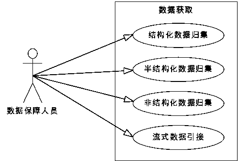
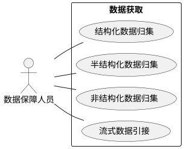
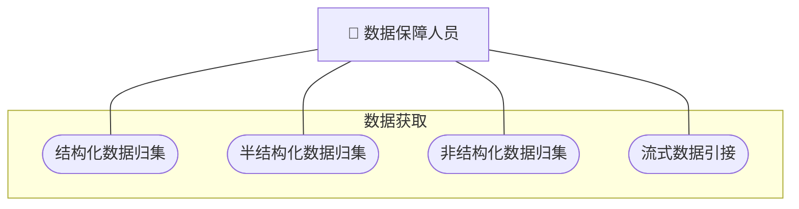
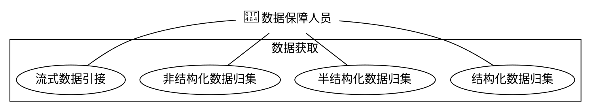

# 1_001 数据对档案

| 字段 | 值 |
|---|---|
| doc | 01数据获取转换分系统需求规格说明-终稿 |
| section | 3.2.1.2 |
| image_caption | 图 3 数据获取用例图 |
| table_caption | 表3 数据获取功能划分 |

## 原始图片

*图 3 数据获取用例图*

## 结构图

*⚠ 结构经census重对齐: 旧锚点(oleObject2.bin:page1.xml)与图片不符, 已切换到与image.png内容一致的锚点(oleObject3.bin:page1.xml, align_score=1.0)*

*来源: born-digital导出(usecase, 6节点/4边)*
*类型经几何启发式精化(Master类型识别失败的图, 投影层推断, canonical锚点不变)*

*用例图以PlantUML渲染(UML母语): 小人=参与者 | 椭圆=用例 | 矩形框=系统边界 | 实线=关联 | 虚线=include/extend*

Mermaid兼容投影(通用md渲染器可显示)

DOT源码(完整语义, graphviz可渲染)

### 锚点节点结构

| # | 文本 | 类型 |
|---|---|---|
| 1 | 数据获取 | boundary |
| 2 | 结构化数据归集 | usecase |
| 3 | 半结构化数据归集 | usecase |
| 4 | 数据保障人员 | actor |
| 5 | 非结构化数据归集 | usecase |
| 6 | 流式数据引接 | usecase |

## 表格内容

| 序号 | 功能名称/标识 | 子功能名称/标识 | 备注 |
|---|---|---|---|
| 1 | 结构化数据归集/ZZSJHQZHFW-G | 结构化数据归集任务制定/ ZZSJHQZ | — |
| 2 | 结构化数据源引接/ ZZSJHQZHFW | — |
| 3 | 半结构化数据归集/ZZSJHQZHFW- | 半结构化数据上传/ ZZSJHQZHFW | — |
| 4 | 半结构化数据源引接/ ZZSJHQZHF | — |
| 5 | 非结构化数据归集/ZZSJHQZHFW- | 非结构化数据导入/ ZZSJHQZHFW | — |
| 6 | 非结构化数据源引接/ ZZSJHQZHF | — |
| 7 | 流式数据归集/ZZSJHQZHFW-GN | 流式数据引接/ ZZSJHQZHFW-G | — |
| 8 | 流式数据源管理/ ZZSJHQZHFW- | — |

## 正文

数据获取针对各业务部门的海量多源异构数据资源、其他外部数据资源等，提供精准可靠、自动人工互补、便捷可扩展的数据引接汇聚工具手段，实现全域数据接入能力。通过采用离线数据报送、在线数据抽取、实时数据采集等方式，实现对数据中台结构化数据、半结构化数据、非结构化数据和流式数据资源的引接归集。数据归集根据数据结构、内容、时效性的区别，提供不同的数据归集手段，包括结构化数据归集、半结构化数据归集、非结构化数据归集、流式数据归集。
