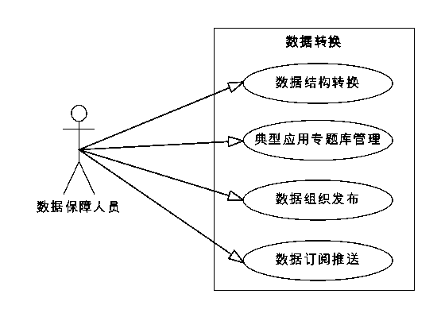
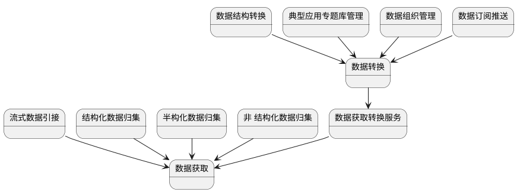
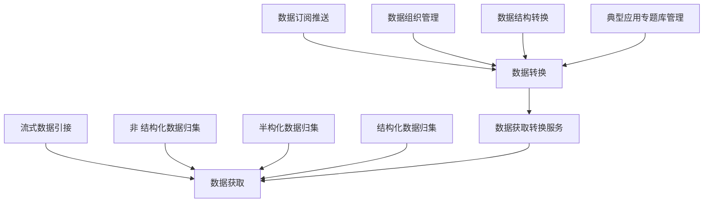
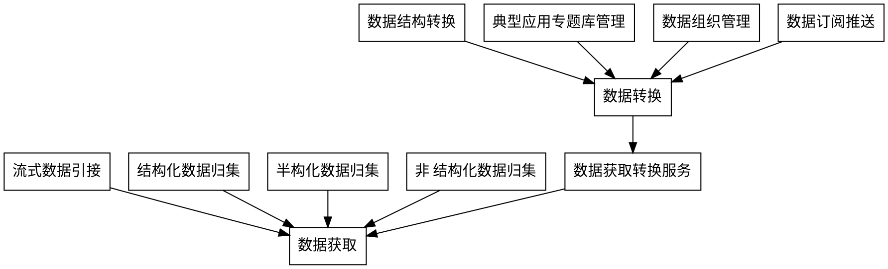
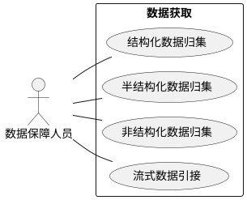
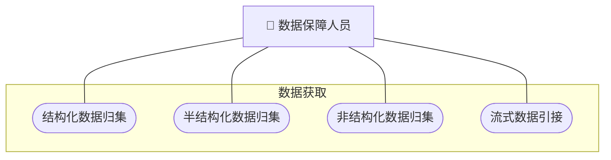
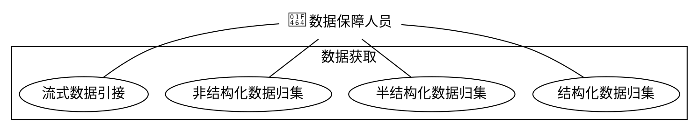

# 1_002 数据对档案

| 字段 | 值 |
|---|---|
| doc | 01数据获取转换分系统需求规格说明-终稿 |
| section | 3.2.2.2 |
| image_caption | 图 9 数据转换用例图 |
| table_caption | 表16 数据转换功能划分 |

## 原始图片

*图 9 数据转换用例图*

## 结构图

*该图为复合图: image.png由2个Visio结构组成(贪心集覆盖并集召回100%, VLM文本匹配判定)*

### 组成部分 1/2 (oleObject1.bin:page1.xml)

*来源: born-digital导出(flowchart, 11节点/10边)*
*类型经几何启发式精化(Master类型识别失败的图, 投影层推断, canonical锚点不变)*

*状态图以PlantUML渲染(UML母语): [*]=起止 | 圆角框=状态 | 箭头标签=迁移事件*

Mermaid兼容投影(通用md渲染器可显示)

DOT源码(完整语义, graphviz可渲染)

### 组成部分 2/2 (oleObject3.bin:page1.xml)

*来源: born-digital导出(usecase, 6节点/4边)*
*类型经几何启发式精化(Master类型识别失败的图, 投影层推断, canonical锚点不变)*

*用例图以PlantUML渲染(UML母语): 小人=参与者 | 椭圆=用例 | 矩形框=系统边界 | 实线=关联 | 虚线=include/extend*

Mermaid兼容投影(通用md渲染器可显示)

DOT源码(完整语义, graphviz可渲染)

### 锚点节点结构

| # | 文本 | 类型 |
|---|---|---|
| 1 | 数据获取转换服务 | process |
| 2 | 数据获取 | process |
| 3 | 数据转换 | process |
| 4 | 数据结构转换 | process |
| 5 | 典型应用专题库管理 | process |
| 6 | 数据组织管理 | process |
| 7 | 数据订阅推送 | process |
| 8 | 流式数据引接 | process |
| 9 | 结构化数据归集 | process |
| 10 | 半构化数据归集 | process |
| 11 | 非
结构化数据归集 | process |

## 表格内容

| 序号 | 功能名称/标识 | 子功能名称/标识 | 备注 |
|---|---|---|---|
| 1 | 数据结构转换/ ZZSJHQZHFW-G | 清洗转换规则管理/ ZZSJHQZHFW | — |
| 2 | 清洗转换任务管理/ ZZSJHQZHFW | — |
| 3 | 典型应用专题库管理/ZZSJHQZHFW | 专题库模型构建/ZZSJHQZHFW-G | — |
| 4 | 专题数据生产/ZZSJHQZHFW-GN | — |
| 5 | 数据组织发布/ ZZSJHQZHFW-G | 服务封装/ZZSJHQZHFW-GN-S | — |
| 6 | 服务在线测试/ZZSJHQZHFW-GN | — |
| 7 | 服务发布/ZZSJHQZHFW-GN-S | — |
| 8 | 服务接口管理/ZZSJHQZHFW-GN | — |
| 9 | 数据订阅推送/ ZZSJHQZHFW-G | 数据按需订阅/ ZZSJHQZHFW-G | — |
| 10 | 数据主动推送/ZZSJHQZHFW-GN | — |

## 正文

数据转换包含数据结构转换、典型应用专题库管理、数据组织发布和数据订阅推送4个方面能力，主要组成如图 8所示。
