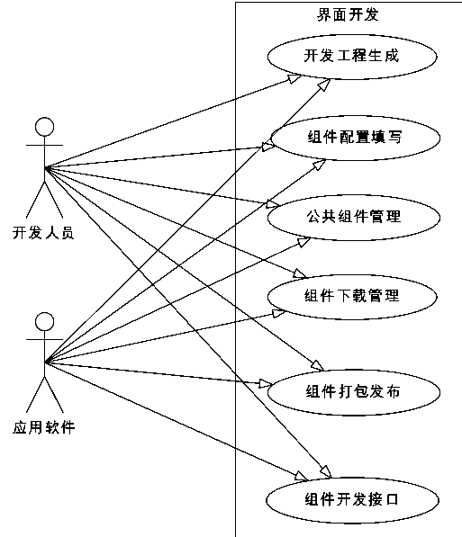
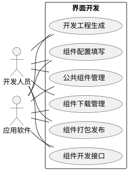
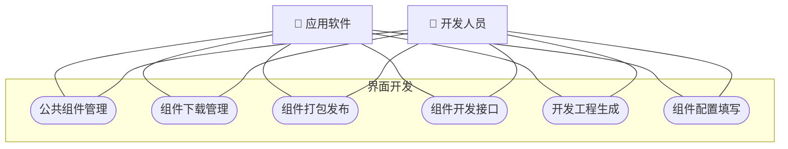
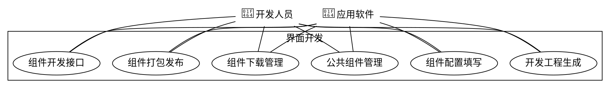

# 1_004 数据对档案

| 字段 | 值 |
|---|---|
| doc | 02界面集成框架软件需求规格说明-终稿 |
| section | 1.8.1 |
| image_caption | 图4 界面开发用例图 |
| table_caption | 表3 界面开发能力标识 |

## 原始图片

*图4 界面开发用例图*

## 结构图

*⚠ 结构经census重对齐: 旧锚点(oleObject5.bin:page1.xml)与图片不符, 已切换到与image.png内容一致的锚点(oleObject4.bin:page1.xml, align_score=1.0)*

*来源: born-digital导出(usecase, 9节点/12边)*
*类型经几何启发式精化(Master类型识别失败的图, 投影层推断, canonical锚点不变)*

*用例图以PlantUML渲染(UML母语): 小人=参与者 | 椭圆=用例 | 矩形框=系统边界 | 实线=关联 | 虚线=include/extend*

Mermaid兼容投影(通用md渲染器可显示)

DOT源码(完整语义, graphviz可渲染)

### 锚点节点结构

| # | 文本 | 类型 |
|---|---|---|
| 1 | 界面开发 | boundary |
| 2 | 公共组件管理 | usecase |
| 3 | 组件下载管理 | usecase |
| 4 | 组件打包发布 | usecase |
| 5 | 组件开发接口 | usecase |
| 6 | 开发工程生成 | usecase |
| 7 | 组件配置填写 | usecase |
| 8 | 开发人员 | actor |
| 9 | 应用软件 | actor |

## 表格内容

| 序号 | Use case名称 | 项目唯一标识符 | 需求描述 | 需求重用 | 方式 名称 | 运行状态 | 对应的任务书功能/性能 |
|---|---|---|---|---|---|---|---|
| 1 | 开发工程生成 | PZXQ-GN-JMJCKJ- JMKF | 提供界面组件开发模板，支持应用软件基于模 | 新研 | 桌面 | 开发阶段 | 4.1.1a) |
| 2 | 组件配置填写 | PZXQ-GN-JMJCKJ- JMKF | 提供界面组件配置功能，能够对组件配置文件 | 沿用 | 桌面 | 开发阶段 | 4.1.1b) |
| 3 | 公共组件管理 | PZXQ-GN-JMJCKJ- JMKF | 提供公共组件展示功能，能够展示公共组件的 | 改造 | 桌面 | 开发阶段 | 4.1.1c) |
| 4 | 组件下载管理 | PZXQ-GN-JMJCKJ- JMKF | 提供组件包管理功能，支持界面开发所需的公 | 新研 | 桌面 | 开发阶段 | 4.1.1c) |
| 5 | 组件打包发布 | PZXQ-GN-JMJCKJ- JMKF | 提供界面组件的打包发布功能，支持对界面组 | 新研 | 桌面 | 开发阶段 | 4.1.1g) |
| 6 | 组件开发接口 | PZXQ-GN-JMJCKJ- JMKF | 提供组件生命周期管理、界面设置、数据状态 | 沿用 | 桌面 | 开发阶段 | 4.1.1d) e) f) |

## 正文

界面开发功能包括：开发工程生成、组件配置填写、公共组件管理、组件下载管理、组件打包发布、组件开发接口功能，此功能只在桌面版提供并使用，其功能用例如图4所示。
