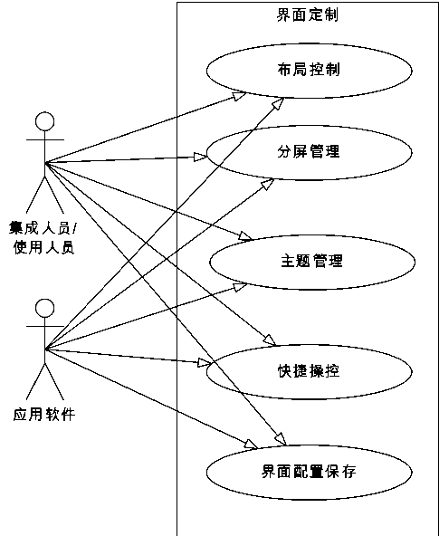

# 1_005 数据对档案

| 字段 | 值 |
|---|---|
| doc | 02界面集成框架软件需求规格说明-终稿 |
| section | 1.8.3 |
| image_caption | 图24 界面定制用例图 |
| table_caption | 表20 界面定制能力标识 |

## 原始图片

*图24 界面定制用例图*

## 结构图

*该对无Visio锚点(非Visio图, 无born-digital导出)*

## 表格内容

| 序号 | Use case名称 | 项目唯一标识符 | 需求描述 | 需求重用 | 方式 名称 | 运行 状态 | 对应的任务书功能/性能 |
|---|---|---|---|---|---|---|---|
| 1 | 布局控制 | PZXQ-GN-JMJCKJ- JMJC | 提供布局显示控制功能，支持用户对界面组件 | 改进 | 平板、桌面、手持 | 集成阶段、运行阶段 | 4.1.3a) |
| 2 | 分屏管理 | PZXQ-GN-JMJCKJ- JMDZ | 提供分屏状态每一屏展示组件的定制功能，支 | 新研 | 平板、桌面、手持 | 运行阶段 | 4.1.3b) |
| 3 | 主题管理 | PZXQ-GN-JMJCKJ- JMDZ | 提供主题样式管理功能，支持界面字号大小、 | 沿用 | 平板、桌面、手持 | 运行阶段 | 4.1.3c) |
| 4 | 快捷操控 | PZXQ-GN-JMJCKJ- JMDZ | 提供键盘快捷键定制功能，支持对应用所设置 | 沿用 | 桌面 | 集成阶段、运行阶段 | 4.1.3d)/4.2 c) |
| 5 | 界面配置保存 | PZXQ-GN-JMJCKJ- JMDZ | 提供依据用户身份保存与加载界面配置信息功 | 新研 | 平板、桌面、手持 | 运行阶段 | 4.1.3e) |

## 正文

界面定制功能包括：布局控制、分屏管理、主题管理、快捷操控、界面配置保存功能，其功能用例如图24所示。
