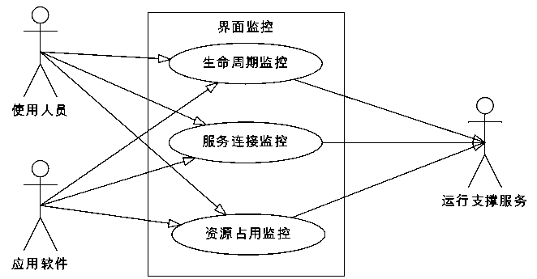
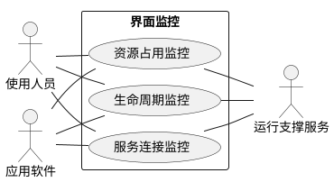
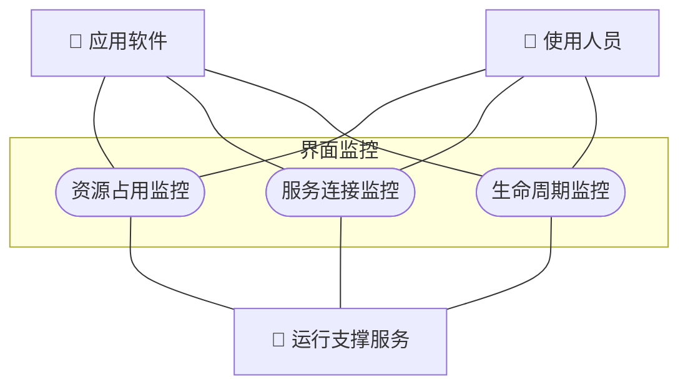
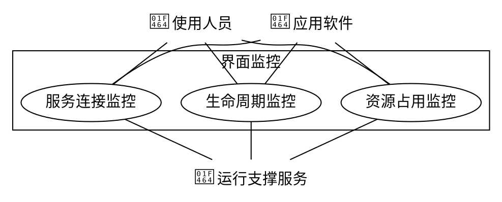

# 1_006 数据对档案

| 字段 | 值 |
|---|---|
| doc | 02界面集成框架软件需求规格说明-终稿 |
| section | 1.8.4 |
| image_caption | 图31 界面监控用例图 |
| table_caption | 表26 界面定制能力标识 |

## 原始图片

*图31 界面监控用例图*

## 结构图

*⚠ 结构经census重对齐: 旧锚点(oleObject32.bin:page1.xml)与图片不符, 已切换到与image.png内容一致的锚点(oleObject31.bin:page1.xml, align_score=1.0)*

*来源: born-digital导出(usecase, 7节点/9边)*
*类型经几何启发式精化(Master类型识别失败的图, 投影层推断, canonical锚点不变)*

*用例图以PlantUML渲染(UML母语): 小人=参与者 | 椭圆=用例 | 矩形框=系统边界 | 实线=关联 | 虚线=include/extend*

Mermaid兼容投影(通用md渲染器可显示)

DOT源码(完整语义, graphviz可渲染)

*⚠ 锚点Connect重建存在1个悬空连线端点(线端粘在无文本形状上被语义过滤跳过), 图示边数可能少于原图——渲染只呈现锚点事实, 不编造边; 独立证据可对照VLM通道提取(scene_vlm_extractions.json)*

### 锚点节点结构

| # | 文本 | 类型 |
|---|---|---|
| 1 | 界面监控 | boundary |
| 2 | 服务连接监控 | usecase |
| 3 | 资源占用监控 | usecase |
| 4 | 生命周期监控 | usecase |
| 5 | 使用人员 | actor |
| 6 | 应用软件 | actor |
| 7 | 运行支撑服务 | actor |

## 表格内容

| 序号 | Use case名称 | 项目唯一标识符 | 需求描述 | 需求 重用 | 方式 名称 | 运行阶段 | 对应的任务书功能/性能 |
|---|---|---|---|---|---|---|---|
| 1 | 生命周期监控 | PZXQ-GN-JMJCKJ- JMJC | 提供组件生命周期的监控，包括组件加载、组 | 新研 | 平板、桌面、手持 | 运行阶段 | 4.1.4a) |
| 2 | 资源占用监控 | PZXQ-GN-JMJCKJ- JMDZ | 提供集成组件占用资源的监控，包括网络、I | 新研 | 平板、桌面、手持 | 运行阶段 | 4.1.4b) |

## 正文

界面监控功能包括：组件生命周期监控（组件加载、组件运行、组件卸载）、服务连接监控和资源占用监控等功能，其功能用例如图31所示。
