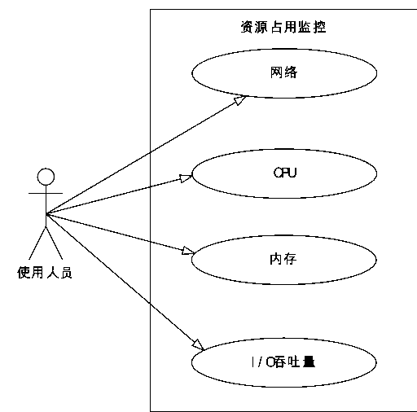
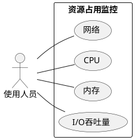
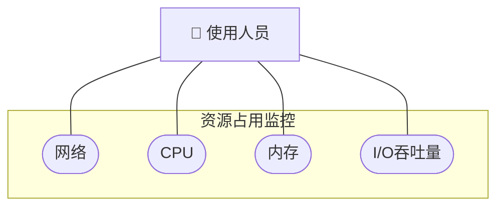
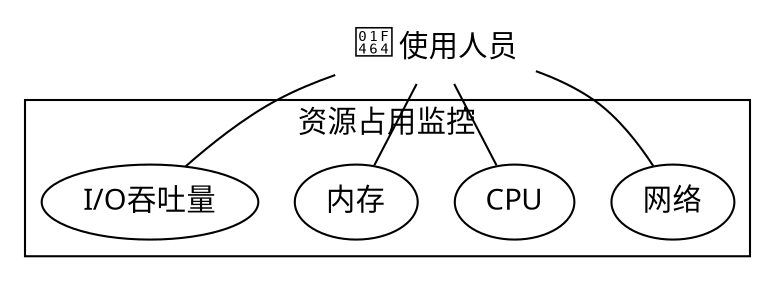

# 1_007 数据对档案

| 字段 | 值 |
|---|---|
| doc | 02界面集成框架软件需求规格说明-终稿 |
| section | 1.8.4.2 |
| image_caption | 图 35 资源占用用例图 |
| table_caption | 表 31资源占用监控标识 |

## 原始图片

*图 35 资源占用用例图*

## 结构图

*来源: born-digital导出(usecase, 6节点/4边)*
*类型经几何启发式精化(Master类型识别失败的图, 投影层推断, canonical锚点不变)*

*用例图以PlantUML渲染(UML母语): 小人=参与者 | 椭圆=用例 | 矩形框=系统边界 | 实线=关联 | 虚线=include/extend*

Mermaid兼容投影(通用md渲染器可显示)

DOT源码(完整语义, graphviz可渲染)

*锚点Connect重建存在3个悬空连线端点, 已几何恢复3条边(连线自由端吸附最近语义节点, 每条带距离证据, via=dangling_snap; canonical锚点不变)*

### 锚点节点结构

| # | 文本 | 类型 |
|---|---|---|
| 1 | 资源占用监控 | boundary |
| 2 | 网络 | usecase |
| 3 | CPU | usecase |
| 4 | 内存 | usecase |
| 5 | I/O吞吐量 | usecase |
| 6 | 使用人员 | actor |

## 表格内容

| 序号 | Use case名称 | 项目唯一标识符 | 需求描述 | 需求重用 | 方式名称 | 对应的任务书功能/性能 |
|---|---|---|---|---|---|---|
| 1 | 网络使用 | PZXQ-GN-JMJCKJ- JMJC | 提供组件占用网络的监控，查看组件获取数据 | 无 | 平板、桌面、手持 | 4.1.4 |
| 2 | CPU占用 | PZXQ-GN-JMJCKJ- JMDZ | 提供组件占用CPU资源的监控，查看组件获 | 无 | 平板、桌面、手持 | 4.1.4 |
| 3 | 内存使用 | PZXQ-GN-JMJCKJ- JMDZ | 提供组件占用内存的监控，查看组件获取数据 | 无 | 平板、桌面、手持 | 4.1.4 |
| 4 | I/O吞吐量占用 | PZXQ-GN-JMJCKJ- JMDZ | 提供组件使用I/O吞吐量的监控，查看组件 |   | 平板、桌面、手持 | 4.1.4 |

## 正文

资源占用监控包括每个组件占用网络、CPU、内存和I/O等资源的情况，其功能用例图如图 35所示。
