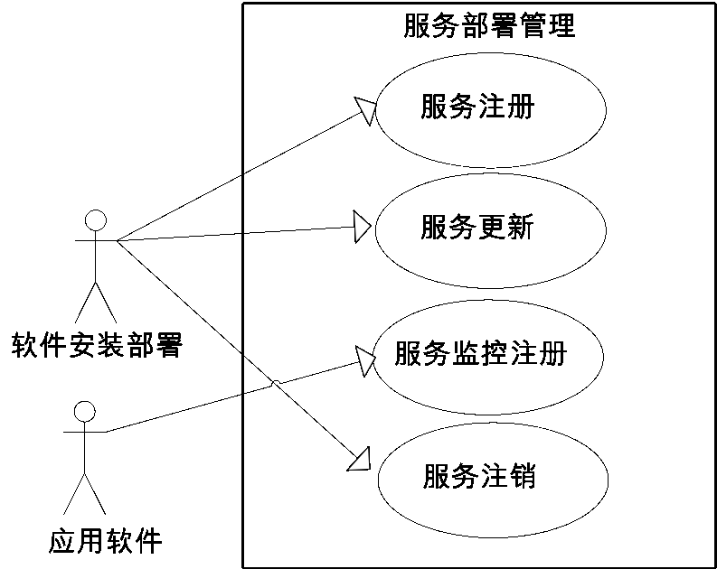
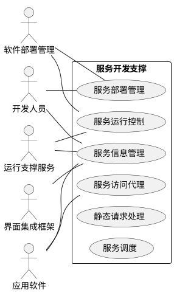
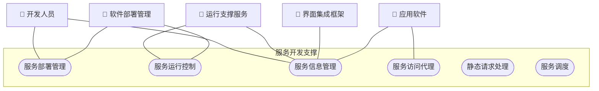
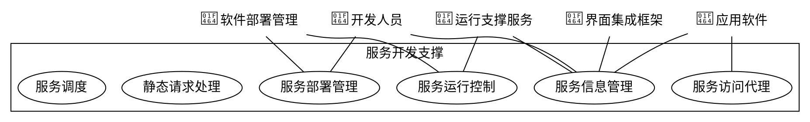

# 1_010 数据对档案

| 字段 | 值 |
|---|---|
| doc | 03服务集成框架软件需求规格说明-终稿 |
| section | 3.2 |
| image_caption | 图4服务集成框架用例图  |
| table_caption | 表2 服务集成框架软件所有能力标识 |

## 原始图片

*图4服务集成框架用例图 *

## 结构图

*⚠ 结构经census重对齐: 旧锚点(oleObject2.bin:page1.xml)与图片不符, 已切换到与image.png内容一致的锚点(oleObject4.bin:page1.xml, align_score=1.0)*

*来源: born-digital导出(usecase, 12节点/9边)*
*类型经几何启发式精化(Master类型识别失败的图, 投影层推断, canonical锚点不变)*

*用例图以PlantUML渲染(UML母语): 小人=参与者 | 椭圆=用例 | 矩形框=系统边界 | 实线=关联 | 虚线=include/extend*

Mermaid兼容投影(通用md渲染器可显示)

DOT源码(完整语义, graphviz可渲染)

### 锚点节点结构

| # | 文本 | 类型 |
|---|---|---|
| 1 |   | other |
| 2 |   | other |
| 3 | 开发人员 | other |
| 4 |   | other |
| 5 |   | other |
| 6 |   | other |
| 7 |   | other |
| 8 | 服务开发支撑 | other |
| 9 |   | other |
| 10 |   | other |
| 11 | 服务部署管理 | other |
| 12 |   | other |
| 13 |   | other |
| 14 | 服务运行控制 | other |
| 15 |   | other |
| … | 共38个节点 | |

## 表格内容

| 序号 | Use case名称 | 项目唯一标识符 | 需求描述 | 需求 重用 | 方式 名称 | 运行状态 | 对应的任务书功能/性能 |
|---|---|---|---|---|---|---|---|
|   | 服务开发支撑 | PZXQ-GN-FWKFZC | 提供服务开发基础为用户提供服务开发必须的 | 新增 | 桌面 | 开发阶段 | 4.1.1 |
|   | 服务部署管理 | PZXQ-GN-FWBSGL | 提供服务注册、服务多实例部署、服务更新和 | 改进 | 平板、桌面、手持 | 运行阶段 | 4.1.2/4.2 a) |
|   | 服务运行控制 | PZXQ-GN-FWYXKZ | 支持手动、自动、按需三种服务启动策略；  | 改进 | 平板、桌面、手持 | 运行阶段 | 4.1.3/4.2 b) |
|   | 服务信息管理 | PZXQ-GN-FWXXGL | 支持对服务的启动、停止状态进行监视；服务 | 改进 | 平板、桌面、手持 | 运行阶段 | 4.1.4/4.2 c) |
|   | 服务调度 | PZXQ-GN-FWDD | 提供服务发现、服务负载均衡功能、基于优先 | 新增 | 平板、桌面、手持 | 运行阶段 | 4.1.5 |
|   | 服务访问代理 | PZXQ-GN-FWFWDL | 提供服务访问路由功能，支持将服务请求发送 | 新增 | 平板、桌面、手持 | 运行阶段 | 4.1.5 |
|   | 静态请求处理 | PZXQ-GN-JTQQCL | 提供静态资源的处理、文件上传和文件下载功 | 新增 | 平板、桌面、手持 | 运行阶段 | 4.1.6 |

## 正文

服务集成框架按照其功能需求，包含服务开发支撑、服务部署管理、服务运行控制、服务状态监视、服务调度、服务访问代理、静态请求处理7部分。
