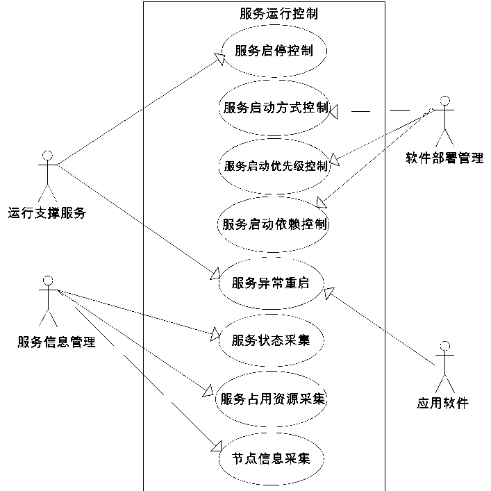
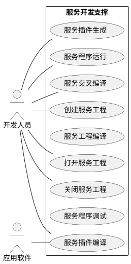
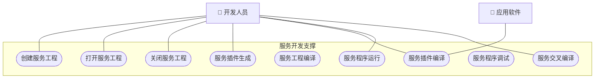
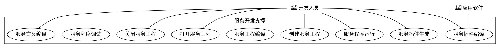

# 1_011 数据对档案

| 字段 | 值 |
|---|---|
| doc | 03服务集成框架软件需求规格说明-终稿 |
| section | 3.2.1 |
| image_caption | 图5 服务开发用例图 |
| table_caption | 表3 服务开发支撑所有能力能力标识 |

## 原始图片

*图5 服务开发用例图*

## 结构图

*⚠ 结构经census重对齐: 旧锚点(oleObject17.bin:page1.xml)与图片不符, 已切换到与image.png内容一致的锚点(oleObject5.bin:page1.xml, align_score=1.0)*

*来源: born-digital导出(usecase, 12节点/8边)*
*类型经几何启发式精化(Master类型识别失败的图, 投影层推断, canonical锚点不变)*

*用例图以PlantUML渲染(UML母语): 小人=参与者 | 椭圆=用例 | 矩形框=系统边界 | 实线=关联 | 虚线=include/extend*

Mermaid兼容投影(通用md渲染器可显示)

DOT源码(完整语义, graphviz可渲染)

### 锚点节点结构

| # | 文本 | 类型 |
|---|---|---|
| 1 |   | other |
| 2 |   | other |
| 3 | 服务开发支撑 | other |
| 4 |   | other |
| 5 | 开发人员 | other |
| 6 |   | other |
| 7 | 创建服务工程 | other |
| 8 |   | other |
| 9 | 应用软件 | other |
| 10 |   | other |
| 11 | 打开服务工程 | other |
| 12 |   | other |
| 13 | 关闭服务工程 | other |
| 14 |   | other |
| 15 | 服务插件编译 | other |
| … | 共26个节点 | |

## 表格内容

| 序号 | Use case名称 | 项目唯一标识符 | 需求描述 | 需求重用 | 方式名称 | 运行状态 | 对应的任务书功能/性能 |
|---|---|---|---|---|---|---|---|
| 1 | 创建服务工程 | PZXQ-GN-FWKFZC-CJFWG | 新建服务工程 | 新增 | 桌面 | 开发阶段 | 4.1.1 |
| 2 | 打开服务工程 | PZXQ-GN-FWKFZC-DKFWG | 打开新建的服务工程 | 新增 | 桌面 | 开发阶段 | 4.1.1 |
| 3 | 关闭服务工程 | PZXQ-GN-FWKFZC-GBFWG | 关闭选中的服务工程 | 新增 | 桌面 | 开发阶段 | 4.1.1 |
| 4 | 服务插件生成 | PZXQ-GN-FWKFZC-FWCJS | 服务工程插件生成 | 新增 | 桌面 | 开发阶段 | 4.1.1 |
| 5 | 服务插件编译 | PZXQ-GN-FWKFZC-FWCJB | 插件信息编译 | 新增 | 桌面 | 开发阶段 | 4.1.1 |
| 6 | 服务工程编译 | PZXQ-GN-FWGCBY | 服务工程的编译 | 新增 | 桌面 | 开发阶段 | 4.1.1 |
| 7 | 服务程序运行 | PZXQ-GN-FWKFZC-FWCSY | 运行服务程序 | 新增 | 桌面 | 开发阶段 | 4.1.1 |
| 8 | 服务程序调试 | PZXQ-GN-FWKFZC-FWCXT | 调试服务程序 | 新增 | 桌面 | 开发阶段 | 4.1.1 |
| 9 | 服务交叉编译 | PZXQ-GN-FWKFZC-FWJCB | 服务交叉编译 | 新增 | 桌面 | 开发阶段 | 4.1.1 |
| 10 | 插件初始化函数定义 | PZXQ-GN-FWKFZC-CJCSH | 插件创建与初始 | 新增 | 桌面 | 开发阶段 | 4.1.1 |
| 11 | 插件销毁函数定义 | PZXQ-GN-FWKFZC-CJXH | 插件销毁与资源回收 | 新增 | 桌面 | 开发阶段 | 4.1.1 |
| 12 | 调用服务响应发送类接口 | PZXQ-GN-FWKFZC-FWXYF | 服务响应发送 | 新增 | 桌面 | 开发阶段 | 4.1.1 |
| 13 | 调用服务请求处理类接口 | PZXQ-GN-FWKFZC-FWQQC | 服务请求处理 | 新增 | 桌面 | 开发阶段 | 4.1.1 |
| 14 | 调用服务消息推送接口 | PZXQ-GN-FWKFZC-FWXXT | 服务消息推送 | 新增 | 桌面 | 开发阶段 | 4.1.1 |
| 15 | 服务定时器接口 | PZXQ-GN-FWKFZC-FWCL | 通过定时器处理定时任务 | 新增 | 桌面 | 开发阶段 | 4.1.1 |
| 16 | 调用服务响应接收类接口 | PZXQ-GN-FWKFZC-FWXYJ | 服务程序接收请求并解析 | 新增 | 桌面 | 开发阶段 | 4.1.1 |
| 17 | 调用服务请求发送类接口 | PZXQ-GN-FWKFZC-QQFS | 提供服务请求发送 | 新增 | 桌面 | 开发阶段 | 4.1.1 |

## 正文

服务开发支撑提供两大类功能：服务开发基础功能和服务二次开发支撑功能。服务开发基础为用户提供服务开发必须的工程管理、程序生成、程序调试等基础性功能，其功能用例如图5所示；服务二次开发支撑提供对服务请求、响应进行处理的常用开发接口以及消息推送、初始化等功能性接口，其功能用例如图6所示。
