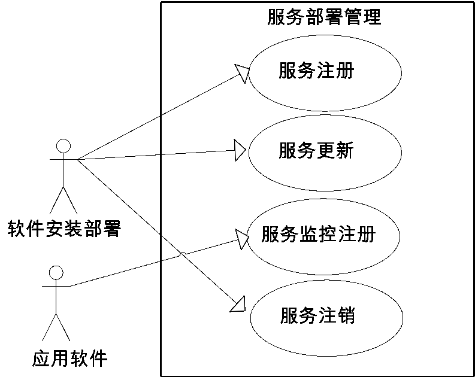
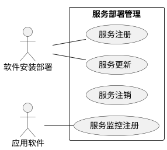
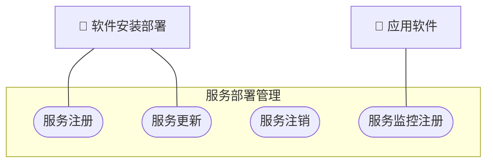
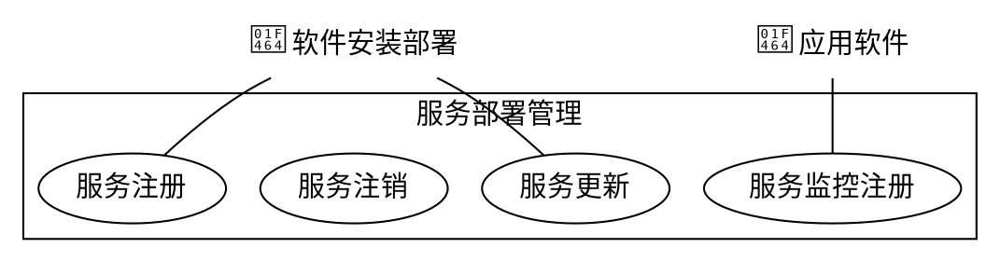

# 1_013 数据对档案

| 字段 | 值 |
|---|---|
| doc | 03服务集成框架软件需求规格说明-终稿 |
| section | 3.2.2 |
| image_caption | 图8 软件安装部署用例图 |
| table_caption | 表21 服务部署管理所有能力能力标识 |

## 原始图片

*图8 软件安装部署用例图*

## 结构图

*来源: born-digital导出(usecase, 7节点/3边)*
*类型经几何启发式精化(Master类型识别失败的图, 投影层推断, canonical锚点不变)*

*用例图以PlantUML渲染(UML母语): 小人=参与者 | 椭圆=用例 | 矩形框=系统边界 | 实线=关联 | 虚线=include/extend*

Mermaid兼容投影(通用md渲染器可显示)

DOT源码(完整语义, graphviz可渲染)

### 锚点节点结构

| # | 文本 | 类型 |
|---|---|---|
| 1 |   | other |
| 2 |   | other |
| 3 | 服务部署管理 | other |
| 4 |   | other |
| 5 | 软件安装部署 | other |
| 6 |   | other |
| 7 | 服务注册 | other |
| 8 |   | other |
| 9 | 服务更新 | other |
| 10 |   | other |
| 11 | 服务注销 | other |
| 12 |   | other |
| 13 | 服务监控注册 | other |
| 14 |   | other |
| 15 | 应用软件 | other |

## 表格内容

| 序号 | Use case名称 | 项目唯一标识符 | 需求描述 | 需求重用 | 方式名称 | 运行状态 | 对应的任务书功能/性能 |
|---|---|---|---|---|---|---|---|
| 1 | 服务注册 | PZXQ-GN-FWBSGL-FWZC | 需要通过服务描述信息完成服务注册，使得服 | 改进 | 桌面、平板、手持 | 运行阶段 | 4.1.2/4.2 a) |
| 2 | 服务更新 | PZXQ-GN-FWBSGL-FWGX | 对服务的信息更新 | 改进 | 桌面、平板、手持 | 运行阶段 | 4.1.2 |
| 3 | 服务监控注册 | PZXQ-GN-FWBSGL-FWJKZ | 调用接口注册对某个服务进行资源占用和状态 | 新增 | 桌面、平板、手持 | 运行阶段 | 4.1.2 |
| 4 | 服务注销 | PZXQ-GN-FWBSGL-FWZX | 通过服务描述信息完成服务注册信息的删除 | 新增 | 桌面、平板、手持 | 运行阶段 | 4.1.2 |

## 正文

服务部署管理功能包括服务注册、服务多实例部署、服务更新和服务注销功能，其中服务注册支持通过读取服务清单文件完成服务注册；服务监控注册支持调用接口注册对某个服务进行资源占用和状态的监控；服务更新支持重新读取服务清单文件完成服务注册信息的更新；服务注销支持重新读取服务清单文件完成服务注册信息的删除；其功能用例如图8所示。
