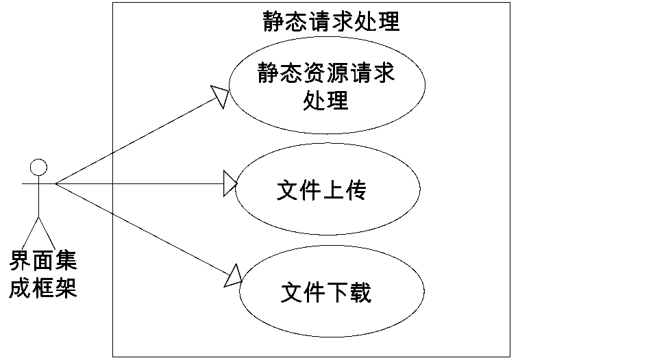
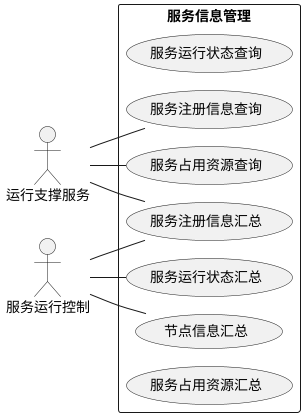
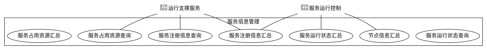

# 1_015 数据对档案

| 字段 | 值 |
|---|---|
| doc | 03服务集成框架软件需求规格说明-终稿 |
| section | 3.2.4 |
| image_caption | 图12 服务信息管理用例图 |
| table_caption | 表35 服务信息管理所有能力能力标识 |

## 原始图片

*图12 服务信息管理用例图*

## 结构图

*来源: born-digital导出(usecase, 10节点/6边)*
*类型经几何启发式精化(Master类型识别失败的图, 投影层推断, canonical锚点不变)*

*用例图以PlantUML渲染(UML母语): 小人=参与者 | 椭圆=用例 | 矩形框=系统边界 | 实线=关联 | 虚线=include/extend*

Mermaid兼容投影(通用md渲染器可显示)

DOT源码(完整语义, graphviz可渲染)

### 锚点节点结构

| # | 文本 | 类型 |
|---|---|---|
| 1 |   | other |
| 2 |   | other |
| 3 | 服务信息管理 | other |
| 4 |   | other |
| 5 | 运行支撑服务 | other |
| 6 |   | other |
| 7 | 服务运行状态查询 | other |
| 8 |   | other |
| 9 | 服务注册信息查询 | other |
| 10 |   | other |
| 11 | 服务占用资源查询 | other |
| 12 |   | other |
| 13 | 服务注册信息汇总 | other |
| 14 |   | other |
| 15 | 服务运行状态汇总 | other |
| … | 共21个节点 | |

## 表格内容

| 序号 | Use case名称 | 项目唯一标识符 | 需求描述 | 需求重用 | 方式名称 | 运行状态 | 对应的任务书功能/性能 |
|---|---|---|---|---|---|---|---|
| 1 | 服务运行状态查询 | PZXQ-GN-FWXXGL-FWYXZ | 监控节点主机的资源使用信息。 | 改进 | 桌面、平板、手持 | 运行阶段 | 4.1.4/4.2 c) |
| 2 | 服务占用资源查询 | PZXQ-GN-FWXXGL-FWZYZ | 通过服务名称获取服务的资源占用信息 | 新增 | 桌面、平板、手持 | 运行阶段 | 4.1.4/4.2 c) |
| 3 | 服务注册信息查询 | PZXQ-GN-FWXXGL-FWZCX | 通过服务名称获取服务注册信息 | 新增 | 桌面、平板、手持 | 运行阶段 | 4.1.4/4.2 c) |
| 4 | 服务注册信息汇总 | PZXQ-GN-FWXXGL-FWZCX | 汇总服务注册的所有信息 | 沿用 | 桌面、平板、手持 | 运行阶段 | 4.1.4 |
| 5 | 服务运行状态汇总 | PZXQ-GN-FWXXGL-FWYXZ | 汇总控制程序上报的服务信息 | 沿用 | 桌面、平板、手持 | 运行阶段 | 4.1.4 |
| 6 | 服务占用资源汇总 | PZXQ-GN-FWXXGL-FWZYZ | 汇总所有控制程序上报的监控信息 | 新增 | 桌面、平板、手持 | 运行阶段 | 4.1.4 |
| 7 | 节点信息汇总 | PZXQ-GN-FWXXGL-JDXXH | 汇总所有连接到信息管理服务的节点信息 | 新增 | 桌面、平板、手持 | 运行阶段 | 4.1.4 |

## 正文

服务运行状态查询功能，支持通过服务名称的方式获取服务的运行状态；服务占用资源查询功能，支持通过服务名称的方式获取服务的资源占用信息；服务注册信息查询功能，支持通过服务名称的方式获取服务的注册信息；根据节点IP获取节点上所有服务注册信息的功能；根据节点IP获取节点上所有服务运行信息的功能；其功能用例如图12所示。
