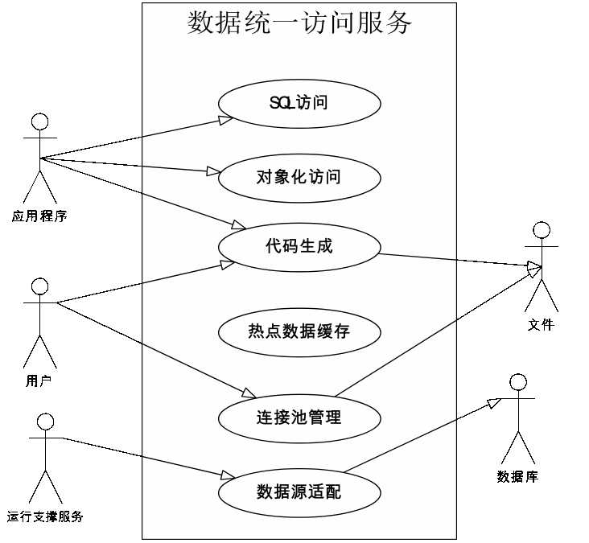
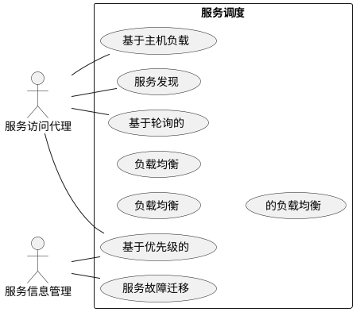
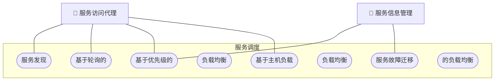
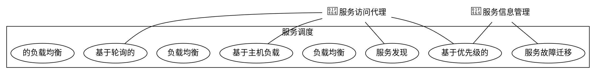

# 1_016 数据对档案

| 字段 | 值 |
|---|---|
| doc | 03服务集成框架软件需求规格说明-终稿 |
| section | 3.2.5 |
| image_caption | 图14 服务调度用例图 |
| table_caption | 表43服务信息管理所有能力能力标识 |

## 原始图片

*图14 服务调度用例图*

## 结构图

*来源: born-digital导出(usecase, 11节点/6边)*
*类型经几何启发式精化(Master类型识别失败的图, 投影层推断, canonical锚点不变)*

*用例图以PlantUML渲染(UML母语): 小人=参与者 | 椭圆=用例 | 矩形框=系统边界 | 实线=关联 | 虚线=include/extend*

Mermaid兼容投影(通用md渲染器可显示)

DOT源码(完整语义, graphviz可渲染)

### 锚点节点结构

| # | 文本 | 类型 |
|---|---|---|
| 1 |   | other |
| 2 |   | other |
| 3 | 服务调度 | other |
| 4 |   | other |
| 5 | 服务访问代理 | other |
| 6 |   | other |
| 7 | 服务发现 | other |
| 8 |   | other |
| 9 | 服务故障迁移 | other |
| 10 |   | other |
| 11 | 服务信息管理 | other |
| 12 |   | other |
| 13 | 基于轮询的 | other |
| 14 | 负载均衡 | other |
| 15 |   | other |
| … | 共20个节点 | |

## 表格内容

| 序号 | Use case名称 | 项目唯一标识符 | 需求描述 | 需求重用 | 方式名称 | 运行状态 | 对应的任务书功能/性能 |
|---|---|---|---|---|---|---|---|
| 1 | 服务发现 | PZXQ-GN-FWDD-FWFX | 服务访问代理向服务信息管理查询，自动发现 | 新增 | 桌面、平板、手持 | 运行阶段 | 4.1.5 |
| 2 | 基于轮询的负载均衡 | PZXQ-GN-FWDD-FWLXFZ | 服务访问代理以轮询的方式将服务分发到不同 | 新增 | 桌面、平板、手持 | 运行阶段 | 4.1.5 |
| 3 | 基于优先级的负载均衡 | PZXQ-GN-FWDD-FWYXJFZ | 按照预先配置的服务优先级将服务按比例分发 | 新增 | 桌面、平板、手持 | 运行阶段 | 4.1.5 |
| 4 | 基于主机负载的负载均衡 | PZXQ-GN-FWDD-FWZJFZ | 通过比较服务主机负载将服务分发到负载最小 | 新增 | 桌面、平板、手持 | 运行阶段 | 4.1.5 |
| 5 | 服务故障迁移 | PZXQ-GN-FWDD-FWGZQY | 出现服务访问故障的请求自动调度到运行正常 | 新增 | 桌面、平板、手持 | 运行阶段 | 4.1.5 |

## 正文

服务调度功能包括服务发现、服务负载均衡功能、基于优先级的负载均衡、基于主机负载的负载均衡；支持服务故障迁移功能，将访问故障服务的请求调度到运行正常的服务，其用例图功能如图14所示；
