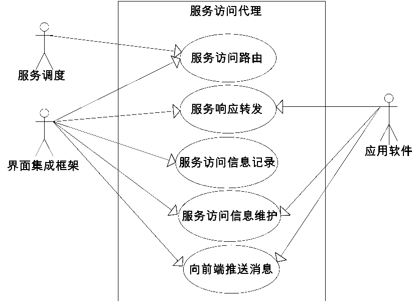
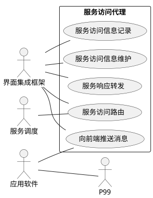
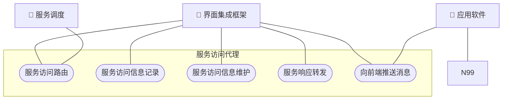
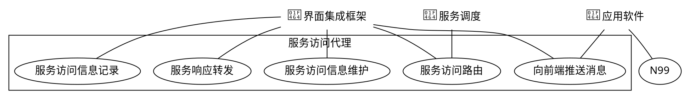

# 1_017 数据对档案

| 字段 | 值 |
|---|---|
| doc | 03服务集成框架软件需求规格说明-终稿 |
| section | 3.2.6 |
| image_caption | 图16 服务访问代理用例图 |
| table_caption | 表49 服务访问代理所有能力标识 |

## 原始图片

*图16 服务访问代理用例图*

## 结构图

*来源: born-digital导出(usecase, 9节点/8边)*
*类型经几何启发式精化(Master类型识别失败的图, 投影层推断, canonical锚点不变)*

*用例图以PlantUML渲染(UML母语): 小人=参与者 | 椭圆=用例 | 矩形框=系统边界 | 实线=关联 | 虚线=include/extend*

Mermaid兼容投影(通用md渲染器可显示)

DOT源码(完整语义, graphviz可渲染)

*⚠ 锚点Connect重建存在2个悬空连线端点(线端粘在无文本形状上被语义过滤跳过), 图示边数可能少于原图——渲染只呈现锚点事实, 不编造边; 独立证据可对照VLM通道提取(scene_vlm_extractions.json)*

### 锚点节点结构

| # | 文本 | 类型 |
|---|---|---|
| 1 |   | other |
| 2 |   | other |
| 3 | 服务访问代理 | other |
| 4 |   | other |
| 5 | 界面集成框架 | other |
| 6 |   | other |
| 7 |   | other |
| 8 | 服务访问路由 | other |
| 9 |   | other |
| 10 | 服务访问信息记录 | other |
| 11 |   | other |
| 12 | 服务访问信息维护 | other |
| 13 |   | other |
| 14 | 服务响应转发 | other |
| 15 |   | other |
| … | 共20个节点 | |

## 表格内容

| 序号 | Use case名称 | 项目唯一标识符 | 需求描述 | 需求重用 | 方式名称 | 运行状态 | 对应的任务书功能/性能 |
|---|---|---|---|---|---|---|---|
| 1 | 服务访问路由 | PZXQ-FWJCKJ-GN-FWFWL | 支持将服务请求发送到具体的服务实例 | 新增 | 桌面、平板、手持 | 运行阶段 | 4.1.5 |
| 2 | 服务响应转发 | PZXQ-FWJCKJ-GN-FWXYZ | 支持将服务响应发给服务访问发起者 | 新增 | 桌面、平板、手持 | 运行阶段 | 4.1.5 |
| 3 | 服务访问信息记录 | PZXQ-FWJCKJ-GN-FWFWJ | 服务调用发起的时间、调用方法、响应状态码 | 新增 | 桌面、平板、手持 | 运行阶段 | 4.1.5 |
| 4 | 服务访问信息维护 | PZXQ-FWJCKJ-GN-FWFWW | 服务请求数据中提取会话信息进行维护 | 新增 | 桌面、平板、手持 | 运行阶段 | 4.1.5 |
| 5 | 向前端推送消息 | PZXQ-FWJCKJ-GN-QDTSX | 支持后台程序主动向前端界面推送数据 | 新增 | 桌面、平板、手持 | 运行阶段 | 4.1.5 |

## 正文

服务访问代理功能包括服务访问路由功能，支持将服务请求发送到具体的服务实例；服务响应转发功能，支持将服务响应发给服务访问发起者；服务访问信息记录功能，可在文件中查看服务调用发起的时间、调用方法、响应状态码等信息；服务访问会话信息维护功能，可在服务响应数据中植入会话信息，可在服务请求数据中提取会话信息；向前端推送消息的功能，支持接收其它程序发来的数据并转发到指定 节点上的界面集成框架；其功能用例如图16所示。
