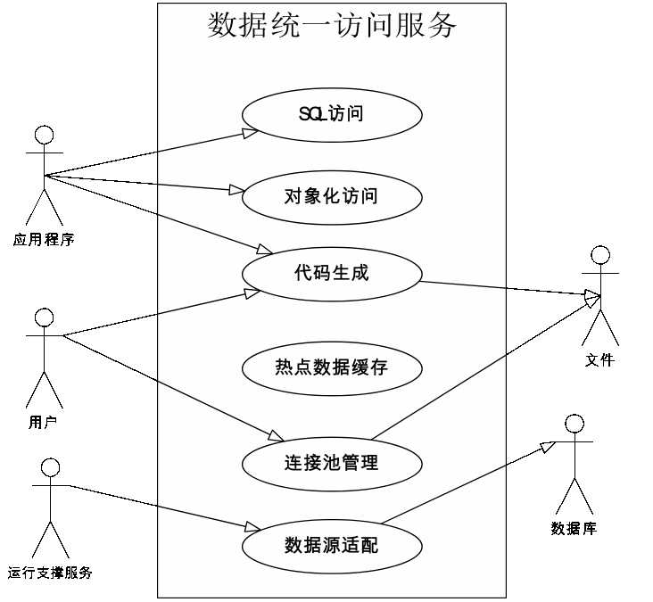
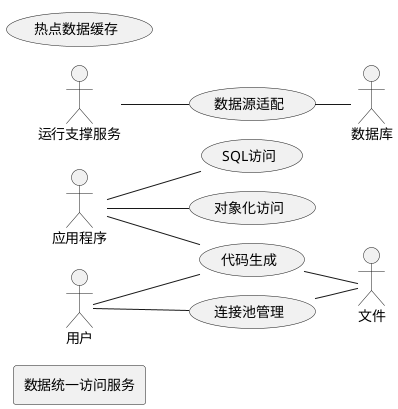
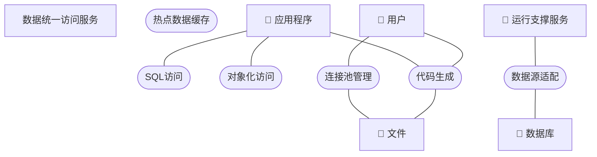
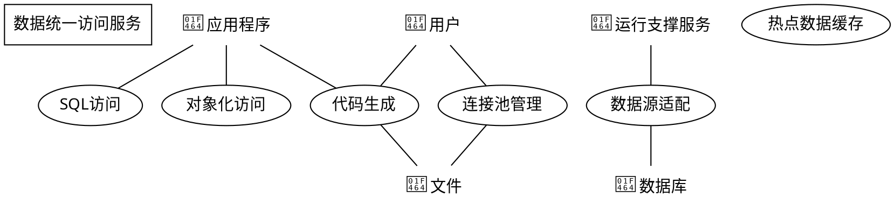

# 1_019 数据对档案

| 字段 | 值 |
|---|---|
| doc | 04数据统一访问服务软件需求规格说明-终稿 |
| section | 3.2 |
| image_caption | 图2 数据统一访问服务软件用例图 |
| table_caption | 表2 数据统一访问服务软件所有能力标识 |

## 原始图片

*图2 数据统一访问服务软件用例图*

## 结构图

*⚠ 结构经census重对齐: 旧锚点(oleObject1.bin:page1.xml)与图片不符, 已切换到与image.png内容一致的锚点(oleObject2.bin:page1.xml, align_score=1.0)*

*来源: born-digital导出(usecase, 12节点/9边)*
*类型经几何启发式精化(Master类型识别失败的图, 投影层推断, canonical锚点不变)*

*用例图以PlantUML渲染(UML母语): 小人=参与者 | 椭圆=用例 | 矩形框=系统边界 | 实线=关联 | 虚线=include/extend*

Mermaid兼容投影(通用md渲染器可显示)

DOT源码(完整语义, graphviz可渲染)

### 锚点节点结构

| # | 文本 | 类型 |
|---|---|---|
| 1 | 数据统一访问服务 | process |
| 2 | SQL访问 | usecase |
| 3 | 对象化访问 | usecase |
| 4 | 代码生成 | usecase |
| 5 | 数据源适配 | usecase |
| 6 | 热点数据缓存 | usecase |
| 7 | 应用程序 | actor |
| 8 | 用户 | actor |
| 9 | 连接池管理 | usecase |
| 10 | 数据库 | actor |
| 11 | 文件 | actor |
| 12 | 运行支撑服务 | actor |

## 表格内容

| 序号 | Use case名称 | 项目唯一标识符 | 需求描述 | 需求重用 | 方式 名称 | 运行状态 | 对应的任务书功能/性能 |
|---|---|---|---|---|---|---|---|
| 1 | SQL访问功能 | PZXQ-GN-SQLFW | 提供原生SQL访问功能，提供数据库连接、 | 沿用 | 平板、桌面、手持 | 运行阶段 开发阶段 | 4.1.1；4.2 |
| 2 | 对象化访问功能 | PZXQ-GN-DXHFW | 提供对象化数据访问功能，支持应用软件通过 | 沿用 | 平板、桌面、手持 | 运行阶段 开发阶段 | 4.1.1 |
| 3 | 代码生成 | PZXQ-GN-DMSC | 提供代码自动生成功能，支持将关系型数据库 | 沿用 | 桌面 | 开发阶段 | 4.1.1 |
| 4 | 数据源适配 | PZXQ-GN-SJYSP | 提供数据源切换功能，支持访问数据源依据场 | 新研 | 平板 | 运行阶段 | 4.1.2；4.2 |
| 6 | 热点数据缓存 | PZXQ-GN-RDSJHC | 提供查询数据的缓存功能，支持对查询的结果 | 新研 | 桌面 | 运行阶段 | 4.1.2 |
| 7 | 连接池管理 | PZXQ-GN-LJCGL | 提供连接池管理功能，支持对达梦数据库 V | 新研 | 桌面 | 运行阶段 | 4.1.2 |

## 正文

数据统一访问服务按照其功能需求，包含SQL访问、对象化访问、代码生成、数据源适配、热点数据缓存以及连接池管理功能。
