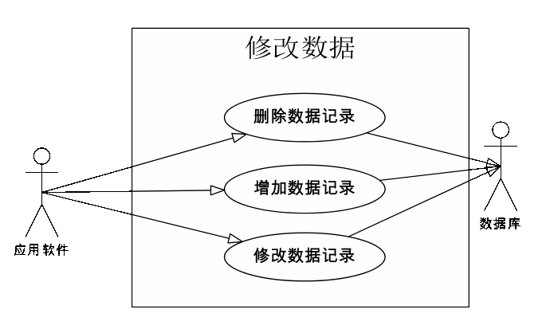
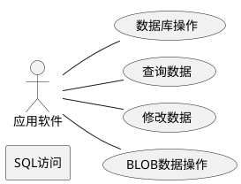
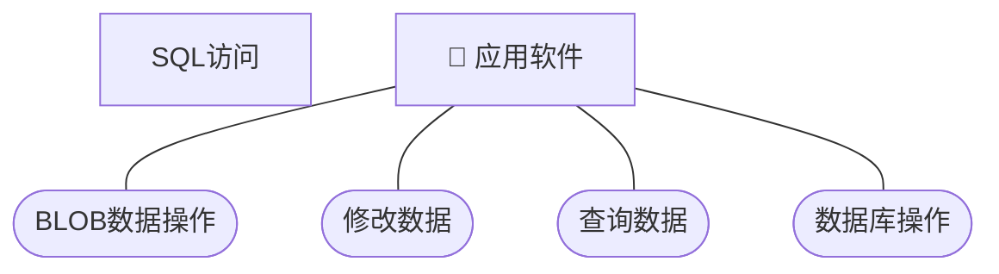
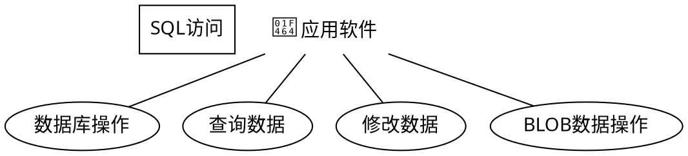

# 1_020 数据对档案

| 字段 | 值 |
|---|---|
| doc | 04数据统一访问服务软件需求规格说明-终稿 |
| section | 3.2.1 |
| image_caption | 图3 SQL访问用例图 |
| table_caption | 表3 SQL访问所有能力能力标识 |

## 原始图片

*图3 SQL访问用例图*

## 结构图

*⚠ 结构经census重对齐: 旧锚点(oleObject23.bin:page1.xml)与图片不符, 已切换到与image.png内容一致的锚点(oleObject3.bin:page1.xml, align_score=1.0)*

*来源: born-digital导出(usecase, 6节点/4边)*
*类型经几何启发式精化(Master类型识别失败的图, 投影层推断, canonical锚点不变)*

*用例图以PlantUML渲染(UML母语): 小人=参与者 | 椭圆=用例 | 矩形框=系统边界 | 实线=关联 | 虚线=include/extend*

Mermaid兼容投影(通用md渲染器可显示)

DOT源码(完整语义, graphviz可渲染)

### 锚点节点结构

| # | 文本 | 类型 |
|---|---|---|
| 1 | SQL访问 | process |
| 2 | 数据库操作 | usecase |
| 3 | 查询数据 | usecase |
| 4 | 修改数据 | usecase |
| 5 | BLOB数据操作 | usecase |
| 6 | 应用软件 | actor |

## 表格内容

| 序号 | Use case名称 | 项目唯一标识符 | 需求描述 | 需求重用 | 方式 名称 | 运行 状态 | 对应的任务书功能/性能 |
|---|---|---|---|---|---|---|---|
|   | 数据库操作 | PZXQ-GN-SQLFW-SJKCZ | 数据库操作功能包括数据库初始化、读取配置 | 沿用 | 平板、桌面、手持 | 运行阶段、开发阶段 | 4.1.1 |
|   | 修改数据 | PZXQ-GN-SQLFW-XGSJ | 修改数据功能包括删除数据记录、增加数据记 | 沿用 | 平板、桌面、手持 | 运行阶段、开发阶段 | 4.1.1 |
|   | 查询数据 | PZXQ-GN-SQLFW-CXSJ | 查询数据功能包括数据查询、获取错误信息、 | 沿用 | 平板、桌面、手持 | 运行阶段、开发阶段 | 4.1.1 |
|   | BLOB数据操作 | PZXQ-GN-SQLFW-BLOBSJ | BLOB数据操作功能包括BLOB数据插入 | 沿用 | 平板、桌面 | 运行阶段、开发阶段 | 4.1.1 |

## 正文

SQL访问功能包括：数据库操作、修改数据、查询数据、逐行获取数据、BLOB数据操作功能，此功能在桌面版、平板版、手持版提供并使用，其功能用例如图3所示。
