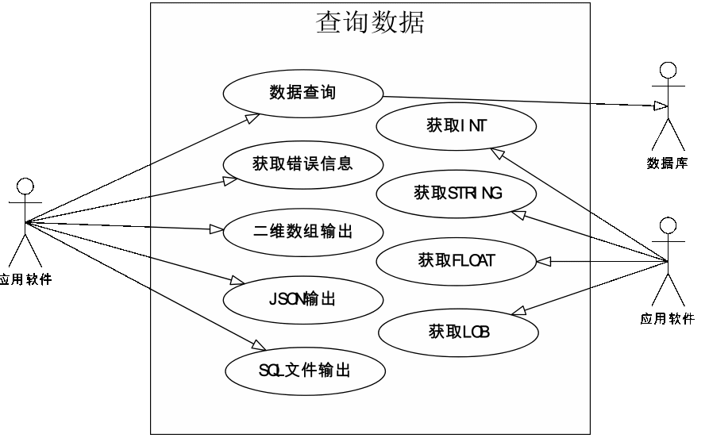
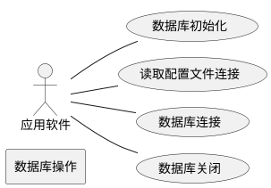
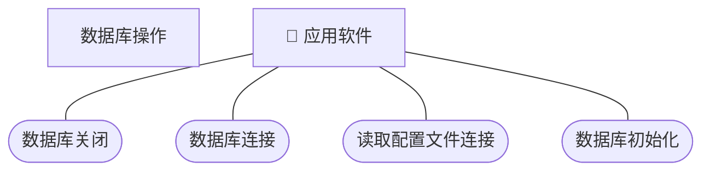

# 1_021 数据对档案

| 字段 | 值 |
|---|---|
| doc | 04数据统一访问服务软件需求规格说明-终稿 |
| section | 3.2.1.1 |
| image_caption | 图4 数据库操作用例图 |
| table_caption | 表4 数据库操作所有能力标识 |

## 原始图片

*图4 数据库操作用例图*

## 结构图

*来源: born-digital导出(usecase, 6节点/4边)*
*类型经几何启发式精化(Master类型识别失败的图, 投影层推断, canonical锚点不变)*

*用例图以PlantUML渲染(UML母语): 小人=参与者 | 椭圆=用例 | 矩形框=系统边界 | 实线=关联 | 虚线=include/extend*

Mermaid兼容投影(通用md渲染器可显示)

DOT源码(完整语义, graphviz可渲染)

### 锚点节点结构

| # | 文本 | 类型 |
|---|---|---|
| 1 | 数据库操作 | process |
| 2 | 数据库初始化 | usecase |
| 3 | 读取配置文件连接 | usecase |
| 4 | 数据库连接 | usecase |
| 5 | 数据库关闭 | usecase |
| 6 | 应用软件 | actor |

## 表格内容

| 序号 | Use case名称 | 项目唯一标识符 | 需求描述 | 需求重用 | 方式名称 | 运行状态 | 对应的任务书功能/性能 |
|---|---|---|---|---|---|---|---|
|   | 数据库初始化 | PZXQ-GN-SJKCZ-SJKCSH | 初始化数据库 | 沿用 | 平板、桌面、手持 | 运行阶段、开发阶段 | 4.1.1 |
|   | 读取配置文件连接 | PZXQ-GN-SJKCZ-DQPZWJ | 读取配置文件连接数据库 | 沿用 | 平板、桌面、手持 | 运行阶段、开发阶段 | 4.1.1 |
|   | 数据库连接 | PZXQ-GN-SJKCZ-SJKLJ | 连接数据库 | 沿用 | 平板、桌面、手持 | 运行阶段、开发阶段 | 4.1.1 |
|   | 数据库关闭 | PZXQ-GN-SJKCZ-SJKGBG | 关闭数据库 | 沿用 | 平板、桌面、手持 | 运行阶段、开发阶段 | 4.1.1 |

## 正文

数据库操作功能包括：数据库初始化、读取配置文件连接、数据库连接、数据库关闭功能，其用例图如图4所示：
