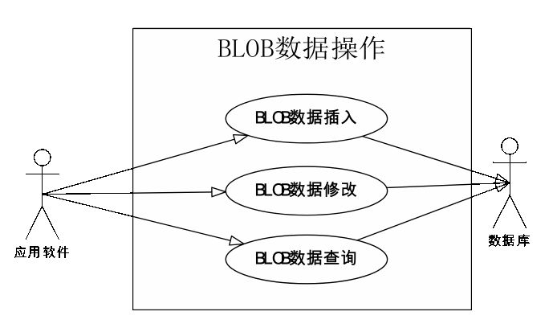
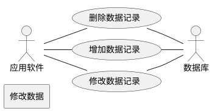
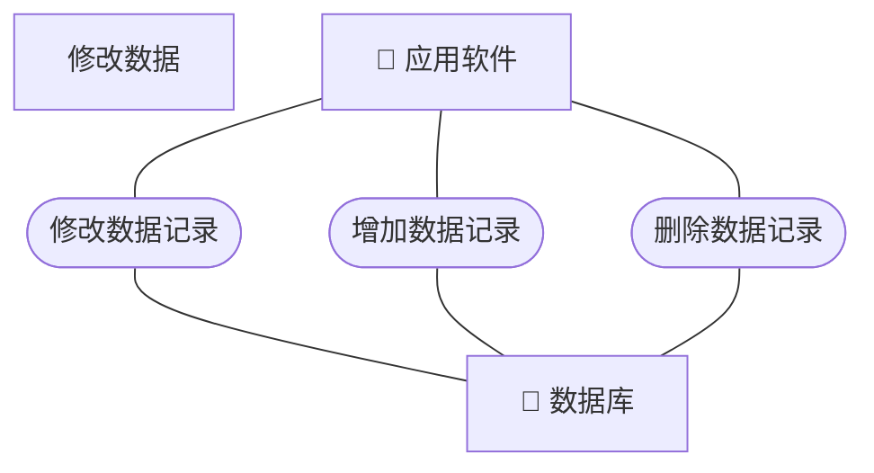
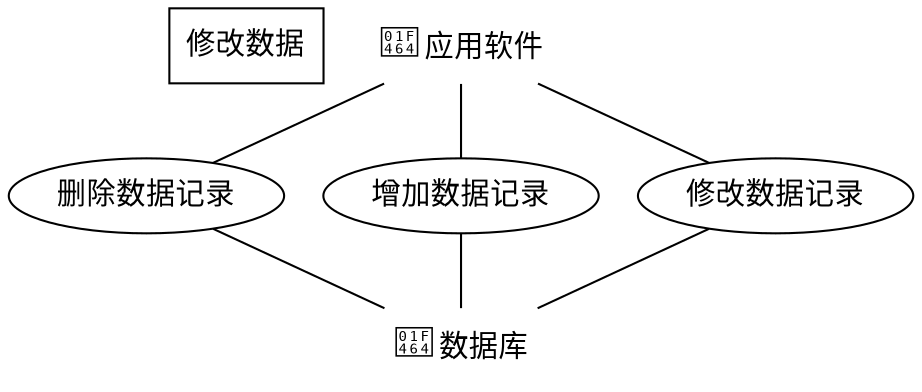

# 1_022 数据对档案

| 字段 | 值 |
|---|---|
| doc | 04数据统一访问服务软件需求规格说明-终稿 |
| section | 3.2.1.2 |
| image_caption | 图9 修改数据用例图 |
| table_caption | 表9修改数据所有能力标识 |

## 原始图片

*图9 修改数据用例图*

## 结构图

*来源: born-digital导出(usecase, 6节点/6边)*
*类型经几何启发式精化(Master类型识别失败的图, 投影层推断, canonical锚点不变)*

*用例图以PlantUML渲染(UML母语): 小人=参与者 | 椭圆=用例 | 矩形框=系统边界 | 实线=关联 | 虚线=include/extend*

Mermaid兼容投影(通用md渲染器可显示)

DOT源码(完整语义, graphviz可渲染)

### 锚点节点结构

| # | 文本 | 类型 |
|---|---|---|
| 1 | 修改数据 | process |
| 2 | 删除数据记录 | usecase |
| 3 | 增加数据记录 | usecase |
| 4 | 修改数据记录 | usecase |
| 5 | 应用软件 | actor |
| 6 | 数据库 | actor |

## 表格内容

| 序号 | Use case名称 | 项目唯一标识符 | 需求描述 | 需求重用 | 方式名称 | 运行状态 | 对应的任务书功能/性能 |
|---|---|---|---|---|---|---|---|
|   | 删除数据记录 | PZXQ-GN-SQLFW-SJXG | 支持删除数据记录 | 沿用 | 桌面、平版、手持 | 开发阶段、 运行阶段 | 4.1.1 |
|   | 增加数据记录 | PZXQ-GN-SQLFW-ZXSW | 支持增加数据记录 | 沿用 | 桌面、平版、手持 | 开发阶段、 运行阶段 | 4.1.1 |
|   | 修改数据记录 | PZXQ-GN-SQLFW-TJSW | 支持修改数据记录 | 沿用 | 桌面、平版、手持 | 开发阶段、 运行阶段 | 4.1.1 |

## 正文

修改数据功能包括：删除数据记录、增加数据记录、修改数据记录功能，其用例图如图9所示：
