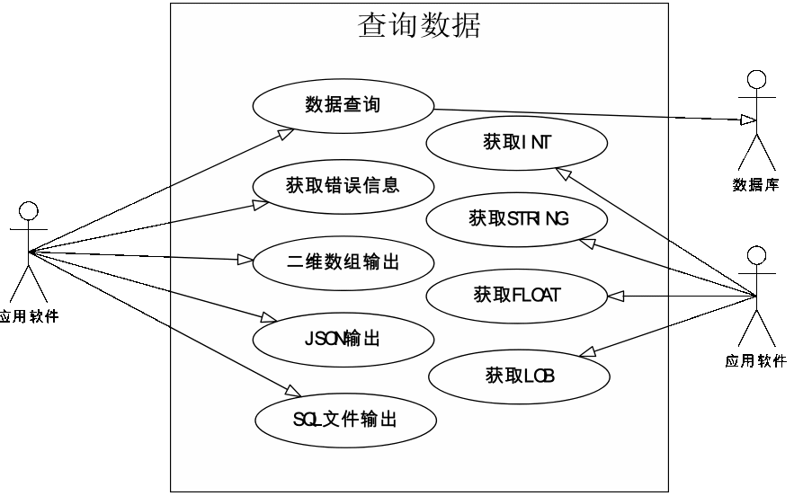
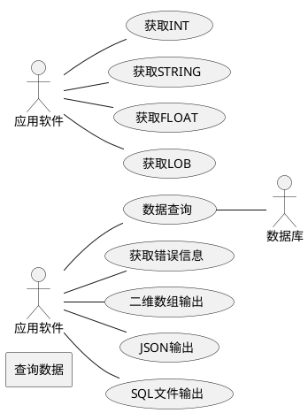
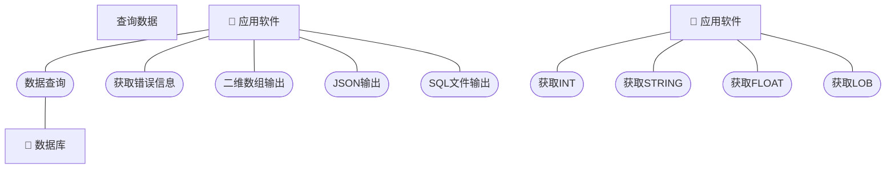
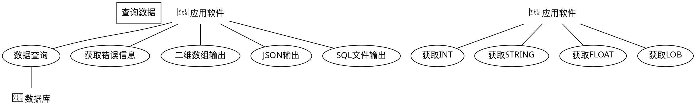

# 1_023 数据对档案

| 字段 | 值 |
|---|---|
| doc | 04数据统一访问服务软件需求规格说明-终稿 |
| section | 3.2.1.3 |
| image_caption | 图13 查询数据用例图 |
| table_caption | 表13 查询数据所有能力标识 |

## 原始图片

*图13 查询数据用例图*

## 结构图

*来源: born-digital导出(usecase, 13节点/10边)*
*类型经几何启发式精化(Master类型识别失败的图, 投影层推断, canonical锚点不变)*

*用例图以PlantUML渲染(UML母语): 小人=参与者 | 椭圆=用例 | 矩形框=系统边界 | 实线=关联 | 虚线=include/extend*

Mermaid兼容投影(通用md渲染器可显示)

DOT源码(完整语义, graphviz可渲染)

### 锚点节点结构

| # | 文本 | 类型 |
|---|---|---|
| 1 | 查询数据 | process |
| 2 | 数据查询 | usecase |
| 3 | 获取错误信息 | usecase |
| 4 | 二维数组输出 | usecase |
| 5 | JSON输出 | usecase |
| 6 | 应用软件 | actor |
| 7 | SQL文件输出 | usecase |
| 8 | 获取INT | usecase |
| 9 | 获取STRING | usecase |
| 10 | 获取FLOAT | usecase |
| 11 | 应用软件 | actor |
| 12 | 获取LOB | usecase |
| 13 | 数据库 | actor |

## 表格内容

| 序号 | Use case名称 | 项目唯一标识符 | 需求描述 | 需求重用 | 方式名称 | 运行状态 | 对应的任务书功能/性能 |
|---|---|---|---|---|---|---|---|
|   | 数据查询 | PZXQ-GN-SQLFW-CXSJ-S | 查询数据 | 沿用 | 桌面、平版、手持 | 开发阶段、运行阶段 | 4.1.1 |
|   | 获取错误信息 | PZXQ-GN-SQLFW- CXSJ- | 支持获取数据库操作中的错误信息 | 沿用 | 桌面、平版、手持 | 开发阶段、运行阶段 | 4.1.1 |
|   | 二维数组输出 | PZXQ-GN-SQLFW- CXSJ- | 将查询结果以二维数组形式输出 | 沿用 | 桌面、平版、手持 | 开发阶段、运行阶段 | 4.1.1 |
|   | JSON输出 | PZXQ-GN-SQLFW- CXSJ- | 将查询结果以JSON形式输出 | 沿用 | 桌面、平版、手持 | 开发阶段、运行阶段 | 4.1.1 |
|   | SQL文件输出 | PZXQ-GN-SQLFW-CXSJ-D | 将查询结果以sql文件形式输出 | 沿用 | 桌面、平版 | 开发阶段、运行阶段 | 4.1.1 |
|   | 获取INT | PZXQ-GN-SQLFW-CXSJ-H | 逐行获取INT值 | 沿用 | 桌面、平版、手持 | 开发阶段、运行阶段 | 4.1.1 |
|   | 获取STRING | PZXQ-GN-SQLFW-CXSJ-H | 逐行获取STRING值 | 沿用 | 桌面、平版、手持 | 开发阶段、运行阶段 | 4.1.1 |
|   | 获取FLOAT | PZXQ-GN-SQLFW-CXSJ-H | 逐行获取FLOAT值 | 沿用 | 桌面、平版、手持 | 开发阶段、运行阶段 | 4.1.1 |
|   | 获取LOB | PZXQ-GN-SQLFW-CXSJ-H | 逐行获取LOB值 | 沿用 | 桌面、平版、手持 | 开发阶段、运行阶段 | 4.1.1 |

## 正文

查询数据功能包括：数据查询、获取错误信息、二维数据输出、JSON输出、SQL文件输出、逐行获取INT、逐行获取STRING、逐行获取FLOAT、逐行获取LOB功能，其用例图如图13所示：
