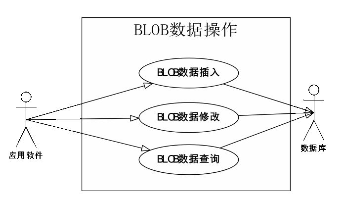
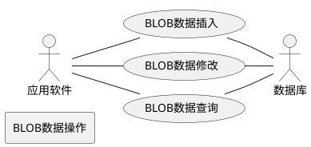
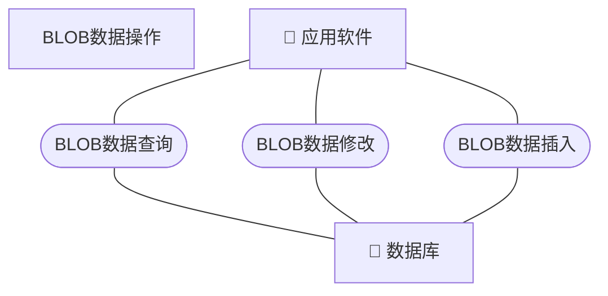
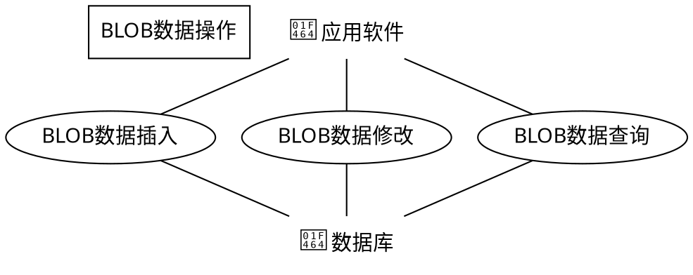

# 1_024 数据对档案

| 字段 | 值 |
|---|---|
| doc | 04数据统一访问服务软件需求规格说明-终稿 |
| section | 3.2.1.4 |
| image_caption | 图23 BLOB数据操作用例图 |
| table_caption | 表23 BLOB数据操作所有能力标识 |

## 原始图片

*图23 BLOB数据操作用例图*

## 结构图

*⚠ 结构经census重对齐: 旧锚点(oleObject3.bin:page1.xml)与图片不符, 已切换到与image.png内容一致的锚点(oleObject23.bin:page1.xml, align_score=1.0)*

*来源: born-digital导出(usecase, 6节点/6边)*
*类型经几何启发式精化(Master类型识别失败的图, 投影层推断, canonical锚点不变)*

*用例图以PlantUML渲染(UML母语): 小人=参与者 | 椭圆=用例 | 矩形框=系统边界 | 实线=关联 | 虚线=include/extend*

Mermaid兼容投影(通用md渲染器可显示)

DOT源码(完整语义, graphviz可渲染)

### 锚点节点结构

| # | 文本 | 类型 |
|---|---|---|
| 1 | BLOB数据操作 | process |
| 2 | BLOB数据插入 | usecase |
| 3 | BLOB数据修改 | usecase |
| 4 | BLOB数据查询 | usecase |
| 5 | 应用软件 | actor |
| 6 | 数据库 | actor |

## 表格内容

| 序号 | Use case名称 | 项目唯一标识符 | 需求描述 | 需求重用 | 方式名称 | 运行状态 | 对应的任务书功能/性能 |
|---|---|---|---|---|---|---|---|
|   | Blob数据修改 | PZXQ-GN-SQLFW-BLOBSJ | 支持对BLOB数据的修改 | 沿用 | 桌面、平板 | 开发阶段、运行阶段 | 4.1.1 |
|   | Blob数据查询 | PZXQ-GN-SQLFW-BLOBSJ | 支持对BLOB数据的查询 | 沿用 | 桌面、平板 | 开发阶段、运行阶段 | 4.1.1 |
|   | BLOB数据插入 | PZXQ-GN-SQLFW-BLOBSJ | 支持对BLOB数据的插入 | 沿用 | 桌面、平板 | 开发阶段、运行阶段 | 4.1.1 |

## 正文

BLOB数据操作功能包括：BLOB数据插入、BLOB删除数据记录、BLOB数据查询功能，其用例图如图23所示：
