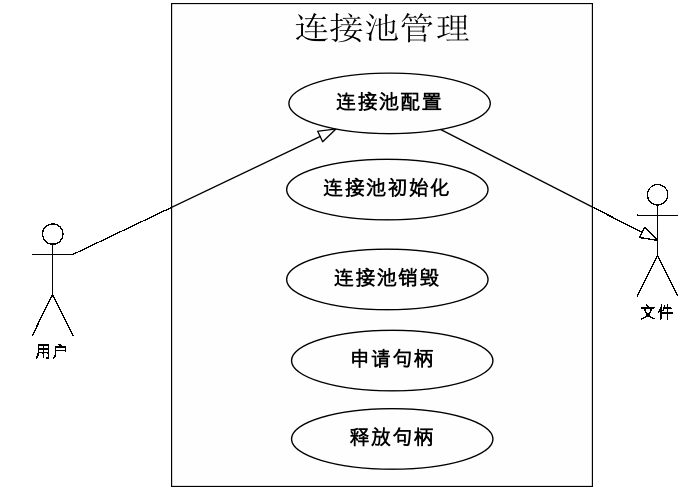

# 1_025 数据对档案

| 字段 | 值 |
|---|---|
| doc | 04数据统一访问服务软件需求规格说明-终稿 |
| section | 3.2.2 |
| image_caption | 图27 对象化访问用例图 |
| table_caption | 表27 对象化访问所有能力能力标识 |

## 原始图片

*图27 对象化访问用例图*

## 结构图

*该对无Visio锚点(非Visio图, 无born-digital导出)*

## 表格内容

| 序号 | Use case名称 | 项目唯一标识符 | 需求描述 | 需求重用 | 方式名称 | 运行状态 | 对应的任务书功能/性能 |
|---|---|---|---|---|---|---|---|
| 1 | 数据插入 | PZXQ-GN-DXHFW-SJCR | 通过对象化访问进行数据插入 | 沿用 | 桌面、平板、手持 | 开发阶段、运行阶段 | 4.1.1 |
| 2 | 数据查询 | PZXQ-GN-DXHFW-SJCX | 通过对象化访问进行数据查询 | 沿用 | 桌面、平板、手持 | 开发阶段、运行阶段 | 4.1.1 |
| 3 | 数据删除 | PZXQ-GN-DXHFW-SJSC | 通过对象化访问进行数据删除 | 沿用 | 桌面、平板、手持 | 开发阶段、运行阶段 | 4.1.1 |
| 4 | 数据更新 | PZXQ-GN-DXHFW-SJGX | 通过对象化访问进行数据更新 | 沿用 | 桌面、平板、手持 | 开发阶段、运行阶段 | 4.1.1 |

## 正文

借助对象关系映射的方式实现对数据库操作，用户直接引用头文件创建数据模型对象，此对象与数据库中的字段一一对应，通过操作对象的方式来操作数据库，无需通过SQL语句操作。对象化访问功能包括：数据插入、数据更新、数据查询、数据删除，其功能用例如图27所示。
