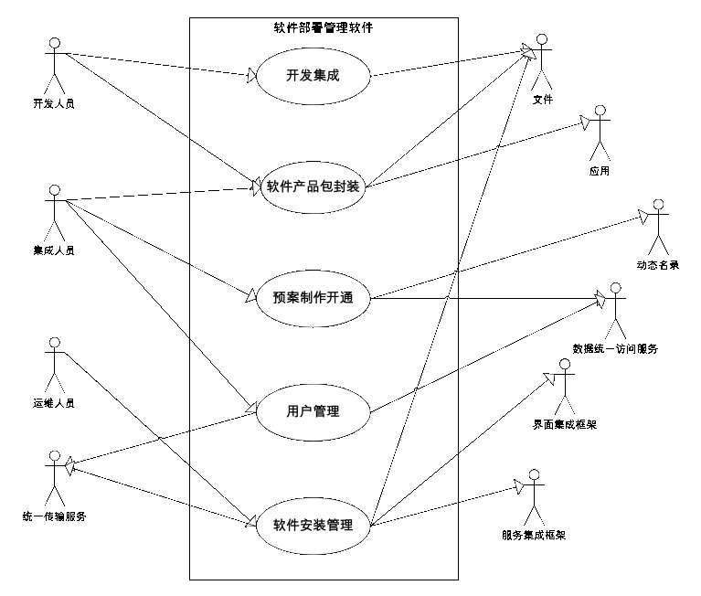

# 1_026 数据对档案

| 字段 | 值 |
|---|---|
| doc | 04数据统一访问服务软件需求规格说明-终稿 |
| section | 3.2.3 |
| image_caption | 图32 热点数据缓存用例图 |
| table_caption | 表32 热点数据缓存所有能力能力标识 |

## 原始图片

*图32 热点数据缓存用例图*

## 结构图

*该对无Visio锚点(非Visio图, 无born-digital导出)*

## 表格内容

| 序号 | Use case名称 | 项目唯一标识符 | 需求描述 | 需求重用 | 方式名称 | 运行状态 | 对应的任务书功能/性能 |
|---|---|---|---|---|---|---|---|
| 1 | 缓存添加 | PZXQ-GN-RDSJHC-HCTJ | 支持将新的查询结果添加到缓存 | 新研 | 桌面 | 运行阶段 | 4.1.2 |
| 2 | 缓存更新 | PZXQ-GN-RDSJHC-HCGX | 支持更新缓存信息 | 新研 | 桌面 | 运行阶段 | 4.1.2 |
| 3 | 缓存查询 | PZXQ-GN-RDSJHC-HCCX | 支持将缓存列表中查询缓存信息 | 新研 | 桌面 | 运行阶段 | 4.1.2 |

## 正文

热点数据缓存包括缓存添加功能、缓存修改功能、缓存查询功能，其功能用例如图32所示。
