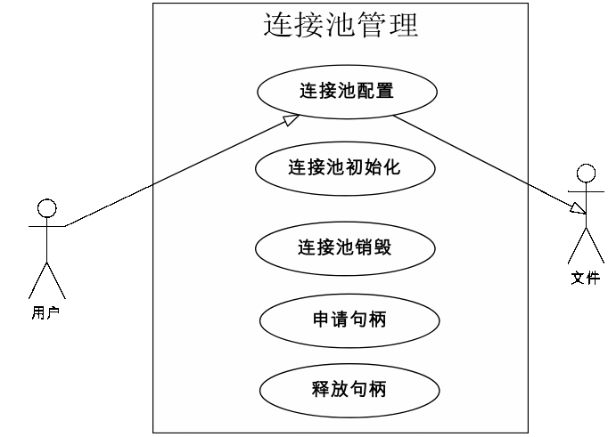
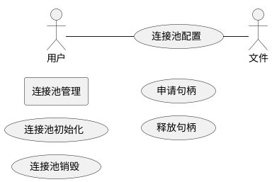
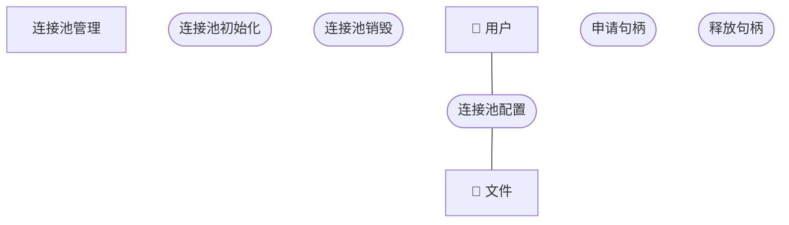
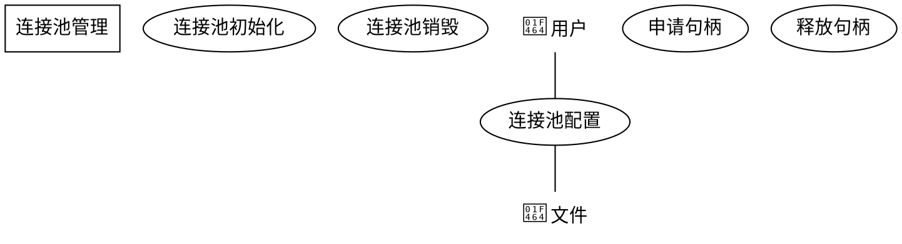

# 1_027 数据对档案

| 字段 | 值 |
|---|---|
| doc | 04数据统一访问服务软件需求规格说明-终稿 |
| section | 3.2.5 |
| image_caption | 图38 连接池管理用例图 |
| table_caption | 表39 连接池管理所有能力能力标识 |

## 原始图片

*图38 连接池管理用例图*

## 结构图

*来源: born-digital导出(usecase, 8节点/2边)*
*类型经几何启发式精化(Master类型识别失败的图, 投影层推断, canonical锚点不变)*

*用例图以PlantUML渲染(UML母语): 小人=参与者 | 椭圆=用例 | 矩形框=系统边界 | 实线=关联 | 虚线=include/extend*

Mermaid兼容投影(通用md渲染器可显示)

DOT源码(完整语义, graphviz可渲染)

### 锚点节点结构

| # | 文本 | 类型 |
|---|---|---|
| 1 | 连接池管理 | process |
| 2 | 连接池初始化 | usecase |
| 3 | 连接池销毁 | usecase |
| 4 | 用户 | actor |
| 5 | 连接池配置 | usecase |
| 6 | 申请句柄 | usecase |
| 7 | 释放句柄 | usecase |
| 8 | 文件 | actor |

## 表格内容

| 序号 | Use case名称 | 项目唯一标识符 | 需求描述 | 需求重用 | 方式名称 | 运行状态 | 对应的任务书功能/性能 |
|---|---|---|---|---|---|---|---|
| 1 | 连接池配置 | PZXQ-GN-LJCGL-LJCPZ | 支持配置连接池 | 新研 | 桌面 | 运行阶段 | 4.1.2 |
| 2 | 连接池初始化 | PZXQ-GN-LJCGL-LJCCSH | 提供初始化连接池的能力 | 新研 | 桌面 | 运行阶段 | 4.1.2 |
| 3 | 连接池销毁 | PZXQ-GN-LJCGL-LJCXH | 支持销毁连接池并释放资源 | 新研 | 桌面 | 运行阶段 | 4.1.2 |
| 4 | 申请句柄 | PZXQ-GN-LJCGL-LJCJB | 提供申请连接句柄的能力 | 新研 | 桌面 | 运行阶段 | 4.1.2 |
| 5 | 释放句柄 | PZXQ-GN-LJCGL-SFJB | 提供释放连接句柄的能力 | 新研 | 桌面 | 运行阶段 | 4.1.2 |

## 正文

连接池管理包括连接池配置功能、连接池初始化功能、连接池销毁功能、申请句柄功能、释放句柄功能，其功能用例如图38所示。
