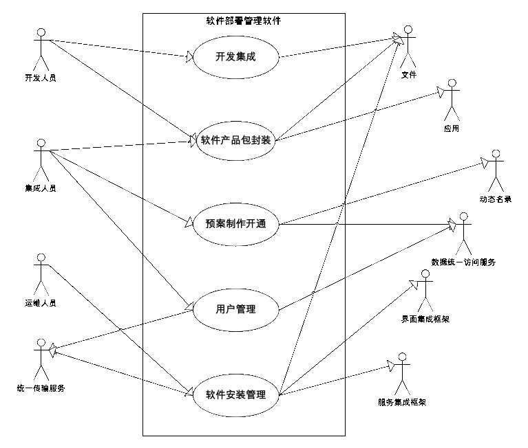
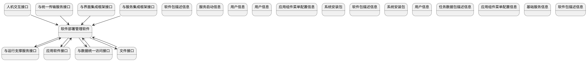
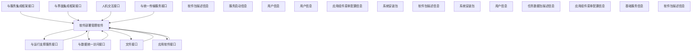
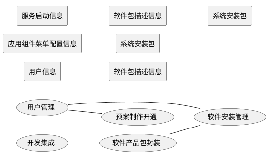
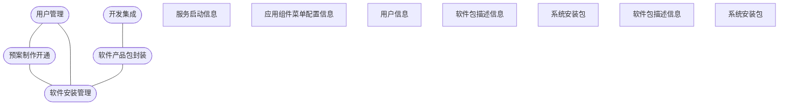
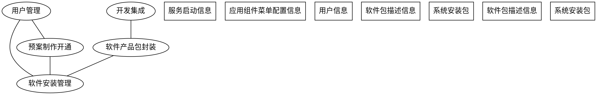
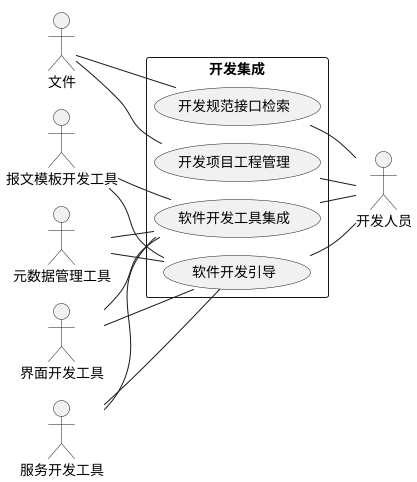
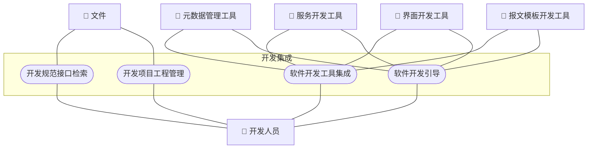
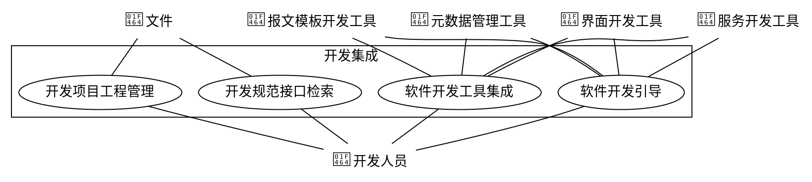

# 1_028 数据对档案

| 字段 | 值 |
|---|---|
| doc | 05软件部署管理软件需求规格说明-终稿 |
| section | 3.2 |
| image_caption | 图4 软件部署管理软件用例图 |
| table_caption | 表2 软件部署管理软件所有能力标识 |

## 原始图片

*图4 软件部署管理软件用例图*

## 结构图

*该图为复合图: image.png由3个Visio结构组成(贪心集覆盖并集召回81%, VLM文本匹配判定)*

### 组成部分 1/3 (oleObject22.bin:page1.xml)

*来源: born-digital导出(flowchart, 22节点/12边)*
*类型经几何启发式精化(Master类型识别失败的图, 投影层推断, canonical锚点不变)*

*状态图以PlantUML渲染(UML母语): [*]=起止 | 圆角框=状态 | 箭头标签=迁移事件*

Mermaid兼容投影(通用md渲染器可显示)

DOT源码(完整语义, graphviz可渲染)

```dot
digraph G {
  rankdir=TB;
  node [fontname="Microsoft YaHei"];
  N146 [shape=box, label="软件部署管理软件"];
  N147 [shape=box, label="人机交互接口"];
  N148 [shape=box, label="与运行支撑服务接口"];
  N149 [shape=box, label="与统一传输服务接口"];
  N150 [shape=box, label="与界面集成框架接口"];
  N151 [shape=box, label="与服务集成框架接口"];
  N152 [shape=box, label="应用软件接口"];
  N153 [shape=box, label="与数据统一访问接口"];
  N154 [shape=box, label="文件接口"];
  N171 [shape=box, label="软件包描述信息"];
  N172 [shape=box, label="服务启动信息"];
  N173 [shape=box, label="用户信息"];
  N174 [shape=box, label="用户信息"];
  N175 [shape=box, label="应用组件菜单配置信息"];
  N176 [shape=box, label="系统安装包"];
  N177 [shape=box, label="软件包描述信息"];
  N178 [shape=box, label="系统安装包"];
  N179 [shape=box, label="用户信息"];
  N180 [shape=box, label="任务数据包描述信息"];
  N181 [shape=box, label="应用组件菜单配置信息"];
  N182 [shape=box, label="基础服务信息"];
  N183 [shape=box, label="软件包描述信息"];
  N146 -> N148;
  N146 -> N153;
  N146 -> N154;
  N146 -> N152;
  N151 -> N146;
  N148 -> N146;
  N150 -> N146;
  N153 -> N146;
  N147 -> N146;
  N152 -> N146;
  N149 -> N146;
  N154 -> N146;
}
```

### 组成部分 2/3 (oleObject23.bin:page1.xml)

*来源: born-digital导出(usecase, 12节点/5边)*
*类型经几何启发式精化(Master类型识别失败的图, 投影层推断, canonical锚点不变)*

*用例图以PlantUML渲染(UML母语): 小人=参与者 | 椭圆=用例 | 矩形框=系统边界 | 实线=关联 | 虚线=include/extend*

Mermaid兼容投影(通用md渲染器可显示)

DOT源码(完整语义, graphviz可渲染)

### 组成部分 3/3 (oleObject6.bin:page1.xml)

*来源: born-digital导出(usecase, 11节点/14边)*
*类型经几何启发式精化(Master类型识别失败的图, 投影层推断, canonical锚点不变)*

*用例图以PlantUML渲染(UML母语): 小人=参与者 | 椭圆=用例 | 矩形框=系统边界 | 实线=关联 | 虚线=include/extend*

Mermaid兼容投影(通用md渲染器可显示)

DOT源码(完整语义, graphviz可渲染)

### 锚点节点结构

| # | 文本 | 类型 |
|---|---|---|
| 1 | 软件部署管理软件 | process |
| 2 | 人机交互接口 | process |
| 3 | 与运行支撑服务接口 | process |
| 4 | 与统一传输服务接口 | process |
| 5 | 与界面集成框架接口 | process |
| 6 | 与服务集成框架接口 | process |
| 7 | 应用软件接口 | process |
| 8 | 与数据统一访问接口 | process |
| 9 | 文件接口 | process |
| 10 | 软件包描述信息 | other |
| 11 | 服务启动信息 | other |
| 12 | 用户信息 | other |
| 13 | 用户信息 | other |
| 14 | 应用组件菜单配置信息 | other |
| 15 | 系统安装包 | other |
| … | 共22个节点 | |

## 表格内容

| 序号 | Use case名称 | 项目唯一标识符 | 需求描述 | 需求重用 | 方式名称 | 运行状态 | 对应的任务书功能/性能 |
|---|---|---|---|---|---|---|---|
|   | 开发集成 | PZXQ-GN-RJBSGL-KFJC | a)提供软件开发项目工程的创建、编辑、封 | 新研 | 桌面 | 开发阶段 | 4.1.1 |
|   | 软件产品包封装 | PZXQ-GN-RJBSGL-RJFZ | a)提供软件包工程的新建、打开功能，支持 | 改进 | 桌面 | 开发阶段、集成阶段 | 4.1.2 |
|   | 预案制作开通 | PZXQ-GN--RJBSGL-YAZZ | a)提供任务数据包可视化管理功能，支持任 | 改进 | 桌面、平板、手持 | 集成阶段、运行阶段 | 4.1.3 |
|   | 用户管理 | PZXQ-GN--RJBSGL-YHGL | a)提供用户基本信息（用户ID、用户密码 | 改进 | 桌面、平板、手持 | 集成阶段、运行阶段 | 4.1.4 |
| f)提供用户功能菜单的编辑、导入、导出维 |
|   | 软件安装管理 | PZXQ-GN-RJBSGL-RJAZG | a)提供软件、数据发布管理功能，能够进行 | 改进 | 桌面、平板、手持 | 运行阶段 | 4.1.5 |

## 正文

软件部署管理软件按照其功能需求，包含开发集成、软件产品包封装、预案制作开通、用户管理、软件安装管理功能。
