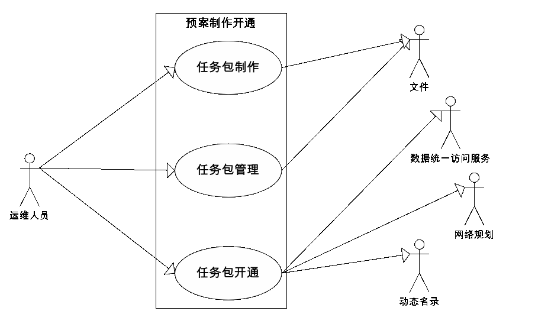
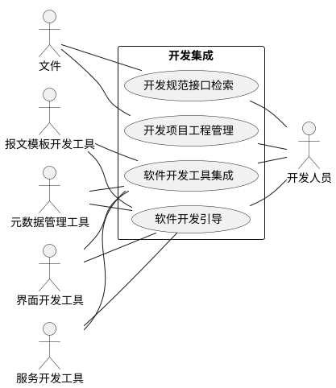
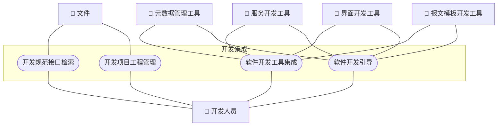
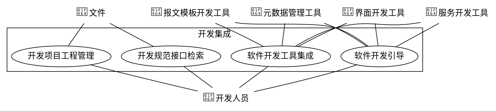

# 1_029 数据对档案

| 字段 | 值 |
|---|---|
| doc | 05软件部署管理软件需求规格说明-终稿 |
| section | 3.2.1 |
| image_caption | 图6 开发集成用例图 |
| table_caption | 表3 开发集成所有能力能力标识 |

## 原始图片

*图6 开发集成用例图*

## 结构图

*来源: born-digital导出(usecase, 11节点/14边)*
*类型经几何启发式精化(Master类型识别失败的图, 投影层推断, canonical锚点不变)*

*用例图以PlantUML渲染(UML母语): 小人=参与者 | 椭圆=用例 | 矩形框=系统边界 | 实线=关联 | 虚线=include/extend*

Mermaid兼容投影(通用md渲染器可显示)

DOT源码(完整语义, graphviz可渲染)

### 锚点节点结构

| # | 文本 | 类型 |
|---|---|---|
| 1 | 开发人员 | actor |
| 2 | 文件 | actor |
| 3 | 开发集成 | boundary |
| 4 | 开发规范接口检索 | usecase |
| 5 | 软件开发引导 | usecase |
| 6 | 软件开发工具集成 | usecase |
| 7 | 开发项目工程管理 | usecase |
| 8 | 界面开发工具 | actor |
| 9 | 服务开发工具 | actor |
| 10 | 报文模板开发工具 | actor |
| 11 | 元数据管理工具 | actor |

## 表格内容

| 序号 | Use case名称 | 项目唯一标识符 | 需求描述 | 需求重用 | 方式名称 | 运行状态 | 对应的任务书功能/性能 |
|---|---|---|---|---|---|---|---|
|   | 开发项目工程管理 | PZXQ-GN-RJBSGL-KFJC- | 提供软件开发项目工程的创建、编辑、封装、 | 无 | 桌面 | 开发阶段 | 4.1.1 a) |
|   | 软件开发工具集成 | PZXQ-GN-RJBSGL-KFJC- | 提供软件开发工具的集成功能，支持界面开发 | 无 | 桌面 | 开发阶段 | 4.1.1 b) |
|   | 软件开发引导 | PZXQ-GN-RJBSGL-KFJC- | 提供软件开发引导功能，能够引导用户进行界 | 无 | 桌面 | 开发阶段 | 4.1.1 c) |
|   | 开发规范接口检索 | PZXQ-GN-RJBSGL-KFJC- | 提供软件开发规范和接口的查看和检索功能， | 无 | 桌面 | 开发阶段 | 4.1.1 d) |

## 正文

b）用户可对已创建或者已打开的项目工程，如果选择前端界面开发，则调用VScode并将前端资源路径传入，进行前端代码的编辑、调试、打包；如果选择后端服务开发，则调用服务开发工具，生成服务及其插件，调用Qt5.9.6进行服务代码的编辑、编译和调试；如果选择模板开发，调用模板开发工具，进行模板的编辑、生成；如果选择数据开发，调用元数据管理工具进行数据库表的编辑、生成数据组件；
