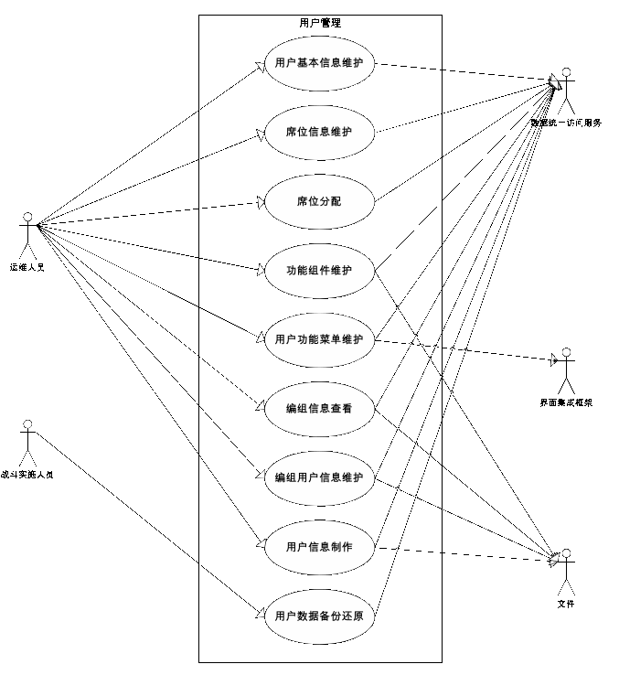
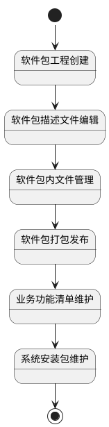
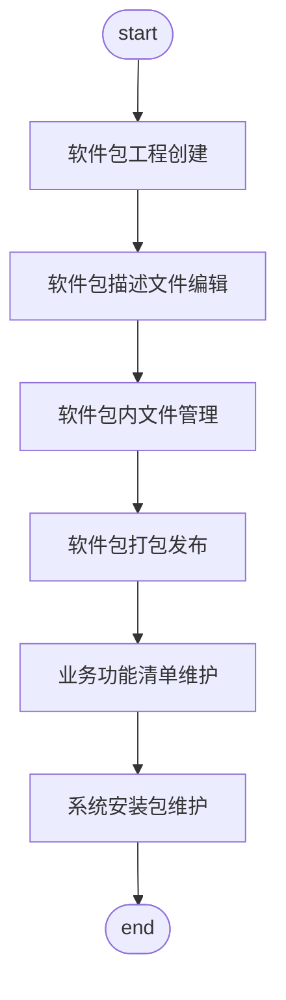
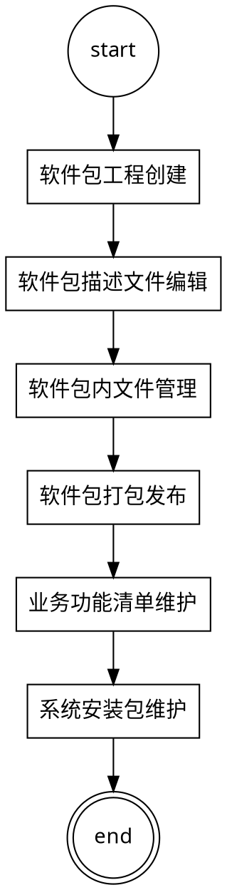
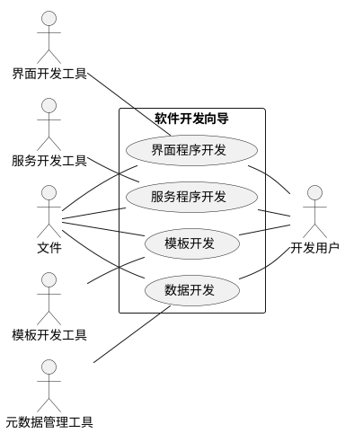
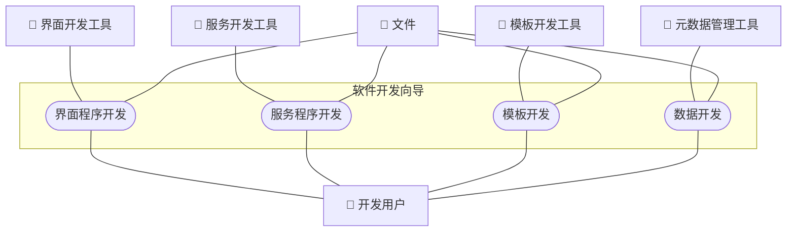
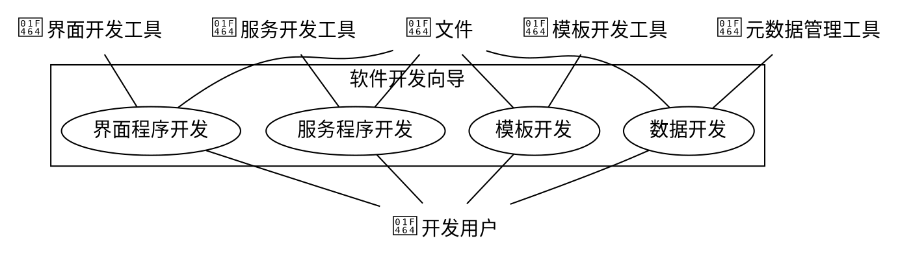
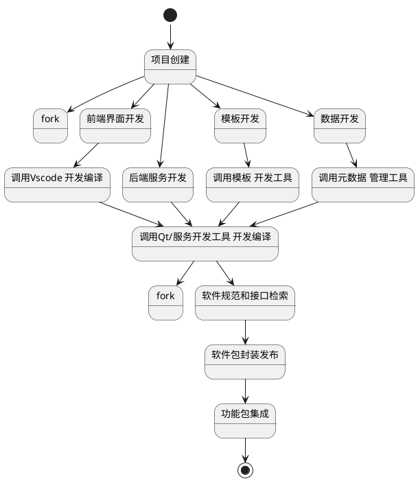
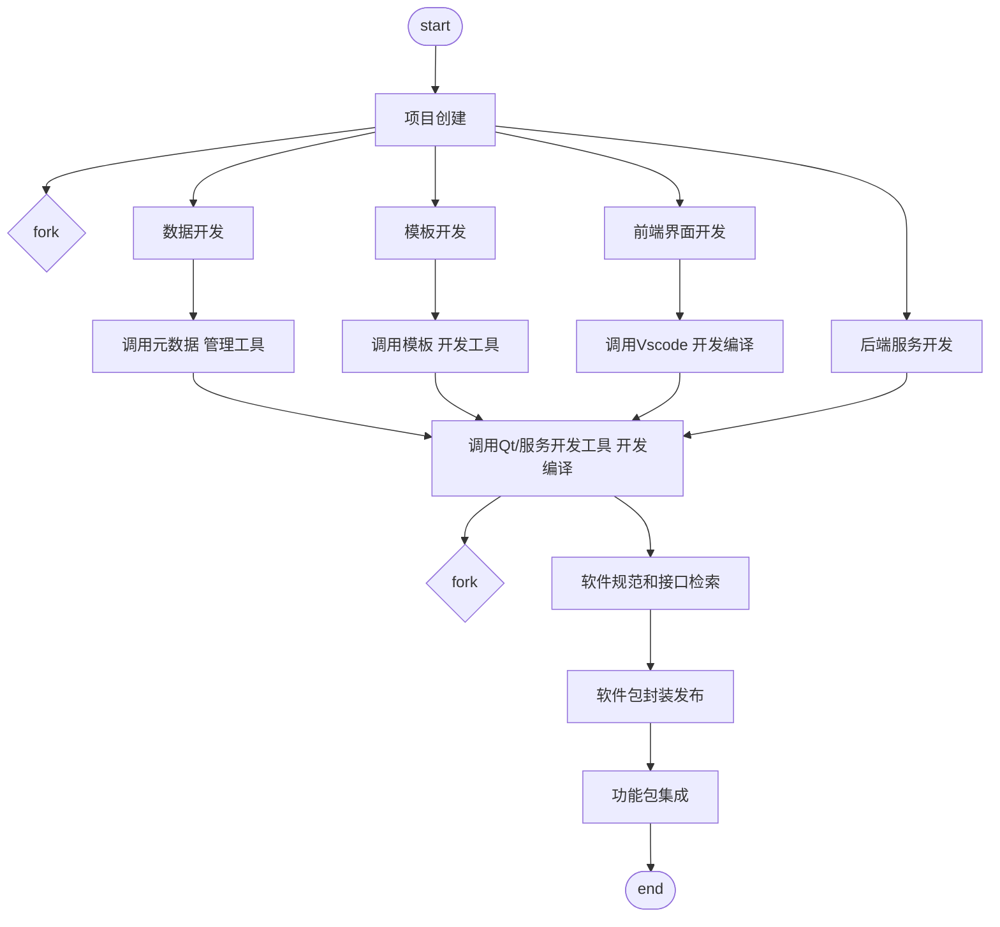
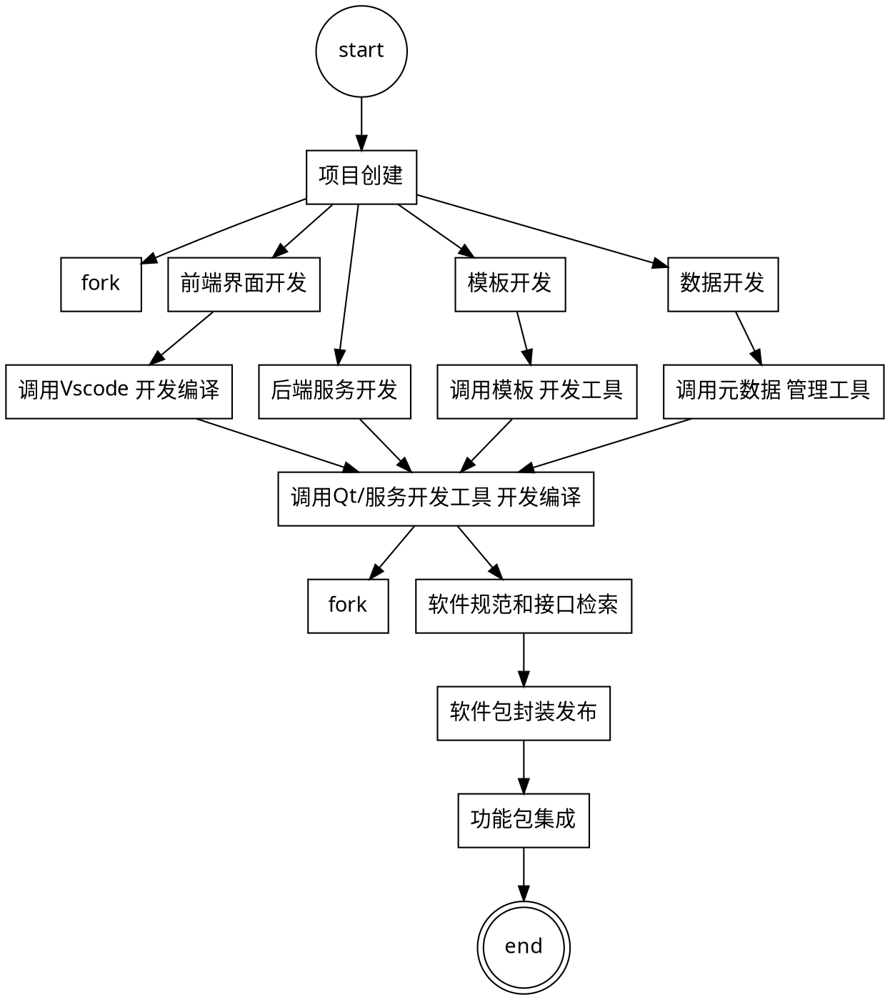

# 1_030 数据对档案

| 字段 | 值 |
|---|---|
| doc | 05软件部署管理软件需求规格说明-终稿 |
| section | 3.2.2 |
| image_caption | 图12 软件产品包封装用例图 |
| table_caption | 表17 软件产品包封装所有能力能力标识 |

## 原始图片

*图12 软件产品包封装用例图*

## 结构图

*该图为复合图: image.png由3个Visio结构组成(贪心集覆盖并集召回91%, VLM文本匹配判定)*

### 组成部分 1/3 (oleObject13.bin:page1.xml)

*来源: born-digital导出(flowchart, 6节点/7边)*
*类型经几何启发式精化(Master类型识别失败的图, 投影层推断, canonical锚点不变)*

*状态图以PlantUML渲染(UML母语): [*]=起止 | 圆角框=状态 | 箭头标签=迁移事件*

Mermaid兼容投影(通用md渲染器可显示)

DOT源码(完整语义, graphviz可渲染)

### 组成部分 2/3 (oleObject10.bin:page1.xml)

*来源: born-digital导出(usecase, 11节点/12边)*
*类型经几何启发式精化(Master类型识别失败的图, 投影层推断, canonical锚点不变)*

*用例图以PlantUML渲染(UML母语): 小人=参与者 | 椭圆=用例 | 矩形框=系统边界 | 实线=关联 | 虚线=include/extend*

Mermaid兼容投影(通用md渲染器可显示)

DOT源码(完整语义, graphviz可渲染)

### 组成部分 3/3 (oleObject7.bin:page1.xml)

*来源: born-digital导出(flowchart, 12节点/18边)*
*类型经几何启发式精化(Master类型识别失败的图, 投影层推断, canonical锚点不变)*

*状态图以PlantUML渲染(UML母语): [*]=起止 | 圆角框=状态 | 箭头标签=迁移事件*

Mermaid兼容投影(通用md渲染器可显示)

DOT源码(完整语义, graphviz可渲染)

### 锚点节点结构

| # | 文本 | 类型 |
|---|---|---|
| 1 |   | start |
| 2 | 软件包工程创建 | process |
| 3 |   | end |
| 4 | 软件包描述文件编辑 | process |
| 5 | 软件包打包发布 | process |
| 6 | 软件包内文件管理 | process |
| 7 | 业务功能清单维护 | process |
| 8 | 系统安装包维护 | process |

## 表格内容

| 序号 | Use case名称 | 项目唯一标识符 | 需求描述 | 需求重用 | 方式名称 | 运行状态 | 对应的任务书功能/性能 |
|---|---|---|---|---|---|---|---|
|   | 软件包工程管理 | PZXQ-GN-RJBSGL-RJFZ- | 提供软件包工程的新建、打开功能，支持软件 | 改进 | 桌面 | 开发阶段 | 4.1.2 a） |
|   | 描述文件编辑 | PZXQ-GN-RJBSGL-RJFZ- | 提供软件包描述文件的编辑和更新功能，能够 | 改进 | 桌面 | 开发阶段 | 4.1.2 b） |
|   | 文件目录管理 | PZXQ-GN-RJBSGL-RJFZ- | 提供对软件包目录结构和源文件的编辑和更新 | 改进 | 桌面 | 开发阶段 | 4.1.2 c） |
|   | 软件包打包发布 | PZXQ-GN-RJBSGL-RJFZ- | 提供软件包打包功能，能够对包内的文件夹及 | 改进 | 桌面 | 开发阶段 | 4.1.2 d）e） |
|   | 业务功能清单维护 | PZXQ-GN-RJBSGL-RJFZ- | 提供业务功能清单制作功能，能够进行业务功 | 改进 | 桌面 | 集成阶段 | 4.1.2 f） |
|   | 系统安装包维护 | PZXQ-GN-RJBSGL-RJFZ- | 提供系统安装包制作功能，能够根据系统安装 | 改进 | 桌面 | 集成阶段 | 4.1.2 g） |

## 正文

软件产品包封装功能包括：软件包工程管理、描述文件编辑、文件目录管理、软件包打包、软件包发布、业务功能清单维护和系统安装包维护功能，其功能用例如图12所示。
