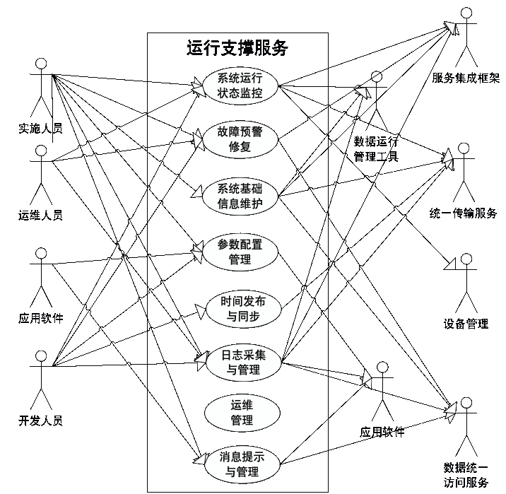
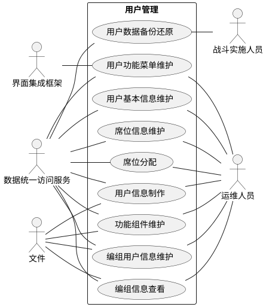
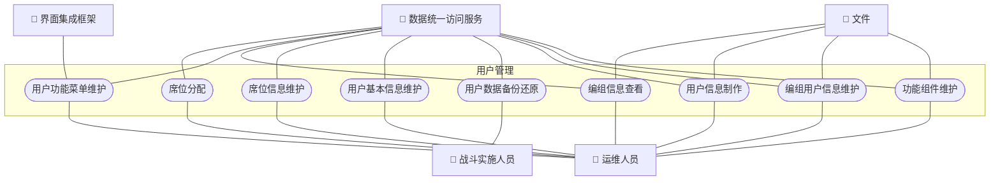

# 1_032 数据对档案

| 字段 | 值 |
|---|---|
| doc | 05软件部署管理软件需求规格说明-终稿 |
| section | 3.2.4 |
| image_caption | 图18 用户管理用例图 |
| table_caption | 表33 用户管理所有能力标识 |

## 原始图片

*图18 用户管理用例图*

## 结构图

*来源: born-digital导出(usecase, 15节点/23边)*
*类型经几何启发式精化(Master类型识别失败的图, 投影层推断, canonical锚点不变)*

*用例图以PlantUML渲染(UML母语): 小人=参与者 | 椭圆=用例 | 矩形框=系统边界 | 实线=关联 | 虚线=include/extend*

Mermaid兼容投影(通用md渲染器可显示)

DOT源码(完整语义, graphviz可渲染)

```dot
digraph G {
  rankdir=TB;
  node [fontname="Microsoft YaHei"];
  N2 [shape=plaintext, label="👤 运维人员"];
  N52 [shape=plaintext, label="👤 数据统一访问服务"];
  N78 [shape=plaintext, label="👤 界面集成框架"];
  N161 [shape=plaintext, label="👤 文件"];
  N184 [shape=plaintext, label="👤 战斗实施人员"];
  subgraph cluster_31 {
    label="用户管理";
    N28 [shape=ellipse, label="席位分配"];
    N29 [shape=ellipse, label="用户基本信息维护"];
    N30 [shape=ellipse, label="席位信息维护"];
    N39 [shape=ellipse, label="用户功能菜单维护"];
    N40 [shape=ellipse, label="编组信息查看"];
    N41 [shape=ellipse, label="用户信息制作"];
    N104 [shape=ellipse, label="用户数据备份还原"];
    N166 [shape=ellipse, label="编组用户信息维护"];
    N173 [shape=ellipse, label="功能组件维护"];
  }
  N161 -> N173 [dir=none];
  N52 -> N173 [dir=none];
  N173 -> N2 [dir=none];
  N161 -> N166 [dir=none];
  N52 -> N166 [dir=none];
  N166 -> N2 [dir=none];
  N161 -> N41 [dir=none];
  N161 -> N40 [dir=none];
  N52 -> N41 [dir=none];
  N52 -> N104 [dir=none];
  N78 -> N39 [dir=none];
  N30 -> N2 [dir=none];
  N28 -> N2 [dir=none];
  N39 -> N2 [dir=none];
  N40 -> N2 [dir=none];
  N41 -> N2 [dir=none];
  N104 -> N184 [dir=none];
  N52 -> N29 [dir=none];
  N52 -> N30 [dir=none];
  N29 -> N2 [dir=none];
  N52 -> N40 [dir=none];
  N52 -> N39 [dir=none];
  N52 -> N28 [dir=none];
}
```

### 锚点节点结构

| # | 文本 | 类型 |
|---|---|---|
| 1 | 运维人员 | actor |
| 2 | 席位分配 | usecase |
| 3 | 用户基本信息维护 | usecase |
| 4 | 席位信息维护 | usecase |
| 5 | 用户管理 | boundary |
| 6 | 用户功能菜单维护 | usecase |
| 7 | 编组信息查看 | usecase |
| 8 | 用户信息制作 | usecase |
| 9 | 数据统一访问服务 | actor |
| 10 | 界面集成框架 | actor |
| 11 | 用户数据备份还原 | usecase |
| 12 | 文件 | actor |
| 13 | 编组用户信息维护 | usecase |
| 14 | 功能组件维护 | usecase |
| 15 | 战斗实施人员 | actor |

## 表格内容

| 序号 | Use case名称 | 项目唯一标识符 | 需求描述 | 需求重用 | 方式名称 | 运行状态 | 对应的任务书功能/性能 |
|---|---|---|---|---|---|---|---|
|   | 用户基本信息维护 | PZXQ-GN-RJBSGL-YHGL- | 提供用户基本信息（用户ID、用户密码）编 | 改进 | 桌面、平板 | 集成阶段、运行阶段 | 4.1.4 a) |
|   | 坐位信息维护 | PZXQ-GN-RJBSGL-YHGL- | 提供坐位信息（坐位名称、坐位描述、坐位功 | 改进 | 桌面、平板 | 集成阶段、运行阶段 | 4.1.4 b) |
|   | 坐位分配 | PZXQ-GN-RJBSGL-YHGL- | 提供坐位分配的功能，能够为用户分配坐位， | 改进 | 桌面、平板 | 集成阶段、运行阶段 | 4.1.4 c) |
|   | 功能组件维护 | PZXQ-GN-RJBSGL-YHGL- | 提供功能组件的编辑功能，支持组件的导入、 | 改进 | 桌面、平板 | 集成阶段、运行阶段 | 4.1.4 d) |
|   | 用户功能菜单维护 | PZXQ-GN-RJBSGL-YHGL- | 提供用户功能菜单的编辑、导入、导出维护功 | 改进 | 桌面、平板 | 集成阶段、运行阶段 | 4.1.4 e) |
|   | 编组信息查看 | PZXQ-GN-RJBSGL-YHGL- | 提供编组文件的导入、查看功能，能够查看编 | 改进 | 桌面、平板 | 集成阶段、运行阶段 | 4.1.4 f) |
|   | 编组用户信息维护 | PZXQ-GN-RJBSGL-YHGL- | 提供对编组内的用户进行坐位分配功能，能够 | 改进 | 桌面、平板 | 集成阶段、运行阶段 | 4.1.4 g) |
|   | 用户信息制作 | PZXQ-GN-RJBSGL-YHGL- | 提供用户信息数据（用户基本信息、角色信息 | 改进 | 桌面、平板 | 集成阶段、运行阶段 | 4.1.4 h) |
|   | 用户数据备份还原 | PZXQ-GN-RJBSGL-YHGL- | 提供用户数据备份还原功能，能够在用户登录 | 改进 | 桌面、平板、手持 | 运行阶段 | 4.1.4 i) |

## 正文

用户管理功能包括：用户基本信息维护、坐位信息维护、坐位分配、用户功能菜单维护、功能组件编辑、编组信息查看、编组用户信息维护、用户信息制作、用户数据备份还原，其功能用例如图18所示。
