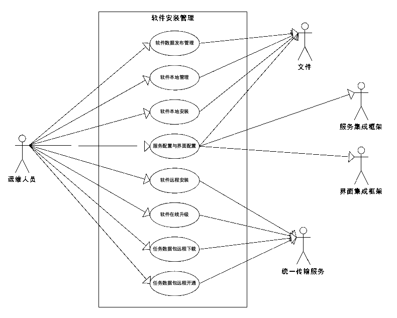
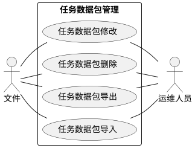
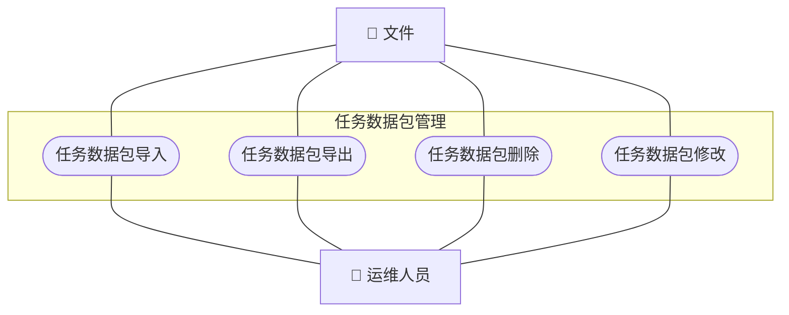
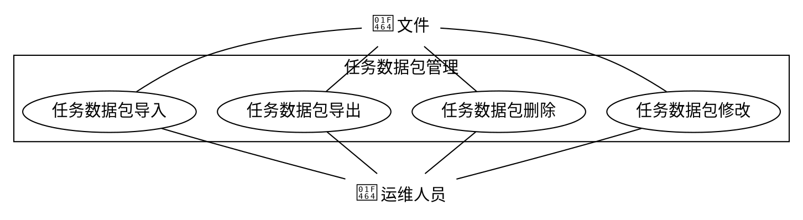

# 1_033 数据对档案

| 字段 | 值 |
|---|---|
| doc | 05软件部署管理软件需求规格说明-终稿 |
| section | 3.2.5 |
| image_caption | 图20 软件安装管理用例图 |
| table_caption | 表43 软件安装管理所有能力标识 |

## 原始图片

*图20 软件安装管理用例图*

## 结构图

*⚠ 该对锚点与图片内容匹配度低(VLM召回仅29%, 全文档最佳结构亦不匹配)——图片可能为复合图或非Visio图, 结构仅供参考, 需人工复核*

*来源: born-digital导出(usecase, 7节点/8边)*
*类型经几何启发式精化(Master类型识别失败的图, 投影层推断, canonical锚点不变)*

*用例图以PlantUML渲染(UML母语): 小人=参与者 | 椭圆=用例 | 矩形框=系统边界 | 实线=关联 | 虚线=include/extend*

Mermaid兼容投影(通用md渲染器可显示)

DOT源码(完整语义, graphviz可渲染)

### 锚点节点结构

| # | 文本 | 类型 |
|---|---|---|
| 1 | 运维人员 | actor |
| 2 | 文件 | actor |
| 3 | 任务数据包管理 | boundary |
| 4 | 任务数据包修改 | usecase |
| 5 | 任务数据包删除 | usecase |
| 6 | 任务数据包导出 | usecase |
| 7 | 任务数据包导入 | usecase |

## 表格内容

| 序号 | Use case名称 | 项目唯一标识符 | 需求描述 | 需求重用 | 方式名称 | 运行状态 | 对应的任务书功能/性能 |
|---|---|---|---|---|---|---|---|
|   | 软件数据发布管理 | PZXQ-GN-RJBSGL-RJAZG | 提供软件、数据发布管理功能，能够进行软件 | 无 | 桌面、平板 | 运行阶段 | 4.1.5 a） |
|   | 软件本地管理 | PZXQ-GN-RJBSGL-RJAZG | 提供本地软件管理功能，支持软件的单个导入 | 无 | 桌面、平板、手持 | 运行阶段 | 4.1.5 b） |
|   | 软件本地安装 | PZXQ-GN-RJBSGL-RJAZG | 提供本地软件安装、升级、卸载功能，支持软 | 无 | 桌面、平板、手持 | 运行阶段 | 4.1.5 c） 4.2 a） |
|   | 服务配置与菜单配置 | PZXQ-GN-RJBSGL-RJAZG | 提供服务启动清单及界面集成框架菜单的生成 | 无 | 桌面、平板、手持 | 运行阶段 | 4.1.5 d） |
|   | 软件远程安装 | PZXQ-GN-RJBSGL-RJAZG | 提供软件的远程安装、更新、卸载功能，在有 | 无 | 桌面、平板、手持 | 运行阶段 | 4.1.5 e） |
|   | 软件在线升级 | PZXQ-GN-RJBSGL-RJAZG | 提供在线升级安装功能，在有线网络或者高速 | 无 | 桌面、平板、手持 | 运行阶段 | 4.1.5 f） |
|   | 任务数据包远程下载 | PZXQ-GN-RJBSGL-RJAZG | 提供任务数据包远程索取功能，在有线网络或 | 无 | 桌面、平板、手持 | 运行阶段 | 4.1.5 g） |
|   | 任务数据包远程开通 | PZXQ-GN-RJBSGL-RJAZG | 提供系统远程开通控制功能，支持在有线网络 | 无 | 桌面、平板、手持 | 运行阶段 | 4.1.5 h） |

## 正文

软件安装管理功能包括：软件数据发布管理、软件本地管理、软件本地安装、服务配置与界面配置、软件远程安装、软件在线升级、任务数据包远程下载、任务数据包远程开通，其功能用例如图20所示。
