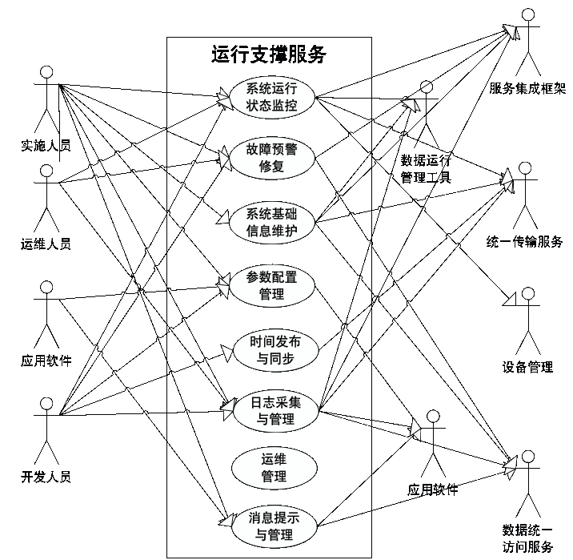
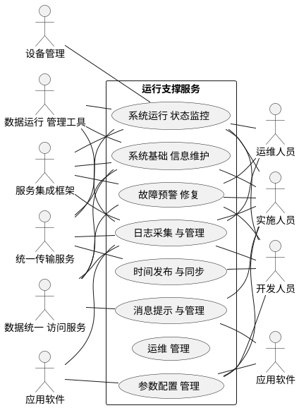
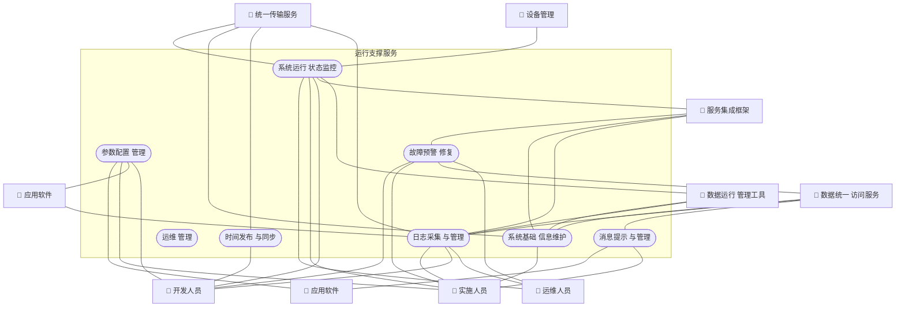

# 1_034 数据对档案

| 字段 | 值 |
|---|---|
| doc | 06运行支撑服务软件需求规格说明-终稿 |
| section | 3.2 |
| image_caption | 图3 运行支撑服务软件用例图 |
| table_caption | 表2 运行支撑服务软件所有能力标识 |

## 原始图片

*图3 运行支撑服务软件用例图*

## 结构图

*⚠ 结构经census重对齐: 旧锚点(oleObject2.bin:page1.xml)与图片不符, 已切换到与image.png内容一致的锚点(oleObject3.bin:page1.xml, align_score=1.0)*

*来源: born-digital导出(usecase, 19节点/34边)*
*类型经几何启发式精化(Master类型识别失败的图, 投影层推断, canonical锚点不变)*

*用例图以PlantUML渲染(UML母语): 小人=参与者 | 椭圆=用例 | 矩形框=系统边界 | 实线=关联 | 虚线=include/extend*

Mermaid兼容投影(通用md渲染器可显示)

DOT源码(完整语义, graphviz可渲染)

```dot
digraph G {
  rankdir=TB;
  node [fontname="Microsoft YaHei"];
  N1 [shape=plaintext, label="👤 实施人员"];
  N2 [shape=plaintext, label="👤 数据运行 管理工具"];
  N3 [shape=plaintext, label="👤 服务集成框架"];
  N19 [shape=plaintext, label="👤 数据统一 访问服务"];
  N20 [shape=plaintext, label="👤 统一传输服务"];
  N21 [shape=plaintext, label="👤 设备管理"];
  N22 [shape=plaintext, label="👤 应用软件"];
  N26 [shape=plaintext, label="👤 应用软件"];
  N78 [shape=plaintext, label="👤 运维人员"];
  N79 [shape=plaintext, label="👤 开发人员"];
  subgraph cluster_11 {
    label="运行支撑服务";
    N9 [shape=ellipse, label="系统基础 信息维护"];
    N10 [shape=ellipse, label="系统运行 状态监控"];
    N12 [shape=ellipse, label="参数配置 管理"];
    N13 [shape=ellipse, label="故障预警 修复"];
    N14 [shape=ellipse, label="时间发布 与同步"];
    N15 [shape=ellipse, label="日志采集 与管理"];
    N16 [shape=ellipse, label="运维 管理"];
    N17 [shape=ellipse, label="消息提示 与管理"];
  }
  N10 -> N2 [dir=none];
  N10 -> N3 [dir=none];
  N15 -> N78 [dir=none];
  N12 -> N79 [dir=none];
  N13 -> N78 [dir=none];
  N10 -> N79 [dir=none];
  N12 -> N22 [dir=none];
  N13 -> N19 [dir=none];
  N10 -> N1 [dir=none];
  N13 -> N1 [dir=none];
  N9 -> N1 [dir=none];
  N12 -> N1 [dir=none];
  N14 -> N79 [dir=none];
  N15 -> N79 [dir=none];
  N17 -> N1 [dir=none];
  N12 -> N26 [dir=none];
  N17 -> N26 [dir=none];
  N19 -> N17 [dir=none];
  N19 -> N15 [dir=none];
  N21 -> N10 [dir=none];
  N22 -> N15 [dir=none];
  N20 -> N15 [dir=none];
  N2 -> N15 [dir=none];
  N3 -> N15 [dir=none];
  N20 -> N14 [dir=none];
  N19 -> N9 [dir=none];
  N20 -> N9 [dir=none];
  N3 -> N9 [dir=none];
  N2 -> N9 [dir=none];
  N3 -> N13 [dir=none];
  N20 -> N10 [dir=none];
  N15 -> N1 [dir=none];
  N13 -> N79 [dir=none];
  N10 -> N78 [dir=none];
}
```

*⚠ 锚点Connect重建存在5个悬空连线端点(线端粘在无文本形状上被语义过滤跳过), 图示边数可能少于原图——渲染只呈现锚点事实, 不编造边; 独立证据可对照VLM通道提取(scene_vlm_extractions.json)*

### 锚点节点结构

| # | 文本 | 类型 |
|---|---|---|
| 1 | 实施人员 | actor |
| 2 | 数据运行
管理工具 | actor |
| 3 | 服务集成框架 | actor |
| 4 | 系统基础
信息维护 | usecase |
| 5 | 系统运行
状态监控 | usecase |
| 6 | 运行支撑服务 | boundary |
| 7 | 参数配置
管理 | usecase |
| 8 | 故障预警
修复 | usecase |
| 9 | 时间发布
与同步 | usecase |
| 10 | 日志采集
与管理 | usecase |
| 11 | 运维
管理 | usecase |
| 12 | 消息提示
与管理 | usecase |
| 13 | 数据统一
访问服务 | actor |
| 14 | 统一传输服务 | actor |
| 15 | 设备管理 | actor |
| … | 共19个节点 | |

## 表格内容

| 序号 | Use case名称 | 项目唯一标识符 | 需求描述 | 需求重用 | 方式 名称 | 运行 状态 | 对应的任务书功能/性能 |
|---|---|---|---|---|---|---|---|
| 1 | 系统运行状态监控 | PZXQ-YXZCFW-GN- XTYX | a)能够对系统运行过程中的重要信息包括计 | 改进 | 桌面、平板、手持 | 运行阶段 | 4.1.1 |
| 2 | 故障预警修复 | PZXQ-YXZCFW-GN- GZYJ | a)提供故障策略库管理功能，支持用户录入 | 改进 | 桌面 | 开发阶段、运行阶段 | 4.1.2 |
| 3 | 系统基础信息维护 | PZXQ-YXZCFW-GN- XTJC | a)提供接口支持对当前登录的用户名、用户 | 改进 | 桌面、平板、手持 | 开发阶段、集成阶段、运行阶段 | 4.1.3 |
| 4 | 参数配置管理 | PZXQ-YXZCFW-GN- CSPZ | a)能够对界面集成框架的分屏、字体大小、 | 改进 | 桌面、平板、手持 | 开发阶段、运行阶段 | 4.1.4 |
| 5 | 日志采集与管理 | PZXQ-YXZCFW-GN- RZCJ | a)提供软件日志记录接口，支持应用软件记 | 新增 | 桌面 | 开发阶段、集成阶段、运行阶段 | 4.1.6 |
| 6 | 运维管理 | PZXQ-YXZCFW-GN- YWGL | a)提供运维管理统一集成框架，能够对用户 | 改进 | 桌面 | 运行阶段 | 4.1.7 |
| 7 | 消息提示与管理 | PZXQ-YXZCFW-GN- XXTS | a)提供消息提示功能，支持以弹框的形式对 | 改进 | 桌面 | 运行阶段 | 4.1.8 |

## 正文

运行支撑服务软件按照其功能需求，包含系统运行状态监控、故障探测预警、系统基础信息维护、参数配置管理、时间发布与同步、日志采集与管理、运维管理和消息提示与管理。
